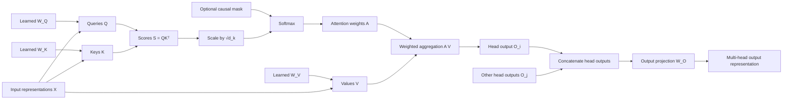
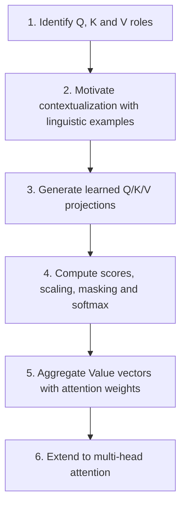
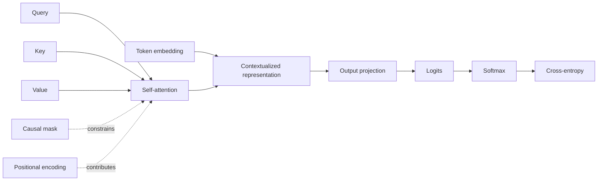

# QKV tutorial: source learning graph and route comparison

**Source:** [Nishanthan K — How Query, Key, and Value (QKV) Work in Transformers](https://dev.to/nishanthan-k/how-query-key-and-value-qkv-work-in-transformers-199a)  
**Source record:** `nishanthan-k-qkv-transformers-devto`  
**Extraction record:** `data/extractions/nishanthan-k-qkv-transformers-devto.yml`  
**Review date:** 2026-11-04  
**Purpose:** reconstruct the source's pedagogical model, compare it with LLM Lab's canonical concept graph and learning route, and record justified changes.

## 1. Method and evidence boundary

This is a reconstruction of the article's teaching structure, not a graph supplied by its author. Nodes and edges below are inferred from the article's sections and explanations. The article body is available through indexed DEV content in this review; the source remains `partially-scanned` because current direct-page retrieval, embedded media, publication metadata and reuse rights have not all been verified. The article's figure is not visually inspected and is not represented as a verified asset node.

The reconstruction separates:
- **domain concepts and computational objects** (what the mechanism contains);
- **process relations** (how the computation transforms them);
- **pedagogical anchors** (examples and learner motivations);
- **learning order** (the order in which the article introduces the material).

The article does not state formal prerequisites or explicit measurable learning outcomes. Those are inferred cautiously from its explanations.

## 2. Reconstructed source knowledge graph

### 2.1 Computational subgraph

Interpretation:
- The same input representation stream is projected into three learned spaces.
- Q and K jointly determine the score matrix; V supplies the vectors combined by the resulting weights.
- Scaling and softmax transform raw scores into normalized weights; a causal mask restricts which positions are accessible.
- Weighted aggregation produces an output representation. In multi-head attention, several head computations run in parallel, then their outputs are concatenated and projected.
- The diagram is a conceptual reconstruction. It does not encode tensor batch dimensions, residual connections, normalization, the feed-forward sublayer, or a full Transformer block.

### 2.2 Pedagogical anchors

| Anchor | Learner difficulty it targets | Role in the source |
|---|---|---|
| `bank` in financial vs river contexts | A token's interpretation depends on surrounding context | Motivates contextual interaction between positions |
| `it` → `the animal` | A token may depend on another position to construct a useful representation | Illustrates a cross-position dependency |
| Search / document retrieval analogy | Distinguishing what is requested, what is matched, and what content is returned | Gives an intuitive entry point for Q, K and V |
| Winner-take-all contrast | Mistaking attention for selecting one highest-scoring token | Emphasizes weighted aggregation over multiple Values |

The examples are illustrations of why contextual processing is useful. They do not demonstrate that an individual attention head performs complete lexical disambiguation or coreference resolution.

## 3. Reconstructed source learning route

The article's six numbered sections imply the following local sequence:

The article actually introduces the role analogy before its contextual examples; both together form its motivation stage. The route is therefore best read as:

1. Name the three roles and give an intuitive analogy.
2. Explain why tokens need contextual information, using lexical ambiguity and pronoun reference.
3. Show how learned projections produce Q, K and V.
4. Follow the score → scale → softmax → weighted aggregation pipeline.
5. Generalize one attention computation to multiple heads.

### Inferred learning outcomes

After reading, a learner should be able to:
- distinguish the functional roles of Q, K and V;
- explain that Q, K and V are learned projections of input representations;
- write the core score, scaling, softmax and aggregation equations;
- explain why attention combines multiple Value vectors rather than selecting one token;
- describe, at a high level, how multiple heads are combined.

### What the source route leaves implicit or outside scope

- No explicit prerequisite list, learning-outcome checklist or retrieval-practice activity.
- No worked numerical example or tensor-shape walkthrough.
- The causal mask is mentioned briefly rather than developed as a separate mechanism.
- No detailed account of cross-attention, residual paths, normalization, the MLP or the complete Transformer block.
- No implementation or experiment is provided.
- Backpropagation is mentioned as the way the projection matrices are learned, but the optimization path is not developed.
- KV-cache is not part of the article's numbered exposition; it appears only in a reader comment and is tracked separately.

## 4. LLM Lab's current model

### 4.1 Canonical concept graph before this comparison

The relevant existing nodes are:
- `query`, `key`, `value`;
- `self-attention`;
- `causal-mask`;
- `positional-encoding`;
- `contextualized-representation`;
- `softmax`.

Existing relations already express Q/K/V as parts of self-attention, the causal mask as a constraint, positional information as a contribution, and self-attention as a contributor to contextualized representations.

The relevant pre-change subgraph can be summarized as follows:

This is a coarse lifecycle graph, not an explicit attention-computation graph: it skips the score, scaling, normalized-weight and weighted-aggregation intermediates.

The graph does not yet give distinct canonical identities to the score matrix, normalized attention weights, the scaled-dot-product operation, or multi-head attention. These are nevertheless explicitly taught by the published pages.

### 4.2 Canonical learner route

The current conceptual route is deliberately broader than the article:

`contextualized representations → Transformer overview → Q/K/V → scaled dot-product attention → causal masking`

The reader-facing computation stage in `data/guided-route.yml` groups the Transformer overview, Q/K/V, scaled attention and causal masking under one objective: connect projections, weights, aggregation and masking. The implementation route is separate and reaches the multi-head implementation in the Transformer-block walkthrough.

### 4.3 Existing depth and learning supports

| Dimension | Existing LLM Lab treatment |
|---|---|
| Context motivation | Dedicated contextualized-representations lesson with both lexical ambiguity and cross-position pronoun reference |
| Q/K/V roles | Dedicated bilingual page; learned projections, dimensions, role separation, self-/cross-attention boundary and misconception checks |
| Score and weight pipeline | Dedicated bilingual attention lesson; matrix shapes, explicit scaling, additive mask formulation, numerical worked example and a numerical workbench |
| Causal masking | Separate bilingual lesson and explicit route step |
| Multi-head attention | Conceptual overview in Transformer page; concrete tensor splitting and output projection in the implementation walkthrough |
| Retrieval practice | Self-checks and exercises |
| Mathematical depth | Derivation of the scaling factor and softmax saturation behavior |
| Implementation | Separate Build route with inspectable tensor shapes and tests |

## 5. Differential comparison

| Dimension | DEV article | LLM Lab | Assessment |
|---|---|---|---|
| Entry point | Short Q/K/V analogy, then contextual examples | Contextual representations and Transformer orientation precede Q/K/V | Different scales; the project's system-first route is coherent |
| Motivation | Two compact linguistic examples in one article | Examples live in the contextualization lesson and link forward to Q/K/V | Already integrated; retain the cross-link rather than duplicate examples |
| Q/K/V intuition | Concise role descriptions | Role separation plus explicit learned-projection framing and boundaries | Project is more precise; article's brevity is useful but not a missing concept |
| Computation sequence | Scores → scaling → softmax → weighted Values | Same sequence, with shapes, mask semantics, numerical example and derivation | Project has materially greater explanatory depth |
| Causal mask | Brief mention in the softmax section | Separate concept and lesson | Project's separation is better for scope and mastery |
| Multi-head attention | Compact final section | Overview and separate implementation treatment | Project intentionally distributes this by depth |
| Prerequisites | Implicit | Explicit upstream route through representations and Transformer | Project is stronger |
| Practice | No explicit self-check in the article | Self-checks, exercises and numerical workbench | Project is stronger |
| Concept graph | Reconstructed here from prose | Canonical YAML graph, bilingual stable IDs and typed relations | Project's graph is authoritative but under-represents intermediate attention objects |
| Visual | User identified a potentially stronger illustration; exact asset still unavailable | Existing project diagrams are present | No visual judgement until the exact original asset is retrieved and inspected |

## 6. Graph changes justified by the comparison

The article does not justify importing its content wholesale. It does expose a mismatch between LLM Lab's own lesson structure and its concept graph: the canonical attention lesson carefully distinguishes raw scores, normalized weights and the attention operation, but the concept graph collapses these into the broad `self-attention` node.

The following reusable concepts are therefore added to the canonical graph, with bilingual labels/definitions and links to their existing teaching pages:

| Concept ID | Why it deserves a stable node | Canonical resources |
|---|---|---|
| `attention-score` | Raw query–key compatibility values are distinct from normalized weights | FR/EN scaled-dot-product-attention |
| `attention-weight` | Normalized, mask-conditioned coefficients are distinct from raw scores and Value vectors | FR/EN scaled-dot-product-attention |
| `scaled-dot-product-attention` | The complete score → scale → normalize → aggregate operation is a reusable mechanism used beyond this article | FR/EN scaled-dot-product-attention |
| `multi-head-attention` | Parallel attention heads and their output projection are a durable architectural mechanism | FR/EN Transformer overview and Transformer-block walkthrough |

Existing `softmax` and `causal-mask` concepts are associated with the scaled-attention lesson as well as their current canonical pages. Typed relations connect Q/K/V and the score/weight objects to scaled-dot-product attention, softmax to attention weights, the causal mask to the attention operation, and single-head attention to the multi-head composition.

These additions do **not** create new pages, duplicate explanations, or change the reader-facing route. They make the graph reflect distinctions already taught by LLM Lab. The graph remains a semantic model; the learning route remains a separate pedagogical sequence.

## 6.5 Exact route crosswalk: source article, local page, project curriculum

The comparison must distinguish three different route scales. The source's six-section order is not directly comparable to one page's navigation metadata or to the full project curriculum.

| Learning function | DEV article's local sequence | LLM Lab page-level sequence | LLM Lab project-level route |
|---|---|---|---|
| Orient and motivate | §1: Q/K/V role analogy; §2: bank ambiguity and pronoun reference | Contextualized representations → Transformer overview → Q/K/V | `representations`: embedding space → positional encoding → contextualized representations |
| Define the mechanism's inputs | §3: shared X projected to Q, K, V; matrices learned by backpropagation | Q/K/V page: roles, shared input, matrix shapes, learned parameters, self-/cross-attention boundary | `computation`: Transformer overview → Q/K/V |
| Calculate the attention distribution | §4: QKᵀ → scaling → softmax; brief causal-mask mention | Next page: scaled dot-product attention with matrix shapes, variance-based scaling rationale, numerical example and mask semantics | `computation`: scaled dot-product attention → causal masking as its own lesson |
| Form contextual output | §5: weighted aggregation A V; explicitly rejects argmax | Covered in the scaled-attention page; Q/K/V page links forward rather than duplicating it | Same computation stage, followed by prediction/logits |
| Generalize across heads | §6: per-head projections, parallel attention, concatenation and Wᴼ | Not on the Q/K/V page; Transformer overview introduces the architecture and block walkthrough owns implementation detail | Optional/deeper architecture and Build path; implementation follows the conceptual route rather than being inserted into the Q/K/V lesson |
| Practice and verify | No exercises, worked tensor shapes or executable experiment | Self-check on Q/K/V, numerical attention workbench and exercises on the dedicated attention page | Build path traces the mechanism into tensor operations and implementation tests |

### What the route comparison says

1. **The article is a self-contained micro-sequence.** It starts with analogy and motivation, then proceeds linearly through projections, scores, aggregation and multi-head attention. It is efficient for a reader who already knows what a Transformer input representation and matrix multiplication are.
2. **The Q/K/V page is a component lesson, not a miniature copy of the article.** It assumes the learner has just seen the Transformer data flow, owns the Q/K/V projection boundary and dimensions, and explicitly hands the score/aggregation derivation to the next page.
3. **The project route deliberately places context before mechanism.** The `representations` stage establishes embeddings, positional information and contextualized states before the `computation` stage. The article's two linguistic examples are already integrated in the contextualization lesson; repeating them on the Q/K/V page would weaken page ownership.
4. **The project decomposes the article's §4 into two learning units.** Scaled attention explains scores, scaling, normalization and weighted aggregation; causal masking then treats the temporal constraint and its implementation separately. This is more precise than the article's brief parenthetical mention.
5. **The project distributes multi-head attention by depth.** The overview provides the architecture-level account; the block walkthrough provides reshaping, head dimensions, concatenation and output projection. Promoting all of §6 into the introductory Q/K/V page would duplicate both destinations.
6. **The project has stronger transfer supports.** Its exercises, numerical workbench and Build implementation make the computation testable rather than merely readable.

### Route decision

No change is justified to the canonical page sequence or project guided route. The article's best contribution is its compact visual/verbal entry point, not a better dependency order. Both Q/K/V pages now link to the author-controlled Medium article as an optional external visual reference, with attribution. This link is a visual detour, not a new mandatory route node; the image itself has not been copied or claimed to be visually validated.

## 7. Route decision

**No change to the six-stage guided route or the page-level suggested route is warranted by this source.**

Reasons:
- The article is a short local tutorial, not a complete curriculum.
- Its section order is already covered across the contextualization, Transformer, Q/K/V and scaled-attention lessons.
- LLM Lab deliberately separates conceptual understanding, optional depth and implementation.
- Moving multi-head attention into the core Q/K/V page would blur page ownership and duplicate the Transformer overview / Build treatment.
- Repeating the `bank` and `it` examples in Q/K/V would duplicate the contextualized-representations lesson.

The article remains useful as an optional beginner-oriented alternative explanation. The canonical route should retain the existing system-first progression.

## 8. Workflow improvements

For tutorial/course/article sources, the extraction workflow should now explicitly reconstruct:
1. the source's local concept/process graph, with typed nodes and relations;
2. its teaching sequence, prerequisites and inferred learning outcomes;
3. its examples, analogies, checks and omissions;
4. the current project's corresponding concept subgraph and canonical route;
5. the difference between semantic graph edges and pedagogical route edges;
6. candidate improvements with an explicit accept/defer/reject decision.

Do not add every source node to the canonical graph. Add only stable concepts or relations that expose a durable gap in LLM Lab's model. Do not copy the source's route into the project's route without demonstrating a learner benefit. Record when a source changes the graph, the route, both, or neither.

## 9. Decision summary

- **Graph:** enriched with four stable concepts and typed relations for distinctions already taught but previously absent from the canonical concept registry.
- **Route:** intentionally unchanged; current staged and depth-separated route is more complete and already incorporates the useful contextual examples.
- **Pages:** no new page and no duplicated example.
- **Source:** remains partially scanned; exact article image and reuse rights remain unresolved.
- **Traceability:** this comparison is linked from the source review and extraction hand-off.

## 9. Second tutorial comparison — Neha KK (Medium)

A second introductory source was scanned on 2026-11-04: [Neha KK, *Understanding Queries, Keys and Values in Transformers*](https://medium.com/@nkk18072004/understanding-queries-keys-and-values-in-transformers-149ed07c9f8b), published 2025-12-31. Its full text reconstruction and source-local graph are recorded in `data/extractions/neha-kk-understanding-qkv-medium.yml`; the source-specific review is [qkv-neha-kk-medium-2026-11.md](qkv-neha-kk-medium-2026-11.md).

### 9.1 Contribution comparison

| Learner question / perspective | Nishanthan K (DEV) | Neha KK (Medium) | Existing LLM Lab coverage | Synthesis decision |
|---|---|---|---|---|
| What are Q, K and V? | Search/retrieval analogy and role definitions | Database search analogy: request, descriptor, payload | Existing index-card analogy plus formal learned projections | Keep one core analogy; retain the database variant as an alternative in the extraction catalogue |
| Why three representations? | Role distinction and trainable projections | Explicitly motivates separating matching from content transfer | Existing page states roles but can make the decoupling rationale more explicit | Add one sentence explaining that separate projections let matching and payload representations be learned independently |
| Why does context matter? | Bank ambiguity and pronoun reference | Pronoun “it” with “animal” and “road” | Contextualized-representations page already motivates cross-token dependencies; Q/K/V page has no short linguistic example | Add a compact optional pronoun example to the Q/K/V page, explicitly not a measured result |
| How is attention computed? | Scores, scaling, softmax, weighted aggregation; masking mentioned | Same four-step sequence | Dedicated page provides shapes, mask semantics, numerical example and scaling derivation | No additional computation text |
| Do attention maps explain decisions? | Cautions against semantic similarity and winner-take-all interpretations | Broadly claims attention maps aid interpretability | Existing attention lesson refutes causal and semantic overinterpretation | Keep the stronger existing counterexample; record the Medium claim as a cautionary example |
| How do Transformers parallelize? | Compact attention pipeline | Says Transformers inspect all words simultaneously | Architecture, causal mask and generation content separate parallel training from autoregressive decoding | No Q/K/V page edit; link to existing architecture/masking coverage |
| What is the input to Q/K/V? | Uses input representations and projection matrices | Calls them word embeddings | Existing lesson correctly uses the current representation stream, including deeper hidden states | Preserve the more general formulation |

### 9.2 Complementary perspectives versus repeated explanations

The two tutorials largely converge on the same introductory Q/K/V model. Their retrieval analogies are not materially distinct enough to stack on the public page. The Medium article's most useful addition is not a new definition or equation: it foregrounds the design question “why three representations?” and gives a concise pronoun-context illustration.

The pronoun example complements the project's existing index-card analogy because it shifts the learner's attention from role naming to information flow across token positions. However, neither tutorial provides measured attention weights or a model experiment for its linguistic examples. The published synthesis therefore uses the pronoun scenario only to illustrate a plausible computation path and explicitly warns against inferring coreference resolution or interpretability from it.

The sources' agreement on the four-step attention computation is pedagogical convergence, not independent empirical validation. The primary technical formulation remains Vaswani et al. (2017), and the project lesson provides the mathematical and computational detail absent from both short tutorials.

### 9.3 Integrated learning experience

The resulting bilingual Q/K/V lesson keeps a single core mental model and adds three bounded improvements:

1. A concise rationale for separate projections: Q/K learn the matching interface, while V learns the payload representation; separating them decouples matching from information transfer.
2. An optional linguistic example that connects a token's query to candidate contextual keys and weighted values, with explicit caveats that the source supplies no measured attention or coreference evidence.
3. A precise account of the input representation: X is the current input to the attention sublayer, not always a raw token embedding; positional information may be added at the input or injected inside attention (for example, by RoPE acting on Q/K).

The attention calculation remains on the next page. No new concept IDs, semantic edges, prerequisite links, navigation edges, curriculum stages, Build steps, figures or experiments are justified.

### 9.4 Provenance and scan status

The Nishanthan DEV article remains partially scanned because the embedded illustration and parts of its comment history/metadata remain unresolved. The Neha KK Medium article also remains partially scanned because the actual figure files and reuse rights were not retrievable. Both sources can be cited and linked; neither article's illustrations are copied or represented as visually inspected.

## 10. Neha KK follow-up scan — media and claim-level refinement

A second pass on 2026-11-04 used the indexed Medium result after direct canonical page retrieval returned a cache miss. It reconstructed the full text represented in that index snapshot and identified **four in-body image placements**: three captioned figures (self-attention; Q/K/V projections; scaled dot-product attention) and one additional uncaptioned full-size-image placeholder. The cover/hero asset is not established. No actual image URL, image bytes, visual composition, comment thread or rights evidence was recovered. The source remains partially scanned; the text reconstruction is complete only for the index snapshot.

The extraction now preserves each of the four visual slots as a distinct figure item with unverified visual evidence, and the pedagogical model includes a separate media inventory. These records deliberately do not infer what the images look like from captions. The visual-assets register records the source as link-only, and the annotated references list includes the article with its scan limitation.

Two claim-level refinements were also extracted:

- **Soft retrieval, not hard selection:** the article's phrase “closest matches determine which values to get” risks suggesting a nearest-neighbour/argmax operation. Its own subsequent softmax and weighted-sum formulation is a soft mixture over accessible values. This is already explained in the project's attention lesson; no extra page content is required.
- **Directional/asymmetric scores:** the article states that attention is directional and non-symmetric. With distinct Q and K projections, QKᵀ is generally non-symmetric for a given input, but symmetry remains possible under special parameter/input configurations. The source provides no matrix example. This is retained as a deferred mathematical teaching opportunity rather than expanding the current page without a worked example.

The page integration remains bounded. The follow-up clarifies the Q/K/V input representation in both languages, but adds no figure, canonical concept, graph edge or route change. Existing explanations and caveats are preserved.

## 11. Input representations and positional information

The Medium article treats a word embedding as the direct Q/K/V input and describes it as a compact representation of semantic meaning. This is acceptable as an introductory first-layer simplification, but it leaves out two distinctions:

- An embedding table supplies learned token vectors; its coordinates are not explicit, human-readable semantic features.
- The input to an attention sublayer is the current representation. In the first block this begins with token embeddings; positional information may be added at the input or introduced within attention (for example, RoPE transforms Q and K). In later blocks, the input is a contextualized hidden state.

The project already covers positional mechanisms in its dedicated lesson and the Transformer overview. The Q/K/V lesson now adds a short bilingual clarification at the point where X is introduced. This is a local integration of a source omission, not a new concept or graph relation.

## 12. Living collection, workflow and latest source refinements

The maintained index for future Q/K/V resources is [Q/K/V source collection and comparative synthesis](qkv-source-collection.md). The reusable method and deliverable templates are specified in [External-source to learning-system integration workflow](../workflows/source-to-learning-system-integration.md).

The latest Medium scan refinement on the base branch adds important provenance and technical detail to the comparison:

- The full text reconstruction is based on an indexed search snapshot, not direct live-page HTML/DOM inspection.
- Four in-body visual placements are inventoried (three captioned figures and one uncaptioned placeholder), but none has been retrieved as image bytes or visually inspected. A cover/hero image remains unknown.
- The source's description of embeddings as semantic vectors and as the Q/K/V input is qualified: the attention sublayer receives its current representation; deeper blocks receive contextualized hidden states, and positional information may enter at the input or inside attention (e.g. RoPE).
- The phrase “closest matches” is distinguished from hard nearest-neighbour selection: the displayed softmax/weighted-sum computation is a soft mixture over accessible values.
- The source's assertion of directional/non-symmetric scores is retained as a potential worked-matrix lesson, with the qualification that asymmetry is typical under distinct Q/K projections, not universal for every parameter/input configuration.

The bilingual Q/K/V pages already received the bounded clarification about current hidden-state inputs and positional mechanisms in the base-branch update. The cross-source synthesis should therefore treat this as an existing integration, not propose it again. No new Q/K/V route step or canonical graph node is implied.

Future sources must be appended to the collection index and compared against this updated baseline. Keep each source extraction independent and preserve the exact scan boundary and evidence quality.
