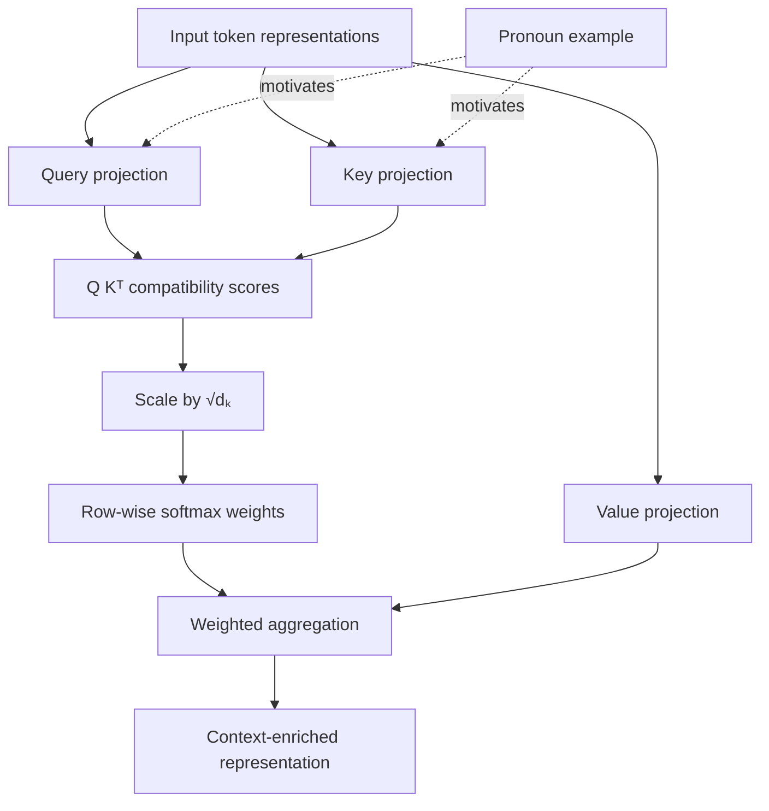

# Source review — Neha KK, “Understanding Queries, Keys and Values in Transformers”

**Source ID:** `neha-kk-understanding-qkv-medium`  
**Author:** Neha KK  
**Publication:** Medium, 2025-12-31  
**Canonical URL:** https://medium.com/@nkk18072004/understanding-queries-keys-and-values-in-transformers-149ed07c9f8b  
**Review date:** 2026-11-04  
**Source type:** introductory educational blog article  
**Language:** English

## 1. Scan scope and evidence

The canonical Medium article was opened directly. Its author-authored text was available from the title and introductory motivation through the final paragraph. The retrieved page exposes the following structure:

1. Why attention exists.
2. Database-search analogy.
3. What Q, K and V are: input embeddings and three learned linear projections.
4. Why three representations are used rather than one.
5. Four attention operations: dot-product scores, scaling, softmax and weighted value aggregation.
6. A pronoun-reference example involving “it”, “animal” and “road”.
7. Claimed benefits, attention maps and language/vision/speech/multimodal scope.
8. Conclusion.

The page metadata gives the author and publication date (31 December 2025). The page reports no responses/comments.

### Separate scan boundaries

| Component | Status | Evidence / limitation |
|---|---|---|
| Author-authored text | Complete | Directly retrieved article body, lines 43–173 in the opened page snapshot |
| Section/teaching sequence | Complete | Reconstructed from the article's visible headings and transitions |
| Displayed figure captions | Partially inspected | Three in-body figure references/captions are visible, but the actual image assets are not resolved |
| Actual image bytes and visual composition | Not inspected | The page reader did not expose stable image URLs or downloadable image bytes |
| Linked resources | Not inspected | No substantive outbound technical references are included in the author-authored body |
| Comments | No comments shown | The retrieved snapshot states there are no responses yet |
| Rights/reuse | Unknown | No licence or figure-reuse permission was established |

The source therefore remains **partially scanned**, even though its author-authored text reconstruction is complete. The article and its illustrations may be linked, but its images must not be copied, traced or recreated from an unseen thumbnail.

## 2. Extracted contributions

The complete structured extraction is in [`data/extractions/neha-kk-understanding-qkv-medium.yml`](../../data/extractions/neha-kk-understanding-qkv-medium.yml). It records the source-local graph, eight-step teaching route, inferred outcomes/prerequisites, atomic items, evidence, caveats and dispositions.

| Contribution | What it adds | Decision |
|---|---|---|
| Database search analogy | Alternative explanation of Q/K matching and V payload | Reject as page addition: same function as the existing index-card analogy |
| Explicit “why three?” rationale | Motivates decoupling matching from information transfer | Clarify within existing lesson |
| Four-step computation | Scores → scaling → softmax → weighted sum | Reject as duplicate: canonical attention lesson is more complete |
| Pronoun/context example | Concrete cross-token contextual dependency | Integrate as a short optional bilingual example, with a caveat |
| Attention-map interpretability claim | Example of a common overstatement | Clarify by linking to existing fallacy treatment; no new text needed |
| Parallelism comparison | Risks conflating training parallelism with autoregressive generation | Link to existing architecture/causal-mask material |
| “Word embedding” input phrasing | Too narrow for deeper layers using current hidden states | Reject: canonical lesson already uses a general representation stream |
| Cross-domain application list | Reminder that attention extends beyond text | Link only; project already covers architecture families and cross-attention |

## 3. Technical review

### Correct and useful

- The separation between Q/K matching and V aggregation is sound.
- Learned linear projections provide role-specific representations.
- The high-level operation order is correct for scaled dot-product attention.
- Row-wise softmax weights form a distribution over the accessible key positions, assuming at least one position is available.
- The distinction between matching representations and payload representations is a useful design motivation.

### Claims that require qualification

1. **“Transformers look at all words simultaneously.”** This describes parallel computation over sequence positions in training/full-sequence passes, not unrestricted access to future tokens in causal decoders. Autoregressive generation still has a token-by-token dependency.
2. **Pronoun resolution.** The article says that the query for “it” favours “animal” over “road”, but gives no model, layer, head, score, visualization or experiment. It is a conceptual illustration, not evidence that a model or attention head resolves coreference.
3. **Interpretability.** An attention map exposes weights, not a complete explanation or causal attribution. This is already addressed in the project's counterexample on attention weights.
4. **Scaling.** The article states that scaling avoids large scores and unstable training but does not derive the variance argument. The existing lesson gives the simplifying assumptions and the relation to softmax concentration/gradients.
5. **Embedding terminology.** The first attention layer can consume token embeddings plus positional information, but deeper layers project their current hidden-state representations. The project's notation is already more general.
6. **Database analogy.** It must not be interpreted as exact lookup, a symbolic index or selection of one nearest value. Attention computes compatibility scores and aggregates multiple V vectors.

## 4. Source pedagogical graph

The article's reconstructed computational flow is:

This is a source-local reconstruction, not a new canonical concept graph. The article's analogy is a pedagogical anchor, not a semantic graph relation.

## 5. Teaching route comparison

### Article route

Motivation → database analogy → learned projections → reason for three roles → four computation steps → pronoun example → applications and interpretability → recap.

The article alternates conceptual motivation and computation, then returns to an application. It is short and accessible but has no formal learning outcomes, exercises, tensor-shape treatment, masking discussion or implementation.

### Existing LLM Lab page route

`Transformer overview → Queries, keys and values → Scaled dot-product attention → Causal masking`

The Q/K/V page is deliberately limited to projection roles, dimensions, self-/cross-attention distinction and the matching-versus-payload split. The adjacent attention page owns score computation, scaling, masking, softmax, aggregation, numerical examples and interpretive caveats.

### End-to-end project route

The article's local sequence maps to the representation/attention stage in the broader LLM lifecycle. It does not supply a reason to change the guided route, page hierarchy, or Build route. The project's route deliberately separates Q/K/V from score computation and causal constraints; this is a stronger scaffold than reproducing the article's compact combined explanation.

### Route decision

No page-route, navigation, curriculum or Build-route changes. The source's article sequence is not a prerequisite graph and does not justify collapsing existing lessons.

## 6. Bounded integration

A bilingual optional note is added to the existing Q/K/V lesson:

- use the pronoun example to illustrate why one position may need information from other positions;
- explain the plausible comparison of Q at the pronoun with K representations of candidate antecedents;
- explain that the resulting weights combine V vectors;
- explicitly state that the article reports no measured weights and that this example does not prove coreference resolution or interpretability;
- cite and link the source;
- do not reproduce its figures.

The database analogy is not added because the current index-card analogy already serves the same learner function. The attention-map claim is not repeated as an endorsed benefit; the existing lesson's fallacy treatment is more precise.

## 7. Graph and curriculum impact

- **Canonical concepts added:** none.
- **Canonical relations added/changed:** none.
- **Guided route changed:** no.
- **Page navigation changed:** no.
- **Build route changed:** no.
- **Published pages updated:** existing bilingual Q/K/V pages only.
- **New page:** none.
- **Local figure/asset added:** none.
- **New experiment:** none.

The article does not introduce a durable concept absent from the current concept model. Its strongest incremental contribution is an illustrative linguistic example, not a new graph node.

## 8. Rights and visual handling

The retrieved page exposes three figure captions/placements, but not stable original asset URLs or image bytes. Visual composition, authorship and licence are therefore unverified. The article may be linked as a reading reference; no image is embedded, copied, traced or described as visually inspected. Attribution does not itself grant reuse rights.

## 9. Validation and completion

The integration is limited to source data and two existing bilingual page files. Run the repository source-catalogue validator, page-metadata checks, Quarto render and local-link checks in CI. CI results must be recorded from the actual PR run; they are not inferred from successful API writes.

The source remains partially scanned because the actual figures and reuse rights were not inspected. Its textual extraction and all author-authored contribution dispositions are complete.
