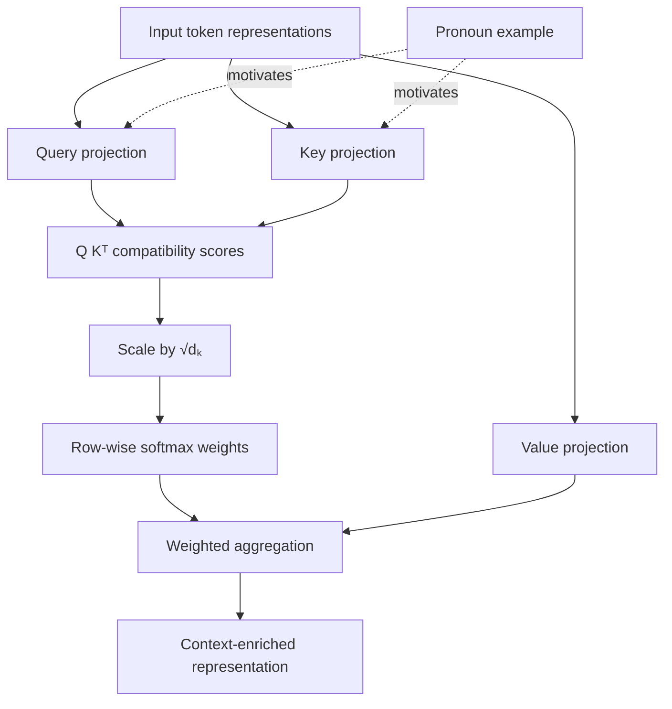

# Source review — Neha KK, “Understanding Queries, Keys and Values in Transformers”

**Source ID:** `neha-kk-understanding-qkv-medium`  
**Author:** Neha KK  
**Publication:** Medium, 2025-12-31  
**Canonical URL:** https://medium.com/@nkk18072004/understanding-queries-keys-and-values-in-transformers-149ed07c9f8b  
**Review date:** 2026-11-04  
**Source type:** introductory educational blog article  
**Language:** English

## 1. Scan scope and evidence

**Recheck 2026-11-05:** the canonical Medium URL is now directly readable through the page reader. The live text view confirms the indexed snapshot's title, author, publication date, section text, equations, pronoun example, conclusion, three figure captions and one additional full-size-image placeholder. The current page view also exposes a “No responses yet” state. This is a point-in-time observation, not proof that comments never existed. The earlier indexed-only reconstruction is retained as historical scan evidence; the current review is upgraded to direct page-text inspection, not full DOM or image inspection. The following structure is confirmed from the directly readable page text:

1. Why attention exists.
2. Database-search analogy.
3. What Q, K and V are: input embeddings and three learned linear projections.
4. Why three representations are used rather than one.
5. Four attention operations: dot-product scores, scaling, softmax and weighted value aggregation.
6. A pronoun-reference example involving “it”, “animal” and “road”.
7. Claimed benefits, attention maps and language/vision/speech/multimodal scope.
8. Conclusion.

The indexed metadata identifies Neha KK and lists 31 December 2025 as the publication date, with a five-minute reading estimate. The indexed result does not expose a comments area; comments and replies were not inspected.

### Separate scan boundaries

| Component | Status | Evidence / limitation |
|---|---|---|
| Author-authored text | Direct page-text inspection completed | Canonical Medium page directly readable on 2026-11-05; visible article text and section order reconciled with the indexed snapshot |
| Page DOM / live-page completeness | Partially verified | Page-reader text is directly accessible; raw DOM, hidden/lazy-loaded elements and full browser behavior remain uninspected |
| Article metadata | Partially inspected | Indexed author, title, five-minute reading estimate and 2025-12-31 publication date |
| Section/teaching sequence | Complete | Reconstructed from the article's visible headings and transitions |
| In-body visual placements | Partially inventoried | Three captioned figures plus one additional uncaptioned full-size-image placeholder are visible in indexed text |
| Cover / hero image | Unknown | Search-index text does not establish whether a separate cover asset exists |
| Actual image bytes and visual composition | Not inspected | The page reader did not expose stable image URLs or downloadable image bytes |
| Linked resources | Not inspected | The indexed text does not expose a substantive bibliography or outbound technical references; live-page links and targets were not inspected |
| Comments | Point-in-time state inspected | Page reader displayed “No responses yet” on 2026-11-05; no comment thread was exposed at that time |
| Rights/reuse | Unknown | No licence or figure-reuse permission was established |

The source therefore remains **partially scanned**. The visible author text has now been reconciled against a directly readable page-text view, but the raw DOM, actual image files, linked resources and reuse rights remain unresolved. The article and its illustrations may be linked, but its images must not be copied, traced or recreated from an unseen thumbnail.

## 2. Extracted contributions

The follow-up extraction adds two claim-level items: (a) the article's 'closest matches' wording can imply hard retrieval, although its own formula computes a soft weighted mixture; and (b) its claim that attention is directional/non-symmetric is a useful matrix-level observation, but is not demonstrated in the article. Four visual placeholders are now represented as separate extraction items, without pretending that the images were inspected.

The complete structured extraction is in [`data/extractions/neha-kk-understanding-qkv-medium.yml`](../../data/extractions/neha-kk-understanding-qkv-medium.yml). It records the source-local graph, eight-step teaching route, inferred outcomes/prerequisites, atomic items, evidence, caveats and dispositions.

| Contribution | What it adds | Decision |
|---|---|---|
| Database search analogy | Alternative explanation of Q/K matching and V payload | Reject as page addition: same function as the existing index-card analogy |
| Explicit “why three?” rationale | Motivates decoupling matching from information transfer | Clarify within existing lesson |
| Four-step computation | Scores → scaling → softmax → weighted sum | Reject as duplicate: canonical attention lesson is more complete |
| Pronoun/context example | Concrete cross-token contextual dependency | Integrate as a short optional bilingual example, with a caveat |
| Attention-map interpretability claim | Example of a common overstatement | Clarify by linking to existing fallacy treatment; no new text needed |
| Parallelism comparison | Risks conflating training parallelism with autoregressive generation | Link to existing architecture/causal-mask material |
| “Word embedding” input phrasing and omitted positional mechanism | Too narrow for deeper layers; does not explain where positional information enters | Clarify the current hidden-state input and distinguish input positional embeddings from RoPE-style Q/K transformations |
| Cross-domain application list | Reminder that attention extends beyond text | Link only; project already covers architecture families and cross-attention |
| Soft retrieval wording | “Closest matches” can imply hard selection | Clarify in extraction; existing attention lesson already explains soft weighted aggregation |
| Directional/asymmetric attention | Names an important matrix property but does not demonstrate it | Defer a worked matrix example; no new graph edge or page section yet |
| Four in-body visual placements | Three captions and one uncaptioned image placeholder | Inventory as unresolved; no reuse until exact assets and rights are verified |

## 3. Technical review

### Correct and useful

- The separation between Q/K matching and V aggregation is sound.
- Learned linear projections provide role-specific representations.
- The high-level operation order is correct for scaled dot-product attention.
- Row-wise softmax weights form a distribution over the accessible key positions, assuming at least one position is available.
- The distinction between matching representations and payload representations is a useful design motivation.

### Claims that require qualification

1. **Parallelism is not the same as long-sequence efficiency.** “Transformers look at all words simultaneously” describes parallel computation over sequence positions in training/full-sequence passes, not unrestricted access to future tokens in causal decoders. Autoregressive generation still has a token-by-token dependency. Moreover, standard dense self-attention computes pairwise interactions across positions, giving O(n²) score complexity (and O(n²) memory for a naively materialized score matrix). The article's claim that attention is “far more efficient” for long sequences therefore needs an architecture- and workload-specific comparison; parallelizability alone does not establish better sequence-length scaling. The original Transformer paper explicitly separates computational complexity from sequential-operation count: dense self-attention has O(n²·d) per-layer complexity but O(1) sequential operations, while recurrence has O(n·d²) complexity and O(n) sequential operations. The paper's efficiency comparison is conditional (not a blanket claim for arbitrarily long sequences).
2. **Pronoun resolution.** The article says that the query for “it” favours “animal” over “road”, but gives no model, layer, head, score, visualization or experiment. It is a conceptual illustration, not evidence that a model or attention head resolves coreference.
3. **Interpretability.** An attention map exposes weights, not a complete explanation or causal attribution. This is already addressed in the project's counterexample on attention weights.
4. **Scaling.** The article states that scaling avoids large scores and unstable training but does not derive the variance argument. The existing lesson gives the simplifying assumptions and the relation to softmax concentration/gradients.
5. **Embedding terminology and positional information.** The article describes an embedding as a compact vector reflecting semantic meaning and uses it as the Q/K/V input. This is an introductory simplification: embedding coordinates are not explicit semantic features, and the input to a deeper attention layer is its current hidden state. The article also omits how positional information enters. The bilingual Q/K/V lesson now clarifies the distinction between input-level positional embeddings and attention-internal mechanisms such as RoPE.
6. **Hard retrieval versus soft aggregation.** “The closest matches determine which values to get” can suggest discrete nearest-neighbour selection. The article's own softmax and weighted-sum equations instead describe a soft mixture of accessible value vectors. The existing attention lesson already explains this distinction.
7. **Directional/asymmetric attention.** With distinct Q and K projections, the score matrix QKᵀ is generally non-symmetric for a given input, but special parameter/input configurations can be symmetric. The article asserts directionality without a matrix example or derivation. This remains a deferred opportunity for a worked matrix illustration.
8. **Database analogy.** It must not be interpreted as exact lookup, a symbolic index or selection of one nearest value. Attention computes compatibility scores and aggregates multiple V vectors.
9. **Missing scope.** The article does not discuss masking, self- versus cross-attention distinctions, tensor shapes, multi-head decomposition, implementation, exercises or explicit assessment. These topics are already distributed across the project's dedicated lessons.

## 4. Source pedagogical graph

The article's reconstructed computational flow is:

This is a source-local reconstruction, not a new canonical concept graph. The article's analogy is a pedagogical anchor, not a semantic graph relation.

## 5. Teaching route comparison

### Article route

Motivation → database analogy → learned projections → reason for three roles → four computation steps → pronoun example → applications and interpretability → recap.

The article alternates conceptual motivation and computation, then returns to an application. It is short and accessible but has no formal learning outcomes, exercises, tensor-shape treatment, masking discussion or implementation.

### Existing LLM Lab page route

`Transformer overview → Queries, keys and values → Scaled dot-product attention → Causal masking`

The Q/K/V page is deliberately limited to projection roles, dimensions, self-/cross-attention distinction and the matching-versus-payload split. The adjacent attention page owns score computation, scaling, masking, softmax, aggregation, numerical examples and interpretive caveats.

### End-to-end project route

The article's local sequence maps to the representation/attention stage in the broader LLM lifecycle. It does not supply a reason to change the guided route, page hierarchy, or Build route. The project's route deliberately separates Q/K/V from score computation and causal constraints; this is a stronger scaffold than reproducing the article's compact combined explanation.

### Route decision

No page-route, navigation, curriculum or Build-route changes. The source's article sequence is not a prerequisite graph and does not justify collapsing existing lessons.

## 6. Bounded integration

A bilingual optional note is added to the existing Q/K/V lesson:

- use the pronoun example to illustrate why one position may need information from other positions;
- explain the plausible comparison of Q at the pronoun with K representations of candidate antecedents;
- explain that the resulting weights combine V vectors;
- explicitly state that the article reports no measured weights and that this example does not prove coreference resolution or interpretability;
- cite and link the source;
- do not reproduce its figures.

The database analogy is not added because the current index-card analogy already serves the same learner function. The attention-map claim is not repeated as an endorsed benefit; the existing lesson's fallacy treatment is more precise.

## 7. Graph and curriculum impact

- **Canonical concepts added:** none.
- **Canonical relations added/changed:** none.
- **Guided route changed:** no.
- **Page navigation changed:** no.
- **Build route changed:** no.
- **Published pages updated:** existing bilingual Q/K/V pages only.
- **New page:** none.
- **Local figure/asset added:** none.
- **New experiment:** none.

The article does not introduce a durable concept absent from the current concept model. Its strongest incremental contribution is an illustrative linguistic example, not a new graph node.

## 8. Rights and visual handling

The directly readable page-text view confirms four in-body image placements: Fig. 1 (self-attention between tokens using Q/K/V), Fig. 2 (linear projections into Q/K/V), an additional uncaptioned full-size-image placeholder after the introduction of three vectors, and Fig. 3 (scaled dot-product attention computation). A separate cover/hero image is not established. None of the four assets was retrieved as image bytes or visually inspected; exact URLs, composition, creator and rights remain unknown. No image is embedded, copied, traced or described as visually inspected. Attribution does not itself grant reuse rights.

## 9. Validation and completion

This follow-up changes the source record, extraction, audit dossier, visual-assets register and annotated bibliography. It also clarifies in both Q/K/V lessons that X is the current attention input, distinguishes first-block token embeddings from later contextualized states, and locates positional information either at the input or inside attention (e.g. RoPE). The earlier bounded pronoun example and role-decoupling clarification remain from PR #453. Run the repository source-catalogue validator, page-metadata checks, Quarto render and local-link checks in CI. CI results must be recorded from the actual PR run; they are not inferred from successful API writes.

The source remains partially scanned because raw DOM completeness, four in-body image files, possible cover image, linked-resource targets and figure reuse rights remain unresolved. The page-reader showed “No responses yet” at the 2026-11-05 recheck; that point-in-time state is recorded in the source scan. The visible author text is now directly reconciled with the earlier search-index snapshot.

## 10. Technical references for the performance qualification

- Vaswani et al., [Attention Is All You Need](https://arxiv.org/abs/1706.03762), especially Section 4 and Table 1: distinguishes per-layer computational complexity from the number of sequential operations; dense self-attention is listed as O(n²·d) with O(1) sequential operations, versus O(n·d²) and O(n) for recurrence.
- Rabe and Staats, [Self-attention Does Not Need O(n²) Memory](https://arxiv.org/abs/2112.05682): qualifies the memory statement further—attention's time complexity remains quadratic, while algorithms can reduce memory requirements below the naive materialized score-matrix footprint.
