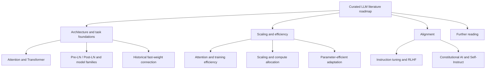

# Understanding Large Language Models — source review

- Author: Sebastian Raschka
- Published: 2023-04-16
- Source: https://magazine.sebastianraschka.com/p/understanding-large-language-models
- Review date: 2026-11-12
- Scan status: partially scanned
- Source ID: `sebastian-raschka-understanding-large-language-models-2023`

## Executive synthesis

This is a curated, historical reading roadmap for machine-learning researchers and practitioners who want an entry point into the literature behind large language models. It is valuable less as a self-contained explanation than as a map connecting foundational sequence attention, the original Transformer, model-family objectives, scaling and efficiency, parameter-efficient adaptation, and post-pretraining alignment.

The article is explicitly dated 16 April 2023. It must therefore be treated as a snapshot of the literature and the author's priorities at that time—not as a current 2026 ranking, a systematic survey, or a complete taxonomy of LLM research. The article's conclusion calls the list a top-10 plus three bonus papers, but the body numbers entries through 19 and adds further-reading lists. This review follows the actual body structure rather than repeating the inconsistent count.

## What the source contributes

### 1. A historical architecture route

The opening sequence starts with attention for recurrent sequence modeling (Bahdanau et al., 2014), then the encoder-decoder Transformer (Vaswani et al., 2017). It points readers to scaled dot-product attention, multi-head attention and positional encoding, then raises implementation and optimization questions around Pre-LN versus Post-LN.

A useful historical aside connects fast-weight memories to later linearized-attention work. This is an advanced lead, not a reason to collapse all attention mechanisms into one formulation: the precise relationship depends on the mathematical formulation, normalization and update rule.

### 2. Model families and objectives

The BERT, GPT and BART entries provide a compact orientation among masked-language-model pretraining, autoregressive decoder language modeling and encoder-decoder denoising/sequence-to-sequence pretraining. The distinction is useful for historical navigation, but it is not an exhaustive taxonomy. Architecture, pretraining objective and downstream task must remain separate dimensions.

The ULMFiT entry also reminds readers that transfer learning and language-model fine-tuning in NLP predate the Transformer. This helps avoid a Transformer-only account of the history of pretrained language models.

### 3. Scaling, efficiency and adaptation

The second group brings together several different research questions:

- FlashAttention: exact attention with an IO-aware algorithm, emphasizing data movement and memory hierarchy rather than changing the mathematical attention result.
- Cramming: practical constraints and throughput when training a masked language model under a tight compute budget.
- LoRA and PEFT surveys: reducing the trainable parameter footprint during adaptation.
- Gopher and Chinchilla: empirical scaling and the joint role of model size, data and compute.
- Pythia: controlled model checkpoints and analyses of training dynamics, memorization and data order.

These are complementary threads, not one interchangeable category of “making models faster.” Algorithmic attention efficiency, training-system utilization, compute-optimal allocation and parameter-efficient adaptation have different bottlenecks and evaluation metrics.

### 4. Alignment and instruction following

The final thematic group introduces InstructGPT's supervised demonstrations, preference rankings/reward model and reinforcement-learning stage; Constitutional AI's principle-guided feedback/self-critique framing; and Self-Instruct's bootstrapping of instruction data from model generations.

The article is a useful historical entry point. It does not establish that these methods are interchangeable, nor does it cover the later breadth of preference optimization, data curation, evaluation, oversight or alignment practice.

## Source-local teaching model

The source's teaching route can be summarized as:

1. Architecture and task foundations.
2. Scaling laws and efficiency.
3. Alignment and steering.
4. A separate RLHF follow-up.
5. Further reading across open models, dialogue and computational biology.

This diagram is an editorial reconstruction of the article's grouping. Its arrows represent organization and thematic relationships, not formal prerequisites or causal dependencies. The machine-readable source-local graph and ordered route are preserved in the extraction YAML.

## Comparison with LLM Lab

LLM Lab already teaches the core Transformer, attention, autoregressive generation and training computations through its bilingual lessons, canonical concepts and computational graph. This article does not justify creating duplicate concepts, a second LLM taxonomy, or a parallel linear curriculum.

Its best role is as a dated external reading roadmap that helps learners discover primary literature. The individual papers should be registered and reviewed separately only when their full text or relevant sections are actually inspected and their claims are needed in the project. A citation in this article is not evidence that LLM Lab has scanned the cited paper.

## Extraction and integration decisions

| Contribution | Decision | Rationale |
|---|---|---|
| Overall curated reading sequence | Link | Useful as an optional historical route; do not replace the maintained learner path. |
| Attention and Transformer foundations | Cite | Canonical lessons already explain the mechanisms; primary papers remain the technical authority. |
| Pre-LN/Post-LN and fast-weight connections | Link | Advanced leads requiring separate mathematical/implementation review before changing canonical explanations. |
| BERT/GPT/BART orientation | Cite | Helpful historical examples, but too compressed for a canonical taxonomy. |
| Scaling, efficiency and PEFT references | Link | Preserve distinctions among algorithmic, systems, compute-allocation and adaptation bottlenecks. |
| Alignment references | Cite | Historical starting points only; not a current survey of alignment practice. |
| Additional linked tutorials, code and papers | Defer | Recommendations in the article have not been independently inspected. |

No new learner-facing page change is proposed from this single source. This is intentional: source ingestion should improve traceability and future discovery without inflating the curriculum or duplicating material already taught.

## Evidence boundaries and caveats

- The complete author-authored article body was retrieved directly and inspected on 2026-11-12, including the introduction, numbered entries, section headings, conclusion and further-reading links.
- The linked primary papers, companion tutorials, repositories, book chapters and datasets were not individually re-read or independently verified in this pass.
- The article is a curated secondary reading list, not a systematic literature review; its selection criteria and coverage are unspecified.
- Its descriptions of impact, model capabilities and the state of the field are time-bound to April 2023.
- Brief summaries of scaling, emergent abilities, model-family boundaries and alignment methods are orientation, not formal definitions or independent evidence.
- No code, model, benchmark or numerical result was reproduced.
- Article text and figures remain link-only because no reuse licence or permission was established.

## Revisit triggers

Revisit this record if the article is updated, if a linked paper is separately ingested, or if the project creates a maintained historical reading path. Any such update should preserve the distinction between this 2023 snapshot and current literature.

## References

- [Original article](https://magazine.sebastianraschka.com/p/understanding-large-language-models)
- [LLM Lab source catalogue](../../data/sources.yml)
- [Structured extraction](../../data/extractions/sebastian-raschka-understanding-large-language-models-2023.yml)
- [Source synthesis method](../source-synthesis-method.md)
