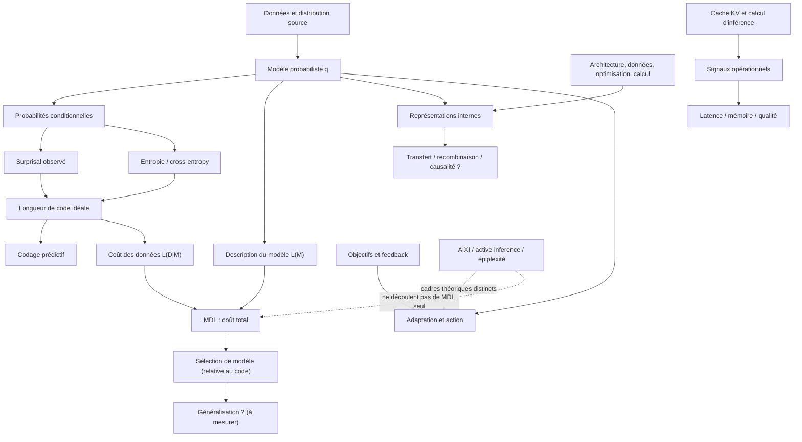

# Compression et intelligence — synthèse transversale des sources

**Version :** 17 novembre 2026  
**Périmètre :** synthèse critique de sources pédagogiques, techniques et philosophiques déjà ingérées dans LLM Lab. Ce document compare leurs apports ; il ne constitue ni une revue systématique de la littérature, ni une démonstration que l'intelligence se réduit à la compression.

## 1. Synthèse exécutive

La compression fournit un **cadre puissant pour comprendre l'apprentissage de régularités** : un modèle qui prédit mieux les données peut, en principe, leur attribuer un coût de codage idéal plus faible. Ce lien est mathématique lorsque le modèle probabiliste, la distribution évaluée et le protocole de codage sont spécifiés.

Mais le slogan « compression = intelligence » fusionne plusieurs propositions de statuts très différents. Les sources étudiées parlent tantôt de codage sans perte, de représentation compacte, de compression des paramètres, de sélection de caractéristiques, de généralisation, d'adaptation ou d'action. Ces notions sont liées, mais ne sont pas interchangeables.

**Conclusion centrale :** la compression prédictive explique une partie de la qualité d'un modèle statistique ; elle ne suffit pas, seule, à mesurer la compréhension, la causalité, l'adaptation, la robustesse, l'ancrage au monde ou l'intelligence générale.

Trois niveaux de conclusion doivent être conservés :

1. **Résultat établi :** les probabilités conditionnelles déterminent une longueur de code idéale ; la cross-entropy mesure un coût prédictif moyen sous une distribution et une convention de logarithme données.
2. **Principe de modélisation :** MDL peut arbitrer entre ajustement des données et coût de description du modèle, relativement à une classe de modèles et un code.
3. **Hypothèses ouvertes :** la compression comme définition générale de l'intelligence, l'identification de structures causales par compression, ou l'équivalence entre compression structurelle et compréhension ne sont pas démontrées par ces sources.

## 2. Corpus comparé et fonction de chaque source

| Source | Apport distinctif | Statut à retenir |
|---|---|---|
| Karthik Shashidhar, [LLMs and compression algorithms](https://artofdatascience.substack.com/p/llms-and-compression-algorithms) (2024) | Intuition LZW, motifs récurrents et limites de l'analogie | Introduction pédagogique, pas étude contrôlée |
| Lewis Hemens, [Intelligence and compression](https://lewish.io/posts/intelligence-and-compression) (2025) | MDL en deux parties, ordre temporel, mise à jour et cadres agentifs | Pont conceptuel ; expérience forward/reverse rapportée non reproduite |
| David Chen, [Compression Is Intelligence](https://www.linkedin.com/pulse/compression-intelligence-david-chen-uqtmc/) (2025) | Sélection de caractéristiques, représentations compactes, codage neuronal sans perte | Exemples techniques hétérogènes ; ne prouvent pas une théorie générale |
| Wayland Zhang, [Information Theory Is All You Need](https://waylandz.com/blog/information-theory-and-llm/) (2026) | Carte de l'entropie, cross-entropy, KL, information mutuelle et LLM | Ressource pédagogique à auditer notion par notion |
| Grant Sanderson / 3Blue1Brown, [Reinventing Entropy — Part 1](https://www.youtube.com/watch?v=l6DKRf-fAAM) (2026) | Dérivation intuitive du surprisal et de l'entropie à partir du codage | Très forte valeur pédagogique ; transcription consultée, pas revue vidéo image par image |
| Grant Sanderson / 3Blue1Brown, [But what is cross-entropy? — Part 2](https://www.youtube.com/watch?v=GlYgs6v2YfU) (2026) | Coût d'un modèle probabiliste évalué sur les données et raccord à l'apprentissage | Complément mathématique ; ne confondre ni entropie ni cross-entropy |
| Mingdi Fan, [Compression Is Intelligence](https://philarchive.org/archive/MINCII-3) (2026) | Compression narrative/probabiliste, efficacité structurelle, épiplexité et incarnation | Prépublication philosophique ; hypothèses, pas consensus empirique |
| Sourav Mukherjee, [Compression Is Intelligence: The Information Theory Behind LLMs](https://medium.com/bongquisitive-tech/compression-is-intelligence-the-information-theory-behind-llms-70022356dad8) (2026) | Usages de signaux entropiques pour cache KV et inférence ; analogie avec hallucinations | Vulgarisation à nuancer ; les méthodes et signaux diffèrent |
| Ressources primaires sur NNCP, MDL, AIXI, épiplexité et cache KV | Vérification de mécanismes particuliers et bornage des affirmations | Les résultats restent attachés à leurs protocoles et hypothèses |

Les revues et extractions individuelles restent les lieux de provenance, de détail et de limites de scan. Les articles de vulgarisation ne sont pas comptés comme preuves indépendantes lorsqu'ils relaient la même étude ou la même vidéo.

## 3. Carte des notions : un même mot, plusieurs problèmes

### 3.1 Compression prédictive et codage sans perte

Pour un modèle probabiliste autorégressif (q), le coût idéal d'une séquence observée est :

\[
L_q(x_{1:T}) = -\sum_{t=1}^{T}\log_2 q(x_t\mid x_{<t}).
\]

Cette expression est en bits si le logarithme est en base 2 ; avec le logarithme naturel, le coût est en nats. Un codeur arithmétique ou un codeur entropique compatible peut approcher ce coût, sous réserve d'un protocole de décodage synchronisé.

Cela établit un lien précis entre **qualité prédictive** et **coût idéal de codage**. Cela ne signifie pas qu'un LLM est lui-même un compresseur sans perte : les poids ne constituent pas une archive réversible du corpus, et la génération conditionnelle ne reconstitue pas un texte original unique.

### 3.2 Entropie, surprisal et cross-entropy

Ces trois quantités répondent à des questions différentes :

- **Surprisal** d'un événement observé : \(-\log q(x)\). Il porte sur un résultat particulier.
- **Entropie** d'une distribution : \(H(p)=\mathbb E_{x\sim p}[-\log p(x)]\). Elle mesure l'incertitude moyenne sous cette distribution.
- **Cross-entropy** entre une source (p) et un modèle (q) : \(H(p,q)=\mathbb E_{x\sim p}[-\log q(x)]\). Elle mesure le coût moyen lorsque les données viennent de (p) et sont évaluées par (q).

La cross-entropy se décompose en \(H(p)+D_{KL}(p\Vert q)\) lorsque les quantités sont définies sur le même espace et que les conditions usuelles sont satisfaites. La loss empirique d'un modèle de langage est une estimation sur un corpus et un protocole donnés, pas automatiquement une mesure en bits/token.

**Garde-fou :** faible entropie, faible surprisal, faible cross-entropy et faible utilité d'un token ne veulent pas dire la même chose. La prévisibilité d'un token ne démontre pas qu'il peut être supprimé sans conséquence.

### 3.3 MDL : le modèle n'est pas gratuit

Une formulation en deux parties est :

\[
L_{\mathrm{total}}(M,D)=L(M)+L(D\mid M).
\]

- \(L(M)\) encode le modèle, sa structure, ses paramètres et les informations auxiliaires nécessaires.
- \(L(D\mid M)\) encode les données conditionnellement au modèle.

Cette perspective empêche de comparer uniquement les résidus ou la loss d'entraînement. Un modèle plus expressif peut mieux ajuster les observations mais coûter davantage à décrire.

MDL est relatif à une classe de modèles, un langage de description et un protocole de codage. Il ne se confond ni avec la complexité de Kolmogorov (non calculable en général), ni avec la sélection du plus petit réseau, ni avec une garantie automatique de généralisation. Les coûts de calcul, de mise à jour, de transmission et les informations partagées doivent être explicités s'ils comptent dans la comparaison.

### 3.4 Quatre sens opérationnels à séparer

| Sens | Objet comprimé | Métriques pertinentes | Ce que le résultat ne prouve pas |
|---|---|---|---|
| Compression prédictive | Séquence / données observées | bits par symbole, log-loss, reconstruction exacte | Compréhension ou causalité |
| Compression de représentation | Entrée / représentation latente | taux, distorsion, qualité de tâche, transfert | Suffisance pour toute tâche |
| Compression du modèle | Poids, architecture ou calcul | taille checkpoint, latence, débit, qualité préservée | Réduction de mémoire d'exécution automatique |
| Compression d'exécution | Cache KV, activations, état intermédiaire | pic mémoire, temps, qualité, coût de recomputation | Compression des poids ou suppression sans risque |

La sélection de caractéristiques et la compression de prompt sont encore des opérations distinctes : elles sont évaluées relativement à une tâche, à des contraintes et à une perte admissible. Un prompt court qui entraîne une longue réponse relève d'une **expansion conditionnelle**, pas d'une décompression sans perte.

## 4. Ce que les sources établissent — et ce qu'elles proposent

| Proposition | Évaluation transversale | Formulation autorisée dans LLM Lab |
|---|---|---|
| Une meilleure distribution prédictive réduit le coût idéal moyen sous la même source | Résultat mathématique, avec hypothèses explicites | « La log-loss est reliée à la longueur idéale de code » |
| La compression favorise la capture de régularités réutilisables | Principe explicatif utile | « La compression peut révéler/exploiter des régularités » |
| Un modèle doit être évalué avec son coût de description | Principe MDL établi, code dépendant | « Comparer ajustement et description totale » |
| Les modèles compacts généralisent toujours mieux | Faux comme règle générale | « La complexité peut contribuer au compromis biais-variance ; le résultat dépend du protocole » |
| L'ordre temporel avant compresse mieux que l'ordre inversé | Pas de loi générale démontrée par l'exemple cité | « Hypothèse empirique dépendante de la source et du codec » |
| La compression définit l'intelligence | Thèse philosophique contestable | « Cadre de lecture partiel, pas définition consensuelle » |
| La compression narrative capture mieux la causalité que la cross-entropy | Hypothèse de Fan, non établie | « Proposition à opérationnaliser et tester » |
| L'épiplexité mesure directement la compréhension ou la généralisation OOD | Non établi | « Quantité de type MDL à temps borné, dépendante du cadre et de l'observateur » |
| Les tokens de raisonnement à faible entropie sont supprimables | Non démontré par les sources examinées | « Question expérimentale ouverte » |
| AIXI prouve que toute intelligence est compression | Non | « Formalisme idéal de prédiction universelle et de décision, incomputable dans sa forme idéale » |

## 5. Désaccords et complémentarités

### 5.1 Prédiction statistique versus sélection de structure

Les sources de 3Blue1Brown, Wayland et Lewis éclairent surtout le lien entre distributions conditionnelles, surprisal, entropie, log-loss et codage. Fan pose une question différente : une bonne prédiction suffit-elle à produire des représentations structurées, causales et recombinables ?

Il faut garder la question ouverte. Une cross-entropy faible est une mesure de performance prédictive sur une distribution ; elle ne mesure pas directement la parcimonie d'une représentation, sa causalité, sa transférabilité ou son ancrage. Mais l'opposition entre « statistique » et « structurel » ne doit pas être caricaturale : l'objectif, l'architecture, les données, les biais inductifs, l'optimisation et le post-entraînement interagissent.

### 5.2 Compression et ordre causal

Lewis rapporte une différence de taille entre versions forward et reverse d'un corpus. La comparaison est intéressante, mais elle ne prouve pas une direction causale universelle. Les tailles finies dépendent du codec, de ses paramètres, du framing et des conditions aux frontières. Pour une source stationnaire, le taux d'entropie ne change pas simplement parce qu'on inverse le temps.

LLM Lab dispose d'une expérience synthétique distincte : contrôles IID, Markov stationnaire et changement de régime, trois codecs, graines appariées et score MDL simplifié. Elle permet d'étudier les asymétries d'implémentation sans prétendre reproduire les chiffres d'origine ni établir une loi de causalité.

### 5.3 Intelligence comme adaptation et action

Lewis introduit l'efficacité d'acquisition de compétences et les cadres agentifs ; Fan distingue les formes d'organisation des représentations et évoque l'interaction sensorimotrice. Ces perspectives rappellent que l'intelligence peut inclure la capacité à apprendre, mettre à jour un modèle, choisir des actions et réussir sous contraintes.

AIXI combine prédiction universelle et maximisation de récompense dans un cadre idéal, mais est incomputable et ses garanties dépendent notamment de la machine universelle de référence. Le Free Energy Principle et l'active inference proposent d'autres cadres ; surprisal, énergie libre variationnelle, erreur de prédiction et récompense ne sont pas synonymes. Ces approches ne doivent pas être présentées comme une conséquence démontrée de la théorie du codage.

### 5.4 Signaux d'entropie et optimisation de l'inférence

Les méthodes de cache KV mentionnées par Mukherjee illustrent des usages opérationnels de signaux différents : entropie des poids d'attention, entropie de distributions de tokens, dérive de cache, scores de récence ou d'importance. Elles ne mesurent pas la même chose et ne s'appliquent pas nécessairement aux mêmes architectures.

Le choix d'un signal doit être validé sur une tâche et un budget donnés. L'entropie n'est pas une mesure universelle de l'utilité d'un token. De même, l'analogie entre hallucination et compression avec perte peut être pédagogique, mais n'est pas une théorie exhaustive des hallucinations : décalage de distribution, ambiguïté, données contradictoires, calibration, objectif de génération et absence de vérification externe comptent aussi.

## 6. Graphe de connaissances transversal

Le graphe ci-dessous représente les dépendances conceptuelles et les garde-fous de la synthèse. Il ne prétend pas démontrer une identité entre ses nœuds.

Relations à conserver :
- prédiction probabiliste → surprisal → longueur de code idéale ;
- modèle + données conditionnelles → coût MDL en deux parties ;
- compression de représentation → qualité de tâche et distorsion, définies par l'usage ;
- optimisation d'inférence → budgets mémoire/temps/qualité ;
- adaptation et action → dimensions complémentaires à la prédiction statique.

Relations à ne pas créer :
- entropie = utilité d'un token ;
- compression = compréhension ;
- taille du checkpoint = mémoire d'inférence ;
- cross-entropy faible = causalité ou vérité ;
- AIXI / FEP = conséquence directe du codage entropique.

## 7. Programme expérimental priorisé

Les expériences déjà présentes dans le dépôt ne doivent pas être dupliquées. Le tableau distingue l'existant des questions réellement ouvertes.

| Priorité | Question | État | Protocole minimal |
|---|---|---|---|
| P0 | Prédiction → codage sans perte | Déjà démontré sur alphabet synthétique | Garder l'expérience de codage arithmétique exact ; inclure overhead et reconstruction |
| P0 | Coût du modèle et ordre forward/reverse | Expérience synthétique existante | Publier distributions appariées, versions de codecs, limites et coût paramétrique explicite |
| P1 | Entropie moyenne versus surprisal rare | Démonstration jouet existante dans le dossier Mukherjee | Montrer qu'une source de faible entropie peut produire un événement rare à surprisal élevé |
| P1 | MDL et généralisation | À approfondir | Comparer modèles sous/sur-paramétrés, données train/test, codes de paramètres défendables et plusieurs seeds |
| P1 | Signal entropique et utilité de tokens | Non exécuté sur LLM | Comparer aucun pruning, entropie, surprisal, aléatoire, récence/attention ; mesurer exactitude, robustesse, latence et mémoire |
| P2 | Compression structurelle et transfert | Hypothèse de recherche | Mesurer recombinaison et transfert sur tâches nouvelles ; définir avant l'expérience la notion de structure |
| P2 | Adaptation et coût de mise à jour | Cadre à opérationnaliser | Comparer performance après adaptation à budgets de données, calcul et temps égaux |
| P2 | Compression et décision agentive | Cadre théorique, pas benchmark projet | Évaluer récompense cumulée, exploration, robustesse et coût de modèle dans un environnement contrôlé |

Aucun résultat ne doit être revendiqué avant exécution. Une expérience sur données synthétiques valide un mécanisme ou une intuition ; elle ne démontre pas une propriété générale des LLM.

## 8. Décisions éditoriales et pédagogiques pour LLM Lab

### Socle obligatoire

1. Conserver les pages canoniques existantes pour probabilités, vraisemblance, entropie, cross-entropy, codage prédictif et compression du modèle.
2. Enseigner les distinctions entropie / surprisal / cross-entropy avant d'utiliser le slogan « compression et intelligence ».
3. Présenter le lien log-loss / code comme un résultat mathématique conditionné par le modèle et le protocole.
4. Séparer explicitement les budgets : stockage des poids, mémoire d'exécution, calcul/latence, communication et coût de description du modèle.

### Approfondissements facultatifs

- MDL, Kolmogorov, Solomonoff et épiplexité : parcours avancé, avec hypothèses et limites.
- AIXI et active inference : comparaison de cadres agentifs, sans les fusionner.
- Compression narrative/structurelle de Fan : objet de discussion et programme d'hypothèses, pas contenu canonique.
- Cache KV guidé par entropie : étude de cas d'optimisation d'inférence, pas théorie générale de l'utilité des tokens.

### Ce qu'il ne faut pas ajouter

- Pas de nouveau concept canonique « compression = intelligence ».
- Pas de doublon des pages Entropie ou Cross-entropy.
- Pas de nouvelle étape obligatoire du parcours fondée uniquement sur une source de vulgarisation.
- Pas de raccourci selon lequel les modèles seraient des archives comprimées et décompressées.
- Pas d'affirmation que la compression prouve la compréhension ou la causalité.

## 9. Conclusion opérationnelle

La formulation la plus robuste pour le projet est :

> **Un modèle apprend des régularités qui peuvent améliorer sa prédiction et réduire le coût idéal d'encodage des données. La qualité de cette compression dépend de la représentation, de la distribution, du code et de la tâche. L'intelligence inclut potentiellement d'autres capacités — généralisation, adaptation, causalité, action et ancrage — qui doivent être définies et évaluées séparément.**

Cette formulation conserve l'intuition commune des sources sans transformer une analogie féconde en identité scientifique.

## 10. Sources de travail et dossiers à consulter

- [Dossier compression, information et efficacité de l'inférence](compression-intelligence-and-inference-efficiency-2026-11.md) — Lewis, David Chen, Mukherjee, MDL, AIXI et expérience forward/reverse.
- [Dossier théorie de l'information et LLM](information-theory-and-llms-2026-11.md) — entropie, cross-entropy, information mutuelle et V-information.
- [Dossier deux sens de la compression](compression-two-meanings-2026-11.md) — compression prédictive versus compression du modèle.
- [Dossier épiplexité et intelligence de Mingdi Fan](fan-compression-intelligence-2026-11.md) — argument philosophique et hypothèses.
- [Dossier pédagogique Reinventing Entropy](reinventing-entropy-2026-11.md) — dérivation de l'entropie par le codage.
- [Revue critique de Lewis](../source-reviews/lewish-intelligence-and-compression-2025.md).
- [Revue critique de David Chen](../source-reviews/david-chen-compression-is-intelligence-2025.md).
- [Revue critique de Mingdi Fan](../source-reviews/fan-compression-intelligence-2026-11.md).
- [Extraction structurée de Lewis](../../data/extractions/lewish-intelligence-and-compression-2025.yml).
- [Catalogue des sources](../../data/sources.yml).

**Limite documentaire :** plusieurs sources restent partiellement scannées (commentaires, figures, code/données ou références secondaires selon les cas). Cette synthèse n'élève pas leur statut de scan et n'accorde aucun droit de réutilisation des contenus.
