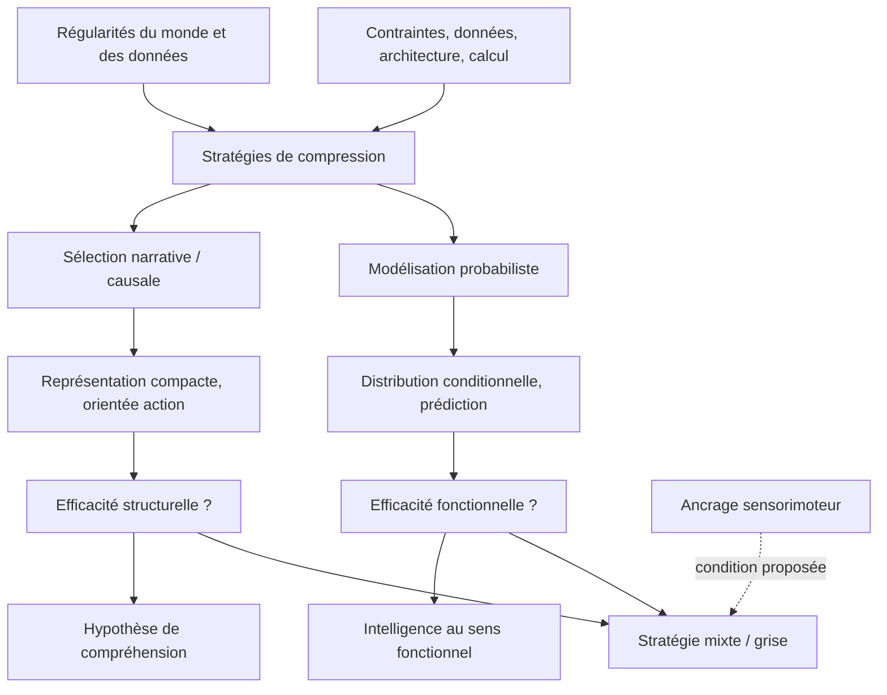

# Compression, épiplexité et intelligence — synthèse critique de Mingdi Fan

**Source principale :** Mingdi Fan, “Compression Is Intelligence: The Common Ground of Positive Subjectivity and Negative Subjectivity”, PhilArchive MINCII-3 (version déposée le 17 mai 2026).  
**Revue de source :** [analyse critique détaillée](../source-reviews/fan-compression-intelligence-2026-11.md).  
**Extraction :** [graphe et affirmations structurés](../../data/extractions/fan-compression-intelligence-2026.yml).

## Synthèse exécutive

Fan propose un cadre unificateur : l'intelligence serait une forme de compression effective, mais plusieurs stratégies de compression conduiraient à des organisations différentes. Il oppose une compression narrative, sélective et orientée vers les structures causales (subjectivité positive), à une compression probabiliste du langage par minimisation de la cross-entropy (subjectivité négative). Il distingue ensuite l'efficacité fonctionnelle — prédire et généraliser — de l'efficacité structurelle — représenter de manière parcimonieuse et recombinable — et réserve la compréhension à cette dernière. Enfin, il esquisse une stratégie mixte pour une subjectivité grise, particulièrement si des systèmes artificiels acquièrent des interactions sensorimotrices.

La contribution pédagogique la plus intéressante n'est pas de proclamer que « l'intelligence est la compression », mais de distinguer **qualité prédictive, structure des représentations, transfert et ancrage**. Ce sont des dimensions différentes qu'une seule loss ne suffit pas à résumer.

**Verdict :** cadre conceptuel stimulant, utile comme hypothèse de recherche et comme objet de critique ; pas une théorie empirique établie de l'intelligence humaine ou artificielle.

## 1. Carte de l'argument

Cette carte représente la thèse de l'auteur et ses hypothèses ; elle ne décrit pas un consensus scientifique ni un mécanisme neuronal ou computationnel déjà démontré.

## 2. Les trois stratégies proposées

| Position | Produit de compression proposé | Objectif dominant | Statut dans l'article |
|---|---|---|---|
| Subjectivité positive | Récit autobiographique / centre « je » | Sélectionner les régularités structurées et utiles à l'action | Modèle philosophique de la cognition humaine |
| Subjectivité négative | Distribution de probabilités sur les séquences | Minimiser la cross-entropy sur les données | Interprétation philosophique du pré-entraînement LLM |
| Subjectivité grise | Modèle probabiliste global + structures temporaires liées à la tâche | Combiner prédiction linguistique et sélection de structures causales | Proposition conceptuelle conditionnelle |

La métaphore du négatif photographique sert à rappeler que deux systèmes peuvent être sensibles aux mêmes régularités sans les organiser de la même manière. Elle ne constitue pas une définition mathématique.

## 3. Le point technique : ce que la cross-entropy mesure — et ce qu'elle ne mesure pas

Pour une séquence, un modèle autorégressif attribue :

[
q(x_{1:T})=prod_{t=1}^{T}q(x_tmid x_{<t})
]

La loss token-level moyenne est une moyenne de (-log q(x_tmid x_{<t})), sous une convention de logarithme donnée. Elle évalue la qualité des probabilités attribuées aux observations. Elle ne mesure pas directement :
- la parcimonie d'une représentation interne ;
- la capacité de recombiner des concepts dans des tâches nouvelles ;
- l'identification de relations causales ;
- la grounding sensorimotrice ;
- la conscience ou l'expérience subjective.

Le texte oppose l'objectif prédictif à la sélection de régularités structurelles. Cette opposition est utile, mais doit être nuancée : l'architecture, les biais inductifs, les données, la régularisation, les contraintes de capacité et le post-entraînement influencent aussi ce qui est appris. Un objectif de cross-entropy n'implique pas que le modèle mémorise indistinctement chaque motif statistique.

## 4. Épiplexité : un outil prometteur, pas un synonyme simple de « structure »

Fan mobilise l'épiplexité proposée par Finzi et al. pour caractériser l'information structurée extractible sous contrainte de calcul. La source reconnaît que la définition formelle s'appuie sur une longueur de programme optimale sous MDL à temps borné, puis emploie parfois une paraphrase intuitive (« contenu d'information structurée »).

Pour enseigner correctement :
- Shannon entropy quantifie l'incertitude d'une source probabiliste ;
- Kolmogorov complexity porte sur la longueur du plus court programme générateur (non calculable en général) ;
- effective complexity vise la description des régularités, avec une séparation régularité/aléatoire qui dépend de choix de modélisation ;
- epiplexity formalise une notion de structure accessible sous contraintes de calcul.

Ces quantités ne sont pas interchangeables. Le budget de calcul, la classe de modèles et la représentation choisie comptent.

## 5. Le détour algébrique An/Fn : une analogie à encadrer

Le texte rapproche la recombinaison libre de définitions dans un monoïde commutatif et la dépendance à l'ordre dans un monoïde libre non commutatif, puis met en correspondance ces structures avec la compression narrative et la modélisation de séquences. L'auteur reconnaît que cette correspondance n'est pas un isomorphisme et que les paramètres d'un réseau ne sont pas littéralement des macros indépendantes.

Il faut donc conserver la valeur heuristique de l'analogie sans transférer les théorèmes à l'apprentissage profond. Les résultats algébriques ne prouvent pas que les LLM sont condamnés à une efficacité linéaire, ni qu'ils ne peuvent pas comprendre.

## 6. Les prédictions et les expériences à examiner

| Proposition de Fan | Mesure possible | Contrôle indispensable |
|---|---|---|
| Le raisonnement explicite pourrait changer la forme des lois d'échelle | Courbes loss / paramètres / budget de raisonnement ; comparaison de modèles statistiques | Contrôler compute, longueur de sortie, données, architecture et contamination |
| La complexité effective des données bornerait les connaissances structurelles | Comparer des corpus de qualité/curation différente à budgets identiques | Ne pas attribuer à l'épiplexité tout effet de curation |
| Le débruitage favoriserait le raisonnement au détriment du rappel factuel | Benchmarks de raisonnement et QA factuelle | Définir le bruit ; contrôler taille, distribution et qualité |
| La découverte autonome de définitions signalerait une meilleure compression structurelle | Taux de réutilisation, gain de description, transfert vers nouveaux théorèmes | Définir T0 et comparer des tâches/communautés comparables |
| L'alignement augmenterait l'épiplexité des représentations | Estimation avant/après alignement à architecture et données contrôlées | Mesure indépendante, réplication, contrôle des objectifs et des données |

Aucune de ces prédictions n'est validée par le seul fait qu'elle est formulée dans le papier. Le cas FineWeb-Edu, par exemple, est une observation compatible avec plusieurs explications et ne constitue pas une mesure directe d'épiplexité.

## 7. Limites et controverses centrales

1. **Définition de l'intelligence :** la thèse dépend de la définition adoptée de la compression « effective ». Elle ne fait pas consensus.
2. **Pont du descriptif au normatif/ontologique :** passer d'une fonction de perte ou d'une propriété informationnelle à un mode d'existence demande des prémisses supplémentaires.
3. **Comparaison humains/LLM :** les récits humains et les distributions de tokens ne sont pas deux implémentations dont l'équivalence aurait été démontrée.
4. **Compréhension :** la définir comme efficacité structurelle est une stipulation utile mais contestable, pas une conclusion imposée par l'algèbre.
5. **Alignement :** RLHF et DPO ne se réduisent pas à une unique « dérive vers l'épiplexité ».
6. **Incarnation :** l'accès sensorimoteur peut enrichir les données et les boucles d'action, mais ne prouve pas à lui seul l'expérience subjective ou l'ancrage sémantique au sens fort.

## 8. Raccordement au parcours LLM Lab

| Notion | Ressources canoniques | Usage de cette source |
|---|---|---|
| Probabilités conditionnelles et prochain token | [Probabilités](../../site/fr/probabilites.qmd), [cross-entropy](../../site/fr/cross-entropy.qmd) | Rappeler ce que mesure l'objectif prédictif |
| Entropie et information | [Entropie](../../site/fr/entropy.qmd), [fiche de révision compression](../../site/fr/compression-revision.qmd) | Distinguer incertitude, structure et qualité de représentation |
| Généralisation | [Boucle d'entraînement](../../site/fr/training-loop.qmd), [scaling laws](../../site/fr/scaling-laws.qmd) | Concevoir des tests de transfert et de décalage |
| Limites et compréhension | [Limites des LLM](../../site/fr/llm-limits.qmd) | Présenter les distinctions comme débats, pas comme faits établis |

**Décision :** aucune nouvelle page canonique de « subjectivité » pour le moment. La source est référencée dans la fiche de révision existante, et son vocabulaire philosophique reste dans le dossier critique. Les graphes conceptuel, computationnel et pédagogique conservent leurs rôles distincts.

## 9. Expérience pédagogique minimale

Une expérience synthétique compare unigramme et bigramme sur un corpus généré par une règle simple, puis sur une version permutée qui conserve les fréquences de symboles mais détruit les dépendances séquentielles. On mesure la cross-entropy en bits/token sur un jeu de test distinct.

Cette expérience rend visible le fait qu'un objectif prédictif peut exploiter des dépendances séquentielles. Elle ne calcule pas l'épiplexité, ne mesure pas la compréhension et ne permet aucune conclusion ontologique.

## Conclusion opérationnelle

L'intérêt de Fan pour LLM Lab est de formuler une question qui dépasse la loss : **quelles régularités un système apprend-il à conserver, avec quelle représentation, et peut-il les recombiner dans des situations nouvelles ?** Le projet doit traiter cette question en distinguant rigoureusement les métriques, les analogies et les hypothèses philosophiques. L'article mérite une lecture avancée et critique, pas une adoption comme théorie démontrée.
