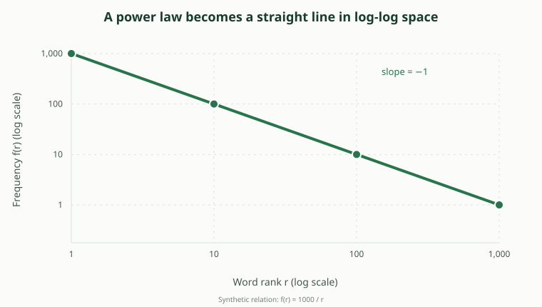

<!--
LLM-LAB-PAGE-MAP v1
id: "en/advent-calendar-story-day-01"
summary: "Builds a small corpus, studies lexical frequencies, and explores Zipf’s law, its uses and limitations."
scope: "Explains counting units, the rank-frequency relation, Zipf-Mandelbrot variants, multilingual findings, history, applications and empirical limitations."
purpose: "Build and normalize a corpus, distinguish types from occurrences, interpret an estimated exponent and evaluate what the law can actually do."
domain: "probabilistic-foundations-training"
suggested_route:
  previous: null
  next: null
hierarchy:
  parents: ["en/deepen"]
  children: []
related: ["en/zipf-law-deep-dive","en/exercises-zipf-law","en/text-data","en/tokenization-strategies"]
tags: ["type:deep-dive", "destination:deepen", "topic:zipfs-law", "level:overview", "language:en", "status:published"]
-->

*LLM Lab Advent Calendar 2026 · Door 1 · about 12 minutes*

This lesson starts with a simple question: why do some forms appear much more often than others? We will build a small corpus, count its words, and then compare the exercise with real linguistic corpora.

> **Prerequisites** — no prior knowledge of quantitative linguistics is needed. Corpus, type and occurrence are introduced here; logarithms are recalled when they become useful.

## 1. A question, a text, a corpus

**Question: why does the word “I” appear so often in this text?**

Read this short account before looking at the numbers:

> You know, I have often wondered why some days seem to last forever while others almost disappear. I leave home in the morning with a very clear idea of what I am going to do. I make a list, put my things in order, check the time, and tell myself that this time everything will go as planned. Then someone asks me a question, something goes missing, the phone rings, and the plan changes. I could get annoyed, of course. I could also pretend that this was exactly what I had intended. But I would rather look at what actually happens. Then we discover that small detours are not always useless. A conversation can give us an idea, a mistake can reveal a problem, and a pause can leave us time to think. I am not saying that we should stop organizing our days. I am only saying that a plan describes an intention, not the whole world. And when I tell the story of my day, I talk a lot about myself, my choices, and what I noticed. Perhaps that is why certain words keep coming back: they follow the path chosen by my story.

A **corpus** is a collection of texts assembled for a study under explicit criteria—for example, language, genre, period, and source.

This first-person account makes the frequency of “I” visible. It is a deliberately revealing example, not a representative sample of English. We will define the units being counted, rank the forms by frequency, and compare this result with patterns observed in much larger corpora.

### Building the corpus: which units should we count?

We use the following conventions:

- convert to lowercase;
- remove punctuation as a counted unit;
- preserve accents and other letters;
- retain apostrophes inside contractions when they occur;
- do not lemmatize: inflected forms remain distinct;
- treat hyphens as separators.

Under these conventions, the text contains **196 lexical occurrences and 127 distinct orthographic types**. These figures can be reproduced from the text above and the rules just stated.

### Type, lexical occurrence and tokenizer token: three distinct notions

The word *token* is used in two related but different contexts.

| Notion | Definition | Example |
|---|---|---|
| **Lexical type** (*word type*) | A distinct orthographic form after normalization | “I” is a type |
| **Lexical occurrence** (*word token*) | One concrete appearance of a form in the text | “I” appears 13 times: 13 occurrences |
| **Tokenizer token** (*model token*) | A unit produced by a tokenizer and represented by an ID in the model vocabulary | The form “I” may be encoded as one or more model tokens, depending on the tokenizer |

The two uses of *token* are related, but they are not interchangeable. A lexical occurrence is a position in the text; a tokenizer token is a representation unit. A word may be split into several model tokens, and a tokenizer may also treat punctuation, spaces or word fragments as separate units.

The notion of type also depends on the convention. Here, “talk” and “talking” are two types; lemmatization could group them under one lemma. Lowercasing also merges variants that differ only in capitalization.

**Takeaway:** before comparing frequencies, always specify the counted unit, the text source and the normalization procedure.

### Count and rank

| Form(s) | Occurrences per form | Rank(s) |
|---|---:|---:|
| I | 13 | 1 |
| a | 9 | 2 |
| the | 7 | 3 |
| that | 6 | 4 |
| and | 5 | 5 |
| my, what | 4 | 6–7 |
| 6 forms (including “am”, “can”, “not”, “of”, “time” and “to”) | 3 | 8–13 |
| an, could, days, idea, in, leave, myself, plan, saying, story, tell, then, this, us, we, why | 2 each | 14–29 |
| 98 forms | 1 | 30–127 |

The word “I” comes first, but this is not mysterious: the account is told in the first person. Frequency therefore also reflects the topic, viewpoint and genre of a text. That is exactly what this example helps us see: rank is not an intrinsic property of a word.

Several forms have the same frequency. They occupy an interval of ranks: “my” and “what” share ranks 6–7, with no substantive reason to privilege one over the other. The table therefore gives rank intervals for ties.

Our short text already shows a highly uneven distribution: “I” appears 13 times, while 98 forms appear only once. But this is not enough to establish Zipf’s law. Rank depends on the corpus, language, period, genre, size, content and normalization conventions. In a text about ancient Egypt, “papyrus” might move up the ranking; in an ordinary conversation, it would probably be much rarer. With only 196 occurrences, our sample is far too short to estimate a power-law exponent reliably.

## 2. Zipf’s law: a rank-frequency approximation

In large corpora, we often observe a regularity: a few forms are very frequent, while many forms are rare. Zipf’s law proposes a simple approximation of this distribution:

$$
f(r) \propto \frac{1}{r^\alpha}
$$

where:

- $r$ is the rank of a lexical type in the frequency ordering;
- $f(r)$ is its frequency, as an occurrence count or relative frequency;
- $\alpha$ is the exponent of the law, estimated from data;
- $\propto$ means “is proportional to”.

In the classical form, $\alpha$ is often taken to be close to 1. We can then write, for a corpus-dependent constant $C$:

$$
f(r) \approx \frac{C}{r}
$$

If the most frequent type occurs 1,000 times, this approximation predicts 500 occurrences at rank 2, 200 at rank 5 and 100 at rank 10. These are illustrative theoretical values, not measurements from our small corpus.

### What does the exponent mean?

The exponent $\alpha$ controls the slope of the distribution:

- a larger $\alpha$ means faster decay: the highest ranks dominate more strongly;
- a smaller $\alpha$ means more gradual decay;
- $\alpha = 1$ gives the intuitive rule that doubling the rank approximately halves the frequency.

The exponent is not a universal constant of English or French. It must be estimated for a particular corpus and model. Its value depends on period, genre, register, corpus size, word definition and fitting method.

The full form is $f(r)=C r^{-\alpha}$. **$C$ sets the vertical scale**: for a fixed exponent, doubling $C$ doubles every predicted frequency. Its value depends on the chosen scale (counts or relative frequencies) and the corpus. **$\alpha$ controls the decay**: it determines the slope on a log-log plot. It is not an immutable property of a language; it summarizes the fit of a model to a particular corpus and counting convention.

### Why use logarithmic axes?

Frequencies may range from thousands of occurrences down to one, while ranks extend from 1 to several thousand. On linear axes, the most frequent forms take up nearly all the space and the long tail becomes hard to inspect. A logarithmic scale makes multiplicative changes (for example, ×10) occupy equal distances.

Starting from the general form:

$$
f(r) = C r^{-\alpha}
$$

Taking logarithms on both sides gives:

$$
\log f(r) = \log C - \alpha \log r
$$

On a plot of $\log f(r)$ against $\log r$, this relation becomes a straight line with slope $-\alpha$.

{#fig-advent-zipf-rank-frequency fig-alt="On logarithmic axes, the synthetic curve f(r)=1000/r falls from 1,000 occurrences at rank 1 to 1 occurrence at rank 1,000; its slope is −1." width=95%}

*This curve is synthetic: it shows the shape of the relation, not a distribution measured in a real corpus.*

### An extension: Zipf-Mandelbrot

The Zipf-Mandelbrot law shifts the rank:

$$
f(r) \propto \frac{1}{(r+\beta)^\alpha}.
$$

It can describe the first few ranks more closely in some corpora. The parameter $\beta$ mainly changes their curvature, while $\alpha$ governs the asymptotic slope. This added flexibility must be evaluated against the data; it is not automatically preferable.

The derivation, comparison plots, and fitting caveats are collected in [the Zipf-Mandelbrot deep dive](zipf-law-deep-dive.qmd#zipf-mandelbrot-law).

## 3. A regularity observed across languages

The rank-frequency relation is not limited to English or French. Lavi-Rotbain and Arnon (2023) report distributions close to Zipf-Mandelbrot in child-directed speech corpora across several languages.

The estimated parameters vary across languages and corpora. They also depend on sample size, the linguistic unit, and counting conventions. These findings illustrate a cross-linguistic regularity in a specific empirical setting; they do not rank languages by their supposed “compliance with Zipf”.

For the data, parameter estimates, and comparison caveats, see [the multilingual observations and Zipf-Mandelbrot deep dive](zipf-law-deep-dive.qmd#cross-linguistic-observations).

## 4. Why does this regularity matter for language science and LLMs?

Zipf is primarily a **descriptive model**. It helps characterize frequency distributions; it does not by itself explain how a system learns or generates text.

- **Corpora:** the rank-frequency curve describes how forms are concentrated and how long the rare-form tail is. A deviation does not prove that a corpus is defective.
- **Information retrieval:** term frequencies affect indexing and ranking. TF-IDF and BM25 use these statistics through their own mechanisms; they do not calculate Zipf's law.
- **Language models:** frequent units provide more observations than rare ones. Tokenization redistributes this long tail between words and subwords, but BPE is not derived from Zipf's formula.

One distinction is essential. Zipf describes a **marginal frequency** in a corpus: how often a form appears across all contexts. An autoregressive model estimates a **context-conditional probability**:

$$
p_\theta(x_t\mid x_{<t}).
$$

A token that is rare across the corpus may be highly probable after a particular prefix. Conversely, a globally frequent token may be unlikely in that context. These distributions answer different questions.

For detailed applications, interpretation limits, and comparison examples, see [the companion deep dive](zipf-law-deep-dive.qmd).

## 5. A regularity, not a universal law

An approximate straight line on logarithmic axes is not enough to prove that a power-law mechanism generated the data. Several difficulties must be considered:

- **Dependence between rank and frequency.** If both are estimated from the same sample, a random fluctuation can increase a word’s observed frequency and move it up the ranking. The two axes are then not independent.
- **The long tail.** Rare forms are numerous, but their frequencies are difficult to estimate precisely in a finite corpus.
- **Non-stationarity.** A word may be very frequent in a corpus about one topic and rare in another. Aggregated frequencies mix different contexts.
- **Linguistic conventions.** Inflected forms, compounds, contractions, characters and segmentation units change the number of types and their frequencies.
- **Model choice.** A simple power law, a Zipf-Mandelbrot law or another model may describe the ends of the distribution differently.

Steven Piantadosi (2014) emphasizes that classical visualizations can hide richer structure and that proposed causal explanations do not account for every phenomenon. Separating the data used to estimate ranks from those used to estimate frequencies is one way to reduce an important bias, but it does not solve every estimation problem.

The reasonable conclusion is therefore: **lexical frequencies often exhibit a Zipf-like regularity, but their exact shape depends on the data, units and analysis method.**

## 6. Back to our corpus: what this small text taught us

We built a corpus, chose a normalization, distinguished 196 occurrences from 127 types and established a ranking. We now know why that ranking is not an intrinsic property of words, why frequency ties complicate ranks and why such a short text cannot provide a robust exponent estimate.

On a large corpus, the same procedure becomes a statistical analysis: count, rank, estimate parameters, compare observed frequencies with expected frequencies, and then inspect the deviations. The formula becomes useful only after these methodological choices.

## Practise

Calculations, transfer questions and worked solutions live on a dedicated companion page. This keeps the lesson focused while allowing the practice material to grow independently.

[Open the Zipf’s law exercises](exercises/zipf-law.qmd).

## The takeaway

Zipf’s law describes a frequent regularity in lexical-frequency distributions: a few forms dominate, while a long tail contains many rare forms. It is useful for corpus analysis, for understanding some challenges in natural-language processing and for studying distributions produced by models. But it never removes the need to define units, describe the data and test the quality of the fit.

## Go further

- The [text-data lesson](text-data.qmd) introduces the representations and units handled in the LLM pipeline.
- The [tokenization lesson](tokenization-strategies.qmd) explains how a string is split into model tokens.

### Sources

- Estoup, J.-B. (1916), *Gammes sténographiques*, Institut sténographique de France — historical landmark for the observation of the rank-frequency relation.
- Zipf, G. K. (1935), *The Psycho-Biology of Language* — formulation and dissemination of lexical-frequency analysis.
- Zipf, G. K. (1949), *Human Behavior and the Principle of Least Effort* — book that widely popularized this regularity.
- Mandelbrot, B. (1953), “An informational theory of the statistical structure of language” — generalization of the rank-frequency relation.
- Petruszewycz, M. (1973), [*L'histoire de la loi d'Estoup-Zipf : documents*](https://www.numdam.org/item/MSH_1973__44__41_0/) — documentary landmarks on the law’s origins.
- Piantadosi, S. T. (2014), [*Zipf’s word frequency law in natural language: A critical review and future directions*](https://doi.org/10.3758/S13423-014-0585-6) — critical review of regularities, estimation methods and proposed explanations.
- Lavi-Rotbain, O. and Arnon, I. (2023), [*Zipfian Distributions in Child-Directed Speech*](https://doi.org/10.1162/opmi_a_00070) — multilingual study of frequencies in child-directed speech.
- Linders, G. M. and Louwerse, M. M. (2023), [*Zipf’s law revisited: Spoken dialog, linguistic units, parameters, and the principle of least effort*](https://doi.org/10.3758/s13423-022-02142-9) — extends the analysis to conversation and multiple linguistic units.
- He, Y., Zeng, Q. and Jiang, M. (2025), [*Pre-trained Models Perform the Best When Token Distributions Follow Zipf’s Law*](https://aclanthology.org/2025.emnlp-main.1421/) — recent study of the link between token distributions, vocabulary size and performance.

[Back to the Advent Calendar](scientific-calendar.qmd).

::: {.language-switch}
**Language:** [Français](../fr/advent-calendar-story-day-01.qmd) · [English](advent-calendar-story-day-01.qmd)
:::
