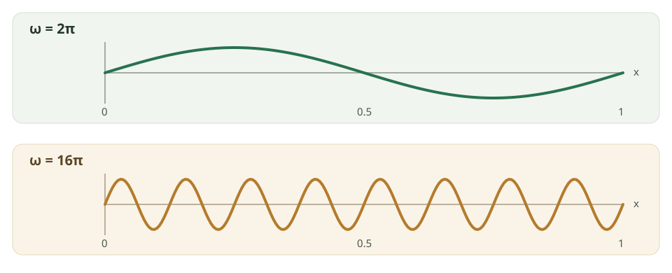

<!--
LLM-LAB-PAGE-MAP v1
id: "en/advent-calendar-story-day-06"
summary: "Shows why transforming a coordinate into multiple sinusoidal features makes different variation scales explicit."
scope: "Explains multi-frequency sinusoidal representations and spectral bias, using Transformer positional encoding as one application."
purpose: "Distinguish a raw coordinate, a bank of frequency features, and a network's ability to use those features."
suggested_route:
  previous: null
  next: null
hierarchy:
  parents: []
  children: []
related: ["en/positional-encoding"]
tags: ["type:deep-dive", "destination:deepen", "topic:advent-story-sine-wave", "level:overview", "language:en", "status:planned"]
-->

*Independent story · about 10 minutes · Pilot A — draft for review*

## A position is a number. Is that already a useful representation?

A token occupies a position in a sequence: 0, 1, 2, 3… That coordinate tells us **where** it is. It does not yet tell a network how to compare that position with others, or which scales of change should matter.

The problem is broader than language. In machine learning, we often give a network a numerical coordinate — a time, a position, a point in space — and ask it to represent a function of that coordinate. Slow variation and rapid oscillation are not equally easy to learn from the raw number alone.

One idea is to transform the coordinate into several sinusoidal features. This is the general idea behind *Fourier features*: make variations at different frequencies available in the input representation.

## One coordinate, several scales

Consider a normalized coordinate $x \in [0,1]$ and the function:

$$
f(x)=\sin(16\pi x).
$$

This function completes eight oscillations over the interval $[0,1]$. A few values make this visible:

| $x$ | $16\pi x$ | $f(x)$ |
|---:|---:|---:|
| $0$ | $0$ | $0$ |
| $1/32$ | $\pi/2$ | $1$ |
| $1/16$ | $\pi$ | $0$ |
| $3/32$ | $3\pi/2$ | $-1$ |
| $1/8$ | $2\pi$ | $0$ |

A linear readout of the number $x$ alone cannot reproduce this oscillation exactly. But if the input already contains the feature $\sin(16\pi x)$, a simple linear readout can recover $f(x)$ exactly: it only needs a weight of 1 on that coordinate.

This small example does not prove that a nonlinear network cannot learn the function from $x$. It shows something more specific: **the chosen representation determines which variations are immediately accessible**.

{#fig-advent-frequency-scales width=95%}

*The coordinate $x$ spans the same interval in both panels. Only the frequency changes.*

## The idea behind Fourier features

A simple bank of sinusoidal features can be written as:

$$
\gamma(x)=
[
\sin(2\pi b_1x),\cos(2\pi b_1x),
\dots,
\sin(2\pi b_mx),\cos(2\pi b_mx)
].
$$

Each frequency $b_j$ provides a pair of coordinates. Low frequencies change slowly as $x$ varies; high frequencies change more quickly. The representation therefore gives the model several “clocks” that do not tick at the same rate.

In their work on *Fourier features*, Tancik and co-authors study this kind of transformation for networks that receive low-dimensional coordinates. Their central result is that the choice of features changes the frequencies a network can learn efficiently: in the settings they study, Fourier features can mitigate the spectral bias of MLPs and make faster variations more accessible.

The point is not that sine waves automatically make a model intelligent. They move part of the work: rather than asking the network to discover an oscillatory basis from raw coordinates alone, we explicitly provide components at multiple frequencies.

## Why does this appear in a Transformer?

A token position is also a coordinate. In the original Transformer, Vaswani and co-authors add pairs of sine and cosine functions to token embeddings, with frequencies following a geometric progression. The pairs therefore do not all vary at the same rate: some change rapidly with position, while others change much more slowly.

This is an idea related to *Fourier features*: transform a coordinate into a vector that exposes several scales of variation. But the two constructions are not identical:

- the original Transformer uses a deterministic bank of frequencies fixed by a formula;
- the *Fourier features* studied by Tancik and co-authors use a coordinate mapping whose frequencies are sampled from a distribution;
- in the Transformer, the positional vector is added to the token embedding; it does not replace lexical content or the attention computation.

The sine wave does not mean that text is periodic. It provides a coordinate system for positions. The model then combines this signal with token content and learns during training which information to use.

The algebraic property that relates a fixed offset to a linear transformation of each pair is important, but it is already derived in the [canonical positional-encoding lesson](positional-encoding.qmd). This story takes a different angle: why a bank of frequencies can be a useful representation of a coordinate.

## What this idea does not guarantee

Three cautions prevent overly strong conclusions.

1. **It is not a Fourier transform of text.** We are not decomposing a sentence into frequencies; we are mapping a position coordinate to features.
2. **A finite bank does not cover every possible variation.** The chosen frequencies define the scales that are directly available; they do not guarantee that every function will be well represented.
3. **A representation is not an acquired capability.** The model still has to learn how to use the features. The original Transformer authors presented extrapolation to longer sequences as a possible motivation, not a universal guarantee.

The connection to *Fourier features* is therefore a way to understand a shared representation idea: make several frequency scales explicit. It does not make the two methods identical in purpose, frequency distribution or theoretical properties.

## Try it

Suppose a model receives only the two features $\sin(2\pi x)$ and $\cos(2\pi x)$, followed by a linear readout.

**Question:** can this readout represent $\sin(16\pi x)$ exactly for every $x \in [0,1]$? What would you add to make that possible directly?

Show the solution

No. A linear combination of $\sin(2\pi x)$ and $\cos(2\pi x)$ remains a sinusoid with one cycle over the interval. It cannot exactly produce the eight oscillations of $\sin(16\pi x)$.

Adding the feature $\sin(16\pi x)$ (or the pair $\sin(16\pi x),\cos(16\pi x)$) makes that component directly available to the linear readout.

This conclusion is about this linear readout and this feature bank. A nonlinear MLP can construct harmonics from other inputs, but learning difficulty depends on the architecture, data and optimization.

## Further reading

The [positional-encoding lesson](positional-encoding.qmd) explains the Transformer's exact formula, its addition to token embeddings and the relative-shift property. This story offers another perspective, starting from frequency-based representations.

### Sources

- [Vaswani et al. (2017), *Attention Is All You Need*](https://arxiv.org/abs/1706.03762), Section 3.5 — sinusoidal positional encodings and their relative-position motivation.
- [Tancik et al. (2020), *Fourier Features Let Networks Learn High Frequency Functions in Low Dimensional Domains*](https://proceedings.neurips.cc/paper/2020/hash/55053683268957697aa39fba6f231c68-Abstract.html) — Fourier features, spectral bias and learning high-frequency functions.
