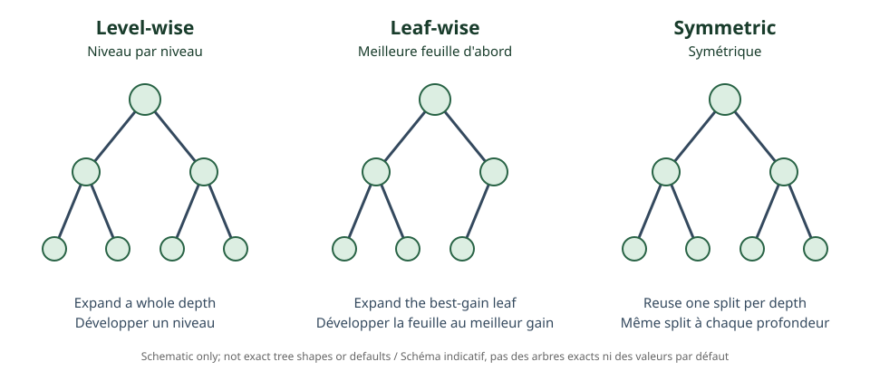

<!--
LLM-LAB-PAGE-MAP v1
id: "en/catboost"
scope: "Explains ordered categorical handling, ordered boosting, permutations, and symmetric trees."
purpose: "Identify target leakage in naive target encoding and distinguish CatBoost from competing optimizations."
suggested_route:
  previous: "en/lightgbm"
  next: null
hierarchy:
  parents: ["en/gradient-boosting"]
  children: []
related: ["en/xgboost", "en/lightgbm"]
tags: ["type:concept-lesson", "destination:deepen", "topic:catboost", "level:advanced", "language:en", "status:published"]
-->
::: {.chapter-lead}
CatBoost is a gradient-boosting algorithm designed in particular to handle categorical features. It aims to prevent an encoding from indirectly using the target of the row it represents.
:::
## The target-encoding trap

A category can be encoded with a target statistic, such as its mean. If that mean includes the target of the row being encoded, the representation depends on the answer to predict: this is target leakage, especially risky for rare categories.

## Ordered statistics

CatBoost uses permutations. For a row, the statistic is computed from preceding observations in a permutation, without using the current row's target. A simplified form is:

\[
\operatorname{TS}(x_k)=
\frac{\sum_{j:x_j=x_k,\;j\prec k}y_j+aP}
{\#\{j:x_j=x_k,\;j\prec k\}+a},
\]

where $j\prec k$ means that $j$ precedes $k$, $P$ is a prior, and $a$ its weight. This is illustrative: CatBoost uses multiple statistics and variants.

{fig-alt="Three structures illustrating level-wise, leaf-wise, and symmetric growth; schematic only."}

## Ordered boosting and symmetric trees

Ordered boosting constructs gradient estimates in an ordered way, avoiding the current observation's target in the corresponding estimate. It reduces certain prediction biases, but does not replace train/validation/test separation or prevent every kind of leakage.

CatBoost often uses symmetric (*oblivious*) trees: at a given depth, the same split condition applies to every node at that level. This makes evaluation easier but imposes a particular partition shape. Tree type depends on configuration.

CatBoost is not automatically superior: quality and speed depend on data, metric, budget, missing values, and validation protocol. Permutations must respect time or group dependencies.

::: {.self-check}
## Check your understanding
1. Why can target encoding over all rows leak the target?

Show answer
A category mean may include the row's own target, exposing information derived from the answer to predict.

2. What changes with an ordered statistic?

Show answer
The encoding uses preceding observations in a permutation and excludes the current target.

3. Does ordered boosting remove the need for independent validation?

Show answer
No. It addresses a particular gradient-estimation bias, not every leakage or evaluation failure.

:::
## References
- [Prokhorenkova et al. (2018), CatBoost: unbiased boosting with categorical features](https://arxiv.org/abs/1706.09516).
- [CatBoost documentation](https://catboost.ai/docs/).
- [AiEdge — Understanding CatBoost!](https://newsletter.theaiedge.io/p/understanding-catboost).
::: {.language-switch}
[Français](../fr/catboost.qmd) · [English](catboost.qmd)
:::
