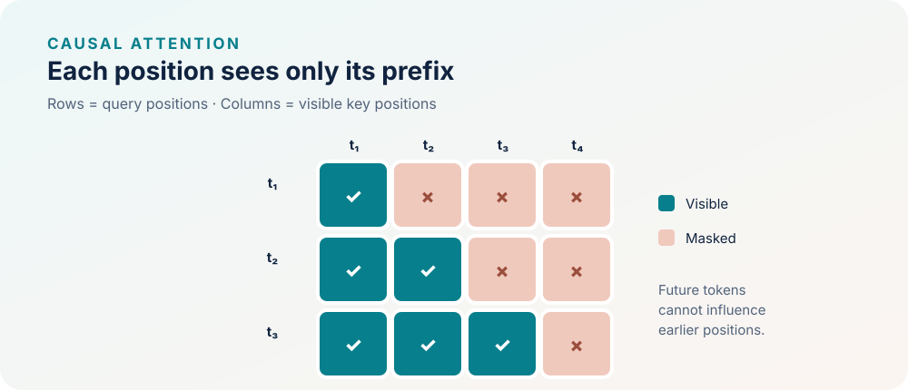

<!--
LLM-LAB-PAGE-MAP v1
id: "en/causal-masking"
scope: "Explains the causal constraint applied to attention scores in an autoregressive model: a position cannot use future positions; distinguishes this mask from next-token selection and from padding or other sequence masks."
purpose: "Readers should be able to read a causal mask, explain which interactions it prevents, and connect the constraint to the autoregressive factorization of a sequence probability."
suggested_route:
  previous: "en/scaled-dot-product-attention"
  next: "en/logits"
hierarchy:
  parents: ["en/scaled-dot-product-attention"]
  children: []
related: ["en/logits"]
tags: ["type:concept-lesson", "destination:understand", "topic:causal-masking", "level:core", "language:en", "status:published"]
-->

::: {.chapter-lead}
Causal masking is an information constraint: to predict the token at position $t+1$, the computation at position $t$ must depend only on the available prefix. It is not merely a visualization convention.
:::

<div class="epistemic-badges">
  <span class="epistemic-badge badge-concept">Verified Concept</span>
  <span class="epistemic-badge badge-code">Executable Invariance Test</span>
  <span class="epistemic-badge badge-status">Architecture: Autoregressive Decoder</span>
</div>

<div class="pipeline-stepper" role="navigation" aria-label="LLM pipeline stages">
  <a class="step-item" href="text-data.qmd">1. Text</a>
  <span class="step-arrow">→</span>
  <a class="step-item" href="embedding-space.qmd">2. Embeddings</a>
  <span class="step-arrow">→</span>
  <span class="step-item active">3. Causal Mask & Attention</span>
  <span class="step-arrow">→</span>
  <a class="step-item" href="logits.qmd">4. Logits</a>
  <span class="step-arrow">→</span>
  <a class="step-item" href="cross-entropy.qmd">5. Loss & Training</a>
</div>

::: {.callout-tip title="The one-minute mental model"}
Causal masking enforces an information rule: **the output at position $i$ must not depend on a token after position $i$**. It blocks the corresponding scores before softmax. The current position is usually allowed because the target is the next token.

**First pass:** inspect the lower-triangular matrix and remember the rule $j\leq i$. This lets the model compute multiple positions in parallel without revealing their future.

**Go deeper:** study API-specific boolean-mask conventions, then the invariance test that detects information leakage.
:::

## Intuition

When training a model to predict the next token, all positions in a sequence can be computed in parallel. Without a mask, however, a position's representation could use tokens that would not yet be known during generation. The mask makes parallel training compatible with the autoregressive objective.

## Definition

For a sequence of length $T$, position $i$ can access positions $j\leq i$. One can define a strict upper-triangular boolean mask or an additive mask $M$:

$$
M_{ij}=
\begin{cases}
0 & j\leq i,\\
-\infty & j>i.
\end{cases}
$$

The additive mask is applied to scores **before** softmax:

$$
A=\operatorname{softmax}\left(\frac{QK^\top}{\sqrt{d_k}}+M\right).
$$

Future positions then receive zero weight in ideal arithmetic. In practice, libraries may represent the mask as a boolean tensor or use an attention primitive that incorporates the constraint.

::: {.callout-note collapse="true" title="Code API conventions (advanced)"}
In code, **boolean-mask polarity is API-specific**. For example, in [PyTorch scaled dot-product attention](https://docs.pytorch.org/docs/stable/generated/torch.nn.functional.scaled_dot_product_attention.html), `True` means that a position is allowed to participate in attention; in [PyTorch MultiheadAttention](https://docs.pytorch.org/docs/stable/generated/torch.nn.MultiheadAttention.html), `True` in `attn_mask` means that the position is masked out. Do not transfer a boolean mask between APIs without checking its documented convention. This is separate from the causal rule itself: the allowed query-key pairs must still exclude future keys.
:::

{fig-alt="Lower-triangular matrix: each position can access itself and all earlier positions" width=100%}

## Provenance and purpose

Causal masking supports an autoregressive factorization of the sequence distribution:

$$
P(x_1,\ldots,x_T)=\prod_{t=1}^{T}P(x_t\mid x_{<t}).
$$

In a common training convention, the output computed at position $i$ is compared with target $x_{i+1}$: inputs and targets are shifted by one token. The mask allows the diagonal $j=i$ because the input at that position contains $x_i$, not the future target $x_{i+1}$. Boundary handling depends, among other things, on the chosen beginning-of-sequence and end-of-sequence token conventions.

Decoder-only Transformers such as GPT use this constraint to learn next-token prediction while computing positions in a training batch in parallel. [*Attention Is All You Need* (Vaswani et al., 2017)](https://arxiv.org/abs/1706.03762) describes masking decoder attention.

## Misconceptions and counterexamples

- **“The data are already ordered, so masking is unnecessary.”** False: token order does not stop an unmasked attention operation from reading representations at future positions.
- **“Zeroing future weights after softmax is equivalent.”** False: the remaining weights may no longer sum to one. Mask the scores before softmax or use an equivalent primitive.
- **“Testing only the mask matrix proves there is no leakage.”** False: another computation path could still pass future information.
- **“Causal means attention sees only the previous token.”** False: it can see all earlier positions unless another restriction, such as a sliding window, is imposed.

<details class="spot-the-fallacy">
<summary>Common Fallacy: “Why bother adding $-\infty$ before softmax? Multiplying future weights by zero after softmax is much simpler!”</summary>
<div class="fallacy-content">
<p><strong>Mathematical refutation:</strong> Softmax normalizes each row so that $\sum_{j=1}^T \alpha_{ij} = 1$. If you evaluate softmax over the unmasked row and subsequently zero out future entries ($\alpha_{ij} = 0$ for $j > i$), the remaining weights will sum to strictly less than one ($\sum_{j \le i} \alpha_{ij} < 1$). The output is no longer a valid convex combination of values, and earlier positions will suffer artificial vector shrinkage. Setting $M_{ij} = -\infty$ <em>prior</em> to exponentiation ensures $e^{-\infty} = 0$, so the denominator correctly normalizes over allowed past keys only.</p>
</div>
</details>

::: {.callout-note collapse="true" title="Causal invariance test (optional)"}
To strictly verify the absence of future information leakage: keep tokens up to position $t$ unchanged, modify a token at position $t' > t$, and verify that all outputs at positions $\le t$ remain numerically identical.

::: {.micro-workbench}
::: {.micro-workbench-header}
<span>NUMERICAL WORKBENCH · CAUSAL INVARIANCE TEST (NO FUTURE LEAKAGE)</span>
<span>Python 3.12+ / NumPy</span>
:::
::: {.micro-workbench-body}
```python
import numpy as np

# 1. Additive causal mask matrix (T=4 positions)
T = 4
mask = np.full((T, T), -np.inf)
mask[np.tril_indices(T)] = 0.0

# 2. Synthetic token representations for T=4 in dimension d=4
np.random.seed(42)
Q = np.random.randn(T, 4)
K = np.random.randn(T, 4)
V = np.random.randn(T, 4)

def run_causal_attention(q, k, v, m):
    scores = (q @ k.T) / np.sqrt(k.shape[-1]) + m
    exp_scores = np.exp(scores - np.max(scores, axis=-1, keepdims=True))
    exp_scores[~np.isfinite(scores)] = 0.0
    weights = exp_scores / np.sum(exp_scores, axis=-1, keepdims=True)
    return weights @ v, weights

out_ref, w_ref = run_causal_attention(Q, K, V, mask)

# 3. Massive alteration of a FUTURE token (position 3)
K_alt = K.copy()
V_alt = V.copy()
K_alt[3] += 100.0
V_alt[3] += 100.0

out_alt, w_alt = run_causal_attention(Q, K_alt, V_alt, mask)

# 4. Strict mathematical invariance: outputs at positions 0, 1, and 2 are IDENTICAL
assert np.allclose(out_ref[:3], out_alt[:3]), "Future leakage detected!"
assert not np.allclose(out_ref[3], out_alt[3]), "Position 3 was expected to change."
```
:::
::: {.micro-workbench-footer}
Formal invariance test passed: changing future representations has zero effect on past and present hidden states.
:::
:::
:::

## Connections to other concepts

- [Queries, keys, and values](queries-keys-values.qmd) defines the projections that produce scores.
- [Scaled dot-product attention](scaled-dot-product-attention.qmd) explains the score → mask → softmax → aggregation sequence.
- [Objective and mathematical foundations](mathematical-foundations.qmd) connects the constraint to next-token prediction and loss.
- The [Transformer overview](transformer.qmd) places masking in the full architecture.

::: {.callout-note collapse="true" title="Reference code and tests (advanced)"}
A tested reference implementation is available in `src/llm_lab/foundations/attention.py` (`causal_mask` and `scaled_dot_product_attention`). The test suite in `tests/unit/test_attention.py` includes this causal invariance test, mask shape validations, and numerical checks.

- [Causal mask implementation](https://github.com/JM-Brun/llm-lab/tree/main/src/llm_lab/foundations/attention.py)
- [Temporal invariance unit tests](https://github.com/JM-Brun/llm-lab/tree/main/tests/unit/test_attention.py)
- [Planned acceptance criteria](https://github.com/JM-Brun/llm-lab/blob/main/docs/roadmap.md#deferred--causal-attention-implementation)
:::

<div class="route-nav-cards">
  <a class="route-nav-card" href="scaled-dot-product-attention.qmd">
    <span class="nav-direction">← Previous Step</span>
    <span class="nav-title">Scaled Dot-Product Attention</span>
  </a>
  <a class="route-nav-card" href="logits.qmd">
    <span class="nav-direction">Next Step →</span>
    <span class="nav-title">Logits: scores before normalization</span>
  </a>
</div>

:::: {.language-switch}
**Language:** [Français](../fr/causal-masking.qmd) · [English](causal-masking.qmd)
::::