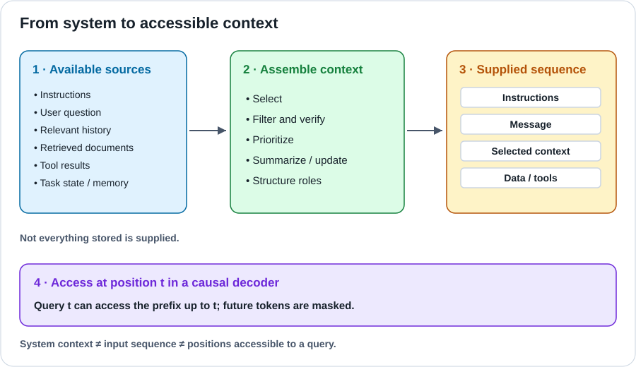

<!--
LLM-LAB-PAGE-MAP v1
id: "en/context-engineering"
summary: "Defines context engineering and locates its main operations within an LLM system."
scope: "Moves from model behavior to system-level context design under budget and reliability constraints."
purpose: "Choose what information to supply for a task and diagnose a failure by inspecting the context actually passed to the model."
suggested_route:
  previous: "en/in-context-learning"
  next: null
hierarchy:
  parents: []
  children: []
related: ["en/in-context-learning", "en/contextualized-representations", "en/generation", "en/post-training", "en/llm-evolution", "en/llm-limits", "en/rag-memory-boundaries", "en/document-retrieval", "en/context-engineering-exercises"]
revision_support:
  status: integrated_sufficient
  evidence:
    - anchor: revision-summary
      note: "The three context levels and distinctions from RAG, memory and ICL are summarized in the key takeaways; seven Practice questions test selection, transmission, causal access, provenance and evaluation."
tags: ["type:concept-lesson", "destination:understand", "topic:context-engineering", "level:core", "language:en", "status:published"]
-->



::: {.chapter-lead}
**Context engineering** is the discipline of designing and managing the information a system makes available to a model at inference time. Its goal is to provide task-relevant elements in a usable form: instructions, history, examples, retrieved documents, tool results, and task state.
:::

## From a prompt to a system context

A prompt is often understood as text written by the user. In a real application, the model input may be a structured assembly of instructions defining the role and constraints, the current message, relevant conversation history, demonstration examples, retrieved documents, tool results, and selected task state or memory.

The **context actually supplied** is the selection and organization of these elements for a particular model call. Not everything stored by the application is necessarily sent to the model. Depending on model and API capabilities, context may also contain multimodal payloads (such as images or audio) and structured tool descriptions, not only text.

## A design example

An assistant must answer a question about a software repository. A useful context might combine response instructions and security rules, the user's question, relevant decisions from the conversation, file excerpts retrieved for this question, and tool results explicitly associated with their provenance.

Injecting the entire repository and conversation history without selection is rarely useful. It is also important to distinguish observed code from instructions: a file may contain malicious or outdated text that must not become an instruction to the model.

## Three levels of context that should not be confused

| Level | What is available |
|---|---|
| **System context** | For a given call, the application selects which instructions, messages, examples, retrieved documents, tool results, and memory items to supply. Stored history or memory enters this call only if the system selects and supplies it. |
| **Input sequence and context window** | The model processes the supplied sequence, which may include structured multimodal elements. Active-context length counts the tokens actually present. The context window sets the maximum token budget, with input and output counting conventions that depend on the model and API. In autoregressive generation, generated tokens are appended to the sequence. |
| **Context accessible at a position** | The architecture, mask, and available window determine which positions a query can attend to. In a causal decoder, attention at position $t$ excludes future positions even if their tokens occur in the input sequence. |

<figure id="fig-context-engineering-levels">
  <picture>
    <source media="(max-width: 600px)" srcset="../images/context-engineering-en-mobile.svg">
    
  </picture>
  <figcaption>Three levels follow without being conflated: information available to the system, the sequence actually supplied (within the context-window budget), and the positions accessible to a particular query. Not everything stored is necessarily sent, and not everything sent is visible from every position.</figcaption>
</figure>

[Contextualized representations](contextualized-representations.qmd) are the hidden vector states the Transformer computes from the tokens accessible at each position. These states are outputs of computation on the sequence, distinct from information the system supplies or stores.

## Why the context window is not enough

The **context window** describes a capacity limit measured in tokens. It does not guarantee that all useful information is present, or that the model will use it correctly.

A longer context can help when it adds relevant evidence. It can also hurt when it accumulates noise, repetition, conflicting instructions, or poorly selected documents. Information position, readability, and trustworthiness matter too. The goal is not to fill the window, but to build a context suited to the task within capacity, cost, and security constraints.

## Definition and main operations

Context engineering is not a particular model feature, nor a standard with a universally fixed scope. It is an engineering practice for LLM systems, not a Transformer layer or a new network architecture. It includes:

1. **Selecting** task-relevant information and excluding noise.
2. **Retrieving** useful knowledge at the right time, for example through search or RAG.
3. **Structuring** messages, instructions, examples, and data so their roles are clear.
4. **Prioritizing** important information and placing critical elements where they remain accessible.
5. **Compressing** or summarizing history without losing necessary facts.
6. **Updating** state and removing stale or contradictory information.
7. **Securing** boundaries between trusted instructions, untrusted data, and tool outputs.
8. **Evaluating** effects on quality, robustness, latency, and cost.

These operations form a design-and-observation loop, not a single recipe. Their importance depends on the task and architecture.

ICL describes a model capability or behavior; context engineering describes the system-design work that prepares its input. Good context can support ICL, but the two concepts are not synonyms.

## Limitations and failure modes

- **Missing context:** information that is absent generally cannot guide the response.
- **Noise and contradictions:** excessive information or incompatible instructions can degrade the answer.
- **Position effects:** information being present does not mean it will be used reliably.
- **Indirect prompt injection:** a document or tool result may contain untrusted instructions.
- **Freshness and provenance:** retrieved information may be stale, misattributed, or irrelevant.
- **Cost and latency:** retrieving, processing, and sending more context has a cost.

Context engineering can reduce some risks, but it does not guarantee truth, instruction compliance, or complete security. It must be combined with appropriate controls, permissions, and evaluation.

## How can context be evaluated?

Establish a baseline, add one source or example at a time, test questions with known answers, introduce irrelevant or contradictory documents in a controlled environment, then measure accuracy, source faithfulness, robustness, cost, and latency. An observed improvement on a test set is not a general guarantee: a context that performs well on a few examples may fail on other tasks or distributions.

## Key takeaways {#revision-summary}

- Context is the information actually supplied to the model for a call, not just the latest user message.
- Context engineering organizes that context through selection, retrieval, structure, prioritization, compression, updating, security, and evaluation.
- Prompt engineering is one part of it, not a synonym.
- RAG, memory, and tool results can contribute to context; they are not interchangeable with it.
- A larger window or longer context does not guarantee a better answer.

## Practice

[Trace what carries over to the next call](exercises/context-engineering.qmd#ex-context-between-calls) or explore the [context engineering exercises](exercises/context-engineering.qmd).

Start from the same prefix. If the first generated token differs from the first observed token, which prefix gives the second distribution in each case? [Compare generation and scoring over two steps](exercises/likelihood.qmd#ex-generation-versus-scoring).



::: {.language-switch}
**Language:** [Français](../fr/context-engineering.qmd) · [English](context-engineering.qmd)
:::

:::: {.supplementary-resources}

Supplementary resources

::: {.learning-resources__content}

### Distinguishing neighboring concepts

| Concept | What it refers to |
|---|---|
| **Prompt engineering** | Formulating and organizing a prompt's instructions and examples. |
| **In-context learning (ICL)** | A phenomenon in which a model adapts its behavior from information and demonstrations in context, without updating its parameters. |
| **Context engineering** | The broader work of selecting, retrieving, structuring, updating, and securing all the context supplied to the model. |
| **RAG** | An architecture that retrieves external information and injects it into context; it is one technique context engineering can use. |
| **Memory** | A mechanism for retaining and reusing information across interactions; it can supply context but is not itself the context window. |
| **Tool use** | A system capability to request an external action; tool descriptions and results may enter context. Context engineering determines how they are presented and controlled. |
| **Agent engineering** | The design of an agent's decision, action, observation, and control loop; it uses context engineering but is not reducible to it. |
| **Fine-tuning** | Adaptation that changes model parameters through optimization rather than only changing the information supplied at inference. |

### RAG and memory: supplying context without confusing the mechanisms

**Document retrieval** selects documents or passages from an external collection. **RAG** adds a pipeline that filters results, assembles evidence, and supplies it to the model. Retriever families, visual search, and ranking evaluation are covered in [Document retrieval](document-retrieval.qmd); the full lifecycle, its failure modes, and provenance concerns are covered in [RAG, memory, and context transmission](rag-memory-boundaries.qmd).

**Persistent memory** retains information across calls or conversations. It can supply context, but a stored or retrieved fact is not automatically transmitted: the system must still select it and include it in the input, or make it available through an invoked tool. This boundary between found information and supplied information is essential.

**ICL**, finally, describes what the model does with information and demonstrations actually present in its context, without updating its parameters. RAG, memory, and ICL can work together, but answer different questions: retrieving, retaining, supplying, and using information.

### References

- Anthropic, [*Effective context engineering for AI agents*](https://www.anthropic.com/engineering/effective-context-engineering-for-ai-agents).
- Liu et al. (2024), [*Lost in the Middle: How Language Models Use Long Contexts*](https://arxiv.org/abs/2307.03172).
- OWASP, [*LLM Prompt Injection Prevention Cheat Sheet*](https://cheatsheetseries.owasp.org/cheatsheets/LLM_Prompt_Injection_Prevention_Cheat_Sheet.html).

:::

::::
