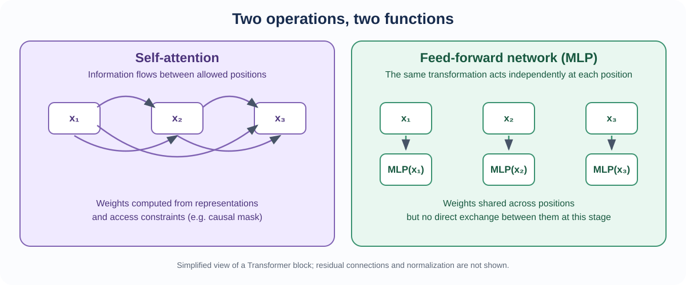

<!--
LLM-LAB-PAGE-MAP v1
id: "en/contextualized-representations-advanced"
summary: "Formalizes contextual dependencies, deepens Transformer blocks, and relates the conceptual model to empirical findings about representations and layers."
scope: "Deepens contextualization after the initial lookup: positional handling, accessible positions, Transformer-block dependencies, self-attention and MLP, the residual stream, normalization, empirical studies of contextuality, and layer probing."
domain: "architectures-mechanisms"
purpose: "Formalize which positions may contribute to a hidden state, distinguish causal decoders from bidirectional encoders, explain Transformer sublayers, and critically interpret empirical findings about contextuality, representation geometry, and information decoded across layers."
suggested_route:
  previous: null
  next: null
hierarchy:
  parents: ["en/deepen"]
  children: []
related: ["en/contextualized-representations", "en/queries-keys-values-advanced", "en/rope", "en/transformer"]
tags: ["type:deep-dive", "destination:deepen", "topic:contextualized-representations-advanced", "level:advanced", "language:en", "status:published"]
-->




This page extends the [introductory explanation of contextualized representations](contextualized-representations.qmd). It assumes readers can already distinguish a token ID, its lookup vector, and a hidden state produced by the network.

## 1. From the initial embedding to the network input

For an architecture that adds absolute positional embeddings, we can write:

$$
h_t^{(0)} = E[\text{ID}_t] + P_t.
$$

The same ID selects the same token-embedding term from a fixed table, but a different position may provide a different positional term. This expression does not describe every architecture. With RoPE, for example, positional information enters through transformations of query and key vectors inside attention, rather than through a universal vector addition to the initial embedding. See [positional encoding and RoPE](positional-encoding.qmd) and [advanced Q/K/V](queries-keys-values-advanced.qmd).

## 2. Formalizing accessible context

We can summarize the conceptual dependency of a state on the next layer as:

$$
h_t^{(\ell+1)} =
F_\ell\!\left(
h_t^{(\ell)},
\{h_j^{(\ell)} : j \in A(t)\}
\right),
$$

where $A(t)$ denotes the positions accessible from position $t$, as determined by the attention mask.

- **Causal decoder** (GPT): using 1-based indexing, $A(t)=\{1,\ldots,t\}$. A position can use its own state and the prefix, never future tokens.
- **Bidirectional encoder**: accessible positions may include the entire sequence, subject to the mask in use.
- **More specific masks**: some architectures further restrict accessible positions, for example through local windows or structured patterns.

Here, $F_\ell$ represents a complete block. This notation describes possible dependencies, not a universal implementation or an exact equation for every internal operation.

## 3. Roles of the sublayers

In a standard Transformer block, the operations have distinct roles:

1. **Self-attention**: each position computes mixing weights over accessible positions and aggregates their value vectors. Q/K/V projections, masking, and score normalization determine this mixture.
2. **MLP / feed-forward network**: then transforms each position independently of other positions at that sublayer, using parameters shared across positions.
3. **Residual connections and normalization**: organize information flow and transformation stability; their exact order depends on the block variant (pre-LN, post-LN, etc.).

### The MLP: a local transformation at each position

*Feed-forward* signals that information flows one way, from input to output, with no interaction between positions and no feedback loop. *MLP* (*multi-layer perceptron*) is the historical name for a chain of linear layers and nonlinear activations. Concretely, this subnetwork projects the representation from \(d_{\mathrm{model}}\) to an intermediate dimension \(d_{\mathrm{ff}}\) (often about four times larger), applies a nonlinear activation, then maps the result back to \(d_{\mathrm{model}}\). Its exact design varies across models.

### Residual connections: add a correction to the stream

Instead of replacing the flowing representation, each sublayer adds a correction. The stream that crosses the whole stack without interruption is called the **residual stream**; the residual connection gives information and gradients a direct path through it:

$$
x_{\text{out}} = x_{\text{in}} + F(x_{\text{in}}).
$$

### Normalization and operation order

Normalization (*LayerNorm* in classic GPT models) centers and rescales the hidden-vector components of each position independently of other positions. It helps control activation scale and supports more favorable gradient flow during optimization. Its effect depends in part on placement: [Xiong et al. (2020)](https://proceedings.mlr.press/v119/xiong20b.html) show that, at initialization, the original Post-LN Transformer can have large gradients near the output, whereas the Pre-LN variant they study has better-behaved gradients. It is therefore too broad to conclude that every deep stack fails without this particular normalization arrangement: stability depends on architecture, initialization, and training choices.

In the **pre-LN** block illustrated below, each sublayer receives a normalized input: \(x' = x + \operatorname{Attention}(\operatorname{LN}(x))\), then \(x'' = x' + \operatorname{MLP}(\operatorname{LN}(x'))\). The opposite arrangement (post-LN) and normalization variants such as RMSNorm differ across models.

```{mermaid}
%%| label: fig-block-prefln
%%| fig-cap: "One pass through a pre-LN block: each sublayer reads a normalized copy of the stream, and its output is added back to the stream (residual connection)."
%%| fig-alt: "Flow diagram: x enters the block; a copy passes through LayerNorm then multi-head attention, and rejoins x at an addition; the result x prime passes through LayerNorm then the MLP, which projects from d_model to d_ff and back to d_model, and rejoins x prime at a second addition, giving x double prime, the block output."
flowchart LR
    X["x — block input"] --> LN1["LayerNorm"]
    LN1 --> ATT["Multi-head attention"]
    ATT --> ADD1["Addition"]
    X -- "residual path" --> ADD1
    ADD1 --> X2["x′ — after attention"]
    X2 --> LN2["LayerNorm"]
    LN2 --> MLP["MLP: d_model to d_ff to d_model"]
    MLP --> ADD2["Addition"]
    X2 -- "residual path" --> ADD2
    ADD2 --> Y["x″ — block output"]
```

The image summarizes the difference in scope between the two sublayers:

{fig-alt="Self-attention allows exchanges between allowed positions; the same feed-forward network is applied separately to each position." width=100%}

| | Self-attention | Feed-forward network (MLP) |
|---|---|---|
| Scope | all positions allowed by the mask | each position, separately |
| Links between positions | yes; the causal mask sets which accesses are allowed | none |
| Weights across positions | shared | shared |
| Dimensions traversed | \(d_{\mathrm{model}}\) to \(d_{\mathrm{model}}\) | \(d_{\mathrm{model}}\) to \(d_{\mathrm{ff}}\), then back to \(d_{\mathrm{model}}\) |
| Question it answers | what to take from the context? | how to transform what was taken? |

Both operations are learned. Attention computes a weighted sum of learned value vectors: it does not literally search through human-readable notes.

### Multi-head attention

Each attention sublayer is in fact **multi-head**: several attentions run in parallel on distinct learned projections, and their results are combined. Each head works in a reduced dimension \(d_{\mathrm{head}}\) (64 for GPT-2), with \(H \times d_{\mathrm{head}} = d_{\mathrm{model}}\) in this configuration: \(12 \times 64 = 768\). This diversity does not guarantee that each head develops a clear, human-interpretable specialization; the projections that feed attention are explained in the [Q/K/V lesson](queries-keys-values.qmd).

Repeating these sublayers evolves hidden states. Section 2 formalizes dependencies across positions and layers; for the detailed computation, see [Q/K/V](queries-keys-values.qmd), [advanced Q/K/V](queries-keys-values-advanced.qmd), and [the Transformer](transformer.qmd).

## 4. Isolating the effect of context in the *bank* example

Consider:

- “The river bank eroded.”
- “The financial bank collapsed.”

To isolate the effect of context, assume a single *bank* token and place both occurrences at the same position (the third word, under the simplifying assumption of one token per word). They therefore share the same ID, initial lookup, and positional treatment at that position, in an architecture whose positional mechanism depends on position.

In a causal decoder, the representational difference at that position can then come from the accessible prefix (*The river* or *The financial*), rather than from a different absolute position. In another example, position and context may both contribute to the difference.

This comparison is a controlled pedagogical setup, not a claim that a model encodes human word senses in sharply separated geometric regions.

## 4 bis. A dependency between positions: pronoun reference

Consider: “The animal was tired because it had been running.” The pronoun “it” refers to “the animal”. This is not a case of disambiguating two senses of one token; it is a relation between distinct positions in the sequence.

The pronoun's representation can incorporate information from its accessible prefix. This example motivates the study of interactions between positions; it does not show that a particular attention head necessarily identifies the antecedent, or that attention alone performs complete coreference resolution.

## 5. Following one position through the layers

$h_t^{(0)}$ denotes the initial input at position $t$. Each block produces a new state, $h_t^{(1)}$, then $h_t^{(2)}$, and so on. The index $t$ stays fixed: we follow the representation at that position through network depth.

The vector is not replaced by a sense label. It is transformed by learned operations that progressively integrate information allowed by the architecture and mask.

## 6. What empirical studies allow us to claim

Studies of contextualized representations provide complementary evidence, but they do not all measure the same object or examine the same architecture.

### Sequence-dependent representations before Transformers

Peters et al. (2018) introduce ELMo (*Embeddings from Language Models*), whose word representations are learned functions of the internal states of a bidirectional LSTM language model. This work establishes the value of context-sensitive representations before Transformers became the dominant architecture. It does not describe GPT self-attention.

### Measuring contextuality and its geometric limits {#measuring-contextuality-geometric-limits}

Ethayarajh (2019) studies ELMo, BERT, and GPT-2. After adjusting for anisotropy, representations of the same word in different contexts remain more similar to one another on average than representations of different words, but this self-similarity decreases in upper layers.

The paper also reports an **average Maximum Explainable Variance (MEV) below 5%** across the studied layers after anisotropy adjustment. MEV estimates the proportion of a word's representation variance explained by its first principal component; in this protocol, it gives an upper bound on what a single static vector could explain. It is therefore neither a raw variance measure nor a direct comparison with any arbitrary pretrained static embedding.

Two qualifications matter:

- this is an aggregate result over the models, layers, and data studied in 2019, not a universal constant for every LLM;
- contextualized representations are anisotropic: a high raw cosine similarity can arise from this geometry and does not by itself establish that two vectors carry the same meaning.

Under this measurement protocol, a static vector explains little of the variability across a word's occurrences; this does not prove that every human word sense corresponds to a distinct geometric region.

### Linguistic information across layers

Tenney, Das, and Pavlick (2019) use probing tasks to investigate where linguistic information is accessible in BERT. On average, they observe a progression from part-of-speech information through syntax, named entities, semantic roles, and coreference. Their qualitative analysis also shows that the model can revise lower-level decisions in light of higher-level contextual information.

A probing result indicates that information can be decoded from a representation under a particular protocol. By itself, it does not demonstrate that the model uses that information as a human would, that a layer has an exclusive function, or that a particular head performs an identifiable linguistic operation.

**Takeaway:** hidden states are context-dependent in the studied models, but their content, geometry, and organization across layers depend on architecture, training objective, model, and measurement method.

Primary references:

- Peters et al. (2018), [*Deep Contextualized Word Representations*](https://aclanthology.org/N18-1202/).
- Ethayarajh (2019), [*How Contextual are Contextualized Word Representations?*](https://aclanthology.org/D19-1006/).
- Tenney, Das, and Pavlick (2019), [*BERT Rediscovers the Classical NLP Pipeline*](https://aclanthology.org/P19-1452/).

## Limits of this formalization

- Hidden states are learned vectors; this notation does not assign them a unique semantic interpretation.
- A computational dependency does not imply that one particular head independently performs an identifiable linguistic task.
- Accessible positions depend on architecture and masking; GPT's causal constraint must not be generalized to bidirectional encoders.
- Block variants may change operation order, normalization, residual connections, and attention mechanisms.

**Takeaway:** lookup fixes the identity of the initial token vector; positional architecture and Transformer blocks then determine how each position's state depends on other accessible states.


## Explore a feature without treating it as a complete explanation

[Neuronpedia](https://www.neuronpedia.org/) supports exploration of features, activations, neurons, attention heads, and attribution graphs. For a first inspection, its documentation uses [Gemma 2 2B · Gemma Scope · layer 20 · residual stream · 16k · feature 10956](https://www.neuronpedia.org/gemma-2-2b/20-gemmascope-res-16k/10956).

A sparse-autoencoder (SAE) feature is a direction/latent variable in a learned decomposition of model activations. It is not automatically one unique human concept, a native neuron, or a complete explanation. A dashboard brings together several kinds of evidence that should be read separately: activation examples, highlighted tokens, associated logits, activation density, and text explanations. Automatic explanations are written by models and can be wrong or overly broad.

**Investigation protocol:**
1. Record the model, release/source, layer, hook, and feature index. The same index in different sources does not identify the same feature.
2. Read the strongest positive activations and several less typical examples. Look for counterexamples where the feature activates without matching the proposed label.
3. Compare the automatic explanation with its supporting examples. Record the model and method that produced it, and any score; an automatic score is not an independent ground-truth measure.
4. Inspect activation density and positive/negative logits. Distinguish activation contexts, tokens whose logits change, and the feature's causal role in overall behaviour.
5. If custom-text inference is available for this source, test positive, negative, and adversarial examples written before the test.
6. State a calibrated conclusion: “the inspected examples are consistent with hypothesis X for this layer/source” is defensible; “the model understands X because of this feature” is not established by this evidence alone.

Attribution graphs and steering tools can extend the investigation, but their interpretation depends on approximations, interventions, and controls. An activation correlated with a pattern, a generated label, or an output changed by steering is not enough to establish a complete causal mechanism. Stronger causal claims require controlled interventions, relevant ablations/controls, and cases that could falsify the hypothesis.

For practice, use the [investigation worksheet](exercises/contextualized-representations.qmd). References: [SAE overview](https://docs.neuronpedia.org/sparse-autoencoders/overview), [feature dashboards](https://docs.neuronpedia.org/sparse-autoencoders/feature-dashboards), [auto-interp](https://docs.neuronpedia.org/sparse-autoencoders/auto-interp), [key concepts](https://docs.neuronpedia.org/getting-started/key-concepts).

## Continue exploring

- [Return to the contextualized-representations lesson](contextualized-representations.qmd) — the essential mental model.
- [Deepen Q/K/V](queries-keys-values-advanced.qmd) — projections and the attention calculation.
- [Return to the Deepen map](deepen.qmd).

::: {.language-switch}
**Language:** [Français](../fr/contextualized-representations-advanced.qmd) · [English](contextualized-representations-advanced.qmd)
:::
