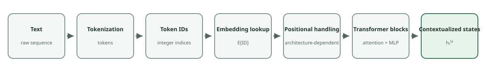

<!--
LLM-LAB-PAGE-MAP v1
id: "en/contextualized-representations"
summary: "Shows how Transformer layers turn initial vectors into context-dependent states, allowing the same token to have different representations in different contexts."
scope: "Explains how Transformer layers turn initial embeddings into context-dependent vectors and why the same ID can therefore have different contextualized states depending on position and context; distinguishes these states from the static vectors in the embedding table."
purpose: "Readers should be able to explain why two occurrences of the same token share an initial embedding but can have different contextualized representations, and connect this difference to processing by Transformer layers."
suggested_route:
  previous: "en/positional-encoding"
  next: "en/transformer"
hierarchy:
  parents: ["en/embedding-space", "en/positional-encoding"]
  children: []
related: ["en/queries-keys-values", "en/transformer", "en/contextualized-representations-exercises"]
tags: ["type:concept-lesson", "destination:understand", "topic:contextualized-representations", "level:core", "language:en", "status:published"]
-->



::: {.callout-note .learning-outcomes collapse="true" title="Learning outcomes"}
By the end of this lesson, you should be able to:
- explain why two occurrences of the same token ID share an initial embedding yet produce distinct contextualized hidden states;
- identify exactly when positional information and sequential interactions transform internal activations;
- refute the misconception that attributes semantic comprehension or contextual disambiguation to the initial embedding lookup.
:::

::: {.chapter-lead}

  Verified concept
  Architecture: Transformer Blocks

Two sentences can contain the same token without giving it the same role: *bank* refers to a river edge in one and a financial institution in the other. Yet the tokenizer may assign the same ID to both occurrences. **The lookup does not change; the Transformer's processing of the sequence builds hidden states that depend on context.**
:::

::: {.callout-tip title="The one-minute mental model"}
- **Same ID, same lookup:** with a fixed matrix, both occurrences select the same row.
- **Position:** the architecture introduces order through its positional mechanism (absolute embeddings, RoPE, etc.).
- **Context:** each block transforms a position's state using the tokens it can access.
- **Result:** hidden states can differ, without guaranteeing a clean geometric representation of human “senses.”

**Quick question:** how can two occurrences share the same initial vector yet have different hidden states?
:::

  
<strong>Token embeddings</strong>Initial vectors retrieved by lookup

  
<strong>Positional signal</strong>Injected at an architecture-dependent point

  

    
<strong>Absolute encoding</strong><small>Add the position vector to the input, before Transformer layers</small>

    
<strong>RoPE</strong><small>Rotate Q/K inside the attention mechanisms of Transformer layers</small>

  

  
<strong>Repeated Transformer layers</strong><small>Attention, MLP, residual connections and normalization</small>

  
<strong>Contextualized representations</strong><small>Each state depends on content and the interactions allowed with context</small>

{.pipeline-figure fig-alt="Text is tokenized into IDs; IDs select vectors from the embedding table; the model handles position and Transformer blocks produce contextualized states." fig-cap="From text to contextualized states: each stage transforms or enriches the representation, from symbols to context-dependent hidden states." width=100%}

This is an original, simplified illustration, not a reproduction of Rushang Chauhan's figure. For another pedagogical overview of the path from tokens to context, see [Rushang Chauhan's article, *Embeddings: The Bridge Between Tokens and Context*](https://www.linkedin.com/pulse/embeddings-bridge-between-tokens-context-rushang-chauhan-oqpzf/).

## Start with what stays the same

Suppose the visible word `bank` is represented by the same token ID in two sentences:

- “The river bank eroded.”
- “The financial bank collapsed.”

Under that explicit assumption, both occurrences retrieve the same initial embedding:

$e_{\text{bank}} = E[\text{ID}_{\text{bank}}]$

The embedding lookup is a table access. It does not inspect the surrounding words, infer which sense is intended, or produce a sentence-specific vector.

One qualification: a visible word is not guaranteed to correspond to one token. A tokenizer may split it into several tokens. This example isolates the contextualization principle by assuming one shared token ID.

## What changes with position and context

The initial lookup is not the whole network input: the architecture must also handle position, and Transformer blocks then build states that depend on accessible context. Positional mechanisms vary across models; a position vector is therefore not always added directly to the embedding.

### Another dependency: pronoun reference

Now consider: *“The animal was tired because it had been running.”* Here, the pronoun `it` refers to `the animal`. This is not a case of one word having two possible senses; it illustrates a dependency between different positions in a sequence. To build a context-dependent representation for `it`, the model can use information from other tokens in its context.

This example is used as a pedagogical motivation in [Nishanthan K's tutorial on Q, K, and V](https://dev.to/nishanthan-k/how-query-key-and-value-qkv-work-in-transformers). It does not show that a particular attention head necessarily identifies the antecedent, or that attention alone performs complete coreference resolution. It complements the lexical-ambiguity example (*bank*) by illustrating a relation between tokens (*it* / *the animal*).

In the running example, “What have the Romans ever done for us?” is already in the context. As “They built roads between distant towns.” is generated, each new token is processed against the context available at that step, which grows throughout the loop.

For the dependencies between positions, causal masks, and the distinct roles of self-attention and the MLP, see the [deep dive on contextualized representations](contextualized-representations-advanced.qmd). The detailed formalization is deliberately separated from this first explanation.

Common Fallacy: “For two senses of a word like 'bank' to be captured, the tokenizer must assign them different token IDs”

<strong>Counterexample:</strong> A tokenizer segments text using its vocabulary and segmentation rules; it does not perform sentence-level semantic disambiguation. In this example, we explicitly assume that both occurrences of “bank” receive the same ID. The model's layers can then build different hidden states from their accessible contexts. Requiring separate IDs for each sense confuses token segmentation with contextual disambiguation.

{fig-alt="Two sequences place bank at the same simplified position. Both occurrences share the same initial lookup, while each Transformer block combines that state with the sequence-specific accessible context before producing a hidden state that may differ." fig-cap="Same token ID and same simplified position: the lookup is identical. The accessible prefixes differ, so hidden states may differ." width=100%}

This original illustration is motivated by [Ethayarajh (2019), *How Contextual are Contextualized Word Representations?*](https://arxiv.org/abs/1909.00512). It illustrates the principle, not measured vectors. Depending on the tokenizer, a visible word may consist of multiple tokens.

## Keep the stages and representations separate

| Object | What determines it? | Is it context-dependent? |
|---|---|---|
| Token ID | Tokenizer vocabulary and rules | No; it identifies a vocabulary entry |
| Initial token embedding | The selected row of the embedding matrix | No, for a fixed matrix and token ID |
| Hidden state at layer $\ell$ | Previous layer's state, positional information, and tokens accessible under the mask | Yes, in general |

Two common confusions follow from collapsing these stages:

- **“The embedding lookup understands the sentence.”** No. The lookup selects a learned row; context is incorporated by subsequent network operations.
- **“The same token must have the same hidden state everywhere.”** No. The initial lookup can be shared while position and context change later representations.

This also does not guarantee that the model will represent human-interpreted senses as cleanly separated clusters. Contextualization is a computational mechanism, not a guarantee of a particular semantic geometry.

## Where this fits in the model

1. The tokenizer maps text to token IDs.
2. The embedding table maps each ID to an initial vector.
3. The architecture introduces positional information according to its design.
4. Transformer layers produce context-dependent hidden states.
5. Later layers and the output head use those states to predict the next token.

The [embedding-space lookup](embedding-space.qmd) maps IDs to initial vectors. To see how the network then transforms these vectors into contextualized states, continue with [The Transformer in a GPT](transformer.qmd): that page locates the stack of blocks and distinguishes attention from the MLP. The [Q/K/V](queries-keys-values.qmd) and [scaled dot-product attention](scaled-dot-product-attention.qmd) pages then unpack the attention mechanism.



::: {.language-switch}
**Language:** [Français](../fr/contextualized-representations.qmd) · [English](contextualized-representations.qmd)
:::

  Supplementary resources
  Experiment, explore further, and practise the ideas from this lesson.

### Practice

The questions and exercises for this lesson are collected on its [dedicated practice page](exercises/contextualized-representations.qmd).

::: {.self-check}
## Check your understanding

[Dedicated exercises](exercises/contextualized-representations.qmd).

Two occurrences of the same token ID appear in different sentences.

1. Does the embedding lookup return the same initial vector?
2. Must their hidden states remain identical after the Transformer layers?
3. At what stage does contextual information enter the computation?

Show the reasoning

With a fixed embedding matrix, the same token ID selects the same row. Hidden states can differ after the Transformer layers combine positional information with information from other accessible tokens. The lookup itself does not disambiguate the word's meaning.

:::

