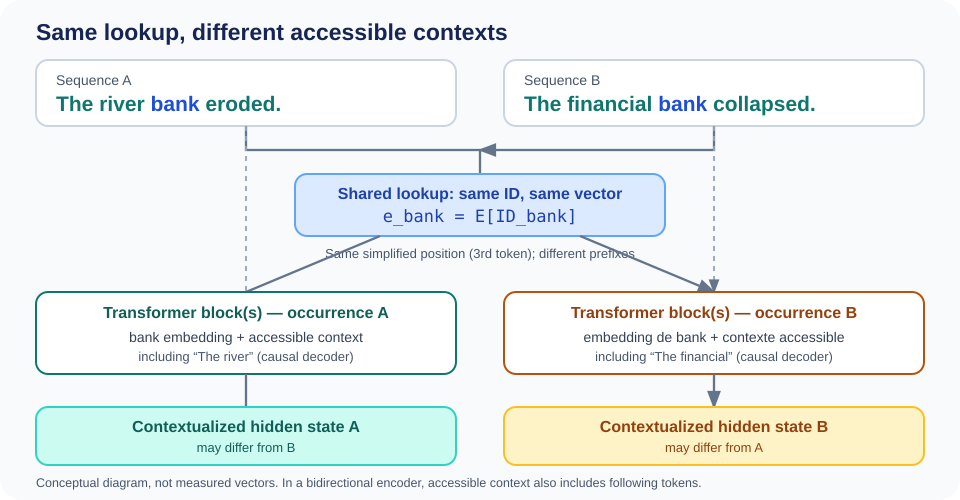

<!--
LLM-LAB-PAGE-MAP v1
id: "en/contextualized-representations"
summary: "Shows how Transformer layers turn initial vectors into context-dependent states, allowing the same token to have different representations in different contexts."
scope: "Explains how Transformer layers turn initial embeddings into context-dependent vectors and why the same ID can therefore have different contextualized states depending on position and context; distinguishes these states from the static vectors in the embedding table."
purpose: "Readers should be able to explain why two occurrences of the same token share an initial embedding but can have different contextualized representations, and connect this difference to processing by Transformer layers."
suggested_route:
  previous: "en/positional-encoding"
  next: "en/transformer"
hierarchy:
  parents: ["en/embedding-space", "en/positional-encoding"]
  children: []
related: ["en/queries-keys-values", "en/transformer", "en/contextualized-representations-exercises"]
tags: ["type:concept-lesson", "destination:understand", "topic:contextualized-representations", "level:core", "language:en", "status:published"]
-->



:::

::: {.callout-note .learning-outcomes collapse="true" title="Learning outcomes"}
By the end of this lesson, you should be able to:
- explain why two occurrences of the same token ID share an initial embedding yet produce distinct contextualized hidden states;
- identify exactly when positional information and sequential interactions transform internal activations;
- refute the misconception that attributes semantic comprehension or contextual disambiguation to the initial embedding lookup.
:::

<div class="epistemic-badges">
  <span class="epistemic-badge badge-concept">Verified concept</span>
  <span class="epistemic-badge badge-status">Architecture: Transformer Blocks</span>
</div> {.chapter-lead}
Two sentences can contain the same token without giving it the same role: *bank* refers to a river edge in one and a financial institution in the other. Yet the tokenizer may assign the same ID to both occurrences. **The lookup does not change; the Transformer's processing of the sequence builds hidden states that depend on context.**
:::

::: {.callout-tip title="The one-minute mental model"}
- **Same ID, same lookup:** with a fixed matrix, both occurrences select the same row.
- **Position:** the architecture introduces order through its positional mechanism (absolute embeddings, RoPE, etc.).
- **Context:** each block transforms a position's state using the tokens it can access.
- **Result:** hidden states can differ, without guaranteeing a clean geometric representation of human “senses.”

**Check yourself:** how can two occurrences share the same initial vector yet have different hidden states?
:::

{fig-alt="A schematic pipeline: text is tokenized into IDs, IDs select rows in a learned embedding table, positional information is handled, attention layers process the sequence, and contextual representations are produced." fig-cap="Overview illustration by Rushang Chauhan. The position-handling stage is schematic: architectures such as RoPE do not simply add a position vector to each token embedding. See the explanation below and the page on positional encoding." width=100%}

The figure is reproduced from Rushang Chauhan's LinkedIn article, [*Embeddings: The Bridge Between Tokens and Context*](https://www.linkedin.com/pulse/embeddings-bridge-between-tokens-context-rushang-chauhan-oqpzf/). It provides an orientation map; the sections below specify the architectural distinctions that a high-level diagram necessarily compresses. Asset-level reuse review is pending in [#156](https://github.com/JM-Brun/llm-lab/issues/156); the existing illustration is retained unchanged while its provenance and applicable permissions are checked.

## Start with what stays the same

Suppose the visible word `bank` is represented by the same token ID in two sentences:

- “The river bank eroded.”
- “The financial bank collapsed.”

Under that explicit assumption, both occurrences retrieve the same initial embedding:

\[
e_{\text{bank}} = E[\text{ID}_{\text{bank}}].
\]

The embedding lookup is a table access. It does not inspect the surrounding words, infer which sense is intended, or produce a sentence-specific vector.

A qualification matters: a visible word is not guaranteed to correspond to one token. A tokenizer may split it into several tokens. This example isolates the contextualization principle by assuming one shared token ID.

### Another dependency: pronoun reference

Now consider: *“The animal was tired because it had been running.”* Here, the pronoun `it` refers to `the animal`. This is not a case of one word having two possible senses; it illustrates a dependency between different positions in a sequence. To build a context-dependent representation for `it`, the model can use information from other tokens in its context.

This example is used as a pedagogical motivation in [Nishanthan K's tutorial on Q, K, and V](https://dev.to/nishanthan-k/how-query-key-and-value-qkv-work-in-transformers). It does not show that a particular attention head necessarily identifies the antecedent, or that attention alone performs complete coreference resolution. It complements the lexical-ambiguity example (*bank*) by illustrating a relation between tokens (*it* / *the animal*).

## What changes with position and context?

The two occurrences appear in different sequences and have different neighbours. Their absolute positions may vary with the sentence and tokenization; the exact handling of position depends on the architecture.

For a model using learned absolute position embeddings, the initial input at position \(t\) may be written:

\[
h_t^{(0)} = E[\text{ID}_t] + P_t.
\]

The same token ID gives the same token-embedding term, but a different position may give a different positional term. Architectures using RoPE handle position differently: it modifies query and key vectors inside attention rather than adding an absolute position vector to the token embedding. See [positional encoding and RoPE](positional-encoding.qmd).

Transformer blocks build these states by allowing information to flow between accessible positions. We can describe this dependency conceptually as:

\\[
h_t^{(\\ell+1)} = F_\\ell\\!\\left(h_t^{(\\ell)},\\{h_j^{(\\ell)} : j \\in A(t)\\}\\right),
\\]

where \\(A(t)\\) denotes the positions accessible from position \\(t\\), as determined by the attention mask. In a causal decoder such as GPT, \\(A(t)=\\{1,\\ldots,t\\}\\): the current token and its prefix, never future tokens. In a bidirectional encoder, accessible positions may include the entire sequence. Here, \\(F_\\ell\\) represents a complete block; the expression summarizes its dependencies, not its detailed implementation.

More concretely, self-attention lets a position aggregate information from accessible positions. The MLP then transforms each position independently, using shared weights. Repeated at every layer, these operations evolve the hidden states. For the detailed computation, see [Q/K/V](queries-keys-values.qmd) and [the Transformer architecture](transformer.qmd).

In the *bank* example, both occurrences deliberately occupy the same position in the sentence (the third word, under the simplifying assumption of one token per word). With learned absolute position embeddings, they therefore receive the same positional term; with a mechanism such as RoPE, their position is also identical. For a causal decoder, the difference in their states then comes from the accessible prefix (*The river* or *The financial*), not from a different absolute position. In other examples, position and context may both contribute.

States then evolve from block to block: \(h_t^{(0)}\) denotes the initial input at position \(t\), and each block produces \(h_t^{(1)}\), \(h_t^{(2)}\), and so on. The vector is not replaced by a sense label; it is transformed by learned operations that progressively integrate information.

::: {.micro-workbench}
::: {.micro-workbench-header}
MICRO-WORKBENCH · CONTEXTUAL DIVERGENCE OF A SHARED TOKEN (NUMPY)
:::
::: {.micro-workbench-body}
```python
import numpy as np

# Vocabulary matrix V=6, dimension d=2
E = np.array([
    [0.1, 0.2],   # 0: river
    [0.9, -0.4],  # 1: financial
    [0.5, 0.5],   # 2: bank (same ID in both contexts)
    [0.0, 0.1],   # 3: eroded
    [0.8, 0.2],   # 4: collapsed
    [0.2, 0.7],   # 5: pad
], dtype=np.float64)

# Two sequences containing the same token (ID 2) at position 1
seq_A = np.array([0, 2])  # [river, bank]
seq_B = np.array([1, 2])  # [financial, bank]

# 1. Initial embedding lookup
x_A = E[seq_A]
x_B = E[seq_B]

# Invariant 1: initial embedding of 'bank' is strictly identical
assert np.array_equal(x_A[1], x_B[1])
assert np.array_equal(x_A[1], E[2])

# 2. Add absolute position encoding (identical at position 1)
P = np.array([[0.01, 0.00], [0.02, 0.05]], dtype=np.float64)
z_A = x_A + P
z_B = x_B + P
assert np.array_equal(z_A[1], z_B[1])

# 3. Causal contextual aggregation: position 1 integrates its context (pos 0)
# Illustrative causal attention weights: 40% context (pos 0), 60% self (pos 1)
h_A_1 = 0.4 * z_A[0] + 0.6 * z_A[1]
h_B_1 = 0.4 * z_B[0] + 0.6 * z_B[1]

# Invariant 2: contextualized representations are now distinct!
assert not np.allclose(h_A_1, h_B_1)
diff = float(np.linalg.norm(h_A_1 - h_B_1))
print(f"Identical initial embedding: {x_A[1]}")
print(f"Contextualized state A (river bank): {h_A_1}")
print(f"Contextualized state B (financial bank): {h_B_1}")
print(f"Divergence induced by context: {diff:.4f}")
```
:::
::: {.micro-workbench-footer}
Context transforms hidden states: identical initial lookups ($E[\text{ID}]$) produce distinct activations after sequence aggregation.
:::
:::

<details class="spot-the-fallacy">
<summary>Common Fallacy: “For two senses of a word like 'bank' to be captured, the tokenizer must assign them different token IDs”</summary>
<div class="fallacy-content">
<p><strong>Counterexample:</strong> The tokenizer operates purely on surface statistics and byte sequences (e.g. BPE) without sentence-level comprehension; it assigns the exact same integer ID to "bank" whether it refers to a financial institution or a river bank. Attention layers subsequently mix context-specific information to specialize the hidden representation $h_t^{(\ell)}$. Demanding separate IDs for different meanings would require solving semantic disambiguation before the model even begins.</p>
</div>
</details>

{fig-alt="Two sequences place bank at the same simplified position. Both occurrences share the same initial lookup, while each Transformer block combines that state with the sequence-specific accessible context before producing a hidden state that may differ." fig-cap="Same token ID and same simplified position: the lookup is identical. The accessible prefixes differ, so hidden states may differ." width=100%}

This original illustration is motivated by [Ethayarajh (2019), *How Contextual are Contextualized Word Representations?*](https://arxiv.org/abs/1909.00512). It illustrates the principle, not measured vectors. Depending on the tokenizer, a visible word may consist of multiple tokens.

## Keep the stages and representations separate

| Object | What determines it? | Is it context-dependent? |
|---|---|---|
| Token ID | Tokenizer vocabulary and rules | No; it identifies a vocabulary entry |
| Initial token embedding | The selected row of the embedding matrix | No, for a fixed matrix and token ID |
| Hidden state at layer \(\ell\) | Previous layer's state, positional information, and tokens accessible under the mask | Yes, in general |

Two common confusions follow from collapsing these stages:

- **“The embedding lookup understands the sentence.”** No. The lookup selects a learned row; context is incorporated by subsequent network operations.
- **“The same token must have the same hidden state everywhere.”** No. The initial lookup can be shared while position and context change later representations.

This also does not guarantee that the model will represent human-interpreted senses as cleanly separated clusters. Contextualization is a computational mechanism, not a guarantee of a particular semantic geometry.

## Where this fits in the model

To place this transformation in the full learning path:

1. The tokenizer maps text to token IDs.
2. The embedding table maps each ID to an initial vector.
3. The architecture introduces positional information according to its design.
4. Transformer layers produce context-dependent hidden states.
5. Later layers and the output head use those states to predict the next token.

The [embedding-space lookup](embedding-space.qmd) maps IDs to initial vectors. To see how the network then transforms these vectors into contextualized states, continue with [The Transformer in a GPT](transformer.qmd): that page locates the stack of blocks and distinguishes attention from the MLP. The [Q/K/V](queries-keys-values.qmd) and [scaled dot-product attention](scaled-dot-product-attention.qmd) pages then unpack the attention mechanism.

::: {.self-check}
## Check your understanding

The questions and exercises for this lesson are collected on its [dedicated practice page](exercises/contextualized-representations.qmd).

[Extended exercises on this topic](../en/exercises.qmd#transformer).

Two occurrences of the **same token ID** appear in two different sentences. Assume the embedding matrix is unchanged:

1. Are the vectors returned by the embedding lookup identical?
2. Must the hidden states after the Transformer layers also be identical? Why?
3. At which stage does contextual information enter the computation?
4. In the *bank* example, what is held constant to isolate the effect of context?

You have understood this step if you can explain the difference between **identity of the initial vector** and **context-dependence of hidden states**, without attributing sentence understanding to the lookup itself.

:::



::: {.language-switch}
**Language:** [Français](../fr/contextualized-representations.qmd) · [English](contextualized-representations.qmd)
:::
