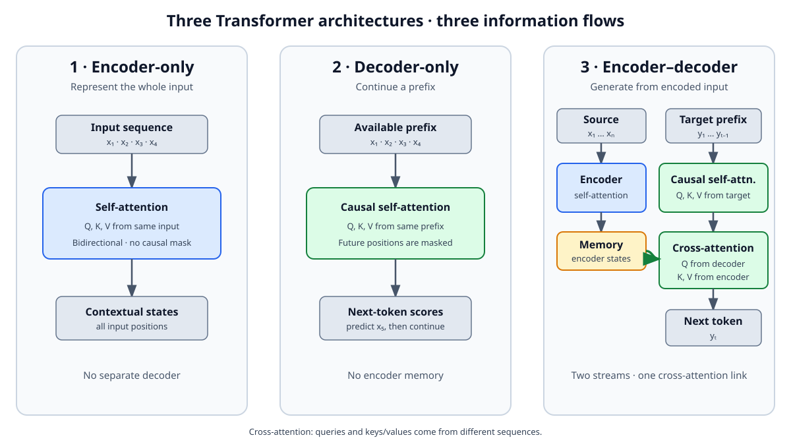

<!--
LLM-LAB-PAGE-MAP v1
id: "en/cross-attention"
scope: "Explains cross-attention in encoder–decoder Transformers, distinguishing the sources of queries, keys, and values, dimensions, information flow, and possible masks."
purpose: "Readers should be able to explain why Q comes from the decoder while K and V come from the encoder, write the cross-attention equation, and distinguish it from self-attention."
suggested_route:
  previous: "en/transformer-architectures"
  next: "en/scaled-dot-product-attention"
hierarchy:
  parents: ["en/transformer-architectures"]
  children: []
related: ["en/queries-keys-values", "en/scaled-dot-product-attention", "en/causal-masking"]
tags: ["type:concept-lesson", "destination:understand", "topic:cross-attention", "level:core", "language:en", "status:published"]
-->

::: {.chapter-lead}
Cross-attention lets one sequence read representations from another. In an encoder–decoder Transformer, the decoder produces the queries **Q**, while the keys **K** and values **V** come from the encoder output. This separation of sources is what distinguishes cross-attention from self-attention.
:::

::: {.callout-note .learning-outcomes collapse="true" title="Learning outcomes"}
You will be able to:
- identify where Q, K, and V come from in cross-attention;
- explain how each target position selects and aggregates information from the input;
- distinguish cross-attention, bidirectional self-attention, and causal self-attention;
- interpret matrix dimensions and possible masks.
:::

## The idea in one diagram

{fig-alt="Three flows: encoder-only with bidirectional self-attention; decoder-only with causal self-attention; encoder–decoder with an encoder, memory, causal decoder self-attention, and a cross-attention link." width=100%}

In an encoder–decoder architecture, two streams coexist:

1. **The encoder** reads the full source sequence and builds contextual representations.
2. **The decoder** builds the target sequence progressively. At each relevant layer, it can read the encoder representations through cross-attention.

The encoder therefore does not pass tokens directly to the decoder: it provides a memory of contextualized vectors.

**How to read the diagram:** it deliberately isolates attention paths to make information flow visible. It does not show every sublayer (normalization, residual connections, and feed-forward networks) in each Transformer block.

## Self-attention or cross-attention?

The essential difference is not the calculation formula, but **where the three matrices come from**.

| Mechanism | Queries Q | Keys K | Values V |
|---|---|---|---|
| Self-attention | Sequence A | Sequence A | Sequence A |
| Cross-attention | Target / decoder sequence | Source / encoder sequence | Source / encoder sequence |

In self-attention, a sequence interacts with itself. In cross-attention, positions in one sequence query positions in another.

::: {.callout-tip title="Key idea"}
**Q comes from the sequence doing the reading; K and V come from the sequence being read.**

When a decoder reads from an encoder:
- Q represents what decoder positions seek in the source memory;
- K makes it possible to compare those queries with positions in that memory;
- V contains the source information that will be aggregated.

“Seek” and “read” are functional analogies: Q, K, and V are learned projections, not literal questions or symbolic labels.
:::

## Where do Q, K, and V come from?

Let:
- (X\in\mathbb{R}^{S\times d_e}) be the encoder representations for the (S) source positions;
- (Y\in\mathbb{R}^{T\times d_d}) be the decoder representations for the (T) available target positions.

The learned projections are distinct:

\[
Q=YW_Q,\qquad K=XW_K,\qquad V=XW_V.
\]

With (W_Q\in\mathbb{R}^{d_d\times d_k}), (W_K\in\mathbb{R}^{d_e\times d_k}), and (W_V\in\mathbb{R}^{d_e\times d_v}), the resulting shapes are:

- (Q\in\mathbb{R}^{T\times d_k});
- (K\in\mathbb{R}^{S\times d_k});
- (V\in\mathbb{R}^{S\times d_v}).

The lengths (T) and (S) may differ. This is expected: the decoder queries a source memory whose number of positions need not equal the number of target tokens generated so far.

Scaled dot-product cross-attention is:

\[
\operatorname{CrossAttention}(Y,X)
=\operatorname{softmax}\left(\frac{QK^\top}{\sqrt{d_k}}+M\right)V.
\]

The score matrix (QK^\top) has shape (T\times S): each row corresponds to a target position and each column to a source position. A row therefore gives the weights with which a decoder position aggregates encoder values.

## Worked example: translating a sentence

Suppose the encoder receives “The cat is sleeping” and the decoder has already produced “Le chat”.

- The target position that must produce the next token builds a query Q from its current state.
- This query is compared with the keys K associated with source positions (“The”, “cat”, “is”, “sleeping”).
- The normalized scores produce weights over source positions.
- These weights combine the values V to provide the decoder with a relevant summary of the input.

The model does not have to align a target token with a single source token. The distribution may be diffuse, and different attention heads may learn different relationships. This example describes the computation flow, not a guarantee of explicit linguistic alignment.

## Which masks apply?

Two constraints must be distinguished:

- **Decoder self-attention:** a causal mask over the target sequence. A position cannot read future target tokens.
- **Cross-attention:** in the classic encoder–decoder Transformer, each target position can generally read all valid source positions. A padding mask may still exclude source positions that do not correspond to real tokens.

Cross-attention therefore does not need a causal mask over the source: the source input is already available while the decoder generates its output. Architectural variants may impose other constraints, but they do not define the classic mechanism.

## Where does it sit in the decoder block?

In the original Transformer, a decoder layer includes:
1. masked self-attention over target tokens;
2. a cross-attention sublayer over encoder outputs;
3. a feed-forward network.

Residual connections and normalization surround these sublayers according to the block variant. Modern implementations may change their order or arrangement, but the provenance of Q, K, and V remains the central conceptual criterion.

::: {.callout-note collapse="true" title="Cross-attention beyond text-to-text Transformers"}
The mechanism is not limited to translation. It also appears in multimodal models, where queries from one stream (for example, text) read representations from another stream (for example, images or audio). The principle—Q from the reading stream, K/V from the stream being read—remains the same; the overall architecture and masks may differ.
:::

## Misconceptions and limitations

- **“Q, K, and V always come from the same tensor.”** True for standard self-attention, not cross-attention.
- **“Cross-attention necessarily aligns one target token with one source token.”** No: each head may aggregate several positions, without one-to-one alignment.
- **“The source is causal because the target is generated token by token.”** No: the causal mask applies to decoder self-attention. The full source is generally accessible.
- **“Cross-attention is just concatenation of the two sequences.”** No: it computes query–key scores, then aggregates values.

## References

- Vaswani et al. (2017), [*Attention Is All You Need*](https://arxiv.org/abs/1706.03762) — the encoder–decoder Transformer and multi-head attention.
- Raffel et al. (2020), [*Exploring the Limits of Transfer Learning with a Unified Text-to-Text Transformer*](https://jmlr.org/papers/v21/20-074.html) — T5 and the text-to-text approach.

## Connections to other concepts

- [Transformer architectures](transformer-architectures.qmd) compares the three major information-flow organizations.
- [Queries, keys, and values](queries-keys-values.qmd) introduces the projections and their roles.
- [Scaled dot-product attention](scaled-dot-product-attention.qmd) details scores, softmax, and aggregation.
- [Causal masking](causal-masking.qmd) explains the temporal constraint in decoder self-attention.
- [Transformer history](transformer-history.qmd) places the encoder–decoder in the original Transformer paper.

::: {.self-check}
## Check your understanding

**In decoder cross-attention, where do Q, K, and V come from?**

Show the reasoning

Q is projected from decoder states, because those are the positions doing the reading. K and V are projected from encoder outputs, which form the memory being read. The score matrix therefore has one row per target position and one column per source position.

:::

::: {.language-switch}
**Language:** [Français](../fr/cross-attention.qmd) · [English](cross-attention.qmd)
:::
