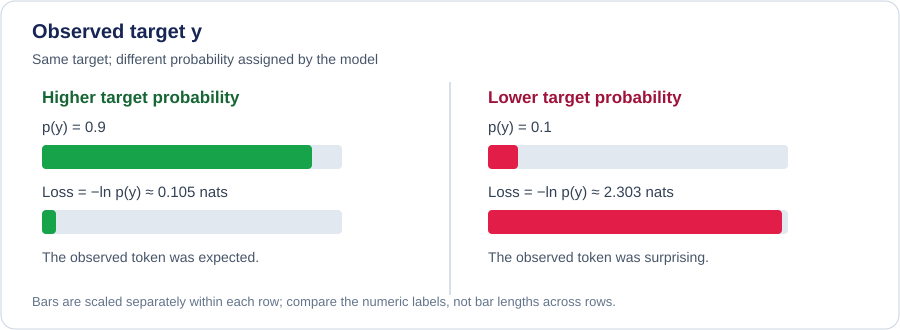

<!--
LLM-LAB-PAGE-MAP v1
id: "en/cross-entropy"
summary: "Connects a target distribution to the model's predicted distribution. With a one-hot target, cross-entropy becomes the penalty for the observed token and provides the local term used to build the loss."
scope: "Define cross-entropy between a target distribution and the model's predicted distribution at a target position, including the one-hot case that reduces to token negative log-probability; distinguish it from the entropy of the prediction and from the batch-level loss reduction and masking policy."
purpose: "Derive cross-entropy for a target distribution, recover negative log-probability for a one-hot target, and explain how token alignment and valid-target masking affect the quantity computed during autoregressive training."
suggested_route:
  previous: "en/likelihood"
  next: "en/loss"
hierarchy:
  parents: ["en/entropy"]
  children: ["en/loss"]
related: ["en/likelihood", "en/cross-entropy-exercises"]
tags: ["type:concept-lesson", "destination:understand", "topic:cross-entropy", "level:core", "language:en", "status:published"]
-->



::: {.chapter-lead}
The previous page built a sequence's likelihood by combining the conditional probabilities of observed tokens, then its negative log-likelihood (NLL). For a one-hot target, cross-entropy at one position is the negative log-probability of the observed token. During autoregressive training, this quantity is computed for allowed target positions and then aggregated using a convention that must be stated explicitly.
:::

::: {.callout-tip title="The one-minute mental model"}
- **One target:** for a one-hot target $y$, $\ell=-\log p_\theta(y\mid x_{<t})$; assigning low probability to the observed token is costly.
- **A target distribution:** more generally, $H(q,p)=-\sum_i q_i\log p_i$. Cross-entropy is not predictive entropy $H(p)$.
- **A sequence:** align each logit with the correct target token, shift inputs and targets consistently, then exclude invalid positions from both numerator and denominator.
- **A batch:** a sum, mean over valid tokens, and mean over sequences have different scales; state the convention before comparing.

**Quick question:** can you recover a token's NLL and explain why a loss mask cannot replace the causal mask?
:::

<div class="pipeline-stepper" role="navigation" aria-label="Steps in calculating cross-entropy">
  <a class="step-item" href="likelihood.qmd">1. Observed target</a>
  <span class="step-arrow" aria-hidden="true">→</span>
  <a class="step-item" href="probabilities.qmd">2. Predicted probability</a>
  <span class="step-arrow" aria-hidden="true">→</span>
  <span class="step-item">3. NLL</span>
  <span class="step-arrow" aria-hidden="true">→</span>
  <span class="step-item active" aria-current="step">4. Mean over tokens</span>
</div>


To connect this formula to training, also inspect how [input-target examples](training-examples.qmd) are built and how loss masking is applied. Do not confuse it with the [entropy of the predicted distribution](entropy.qmd): entropy describes the spread of probabilities before the next token is observed, while cross-entropy loss scores the probability assigned to the observed target (or a target distribution).

In the running example, the target token is the next token actually present in the reference continuation. Cross-entropy penalizes the model when it assigns that token a low probability; it does not directly compare whole sentences as indivisible objects.

## Objective for one token

Here, $t$ indexes the **target token**: the logits are aligned with $x_t$ and represent $p_\theta(x_t\mid x_{<t})$. Some implementations instead index logits by the input position; then the row at input position $t$ predicts $x_{t+1}$. These conventions are equivalent only when the logits and labels are shifted consistently. For a one-hot target, the loss is:

$$
\ell_t=-\log p_\theta(x_t\mid x_{<t}).
$$

If $y$ is the target-token index and $p=\operatorname{softmax}(z)$, this can be written as:

$$
\ell(z,y)=-z_y+\log\sum_{j=1}^{V}e^{z_j}.
$$

The cost increases when the model assigns low probability to the observed token. A wrong but highly confident prediction is therefore strongly penalized.

## Visual intuition: the loss measures the surprise of the observed token

{fig-alt="Two cases for the same observed token: p(y)=0.9 gives −ln p(y)≈0.105 nats; p(y)=0.1 gives −ln p(y)≈2.303 nats. Lower target probability produces a much larger loss." width=100%}

Both cases concern **the same target token**: only the probability assigned to it changes. When $p(y)=0.9$, the loss is about $0.105$ nats; when $p(y)=0.1$, it is about $2.303$ nats. The second loss is nearly 22 times larger. The function $-\log p(y)$ makes confident errors costly, but it does not tell us whether the observed token is true or useful in a broader sense.

This figure illustrates the loss for one token with a one-hot target. It does not show the full vocabulary distribution, the averaging over valid positions, or the entire training objective.

::: {.callout-note title="Extension: soft targets and KL divergence"}
For a general target distribution $q$, cross-entropy is $H(q,p)=-\sum_{i=1}^{V}q_i\log p_i$; the one-hot case above is its special case. The full relationship with KL divergence — $H(q,p)=H(q)+D_{\mathrm{KL}}(q\Vert p)$, and hence the equivalence between minimizing cross-entropy and minimizing KL divergence for a fixed target — is derived in [The mathematics of language modeling](language-modeling-math.qmd).
:::

## Multiple positions: causal shift and masks

In an autoregressive model, the representation at position $t$ is used to predict the next token. Depending on the code convention, logits and labels must therefore be shifted consistently: the model must not receive the target token as unmasked context when predicting that same token.

For a batch, logits often have shape $(B,T,V)$ and labels shape $(B,T)$. Before interpreting the loss, check:

- **Target shift:** each logit is compared with the token it is supposed to predict, not accidentally with the input token.
- **Padding and masks:** ignored positions must contribute neither to the sum nor to the denominator of the mean.
- **Reduction:** a sum, mean over valid tokens, and mean over sequences do not have the same scale.
- **Weighting:** class weights, label smoothing, or auxiliary losses change the objective from the unweighted one-hot case.
- **Comparison:** state the tokenizer, included positions, and averaging convention before comparing two values.

::: {.callout-note collapse="true" title="NumPy implementation and tests (advanced)"}
The [NumPy reference implementation](https://github.com/JM-Brun/llm-lab/blob/main/src/llm_lab/foundations/losses.py) and its [unit tests](https://github.com/JM-Brun/llm-lab/blob/main/tests/unit/test_losses.py) cover a deliberately small case: logits with shape $(B,C)$, one integer target per row, and the **unweighted mean over rows**. The loss uses natural logarithms, so its value is in nats. The gradient function returns the derivative of that same mean loss with respect to the logits; it is not a gradient with respect to a model's parameters.

This reference does **not** implement sequence-level input/target shifting, token masks or `ignore_index`, soft targets, class weights, or perplexity. For token-level language modeling, callers must align logits and targets and select valid target positions before using this row-wise function. The implementation should not be mistaken for a complete LLM training loss.

The tests check a known value, central finite-difference agreement, stability for large logits, invariance to adding a constant per row, gradient row sums, non-mutation of inputs, and invalid-input handling. These checks support this reference implementation's stated scope; they do not validate masking or sequence alignment, which are not implemented here.
:::

::: {.callout-note collapse="true" title="PyTorch example: logits, targets, and ignored positions"}
The following self-contained example uses a common language-model output shape, `(B,T,V)`, then flattens the first two dimensions because `CrossEntropyLoss` expects classes in the second dimension. Targets are assumed to be **already aligned** with the logits: this code does not construct the autoregressive input/target shift.

```python
import torch
import torch.nn.functional as F

# B=1 batch, T=3 positions, V=3 vocabulary tokens.
logits = torch.tensor(
    [[[2.0, 0.0, -1.0], [0.0, 1.0, 0.0], [1.0, 0.0, 2.0]]],
    dtype=torch.float64,
)
targets = torch.tensor([[0, 2, -100]], dtype=torch.long)
# Validate the sequence-level contract before inspecting dimensions.
assert logits.ndim == 3
batch_size, seq_len, vocab_size = logits.shape
assert targets.shape == (batch_size, seq_len)
assert targets.dtype == torch.long
valid = targets.ne(-100)
in_range = targets.ge(0) & targets.lt(vocab_size)
assert torch.all(in_range | targets.eq(-100))
assert valid.any()

flat_logits = logits.reshape(-1, vocab_size)
flat_targets = targets.reshape(-1)

per_token_loss = torch.nn.CrossEntropyLoss(
    ignore_index=-100, reduction="none"
)(flat_logits, flat_targets).reshape(batch_size, seq_len)
mean_loss = torch.nn.CrossEntropyLoss(
    ignore_index=-100, reduction="mean"
)(flat_logits, flat_targets)

manual_loss = -F.log_softmax(logits[valid], dim=-1).gather(
    1, targets[valid].unsqueeze(1)
).mean()

# The framework reduction agrees with the mean over valid target positions.
torch.testing.assert_close(per_token_loss[valid].mean(), mean_loss)
torch.testing.assert_close(mean_loss, manual_loss)

# Passing probabilities as if they were logits changes the objective.
softmax_first_loss = torch.nn.CrossEntropyLoss(ignore_index=-100)(
    logits.softmax(dim=-1).reshape(-1, vocab_size), flat_targets
)
assert not torch.isclose(mean_loss, softmax_first_loss)

print("per-token:", per_token_loss.tolist())
print("mean:", mean_loss.item())  # 0.860645...
print("softmax-first:", softmax_first_loss.item())  # 0.946560...
```

The final position is ignored by `ignore_index`; it contributes neither to the sum nor to the mean denominator. `reduction="none"` exposes local losses, while `reduction="mean"` averages valid targets (with no class weights in this example). Applying softmax first is incorrect for the intended API use: it turns probabilities into a new set of input scores and changes the loss. This example demonstrates the API and reduction; it does not replace causal masking, target alignment, or a training loop.

PyTorch also accepts probability-distribution targets (for example with *label smoothing*), but `ignore_index` applies only to class-index targets. This example deliberately uses integer indices.
:::

### A common shape bug: normalizing over time instead of vocabulary

For logits shaped `(B,T,V)`, each time position needs a probability distribution over the **vocabulary**. Therefore softmax must use `dim=-1` (the vocabulary axis). Normalizing over `dim=1` instead makes probabilities sum to one across time for each vocabulary entry; it does not produce a categorical distribution over tokens at each position.

```python
import torch

logits = torch.tensor(
    [[[2.0, 0.0, -1.0], [0.0, 1.0, 0.0], [1.0, 0.0, 2.0]]],
    dtype=torch.float64,
)
batch_size, seq_len, vocab_size = logits.shape

correct_probs = logits.softmax(dim=-1)
wrong_axis_probs = logits.softmax(dim=1)

# The vocabulary probabilities sum to one at every batch/time position.
torch.testing.assert_close(
    correct_probs.sum(dim=-1),
    torch.ones((batch_size, seq_len), dtype=logits.dtype),
)
# With the wrong axis, the sums over vocabulary are not one per position.
wrong_sums = wrong_axis_probs.sum(dim=-1)
assert not torch.allclose(
    wrong_sums,
    torch.ones_like(wrong_sums),
)
```

This is why the example first flattens `(B,T,V)` to `(B×T,V)`: the class/vocabulary dimension is then unambiguously dimension 1 for `CrossEntropyLoss`.

### A numerical edge case: stable log-softmax

A direct `softmax` can underflow a very small target probability to zero. Taking its logarithm then produces infinity, even though the mathematically correct cross-entropy is finite. The fused, numerically stable cross-entropy computes the equivalent log-softmax expression without first materializing that zero probability.

```python
import torch
import torch.nn.functional as F

extreme_logits = torch.tensor(
    [[1000.0, 0.0, -1000.0]], dtype=torch.float64
)
extreme_target = torch.tensor([2], dtype=torch.long)

stable_loss = F.cross_entropy(extreme_logits, extreme_target)
naive_probability = extreme_logits.softmax(dim=-1)[0, 2]
naive_loss = -torch.log(naive_probability)

torch.testing.assert_close(
    stable_loss, torch.tensor(2000.0, dtype=torch.float64)
)
assert torch.isfinite(stable_loss)
assert naive_probability == 0.0
assert torch.isinf(naive_loss)
```

The infinite result is a floating-point failure of the naïve computation, not an infinite mathematical loss: for these logits, the exact loss is 2000 nats. In practice, pass logits directly to `CrossEntropyLoss` or use `log_softmax` followed by the target gather; do not compute `log(softmax(logits))` yourself.

## Connection to perplexity

If $\bar{\ell}$ is mean cross-entropy in nats over valid tokens, perplexity is:

$$
\operatorname{PPL}=\exp(\bar{\ell}).
$$

For a mean measured in bits, use $2^{\bar{\ell}}$. Perplexity therefore depends on the logarithm base and evaluation convention. It measures probabilistic performance on the evaluated tokens; it is not a direct measure of factual truth or overall assistant quality.

## Connection to the gradient

The derivative of one-hot cross-entropy with respect to the logits is $p_i-\mathbb{1}[i=y]$. Its interpretation and role in backpropagation are developed in the [Gradients](gradients.qmd) lesson.

::: {.callout-note collapse="true" title="API detail (advanced)"}
- **“PyTorch CrossEntropyLoss expects probabilities.”** For ordinary categorical classification, the API expects unnormalized logits and combines a log-softmax-like operation with NLL. Check shapes, ignore_index, targets, and reduction.
:::

## Misconceptions

- **“Cross-entropy is between 0 and 1.”** False: it can grow without bound when the model assigns probability close to zero to the target.

- **“A falling training loss proves that the model is improving.”** No: validation, leakage, baselines, and generalization still need to be examined.
- **“Perplexity directly compares any models.”** Not without controlling for tokenizer, data, and evaluation conventions.




:::: {.language-switch}
[Français](../fr/cross-entropy.qmd) · [English](cross-entropy.qmd)
::::

<details class="learning-resources">
<summary>
  <span class="learning-resources__title">Supplementary resources</span>
  <span class="learning-resources__description">Experiment, explore further, and practise the ideas from this lesson.</span>
</summary>
<div class="learning-resources__content" markdown="1">

### Practice

The questions and exercises for this lesson are collected on its [dedicated practice page](exercises/cross-entropy.qmd).


### Further practice

The [mathematical foundations collection](exercises.qmd#foundations) includes worked exercises on logits, loss and masking; further topics remain planned.

### References

- [PyTorch — CrossEntropyLoss](https://docs.pytorch.org/docs/stable/generated/torch.nn.CrossEntropyLoss.html) — API behaviour, not the general mathematical definition.
- [PyTorch — LogSoftmax](https://docs.pytorch.org/docs/stable/generated/torch.nn.LogSoftmax.html) — log-softmax operation used to compute log-probabilities in a numerically stable way.
- C. E. Shannon (1948), [*A Mathematical Theory of Communication*](https://people.math.harvard.edu/~ctm/home/text/others/shannon/entropy/entropy.pdf).
- Cover & Thomas, [*Elements of Information Theory*](https://onlinelibrary.wiley.com/doi/book/10.1002/047174882X).
- [3Blue1Brown — But what is cross-entropy?](https://www.youtube.com/watch?v=GlYgs6v2YfU) — visual intuition complementary to the derivation above.


::: {.self-check}
## Check your understanding

[Dedicated exercises](exercises/cross-entropy.qmd).

1. Why is the loss zero when the target probability is 1?
2. Why should masked positions be excluded from the denominator of the mean?
3. Does perplexity directly measure the truth or usefulness of an answer?

<details>
<summary>Show the answers</summary>

1. The loss is $-\log p_y$, which is zero when $p_y=1$.
2. Otherwise, the mean is no longer taken only over valid tokens and its scale is distorted.
3. No. Perplexity measures probability assigned to tokens in a particular dataset; it does not directly measure truth, usefulness, or safety.

</details>
:::


</div>
</details>
