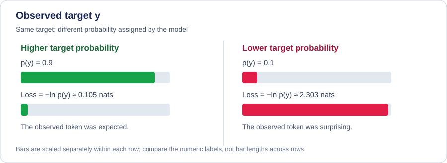

::: {.chapter-lead}
For a one-hot target, cross-entropy at one position is the negative log-probability of the observed token. During autoregressive training, this quantity is computed for allowed target positions and then aggregated using a convention that must be stated explicitly.
:::

To connect this formula to training, also inspect how [input-target examples](training-examples.qmd) are built and how loss masking is applied.

## Objective for one token

Here, \(t\) indexes the **target token**: the logits are aligned with \(x_t\) and represent \(p_\theta(x_t\mid x_{<t})\). Some implementations instead index logits by the input position; then the row at input position \(t\) predicts \(x_{t+1}\). These conventions are equivalent only when the logits and labels are shifted consistently. For a one-hot target, the loss is:

\[
\ell_t=-\log p_\theta(x_t\mid x_{<t}).
\]

If \(y\) is the target-token index and \(p=\operatorname{softmax}(z)\), this can be written as:

\[
\ell(z,y)=-z_y+\log\sum_{j=1}^{V}e^{z_j}.
\]

The cost increases when the model assigns low probability to the observed token. A wrong but highly confident prediction is therefore strongly penalized.

## Visual intuition: the loss measures the surprise of the observed token

{fig-alt="Two cases for the same observed token: p(y)=0.9 gives −ln p(y)≈0.105 nats; p(y)=0.1 gives −ln p(y)≈2.303 nats. Lower target probability produces a much larger loss." width=100%}

Both cases concern **the same target token**: only the probability assigned to it changes. When \(p(y)=0.9\), the loss is about \(0.105\) nats; when \(p(y)=0.1\), it is about \(2.303\) nats. The second loss is nearly 22 times larger. The function \(-\log p(y)\) makes confident errors costly, but it does not tell us whether the observed token is true or useful in a broader sense.

This figure illustrates the loss for one token with a one-hot target. It does not show the full vocabulary distribution, the averaging over valid positions, or the entire training objective.

## One-hot targets, soft targets, and KL divergence

For a target distribution \(q\) and predicted distribution \(p\), cross-entropy is (terms with zero target mass contribute zero):

\[
H(q,p)=-\sum_{i=1}^{V}q_i\log p_i.
\]

For a one-hot target, the sum reduces to \(-\log p_y\). With a soft target—such as label smoothing or a teacher distribution—multiple categories contribute. Assume \(q_i\geq0\), \(\sum_i q_i=1\), and that \(p\) is also normalized. Unless stated otherwise, \(\log\) is the natural logarithm, so losses are measured in nats; using \(\log_2\) gives bits.

Define the target entropy as \(H(q)=-\sum_i q_i\log q_i\). The identity \(H(q,p)=H(q)+D_{\mathrm{KL}}(q\Vert p)\) explains why, for a fixed target, minimizing cross-entropy is equivalent to minimizing KL divergence toward the predicted distribution. When the quantities are finite, its derivation follows directly from the definitions:

\[
\begin{aligned}
D_{\mathrm{KL}}(q\Vert p)
&=\sum_i q_i\log\frac{q_i}{p_i}\\
&=\sum_i q_i\log q_i-\sum_i q_i\log p_i\\
&=-H(q)+H(q,p).
\end{aligned}
\]

Thus \(H(q,p)=H(q)+D_{\mathrm{KL}}(q\Vert p)\). Here \(q\) and \(p\) are normalized distributions and zero-mass terms contribute zero; if \(q_i>0\) but \(p_i=0\), cross-entropy and \(D_{\mathrm{KL}}(q\Vert p)\) are infinite under the usual extended-value convention. KL divergence is directional; cross-entropy is neither symmetric nor a metric distance. For example, with \(q=(1,0)\) and \(p=(0.9,0.1)\), \(D_{\mathrm{KL}}(q\Vert p)=-\log(0.9)\approx0.105\) nats, whereas \(D_{\mathrm{KL}}(p\Vert q)=+\infty\) because \(p\) assigns positive mass where \(q\) assigns zero. Stable log-softmax calculations help avoid accidental underflow in numerical implementations, but they do not change this mathematical condition.

## Multiple positions: causal shift and masks

In an autoregressive model, the representation at position \(t\) is used to predict the next token. Depending on the code convention, logits and labels must therefore be shifted consistently: the model must not receive the target token as unmasked context when predicting that same token.

For a batch, logits often have shape \((B,T,V)\) and labels shape \((B,T)\). Before interpreting the loss, check:

- **Target shift:** each logit is compared with the token it is supposed to predict, not accidentally with the input token.
- **Padding and masks:** ignored positions must contribute neither to the sum nor to the denominator of the mean.
- **Reduction:** a sum, mean over valid tokens, and mean over sequences do not have the same scale.
- **Weighting:** class weights, label smoothing, or auxiliary losses change the objective from the unweighted one-hot case.
- **Comparison:** state the tokenizer, included positions, and averaging convention before comparing two values.

## Reference implementation and its scope

The [NumPy reference implementation](https://github.com/JM-Brun/llm-lab/blob/main/src/llm_lab/foundations/losses.py) and its [unit tests](https://github.com/JM-Brun/llm-lab/blob/main/tests/unit/test_losses.py) cover a deliberately small case: logits with shape \((B,C)\), one integer target per row, and the **unweighted mean over rows**. The loss uses natural logarithms, so its value is in nats. The gradient function returns the derivative of that same mean loss with respect to the logits; it is not a gradient with respect to a model's parameters.

This reference does **not** implement sequence-level input/target shifting, token masks or `ignore_index`, soft targets, class weights, or perplexity. For token-level language modeling, callers must align logits and targets and select valid target positions before using this row-wise function. The implementation should not be mistaken for a complete LLM training loss.

The tests check a known value, central finite-difference agreement, stability for large logits, invariance to adding a constant per row, gradient row sums, non-mutation of inputs, and invalid-input handling. These checks support this reference implementation's stated scope; they do not validate masking or sequence alignment, which are not implemented here.

## Connection to perplexity

If \(\bar{\ell}\) is mean cross-entropy in nats over valid tokens, perplexity is:

\[
\operatorname{PPL}=\exp(\bar{\ell}).
\]

For a mean measured in bits, use \(2^{\bar{\ell}}\). Perplexity therefore depends on the logarithm base and evaluation convention. It measures probabilistic performance on the evaluated tokens; it is not a direct measure of factual truth or overall assistant quality.

## Gradient with respect to logits

For a one-hot target \(y\) and \(p=\operatorname{softmax}(z)\), the derivative with respect to each logit is:

\[
\frac{\partial\ell}{\partial z_i}=p_i-\mathbb{1}[i=y].
\]

To see the result, differentiate the logit form of the loss:

\[
\begin{aligned}
\frac{\partial\ell}{\partial z_i}
&=-\mathbb{1}[i=y]+\frac{e^{z_i}}{\sum_j e^{z_j}}\\
&=p_i-\mathbb{1}[i=y].
\end{aligned}
\]

This derivation applies to one position and an unweighted one-hot target. Under gradient descent, the negative gradient on the target logit raises it, while positive gradients on alternatives lower them. Masking, weighting, and reduction change aggregated gradients or their scale. The link from this local gradient to network parameters is covered in [Gradients](gradients.qmd).

## Numerical example

If the target token receives probability \(0.8\), the loss in nats is \(-\log(0.8)\approx0.223\). If its probability is \(0.01\), the loss is about \(4.605\). Low probability for the observed token therefore incurs a substantial penalty.

## Misconceptions

- **“Cross-entropy is between 0 and 1.”** False: it can grow without bound when the model assigns probability close to zero to the target.
- **“PyTorch CrossEntropyLoss expects probabilities.”** For ordinary categorical classification, the API expects unnormalized logits and combines a log-softmax-like operation with NLL. Check shapes, ignore_index, targets, and reduction.
- **“A falling training loss proves that the model is improving.”** No: validation, leakage, baselines, and generalization still need to be examined.
- **“Perplexity directly compares any models.”** Not without controlling for tokenizer, data, and evaluation conventions.

## Self-check

1. Why does a target probability of 1 give zero loss?
2. Why must the averaging denominator be specified when tokens are masked?
3. Why is perplexity insufficient to measure an assistant's overall quality?

Show answers

1. The loss is \(-\log p_y\), so it is zero when \(p_y=1\).
2. If masked positions remain in the denominator, the result is no longer the mean over valid tokens and becomes difficult to compare.
3. Perplexity measures probability assignment to tokens in a particular dataset; it does not directly measure truth, usefulness, safety, or calibration.

## Further practice

The [mathematical foundations exercise collection](exercises.qmd#foundations) is planned navigation scaffolding; detailed exercises are not yet written.

## References

- [PyTorch — CrossEntropyLoss](https://docs.pytorch.org/docs/stable/generated/torch.nn.CrossEntropyLoss.html) — API behaviour, not the general mathematical definition.
- C. E. Shannon (1948), [*A Mathematical Theory of Communication*](https://people.math.harvard.edu/~ctm/home/text/others/shannon/entropy/entropy.pdf).
- Cover & Thomas, [*Elements of Information Theory*](https://onlinelibrary.wiley.com/doi/book/10.1002/047174882X).
- [3Blue1Brown — But what is cross-entropy?](https://www.youtube.com/watch?v=GlYgs6v2YfU) — visual intuition complementary to the derivation above.

:::: {.language-switch}
[Français](../fr/cross-entropy.qmd) · [English](cross-entropy.qmd)
::::
