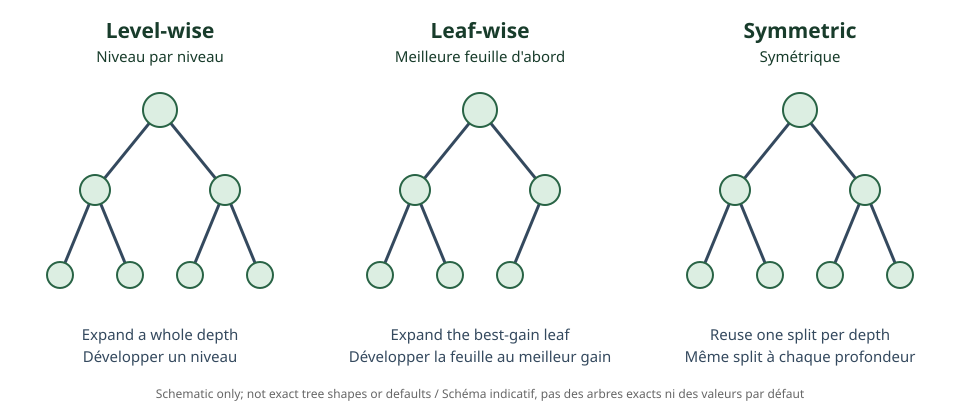

<!--
LLM-LAB-PAGE-MAP v1
id: "en/decision-trees"
scope: "Describes decision trees as recursive partitions of feature space, split criteria, leaf predictions, and complexity control."
purpose: "Read a tree, explain a greedy split, and distinguish local criterion, global objective, and regularization."
suggested_route:
  previous: "en/bias-variance"
  next: "en/gradient-boosting"
hierarchy:
  parents: []
  children: []
related: ["en/gradient-boosting", "en/xgboost", "en/lightgbm", "en/catboost"]
tags: ["type:concept-lesson", "destination:deepen", "topic:decision-trees", "level:applied", "language:en", "status:published"]
-->
::: {.chapter-lead}
A decision tree represents a prediction as a sequence of feature tests. Each split partitions the observations; a leaf produces the final prediction. Trees model nonlinear interactions without imposing one global linear form.
:::
## Tree structure

An internal node applies a test such as (x_j < s). Observations move down one branch; successive tests define regions of feature space. A leaf stores a predicted value (regression) or class label/distribution (classification).

## Choosing a split

CART trees greedily search for a feature and threshold that reduce child impurity relative to the parent. Regression often uses reduction in squared error; classification uses criteria such as Gini or entropy. For classification, Gini impurity is:

\[
G(S)=1-\sum_{k=1}^{K}p_k^2,
\]

where (p_k) is the proportion of class (k) in the node. Split gain weights child impurities by their sizes. A locally optimal greedy choice does not guarantee a globally optimal tree.

## Complexity and generalization

A deep tree can create highly specific regions and memorize noise. Complexity is controlled through maximum depth, minimum samples per leaf, minimum split gain, pruning, or leaf-count penalties. These constraints interact with data volume and loss.

{fig-alt="Three schematic structures illustrating level-wise, leaf-wise, and symmetric growth."}

The criteria for a standalone tree are not necessarily those used inside a boosted tree. In XGBoost, gradients and Hessians of the current ensemble contribute to split gain; the criterion is not simply Gini or raw variance reduction.

## Role in ensembles

- **Bagging / random forest:** independent trees are aggregated to stabilize predictions.
- **Boosting:** trees are added sequentially to correct the current model.
- **Boosted tree:** often a shallow tree whose contribution is regularized.

See [Gradient Boosting](gradient-boosting.qmd), then [XGBoost](xgboost.qmd), [LightGBM](lightgbm.qmd), and [CatBoost](catboost.qmd).

::: {.self-check}
## Check your understanding
1. Why does a leaf correspond to a region of feature space?

Show answer
The tests along its path impose constraints; their intersection defines the region of observations reaching that leaf.

2. Why does a greedy split not guarantee an optimal tree?

Show answer
It optimizes a local gain without exploring every possible combination of future splits.

3. Why does a boosted tree not necessarily use Gini?

Show answer
It is fitted using gradients of the current ensemble's loss; split scores come from the boosting objective and its regularization.

:::
## References
- [Breiman et al. (1984), Classification and Regression Trees](https://doi.org/10.1201/9781315139470).
- [The Elements of Statistical Learning](https://hastie.su.domains/ElemStatLearn/), Chapter 9.
::: {.language-switch}
[Français](../fr/decision-trees.qmd) · [English](decision-trees.qmd)
:::
