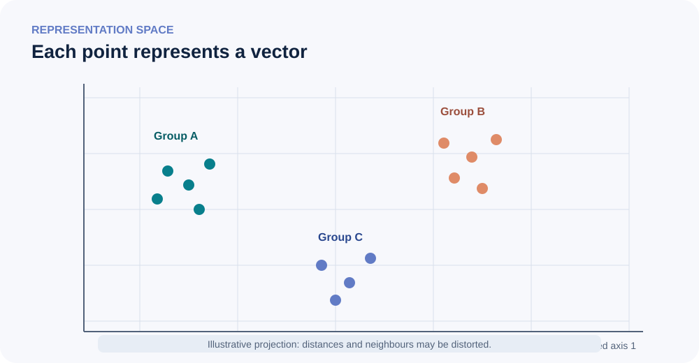

<!--
LLM-LAB-PAGE-MAP v1
id: "en/deepen"
scope: "Entry point to advanced deep dives: organizes pages by question families and clarifies their relationship to the core Understand route."
purpose: "Choose a deep dive by question, identify neighbouring topics, and understand its level without turning optional reading into a prerequisite."
suggested_route:
  previous: null
  next: null
hierarchy:
  parents: []
  children: ["en/next-concept-modeling", "en/contextualized-representations-advanced", "en/embeddings-deep-dive"]
related: []
tags:
  - "type:entry-point"
  - "destination:deepen"
  - "topic:deepen-hub"
  - "level:overview"
  - "language:en"
  - "status:published"
-->

# Deepen: a map, not a list

The **Deepen** area collects treatments that go beyond the mental model needed for the core learning route. It is neither a second mandatory sequence nor an unstructured repository of specialist topics.

Each entry answers a more specific question: why a mechanism works, under which conditions it remains valid, which trade-offs it introduces, or how to investigate it rigorously. Pages are grouped by **intellectual problem**, not alphabetically. A page may have cross-links, but retains one primary category to keep its entry point stable.

## Choose by question

| Your question | Domain |
|---|---|
| How does a specialized architecture change information flow? | [Attention, position, and architectures](#architectures-and-mechanisms) |
| How can text representation be designed and evaluated? | [Text and tokenization](#text-and-tokenization) |
| Which mathematical tools help analyze representations? | [Mathematical tools and geometry](#mathematical-tools-and-geometry) |
| How are probabilities, the learning objective, and gradients connected? | [Probabilistic formalization and the training chain](#probabilistic-foundations-and-training) |
| How are outputs produced, and what resources do they require? | [Inference and efficiency](#inference-and-efficiency) |
| What can evidence tell us about scale and model capabilities? | [Scale and research questions](#scale-and-research-questions) |

## Attention, position, and architectures {#architectures-and-mechanisms}

**Guiding question:** which variants change information flow or a model's computational structure?

- [Why scale attention scores?](attention-score-scaling.qmd) — dot-product variance under Gaussian assumptions, softmax concentration, and the limits of the $\sqrt{d_k}$ factor.
- [Contextualized representations: dependencies across positions and layers](contextualized-representations-advanced.qmd) — formalizing accessible context, masks, and hidden-state evolution.
- [Q/K/V: mathematical formulation and variants](queries-keys-values-advanced.qmd) — per-position equations, batched dimensions, compatibility geometry, gradient paths, and head/projection sharing.
- [Cross-attention](cross-attention.qmd) — information transfer between two sequences, notably in encoder–decoder and multimodal architectures.
- [Sinusoidal positional encodings](sinusoidal-positional-encoding.qmd) — logarithmic frequencies, wavelengths, derivation of the linear-shift property, implementation, and extrapolation limits.
- [RoPE: rotary positional embeddings](rope.qmd) — rotation geometry, relative-position dependence, and extrapolation limits.
- [Hybrid architectures: Nemotron 3 and 3.5](hybrid-llm-architectures.qmd) — recurrence, attention, experts, and multi-token prediction in a concrete case.
- [Next-Concept Modeling](next-concept-modeling.qmd) — non-autoregressive generation through discrete-code levels, compared with GPT and diffusion models.

Specialized variants do not enter the core route merely because a recent model uses them. Their necessity for general understanding must be demonstrated.

### Resources focused on sinusoidal positional encodings

- [Vaswani et al. (2017), section 3.5](https://arxiv.org/abs/1706.03762) — primary source for the formula, frequencies, and mathematical motivation.
- [Jay Alammar — *The Illustrated Transformer*](https://jalammar.github.io/illustrated-transformer/) — visualization of positional signals; distinguish the initial concatenated illustration from the paper's interleaved formula.
- [Harvard NLP — *The Annotated Transformer*](https://nlp.seas.harvard.edu/annotated-transformer/) — annotated PyTorch code connecting the formula to its implementation.
- [Stanford — *Transformers for Signal Prediction*](https://web.stanford.edu/class/ee269/Lecture_Transformers.pdf) — signal-oriented treatment of logarithmic frequencies and wavelengths.

### Complementary resources for understanding Transformers {#transformer-resources}

These resources offer visual explanations, the original architectural formulation, or implementation examples. They complement LLM Lab's conceptual lessons; they are neither a parallel learning path nor prerequisites.

#### Building intuition with visualizations

- [3Blue1Brown — *Transformers, the tech behind LLMs*](https://www.3blue1brown.com/lessons/gpt/): an animated explanation of the system, from embeddings through Transformer blocks to logits and generation.
- [3Blue1Brown — *Attention in transformers, step by step*](https://www.3blue1brown.com/lessons/attention/): a focused visual explanation of attention, masking, multiple heads, and cross-attention.
- [Jay Alammar — *The Illustrated Transformer*](https://jalammar.github.io/illustrated-transformer/): a step-by-step visual explanation of the **original encoder–decoder Transformer**. It illuminates the 2017 design but does not represent all modern GPTs.
- [Jay Alammar — *The Illustrated GPT-2*](https://jalammar.github.io/illustrated-gpt2/): a visual presentation more directly related to decoder-only GPT-style models.

#### Connecting equations to an implementation

- [Vaswani et al. (2017), *Attention Is All You Need*](https://arxiv.org/abs/1706.03762): the primary paper describing the original Transformer formulation. It presents an encoder–decoder architecture; GPT is a later decoder-only family.
- [Harvard NLP — *The Annotated Transformer*](https://nlp.seas.harvard.edu/annotated-transformer/): an executable, annotated implementation tied to the original paper. It helps connect equations to code, but its architecture and training choices do not define all modern LLMs.
- [PyTorch — scaled dot-product attention](https://docs.pytorch.org/docs/stable/generated/torch.nn.functional.scaled_dot_product_attention.html): the API contract of one operation, not a full explanation or implementation of a Transformer.

#### Optional books and courses

- [Sebastian Raschka — *Build a Large Language Model (From Scratch)*](https://www.sebastianraschka.com/llms-from-scratch/) and [the source repository](https://github.com/rasbt/LLMs-from-scratch): a book with accompanying code covering data, attention, GPT implementation, pretraining, and fine-tuning. Use it as a substantial reference, not as the mandatory order of this site.
- [Raschka — reading recommendations](https://github.com/rasbt/LLMs-from-scratch/blob/main/ch01/reading-recommendations.md): advice on first building a big-picture understanding, then reading alongside code.
- [DeepLearning.AI — *How Transformer LLMs Work*](https://www.deeplearning.ai/courses/how-transformer-llms-work): a compact video course by Jay Alammar and Maarten Grootendorst covering tokenization, embeddings, attention, modern block components, and selected efficiency variants. Course access and terms may change.

These resources are complementary, not interchangeable: visualizations build intuition, the primary paper records the original formulation, annotated code exposes implementation choices, and API documentation specifies one library contract.

## Text and tokenization

**Guiding question:** how do text-representation choices affect a system's properties?

- [Unicode and text representation](unicode-text.qmd) — character-representation layers and their consequences.
- [Tokenizer design and evaluation](tokenizer-design-evaluation.qmd) — BPE, WordPiece, and Unigram families, design, and empirical protocols.

The core [Tokenization strategies](tokenization-strategies.qmd) lesson remains the conceptual entry point; design and comparative evaluation are advanced topics.

## Mathematical tools and geometry {#mathematical-tools-and-geometry}

**Guiding question:** which mathematical operations and properties help analyze representations and computations?

- [Specialized deep dive: embeddings and vector representations](embeddings-deep-dive.qmd) — a self-contained map of families, objectives, geometry, evaluation, and uses beyond LLMs.\n- [Tensors](tensors.qmd) — dimensions, operations, and conventions.
- [Cosine similarity](cosine-similarity.qmd) — angular measure and interpretation limits.
- [Embedding linearity](embedding-linearity.qmd) — assumptions and empirical evidence behind linear relations in representation spaces.

### Historical perspective: from static vectors to contextualized representations

Early neural distributed text representations, followed by methods such as Word2Vec, learned vectors associated with words or lexical units. These so-called **static** vectors did not change with the sentence. Contextualized models later produced different states depending on context, while retaining an initial embedding table for input IDs. This transition is a useful historical marker, not a single linear progression or the replacement of every earlier method.

- [Bengio et al. (2003), *A Neural Probabilistic Language Model*](https://www.jmlr.org/papers/v3/bengio03a.html) — a neural language model with learned distributed representations.
- [Mikolov et al. (2013), *Efficient Estimation of Word Representations in Vector Space*](https://arxiv.org/abs/1301.3781) — the CBOW and Skip-gram architectures associated with Word2Vec.
- [Peters et al. (2018), *Deep Contextualized Word Representations*](https://arxiv.org/abs/1802.05365) — ELMo and context-dependent representations.

#### What the historical comparison does—and does not—tell us

Word2Vec learns vectors associated with vocabulary words. CBOW predicts a target word from its context; Skip-gram predicts context words from a target word. Once trained, a given word has a static vector: a word's vector does not change from one sentence to another. In the Monty Python exchange, the word “the” has the same static vector in “the Romans” and “the sanitation”. This limitation helped motivate contextualized representations, but it does not mean that Transformers have done away with input embedding tables: those tables still provide the initial vectors associated with token IDs.

The Monty Python exchange provides a familiar example: if the two occurrences of “the” are encoded with the same ID, they retrieve the same initial row; subsequent context processing can produce different hidden states. The exact segmentation and ID remain specific to the tokenizer. This is a conceptual example, not a claim about universal tokenization.

#### Representation geometry: interpretation caveats

{fig-alt="Vectors are projected into an abstract plane; the clusters are illustrative and do not guarantee semantic proximity." fig-cap="A 2D projection is an exploratory tool, not proof of separation in the original space." width=100%}

A vector of dimension $d$ can be interpreted as a point in vector space, but two-dimensional visualizations are projections: they generally preserve only some distances and neighbourhoods. Visually separated groups in a 2D plot therefore prove neither robust separation in the original space nor classification ability on unseen data.

Closeness depends on the object being compared (initial embedding, a contextualized state at a particular layer and position, or a sentence embedding), the model, layer, corpus, any pooling method, and the chosen metric.

It is also important to distinguish three levels: a **token embedding** is the initial vector retrieved from the table; a **contextualized state** is produced by the network's layers for a particular position; a **sentence or document embedding** represents a longer text, using a model-specific method (for example, pooling or a dedicated head). These objects have different uses and properties. A method validated for comparing sentence embeddings does not automatically apply to a language model's internal hidden states. High cosine similarity does not imply semantic equivalence: negation or a logical relation can change meaning while leaving much of the vocabulary unchanged.

- [Ethayarajh (2019), *How Contextual are Contextualized Word Representations?*](https://arxiv.org/abs/1909.00512) — analysis of how contextual representations vary across layers.
- [Li et al. (2020), *On the Sentence Embeddings from Pre-trained Language Models*](https://aclanthology.org/2020.emnlp-main.733/) — study of properties and limitations of sentence embeddings from pretrained models.
- [Steck, Ekanadham & Kallus (2024), *Is Cosine-Similarity of Embeddings Really About Similarity?*](https://arxiv.org/abs/2403.05440) — challenges a naïve interpretation of cosine similarity.
- [Sentence Transformers — Semantic Textual Similarity](https://sbert.net/docs/sentence_transformer/usage/semantic_textual_similarity.html) — an example of a task and protocol designed for comparing sentence embeddings.

For measurement tools, see [cosine similarity](cosine-similarity.qmd); for geometric relations and their empirical evidence, see [embedding linearity](embedding-linearity.qmd). For a visual introduction to a GPT input pipeline, also see [The Illustrated GPT-2](https://jalammar.github.io/illustrated-gpt2/).

These pages provide analytical tools; they are not a prerequisite mathematics course to complete before building a small GPT.

## Probabilistic formalization and the training chain {#probabilistic-foundations-and-training}

**Guiding question:** how are the predicted distribution, observed likelihood, objective function, and optimization connected?

- [Mathematical formalization of language modeling](language-modeling-math.qmd) — autoregressive factorization, cross-entropy, and KL divergence.
- [The mathematical chain of LLM training](mathematical-foundations.qmd) — from logits to gradients, distinguishing the mathematical objects involved.
- [Score centering in off-policy RL](score-centering.qmd) — correcting policy-gradient drift when sampler and trainer distributions differ.

The core route's canonical pages remain responsible for local definitions of likelihood, entropy, cross-entropy, loss, and gradients. These deep dives connect or generalize those concepts without replacing them.

## Inference and efficiency {#inference-and-efficiency}

**Guiding question:** how does a model use context, select outputs, and consume resources?

- [In-context learning](in-context-learning.qmd) — prompt examples without parameter updates.
- [Advanced decoding strategies](decoding-strategies.qmd) — distribution transformations and sequence search.
- [Computational complexity and parallelism in LLMs](llm-computational-complexity.qmd) — compute, memory, and parallelism in training, prefill, and decoding.

The core route introduces autoregressive generation and its minimum operations. This category covers strategies and costs not needed for that first understanding.

## Scale and research questions {#scale-and-research-questions}

**Guiding question:** which empirical regularities and capability claims are supported by evidence?

- [From GPT-2 to contemporary LLM systems](llm-evolution.qmd) — a cross-cutting synthesis from scale and post-training to reasoning and tool-using systems.
- [Scaling laws: parameters, data, and compute](scaling-laws.qmd) — empirical relationships between training resources and loss, and limits to extrapolation.
- [Emergence](emergence.qmd) — gradual improvement, metric-induced thresholds, and genuine discontinuities.
- [From shared observations to shared representations: JEPA and the Platonic Representation Hypothesis](jepa-platonic-representation.qmd) — positive-pair graphs, good versus bad views, a conditional convergence theorem, and a qualified reading of cross-modal alignment evidence.

Always distinguish observations, explanatory hypotheses, and conclusions that depend on the protocol.

## Classifying a new topic

Classify an entry by its **primary learning objective**, not by a keyword in its title.

1. **Conceptual necessity:** is the mechanism essential to the first mental model? If so, put only the minimum accurate explanation in Understand and reserve derivations or variants for Deepen. Otherwise, keep it here.
2. **Question addressed:** architecture/flow, text/tokenization, mathematical tool, probabilistic foundation/training, inference/efficiency, or scale/research.
3. **Content ownership:** extend a canonical page if the material belongs to its scope. Create a page only for a durable, distinct question.
4. **Relation semantics:** parent/child for generalization or decomposition; related for a cross-topic connection; suggested_route for a recommended reading order. Not every dependency is hierarchical.
5. **Evidence level:** state assumptions and conventions in derivations; document data, metrics, and protocols for empirical comparisons; separate general principles from case-specific choices.

### Maintenance rule

Every new advanced page must be added simultaneously to this map, FR/EN navigation, the Quarto render list, the editorial inventory, and the metadata graph. Its counterpart must preserve the same scope, level, and relations. Create a category when it groups multiple pages or represents a durable research axis; avoid single-entry categories unless justified.

**This map is a discovery taxonomy, not a new mandatory learning route.** Category order does not create prerequisites.
