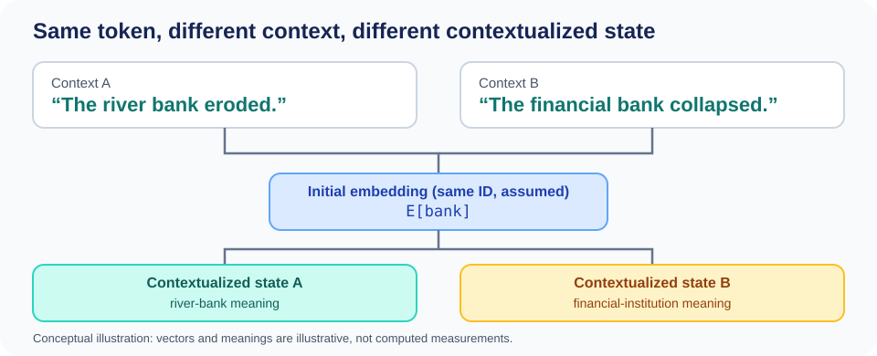

::: {.chapter-lead}
An **embedding** is a numerical vector associated with an object, such as a token. The collection of these vectors forms a representation space. We can compare their directions, distances, or neighbours, but interpretation depends on the model, its training, and the task: geometry is not a universal dictionary of meaning.
:::

This page first establishes how token IDs select vectors and how a Transformer turns initial embeddings into contextualized states. It then examines the geometry of those representations, the limits of similarity measures, and common interpretation pitfalls.

## Where do the vectors come from?

A tokenizer splits text into tokens and usually maps each token to an integer ID. An embedding matrix $E\in\mathbb{R}^{V\times d}$ contains one vector per ID: $V$ is the vocabulary size and $d$ is the embedding dimension. The initial embedding for token ID $i$ is row $E_i$.

In a Transformer, this representation is then transformed by the network's layers. Three objects should be distinguished:

- **Token embedding:** the initial vector retrieved from the vocabulary matrix.
- **Contextualized representation:** a vector produced after processing context, including through attention.
- **Sentence or document embedding:** a vector computed by a model and aggregation method designed to represent a longer text.

These objects are not interchangeable. A method suited to sentence embeddings for document retrieval does not automatically transfer to a language model's internal activations.

## From token IDs to vectors: a worked lookup

Let the vocabulary contain five IDs and let each token embedding have dimension two. A tiny illustrative embedding matrix is:

\[
E =
\begin{bmatrix}
0.1 & 0.0 \\
0.0 & 0.2 \\
0.8 & -0.1 \\
-0.2 & 0.5 \\
0.3 & 0.7
\end{bmatrix}
\in \mathbb{R}^{5\times 2}.
\]

For token IDs \([2,0,3]\), the lookup selects rows \(E_2\), \(E_0\), and \(E_3\):

\[
X =
\begin{bmatrix}
0.8 & -0.1 \\
0.1 & 0.0 \\
-0.2 & 0.5
\end{bmatrix}
\in \mathbb{R}^{3\times 2}.
\]

The IDs are row indices; the resulting vectors are learned parameters. The values above are invented solely to make the lookup hand-checkable. They do not encode real semantic relationships, and ID 3 is not “more similar” to ID 2 because the integers are close.

For a batch, the common shape transition is:

\[
\text{token IDs }[B,L]
\;\longrightarrow\;
\text{token embeddings }[B,L,d],
\]

where \(B\) is batch size, \(L\) sequence length, and \(d\) embedding dimension. Lookup does not mix information across positions: two occurrences of the same token ID retrieve the same row before positional information and contextual processing are applied.

### One reproducible trace: text → token IDs → embedding rows

The next example connects a real, named tokenizer encoding to a **synthetic** embedding table. It uses the GPT-2 byte-level BPE encoding distributed by `tiktoken`; the IDs below are asserted against the library's public tests. Install the pinned tokenizer version with `python -m pip install tiktoken==0.14.0`. NumPy is already a project dependency.

```python
import numpy as np
import tiktoken

text = "hello world"  # a Python Unicode string
utf8_bytes = text.encode("utf-8")
encoding = tiktoken.get_encoding("gpt2")
token_ids = encoding.encode(text)
token_bytes = [encoding.decode_single_token_bytes(i) for i in token_ids]
token_strings = [part.decode("utf-8") for part in token_bytes]

assert utf8_bytes == b"hello world"
assert token_ids == [31373, 995]
assert token_strings == ["hello", " world"]
assert encoding.decode(token_ids) == text

# Synthetic weights: real GPT-2 uses a different embedding dimension and learned values.
vocab_size, d = 50_257, 2
E = np.zeros((vocab_size, d), dtype=np.float32)
E[31373] = [0.1, 0.2]
E[995] = [-0.3, 0.4]
X = E[token_ids]

assert X.shape == (2, 2)
assert np.allclose(X, [[0.1, 0.2], [-0.3, 0.4]])

# Illustrative learned absolute-position vectors, not GPT-2's real parameters.
P = np.array([[0.01, 0.02], [0.03, 0.04]], dtype=np.float32)
Z = X + P
assert Z.shape == (2, 2)
assert np.allclose(Z, [[0.11, 0.22], [-0.27, 0.44]])
```

Read the trace carefully:

1. `text` is Unicode text; UTF-8 gives its bytes.
2. The selected `gpt2` encoding maps the text to token IDs `[31373, 995]`; their byte fragments decode to `"hello"` and `" world"`. The leading space belongs to the second token.
3. The IDs index rows in `E`. The two vectors are **invented** values, not the pretrained GPT-2 embeddings; the table has the same vocabulary index range only so the real IDs can select rows.
4. `P` illustrates one architecture's position-vector addition. `Z` remains shape `[L,d]`; this example does not run a Transformer block and therefore does not compute contextualized hidden states.

The exact IDs are specific to the named encoding and library behaviour; another tokenizer may produce different fragments and IDs. The assertions make changes visible rather than silently treating tokenization as universal. See the [official tiktoken repository](https://github.com/openai/tiktoken) and its [encoding tests](https://github.com/openai/tiktoken/blob/0.14.0/tests/test_encoding.py) for the reference output.

## Vocabulary size, dimension, and parameters

Vocabulary size \(V\) and embedding dimension \(d\) are separate design choices. The embedding matrix \(E\in\mathbb{R}^{V\times d}\) has \(V\) rows—one per ID—and \(d\) components per row. For a sequence of length \(L\), lookup produces a matrix of shape \(L\times d\); for a batch of \(B\) sequences, the common shape is \(B\times L\times d\).

- **\(V\)** depends on the tokenizer and its vocabulary, including special tokens.
- **\(d\)** is an architectural hyperparameter chosen alongside depth, attention heads, and compute budget; it is not derived from \(V\).
- The embedding table contains \(Vd\) parameters.

**A hand-checkable scale estimate:** with \(V=50\,000\) tokens and \(d=768\), the table contains \(50\,000\times768=38\,400\,000\) parameters. At 32-bit precision, the weights alone occupy about 153.6 MB in decimal units (or 146.5 MiB), excluding gradients, optimizer states, and other parameters. This estimates the table's cost; it does not describe a particular model.
- If the output projection has a separate weight matrix, it typically adds \(dV\) parameters, possibly plus a bias. Some models share input and output weights (*weight tying*), so check the architecture before counting both matrices.
- IDs and their associated weights are coupled. Changing the vocabulary, ID assignments, or \(V\) requires an explicit adaptation or retraining strategy; it is not a neutral substitution.

At each position, the output distribution generally has \(V\) logits. The [tensors page](tensors.qmd) explains how to read axes and shapes; the [logits page](logits.qmd) covers output scores in more depth. This section complements the [text-to-token overview](text-data.qmd) without conflating initial lookup with Transformer contextualization.

## From token embeddings to contextualized states

The next step depends on the architecture. In a GPT-2-style model with learned absolute position embeddings, a position-specific vector is added to each token embedding:

\[
X_{b,t}=E_{\text{token}_{b,t}}+P_t.
\]

Both terms have dimension \(d\), so the combined input has shape \([B,L,d]\). Transformer blocks then contextualize each position using the sequence; for a standard width-preserving block, the hidden-state shape remains \([B,L,d]\), although the values change as information from the context is incorporated.

This addition is **not universal**. For example, [RoPE](positional-encoding.qmd) applies position-dependent rotations to query and key vectors inside attention rather than adding a position vector directly to the initial token embeddings. Always identify the architecture before drawing a precise pipeline.

During training, gradients can update the embedding-table rows used by the examples. The lookup operation itself does not make a vector context-aware; contextualization happens in the subsequent network layers. See [tensors](tensors.qmd) for axis conventions and [from text to tokens](text-data.qmd) for the preceding tokenizer stage.

### Same token, different contexts

{fig-alt="Two sentences use bank in different contexts. Assuming the same ID, both occurrences share the initial embedding, then may produce different contextualized states." width=100%}

This original illustration is motivated by [Ethayarajh (2019), *How Contextual are Contextualized Word Representations?*](https://arxiv.org/abs/1909.00512). It illustrates the principle, not measured vectors: it assumes `bank` maps to the same token in both sentences. Depending on the tokenizer, a visible word may consist of multiple tokens.

The initial embedding is retrieved from the ID; the contextualized representation then depends on other tokens, the architecture, and the layer considered. This does not mean every occurrence must have a wholly different vector at every layer, or that vectors always separate according to human-expected meanings.

## A map of representations

{fig-alt="Points grouped in an abstract plane. The groups are illustrative; the axes do not necessarily correspond to human concepts." width=100%}

This is a conceptual illustration in two dimensions. Real embeddings often have hundreds or thousands of coordinates; a 2D projection can distort distances and neighbourhoods.

## What does proximity mean?

Two vectors can be compared using a dot product, Euclidean distance, or cosine similarity. Cosine compares their directions:

$$
\operatorname{cos}(x,y)=\frac{x^\top y}{\|x\|_2\|y\|_2}.
$$

A high score means the directions are close. It does not prove that the texts are equivalent, imply the same conclusion, or that a document correctly answers a question.

For example, “the treatment is effective” and “the treatment is not effective” share almost all their words, although negation changes the decisive meaning. Conversely, very different formulations can express the same information.

## Learned geometry, not universal geometry

Embedding dimensions generally do not have stable human-readable labels. For example, an orthogonal change of coordinates can mix dimensions while preserving dot products, distances, and cosine similarities; the same geometry is then expressed along different axes. This illustrates why an individual axis has no guaranteed human-readable meaning. Do not interpret a dimension as “sentiment” or “causality” without experiments supporting that interpretation.

Geometry depends on the training objective, data, observed layer, normalization, metric, and task. **Anisotropy** (vectors concentrated in certain directions) and **hubness** (points becoming neighbours of many other points) can degrade similarity search. These are phenomena to measure, not explanations to assume automatically.

## Can a 2D projection mislead?

Yes. UMAP, t-SNE, and other dimensionality-reduction methods aim to preserve selected relationships, not the entire original geometry. Distances in the image should not be treated as exact distances in the original space. A visually clear separation also does not prove that the model distinguishes categories correctly on new data.

To evaluate an embedding space, return to the actual task: document retrieval, annotated similarity, classification, and so on. For retrieval, measure metrics such as Recall@k, MRR, or nDCG; for annotated similarity scores, use an appropriate correlation measure. Also inspect false positives and out-of-distribution examples.

## Common misconceptions

- **“Each dimension corresponds to a concept.”** There is no such guarantee; a feature may be distributed across multiple dimensions.
- **“Nearby vectors always represent nearby meanings.”** Negation, contradictions, and out-of-distribution uses can break this intuition.
- **“A beautiful visualization demonstrates embedding quality.”** It illustrates a projection; task-specific evaluation measures usefulness for the task.
- **“All embeddings should be compared with cosine.”** The choice depends on the model and its objective. Dot product and cosine induce the same ranking when vectors are normalized.

## Continue learning

- [Cosine similarity](cosine-similarity.qmd): metrics and limitations.
- [Representation linearity](embedding-linearity.qmd): decodability, linearity, and interpretation.
- [Tensors](tensors.qmd): how vectors are organized in network computations.
- [Positional encoding and RoPE](positional-encoding.qmd): information about token positions.

## References

- [Mikolov et al. (2013), *Efficient Estimation of Word Representations in Vector Space*](https://arxiv.org/abs/1301.3781).
- [Ethayarajh (2019), *How Contextual are Contextualized Word Representations?*](https://arxiv.org/abs/1909.00512).
- [Li et al. (2020), *On the Sentence Embeddings from Pre-trained Language Models*](https://aclanthology.org/2020.emnlp-main.733/).
- [Steck, Ekanadham & Kallus (2024), *Is Cosine-Similarity of Embeddings Really About Similarity?*](https://arxiv.org/abs/2403.05440).
- [Sentence Transformers — Semantic Textual Similarity](https://sbert.net/docs/sentence_transformer/usage/semantic_textual_similarity.html).

::: {.language-switch}
**Language:** [Français](../fr/embedding-space.qmd) · [English](embedding-space.qmd)
:::
