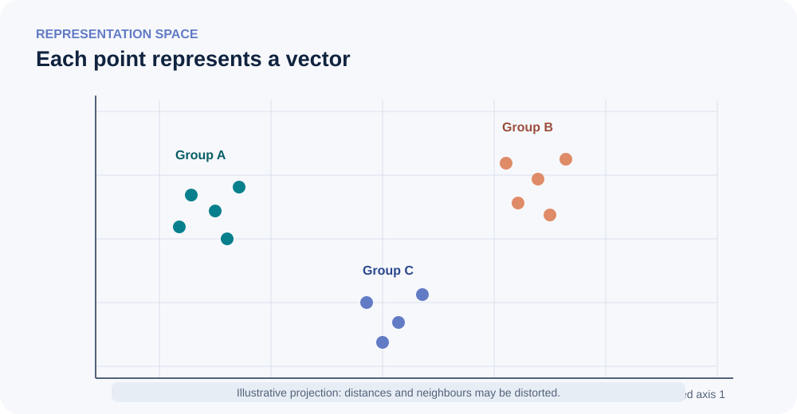

<!--
LLM-LAB-PAGE-MAP v1
id: "en/embedding-space"
scope: "Explains the lookup that maps each token ID to an initial learned vector, then distinguishes this vector from contextualized representations produced by Transformer layers; introduces geometry cautiously without making it a prerequisite."
purpose: "Readers should be able to explain how an ID selects a row in the embedding matrix, distinguish initial embeddings from contextualized representations, and understand why geometric properties require model- and task-dependent interpretation."
suggested_route:
  previous: "en/tokenization-strategies"
  next: "en/positional-encoding"
hierarchy:
  parents: ["en/text-data", "en/transformer"]
  children: ["en/positional-encoding", "en/contextualized-representations", "en/cosine-similarity", "en/embedding-linearity"]
related: []
tags: ["type:concept-lesson", "destination:understand", "topic:embedding-space", "level:core", "language:en", "status:published"]
-->

::: {.chapter-lead}
An **embedding** is a numerical vector associated with an object, such as a token. The collection of these vectors forms a representation space. We can compare their directions, distances, or neighbours, but interpretation depends on the model, its training, and the task: geometry is not a universal dictionary of meaning.
:::

::: {.callout-tip title="The one-minute mental model"}
An ID is a **row address**, not a semantic coordinate. The embedding matrix stores one learned vector per ID; lookup simply selects the corresponding row. Two occurrences of the same ID therefore retrieve the same initial vector. The Transformer then builds a context-dependent representation from it.

**First pass:** understand the lookup in the small matrix and remember that an ID selects a row; it is not itself a semantic coordinate.

**Go deeper:** the Python trace and parameter count are available in optional collapsed sections; geometric properties are developed in the cosine-similarity and linearity lessons.
:::

## Where do the vectors come from?

A tokenizer splits text into tokens and usually maps each token to an integer ID. An embedding matrix $E\in\mathbb{R}^{V\times d}$ contains one vector per ID: $V$ is the vocabulary size and $d$ is the embedding dimension. The initial embedding for token ID $i$ is row $E_i$.

In a Transformer, this representation is then transformed by the network's layers. Three objects should be distinguished:

- **Token embedding:** the initial vector retrieved from the vocabulary matrix.
- **Contextualized representation:** a vector produced after processing context, including through attention.
- **Sentence or document embedding:** a vector computed by a model and aggregation method designed to represent a longer text.

These objects are not interchangeable. A method suited to sentence embeddings for document retrieval does not automatically transfer to a language model's internal activations.

### A historical distinction: static word vectors

Before contextual language models, methods such as Word2Vec learned **one vector per word type** from patterns in its surrounding words. CBOW predicts a target word from its context; Skip-gram predicts surrounding words from a target word. In a trained Word2Vec model, the vector for a vocabulary entry such as `bank` is the same wherever that word appears.

A Transformer starts differently: its embedding table maps each **token ID** (often a subword unit, not a whole word) to an initial vector. The same ID retrieves the same initial row, but subsequent layers combine it with positional and contextual information, so the resulting hidden state can differ across occurrences. Thus, a static Word2Vec word vector, a Transformer token embedding, and a contextualized hidden state are related ideas, but they are not interchangeable.

This is a conceptual contrast, not a claim that modern Transformer embeddings are initialized or trained like Word2Vec. See [Mikolov et al. (2013)](https://arxiv.org/abs/1301.3781) for the original word-representation architectures.

## From token IDs to vectors: a worked lookup

Let the vocabulary contain five IDs and let each token embedding have dimension two. A tiny illustrative embedding matrix is:

\[
E =
\begin{bmatrix}
0.1 & 0.0 \\
0.0 & 0.2 \\
0.8 & -0.1 \\
-0.2 & 0.5 \\
0.3 & 0.7
\end{bmatrix}
\in \mathbb{R}^{5\times 2}.
\]

For token IDs \([2,0,3]\), the lookup selects rows \(E_2\), \(E_0\), and \(E_3\):

\[
X =
\begin{bmatrix}
0.8 & -0.1 \\
0.1 & 0.0 \\
-0.2 & 0.5
\end{bmatrix}
\in \mathbb{R}^{3\times 2}.
\]

The IDs are row indices; the resulting vectors are learned parameters. The values above are invented solely to make the lookup hand-checkable. They do not encode real semantic relationships, and ID 3 is not “more similar” to ID 2 because the integers are close.

For a batch, the common shape transition is:

\[
\text{token IDs }[B,L]
\;\longrightarrow\;
\text{token embeddings }[B,L,d],
\]

where \(B\) is batch size, \(L\) sequence length, and \(d\) embedding dimension. Lookup does not mix information across positions: two occurrences of the same token ID retrieve the same row before positional information and contextual processing are applied.

::: {.callout-note collapse="true" title="Optional example"}

### One reproducible trace: text → token IDs → embedding rows
The next example connects a real, named tokenizer encoding to a **synthetic** embedding table. It uses the GPT-2 byte-level BPE encoding distributed by `tiktoken`; the IDs below are asserted against the library's public tests. Install the pinned tokenizer version with `python -m pip install tiktoken==0.14.0`. NumPy is already a project dependency.

```python
import numpy as np
import tiktoken

text = "hello world"  # a Python Unicode string
utf8_bytes = text.encode("utf-8")
encoding = tiktoken.get_encoding("gpt2")
token_ids = encoding.encode(text)
token_bytes = [encoding.decode_single_token_bytes(i) for i in token_ids]
token_strings = [part.decode("utf-8") for part in token_bytes]

assert utf8_bytes == b"hello world"
assert token_ids == [31373, 995]
assert token_strings == ["hello", " world"]
assert encoding.decode(token_ids) == text

# Synthetic weights: real GPT-2 uses a different embedding dimension and learned values.
vocab_size, d = 50_257, 2
E = np.zeros((vocab_size, d), dtype=np.float32)
E[31373] = [0.1, 0.2]
E[995] = [-0.3, 0.4]
X = E[token_ids]

assert X.shape == (2, 2)
assert np.allclose(X, [[0.1, 0.2], [-0.3, 0.4]])

# Illustrative learned absolute-position vectors, not GPT-2's real parameters.
P = np.array([[0.01, 0.02], [0.03, 0.04]], dtype=np.float32)
Z = X + P
assert Z.shape == (2, 2)
assert np.allclose(Z, [[0.11, 0.22], [-0.27, 0.44]])
```

Read the trace carefully:

1. `text` is Unicode text; UTF-8 gives its bytes.
2. The selected `gpt2` encoding maps the text to token IDs `[31373, 995]`; their byte fragments decode to `"hello"` and `" world"`. The leading space belongs to the second token.
3. The IDs index rows in `E`. The two vectors are **invented** values, not the pretrained GPT-2 embeddings; the table has the same vocabulary index range only so the real IDs can select rows.
4. `P` illustrates one architecture's position-vector addition. `Z` remains shape `[L,d]`; this example does not run a Transformer block and therefore does not compute contextualized hidden states.

The exact IDs are specific to the named encoding and library behaviour; another tokenizer may produce different fragments and IDs. The assertions make changes visible rather than silently treating tokenization as universal. See the [official tiktoken repository](https://github.com/openai/tiktoken) and its [encoding tests](https://github.com/openai/tiktoken/blob/0.14.0/tests/test_encoding.py) for the reference output.
:::

::: {.callout-note title="Parameter cost: where to find it"}
The embedding table contains $V \times d$ parameters; a separate output projection may add $d \times V$ unless input and output weights are tied. The detailed counting, the associated shapes, and a hand-checkable scale estimate are provided in the [Tensors](tensors.qmd) page.
:::

## From initial embeddings to contextualized representations

Lookup ends when a row is selected from the embedding matrix; it does not contextualize the vector. Positional information and processing by Transformer layers come afterwards, with mechanisms that depend on the architecture. To keep these stages distinct, see the dedicated lessons on [positional encoding](positional-encoding.qmd) and [contextualized representations](contextualized-representations.qmd).

During training, gradients can update the embedding-table rows used by the examples. For tensor shapes and operations, see [tensors](tensors.qmd); for the preceding tokenizer stage, see [from text to tokens](text-data.qmd).

## Interpreting geometry with care

{fig-alt="Points grouped in an abstract plane. The groups are illustrative; the axes do not necessarily correspond to human concepts." width=100%}

This projection is illustrative: real embeddings often have hundreds or thousands of coordinates, and a 2D representation can distort distances and neighbourhoods.

Geometric proximity depends on the model, layer, training objective, and metric. It does not prove that two texts are equivalent or that a document correctly answers a question—negation can reverse meaning even when most of the vocabulary is shared.

For a deeper treatment without conflating geometry with the lookup mechanism, see the pages on [cosine similarity](cosine-similarity.qmd) and the [linearity hypothesis for representations](embedding-linearity.qmd).

::: {.self-check}
## Check your understanding

[Extended exercises on this topic](../en/exercises.qmd#transformer).

1. An embedding matrix has \(V\) rows and vectors of dimension \(d\). How many parameters does it contain, and what does ID \(i\) select?

<details>
<summary>Show the reasoning</summary>

The matrix contains \(V\times d\) parameters. ID \(i\) selects row \(E_i\); its integer value is an index, not a semantic coordinate. Positional processing and contextualization happen afterwards, depending on the architecture (see the two dedicated lessons).

</details>

2. A 2D projection shows two clearly separated point clusters. Does this prove that the model correctly distinguishes these categories on new data?

<details>
<summary>Show the reasoning</summary>

No. A 2D projection preserves only selected aspects of the geometry and may create or exaggerate visual separation. Define a task, metric, and evaluation protocol on relevant held-out data; an exploratory plot is not evidence of predictive performance.

</details>
:::

## References

- [Mikolov et al. (2013), *Efficient Estimation of Word Representations in Vector Space*](https://arxiv.org/abs/1301.3781).
- [Ethayarajh (2019), *How Contextual are Contextualized Word Representations?*](https://arxiv.org/abs/1909.00512).
- [Li et al. (2020), *On the Sentence Embeddings from Pre-trained Language Models*](https://aclanthology.org/2020.emnlp-main.733/).
- [Steck, Ekanadham & Kallus (2024), *Is Cosine-Similarity of Embeddings Really About Similarity?*](https://arxiv.org/abs/2403.05440).
- [Sentence Transformers — Semantic Textual Similarity](https://sbert.net/docs/sentence_transformer/usage/semantic_textual_similarity.html).

::: {.language-switch}
**Language:** [Français](../fr/embedding-space.qmd) · [English](embedding-space.qmd)
:::
