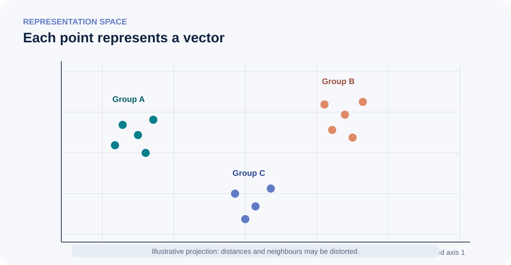

::: {.chapter-lead}
An **embedding** is a numerical vector associated with an object, such as a token. The collection of these vectors forms a representation space. We can compare their directions, distances, or neighbours, but interpretation depends on the model, its training, and the task: geometry is not a universal dictionary of meaning.
:::

## A map of representations

{fig-alt="Points grouped in an abstract plane. The groups are illustrative; the axes do not necessarily correspond to human concepts." width=100%}

This is a conceptual illustration in two dimensions. Real embeddings often have hundreds or thousands of coordinates; a 2D projection can distort distances and neighbourhoods.

## Where do the vectors come from?

A tokenizer splits text into tokens and usually maps each token to an integer ID. An embedding matrix $E\in\mathbb{R}^{V\times d}$ contains one vector per ID: $V$ is the vocabulary size and $d$ is the embedding dimension. The initial embedding for token ID $i$ is row $E_i$.

In a Transformer, this representation is then transformed by the network's layers. Three objects should be distinguished:

- **Token embedding:** the initial vector retrieved from the vocabulary matrix.
- **Contextualized representation:** a vector produced after processing context, including through attention.
- **Sentence or document embedding:** a vector computed by a model and aggregation method designed to represent a longer text.

These objects are not interchangeable. A method suited to sentence embeddings for document retrieval does not automatically transfer to a language model's internal activations.

## What does proximity mean?

Two vectors can be compared using a dot product, Euclidean distance, or cosine similarity. Cosine compares their directions:

$$
\operatorname{cos}(x,y)=\frac{x^\top y}{\|x\|_2\|y\|_2}.
$$

A high score means the directions are close. It does not prove that the texts are equivalent, imply the same conclusion, or that a document correctly answers a question.

For example, “the treatment is effective” and “the treatment is not effective” share almost all their words, although negation changes the decisive meaning. Conversely, very different formulations can express the same information.

## Learned geometry, not universal geometry

Embedding dimensions generally do not have stable human-readable labels. A transformation that mixes coordinates can preserve task-relevant relationships while changing the interpretation of each axis. Do not interpret an individual dimension as “sentiment” or “causality” without experiments supporting that interpretation.

Geometry depends on the training objective, data, observed layer, normalization, metric, and task. **Anisotropy** (vectors concentrated in certain directions) and **hubness** (points becoming neighbours of many other points) can degrade similarity search. These are phenomena to measure, not explanations to assume automatically.

## Can a 2D projection mislead?

Yes. UMAP, t-SNE, and other dimensionality-reduction methods aim to preserve selected relationships, not the entire original geometry. Distances in the image should not be treated as exact distances in the original space. A visually clear separation also does not prove that the model distinguishes categories correctly on new data.

To evaluate an embedding space, return to the actual task: document retrieval, annotated similarity, classification, and so on. For retrieval, measure metrics such as Recall@k, MRR, or nDCG; for annotated similarity scores, use an appropriate correlation measure. Also inspect false positives and out-of-distribution examples.

## Common misconceptions

- **“Each dimension corresponds to a concept.”** There is no such guarantee; a feature may be distributed across multiple dimensions.
- **“Nearby vectors always represent nearby meanings.”** Negation, contradictions, and out-of-distribution uses can break this intuition.
- **“A beautiful visualization demonstrates embedding quality.”** It illustrates a projection; task-specific evaluation measures usefulness for the task.
- **“All embeddings should be compared with cosine.”** The choice depends on the model and its objective. Dot product and cosine induce the same ranking when vectors are normalized.

## Continue learning

- [Cosine similarity](cosine-similarity.qmd): metrics and limitations.
- [Representation linearity](embedding-linearity.qmd): decodability, linearity, and interpretation.
- [Tensors](tensors.qmd): how vectors are organized in network computations.
- Positional encoding and RoPE: information about token positions. The dedicated page is currently available in French only ([encodage positionnel et RoPE](../fr/positional-encoding.qmd)).

## Further video

- [Video suggested for further study](https://www.youtube.com/watch?v=Hwr9OpeO9fM) — the link was supplied, but its title and content have not been independently verified.

## References

- [Mikolov et al. (2013), *Efficient Estimation of Word Representations in Vector Space*](https://arxiv.org/abs/1301.3781).
- [Ethayarajh (2019), *How Contextual are Contextualized Word Representations?*](https://arxiv.org/abs/1909.00512).
- [Li et al. (2020), *On the Sentence Embeddings from Pre-trained Language Models*](https://aclanthology.org/2020.emnlp-main.733/).
- [Steck, Ekanadham & Kallus (2024), *Is Cosine-Similarity of Embeddings Really About Similarity?*](https://arxiv.org/abs/2403.05440).
- [Sentence Transformers — Semantic Textual Similarity](https://sbert.net/docs/sentence_transformer/usage/semantic_textual_similarity.html).

::: {.language-switch}
**Language:** [Français](../fr/embedding-space.qmd) · [English](embedding-space.qmd)
:::
