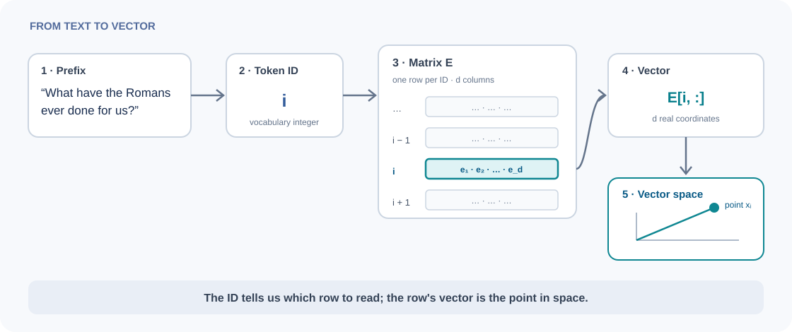

<!--
LLM-LAB-PAGE-MAP v1
id: "en/embedding-space"
summary: "Explains how a token ID selects a row in the embedding matrix and how the resulting vector becomes input to later processing."
scope: "Introduces embedding-matrix lookup, distinguishes a row address from vector coordinates, explains how the matrix is learned, and connects the lookup to contextualized representations. Code, exercises, references, and extended history are moved to Build, Practice, and Deepen."
purpose: "Readers should be able to explain that a token ID is used as a row index/address in E, identify the vector stored in that row, and distinguish it from a contextualized state."
suggested_route:
  previous: "en/text-data"
  next: "en/positional-encoding"
hierarchy:
  parents: ["en/text-data"]
  children: ["en/positional-encoding", "en/contextualized-representations", "en/cosine-similarity", "en/embedding-linearity"]
related: ["en/embedding-space-exercises", "en/gpt-model-walkthrough"]
tags: ["type:concept-lesson", "destination:understand", "topic:embedding-space", "level:core", "language:en", "status:published"]
-->



::: {.chapter-lead}
After tokenization, the model receives a sequence of **integer token IDs**. Each ID retrieves a learned vector from a parameter table: the **embedding matrix**. This lesson explains that lookup, then carefully distinguishes the row address, the vector stored in that row, and the representations that the Transformer builds afterwards.
:::

::: {.callout-note .learning-outcomes collapse="true" title="Learning outcomes"}
By the end of this lesson, you should be able to:
- explain how a token ID selects a row in the embedding matrix;
- distinguish the row address from the vector stored in that row;
- explain why two occurrences of the same ID share the same initial vector but may later have different contextualized states.
:::

## Start with the prefix supplied to the model

For the recurring example, the English pages use the cultural parallel from *Monty Python's Life of Brian*. The text already present in the context is the group's question:

> **Prefix / prompt:** “What have the Romans ever done for us?”

The scene then unfolds through successive replies, including examples such as “Aqueducts”, “sanitation”, “roads” and “irrigation”. In the film these are spoken by different characters, so this is a memorable analogy for context and continuation, not a literal single-speaker autoregressive generation trace. The exact tokenization and IDs depend on the tokenizer; no universal segmentation or ID is assumed here.

A tokenizer splits the prefix into tokens according to its vocabulary and rules, then assigns an integer ID to each token. A visible word is not necessarily one token: the exact segmentation depends on the tokenizer in use.

## Lookup: select a row, not a coordinate

The embedding matrix, denoted by (E), is a learned table. It contains one row per vocabulary ID, and each row contains a vector of real numbers.

{fig-alt="The prefix is split into tokens. A token receives ID i, used as a row index or address to select row i of matrix E. That row contains a vector of d numbers, which can be represented as a point in embedding space. The row address and the point are different objects." fig-cap="The token ID retrieves a row from the table; the vector stored in that row is the object represented in vector space." width=100%}

The distinction matters:

| Object | What it denotes | Role |
|---|---|---|
| **Token ID** (i) | An integer assigned to a token by the tokenizer | Identifies a vocabulary entry |
| **Row index / row address** (i) | That entry's position in matrix (E) | Tells the model which row to select |
| **Embedding vector** (E_{i,:}) | The (d) real numbers stored in that row | Initial numerical representation of the token |
| **Point in space** | The geometric interpretation of vector (E_{i,:}) | Supports analysis of distances, directions, and neighbourhoods |

The phrase **row address** therefore describes access to the table, not the token's geometric position. The vector is a list of coordinates; it is the vector that can be represented as a point in a (d)-dimensional space.

## The matrix in one formula

If the vocabulary contains (V) IDs and each vector has (d) components, the matrix has (V) rows and (d) columns:

$$
E \in \mathbb{R}^{V \times d}
$$

For an ID (i), lookup selects the corresponding row:

$$
\mathbf{x}_i = E_{i,:} \in \mathbb{R}^{d}
$$

- (V) is the size of the vocabulary associated with the model's tokenizer.
- (d) is the embedding dimension.
- (E_{i,:}) denotes all components of row (i).

The matrix therefore contains (V \times d) parameters. The integer (i) is neither a coordinate in vector space nor a measure of proximity: consecutive IDs may select vectors that are far apart.

## Where do the table values come from?

The rows of (E) are not hand-written definitions. The matrix is part of the network's **learned parameters**. In a standard training setup, its values are initialized and then adjusted with the other parameters: the model makes predictions, a loss function measures the discrepancy with target tokens, backpropagation computes gradients, and the optimizer updates the parameters.

The implementation and code belong in the **Build** path: [assembling the GPT and tracing its embedding tables](gpt-model-walkthrough.qmd), within the [guided build route](build-path.qmd). For the roles of loss and gradients, see [the loss function](loss.qmd) and [gradients](gradients.qmd).

## From the initial vector to a contextualized representation

With a fixed matrix, two occurrences of the same ID select the same row and therefore retrieve the same initial vector. The lookup does not read neighbouring words or disambiguate the meaning of a sentence.

Position and context enter later, depending on the architecture. Transformer layers transform input vectors into **contextualized hidden states**: two occurrences with the same initial vector can therefore have different representations when their positions or accessible contexts differ.

For the next steps, see [positional encoding](positional-encoding.qmd), followed by [contextualized representations](contextualized-representations.qmd).

## Continue according to your goal

- **Practice:** [embedding-space exercises](exercises/embedding-space.qmd).
- **Build:** [guided tour of the GPT model](gpt-model-walkthrough.qmd) — embedding tables, dimensions, and the forward pass.
- **Deepen:** [mathematical tools and representation geometry](deepen.qmd#mathematical-tools-and-geometry), including the history of static word vectors, cosine similarity, and the limits of geometric interpretations.



::: {.language-switch}
**Language:** [Français](../fr/embedding-space.qmd) · [English](embedding-space.qmd)
:::
