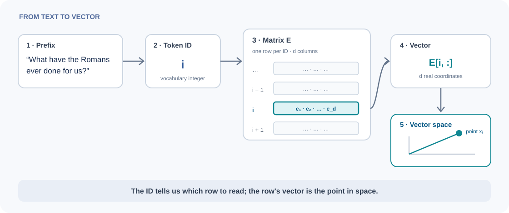

<!--
LLM-LAB-PAGE-MAP v1
id: "en/embedding-space"
summary: "Follows an ID sequence to the initial vectors selected from the embedding matrix, preserving their order and repeated IDs."
scope: "Traces an ID sequence through lookup: sequence position, ID, selected row, and resulting initial vector. Distinguishes this result from positional processing and contextualized states."
purpose: "Given an ID sequence, retrieve the selected rows and vectors in order, explain why repeated IDs share the same vector with a fixed table, and place lookup before positional processing and contextualization."
suggested_route:
  previous: "en/text-data"
  next: "en/positional-encoding"
hierarchy:
  parents: []
  children: ["en/cosine-similarity", "en/embedding-linearity"]
related: ["en/text-data", "en/positional-encoding", "en/contextualized-representations", "en/embedding-space-exercises", "en/gpt-model-walkthrough"]
revision_support:
  status: integrated_sufficient
  evidence:
    - anchor: revision-summary
      note: "The recap distinguishes the ID as a row address, the sequence position, and the selected initial vector. The review sheet asks learners to predict row order and repeated vectors; the associated exercise extends the reasoning to coordinated renumbering of IDs and table rows."
tags: ["type:concept-lesson", "destination:understand", "topic:embedding-space", "level:core", "language:en", "status:published"]
-->



::: {.chapter-lead}
After tokenization, the model receives an ordered sequence of **integer token IDs**. Each ID selects a row of the **embedding matrix** and the learned vector stored there: this is **lookup**. The matrix values are model parameters adjusted during training; the tokenizer supplies IDs but does not compute these vectors.
:::

::: {.callout-note .learning-outcomes collapse="true" title="Learning outcomes"}
By the end of this lesson, you should be able to:

- explain how a token ID selects a row in the embedding matrix;
- distinguish sequence position, ID, and selected vector;
- retrieve the vectors for an ID sequence in order and explain why repeated IDs share the same initial vector with a fixed table.
:::

## Start with the prefix supplied to the model

The text already present in the context is:

> **Prefix / prompt:** “What have the Romans ever done for us?”

[Tokenizing the prefix](text-data.qmd#tokenizer-output) assigns its final token the GPT-2 ID `30`. In the table paired with GPT-2, that ID tells the model which row to read. Position tells it where the token occurs in the sequence. Segmentation depends on the tokenizer, including at the end of the question.

Background to the running example

The replies add examples such as aqueducts, sanitation, roads, and irrigation. They are not yet present when the model processes the prefix. In the scene, different members of the group supply these replies, so this is a context-and-response analogy rather than a single-speaker generation trace. No universal segmentation or token ID is assumed here.

For a controlled, single-speaker continuation used to trace next-token mechanics, keep a separate illustrative example in mind: **“They built roads between distant towns.”** It is not one of the group's replies and does not turn the scene into a single-speaker generation trace.

## Lookup: select a row, not a coordinate {#lookup}

The embedding matrix, denoted by $E$, is a learned table. It contains one row per vocabulary ID, and each row contains a vector of real numbers.

To work out the rows and vectors by hand, distinguish the GPT-2 prefix output from the toy sequence `[17, 42, 8, 17]` used in the [lookup exercise](exercises/text-data.qmd#ex-text-to-embedding-lookup). The toy tokenizer splits “cat follows the cat” into four tokens. With zero-based sequence positions, $t$ denotes the position while $i_t$ denotes the ID at that position. Lookup therefore reads rows $E_{17,:}$, $E_{42,:}$, $E_{8,:}$, and $E_{17,:}$ in that order.

| Position $t$ | 0 | 1 | 2 | 3 |
|---|---:|---:|---:|---:|
| ID $i_t$ | 17 | 42 | 8 | 17 |
| Selected row | $E_{17,:}$ | $E_{42,:}$ | $E_{8,:}$ | $E_{17,:}$ |
| Retrieved vector | $(2,-1)$ | $E_{42,:}$ | $E_{8,:}$ | $(2,-1)$ |

In the following [first-block-input exercise](exercises/text-data.qmd#ex-token-to-block-input), the toy vector for row 17 is fixed at $(2,-1)$ so that both occurrences of `cat` can be traced into the positional step. This value is illustrative; it is not a row extracted from the real GPT-2 weights. Both occurrences retrieve exactly the same vector because they use the same ID and the same table. The vectors in rows 42 and 8 remain symbolic here; the exercise lets us reason about their order without inventing their values.

<figure id="fig-embedding-lookup">
  <picture>
    <source media="(max-width: 600px)" srcset="../images/embedding-lookup-en-mobile.svg">
    
  </picture>
  <figcaption>The token ID retrieves a row from the table; the vector stored in that row is the object represented in vector space.</figcaption>
</figure>

| Object | What it denotes | Role |
|---|---|---|
| **Token ID** $i$ | An integer assigned to a token by the tokenizer | Identifies a vocabulary entry |
| **Row index / row address** $i$ | That entry's position in matrix $E$ | Tells the model which row to select |
| **Embedding vector** $E_{i,:}$ | The $d$ real numbers stored in that row | Initial numerical representation of the token |
| **Point in space** | The geometric interpretation of vector $E_{i,:}$ | Supports analysis of distances, directions, and neighbourhoods |

The phrase **row address** therefore describes access to the table, not the token's geometric position. The vector is a list of coordinates; it is the vector that can be represented as a point in a $d$-dimensional space.

## The matrix in one formula {#embedding-matrix-lookup}

If the vocabulary contains $V$ IDs and each vector has $d$ components, the matrix has $V$ rows and $d$ columns:

$$
E \in \mathbb{R}^{V \times d}
$$

For an ID $i$, lookup selects the corresponding row:

$$
\mathbf{x}_i = E_{i,:} \in \mathbb{R}^{d}
$$

- $V$ is the size of the vocabulary associated with the model's tokenizer.
- $d$ is the embedding dimension.
- $E_{i,:}$ denotes all components of row $i$.

For an ID sequence $(i_0,\ldots,i_{T-1})$, lookup is applied at every position $t$, in the same order:

$$
X = \begin{bmatrix}
E_{i_0,:} \\
E_{i_1,:} \\
\vdots \\
E_{i_{T-1},:}
\end{bmatrix}
\in \mathbb{R}^{T \times d}
$$

$T$ is the number of positions in the sequence and $d$ is the dimension of each vector. For the example $[17,42,8,17]$, $T=4$ and the output therefore has shape $(4,d)$. If an ID occurs twice, the corresponding rows of $X$ are identical before any positional processing. Position $t$, ID $i_t$, and vector $E_{i_t,:}$ denote three distinct objects.

The matrix therefore contains $V \times d$ parameters. The integer $i$ is neither a coordinate in vector space nor a measure of proximity: consecutive IDs may select vectors that are far apart.

ID numbers are labels, not properties of the vectors: renumbering the vocabulary while moving the corresponding matrix rows preserves lookup. The [lesson on turning text into tokens](text-data.qmd#text-id-experiment) explains this invariance at the tokenizer–model contract level; the associated exercise lets you verify it on a concrete sequence.

The tokenizer fixes the vocabulary and the token-to-ID mapping; it does not provide the values of $E$. Those values are **learned network parameters**: they are initialized and then adjusted during training. When an example uses ID $i$, the loss gradient can contribute to updating row $E_{i,:}$. Lookup selects that row; it does not compute its contents.

## From the initial vector to a contextualized representation {#from-lookup-to-contextualized-representation}

With a fixed matrix, two occurrences of the same ID select the same row and therefore retrieve the same initial vector. The lookup does not read neighbouring words or disambiguate the meaning of a sentence.

Position and context enter later, depending on the architecture. Transformer layers transform input vectors into **contextualized hidden states**: two occurrences with the same initial vector can therefore have different representations when their positions or accessible contexts differ.

::: {.callout-tip title="The one-minute mental model" #revision-summary}
A **token ID is a row address**, not a vector or a coordinate in space. The embedding matrix $E\in\mathbb{R}^{V\times d}$ maps each ID to an initial vector of dimension $d$. Two occurrences of the same ID share this lookup vector; Transformer layers can produce different contextualized states according to position and context.
:::

Both occurrences retrieve the same vector. [Positional encoding](positional-encoding.qmd) explains how their location enters the calculation. Transformer blocks then integrate information from the accessible prefix to produce [contextualized representations](contextualized-representations.qmd).

## Practice

The questions and exercises for this lesson are collected on its [dedicated practice page](exercises/embedding-space.qmd).



::: {.language-switch}
**Language:** [Français](../fr/embedding-space.qmd) · [English](embedding-space.qmd)
:::

## Further exploration

:::: {.supplementary-resources}

Supplementary resources

::: {.learning-resources__content}

### Continue according to your goal

- **Build:** [guided tour of the GPT model](gpt-model-walkthrough.qmd) — embedding tables, dimensions, and the forward pass.
- **Deepen:** [mathematical tools and representation geometry](deepen.qmd#mathematical-tools-and-geometry), including the history of static word vectors, cosine similarity, and the limits of geometric interpretations.

### Where do the table values come from?

The implementation and code belong in the **Build** path: [assembling the GPT and tracing its embedding tables](gpt-model-walkthrough.qmd), within the [guided build route](build-path.qmd). For the roles of loss and gradients, see [the loss function](loss.qmd) and [gradients](gradients.qmd).

:::

::::
