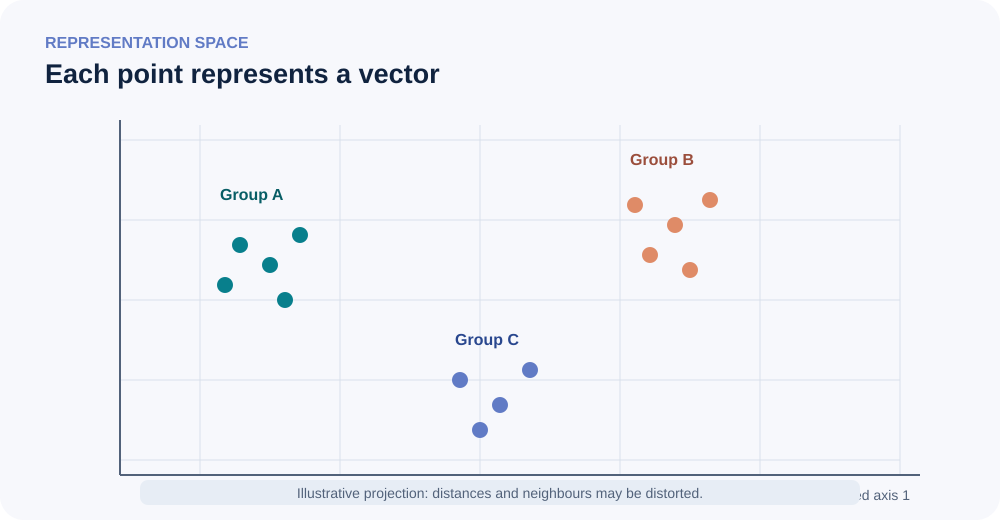

<!--
LLM-LAB-PAGE-MAP v1
id: "en/embeddings-deep-dive"
summary: "A specialized, self-contained guide to vector representations, their families, learning objectives, geometry, evaluation, and uses."
scope: "Steps back to embeddings in the broad sense, including uses beyond LLMs. Reuses the visual intuitions and case-study structure of Hesam Sheikh Hessani's source without replacing the canonical lessons in the main learning path."
purpose: "Enable readers to compare major embedding families, understand what a vector encodes relative to its objective, choose suitable metrics and evaluation protocols, and distinguish token, contextual, sentence, and multimodal representations."
suggested_route:
  previous: null
  next: null
hierarchy:
  parents: ["en/deepen"]
  children: []
related: ["en/embedding-space", "en/contextualized-representations", "en/cosine-similarity", "en/embedding-linearity", "en/tokenizer-design-evaluation"]
tags: ["type:deep-dive", "destination:deepen", "topic:embeddings", "level:advanced", "language:en", "status:published"]
-->

# Why dedicate an entire deep dive to embeddings?

An **embedding** is a representation of an object as a numerical vector. The object may be a word, token, sentence, document, image, audio segment, user, product, or graph node. The term therefore does not name one technique or a magical property of “understanding”: it names a family of representations whose form, space, and usefulness depend on the task and method that produced them.

LLMs use embeddings, but the history and applications of vector representations are much broader. This page is deliberately self-contained: it revisits ideas already encountered in the main learning path and develops them from comparative, historical, mathematical, and experimental perspectives.

::: {.callout-note}
**Guiding idea:** a vector has no meaning independently of its object, model, learning objective, transformations, and evaluation task.
:::

## 1. One general idea, very different objects

The principle can be summarized in three operations:

1. define the objects to represent and the distinctions worth preserving;
2. learn or compute a function that maps each object to a vector;
3. use those vectors for a task: retrieval, ranking, clustering, prediction, recommendation, multimodal alignment, and so on.

```{mermaid}
flowchart LR
    A["Object to represent<br/>word · document · image · audio · node"] --> B["Method / encoder<br/>rules, statistics, or learned network"]
    B --> C["Vector<br/>dense or sparse"]
    C --> D["Geometric operation<br/>distance · similarity · projection"]
    D --> E["Task<br/>retrieval · classification · clustering · recommendation"]
```

This chain highlights an essential distinction: **the encoder builds a representation; the metric and task determine how it is used**. Geometric proximity is not a universal definition of similarity.

### Representation is not simply compression

A representation may preserve some information and discard other information. An embedding trained to retrieve relevant documents may prioritize signals useful for search, not every linguistic nuance. An image embedding trained to distinguish visual categories is not necessarily suitable for aesthetic similarity search. A vector always reflects choices about representation and objective.

## 2. Major families: a map, not a sequence of replacements

The families below sometimes overlap. They do not form a timeline in which every method makes the previous one obsolete.

```{mermaid}
flowchart TD
    E["Vector representations"] --> S["Sparse / lexical"]
    E --> D["Dense / distributed"]
    S --> O["One-hot · counts · TF-IDF"]
    D --> W["Static word vectors"]
    D --> C["Contextual representations"]
    D --> P["Sentence and document"]
    D --> M["Multimodal"]
    W --> W1["Word2Vec · GloVe · fastText"]
    C --> C1["ELMo · BERT · Transformer states"]
    P --> P1["Pooling · SBERT · contrastive encoders"]
    M --> M1["CLIP and text-image spaces<br/>audio-text, etc."]
```

| Family | Represented object | Characteristic | Example use |
|---|---|---|---|
| **One-hot** | Discrete identifier | Sparse vector with one active component; no native semantic proximity | Categorical input, baseline |
| **Counts / TF-IDF** | Document or text chunk | Vocabulary-term dimensions, weighted by frequency and rarity | Lexical retrieval, document ranking |
| **Static vectors** | Word or lexical unit | One vector per vocabulary entry, regardless of context | Lexical analysis, exploratory analogies |
| **Subword vectors** | Morphological units or fragments | Shares statistical information across related forms | Morphologically rich languages, rare words |
| **Contextual** | Token at a position in a sequence | Representation depends on the sequence processed by the network | Sequence encoding, feature extraction |
| **Sentence / document** | Variable-length text | Aggregation or encoder trained to represent the whole text | Semantic search, deduplication, clustering |
| **Multimodal** | Objects from different modalities | Aligned spaces for comparison, association, or transfer | Text-image and audio-text retrieval |

### 2.1 Sparse representations: count before learning a dense geometry

In a *one-hot* representation, each category receives a vector with exactly one component equal to 1. Distinct categories are orthogonal: the representation does not express that they are related or close.

With **bag-of-words** representations, we count the terms in a document. TF-IDF weights those counts to reduce the influence of terms that are frequent across the corpus. The resulting vectors are usually high-dimensional and sparse.

TF-IDF is not a learned word embedding: a TF-IDF vector describes a document or chunk through term weights. It is a vector representation, but the object and meaning of its dimensions differ from those of a Word2Vec table or a token embedding.

### 2.2 Distributed and static vectors: learn from co-occurrence

The distributional hypothesis captures a powerful intuition: units appearing in comparable contexts tend to share some properties. Neural methods learn dense vectors from co-occurrence regularities.

- **Word2Vec – CBOW** predicts a target word from its surrounding context.
- **Word2Vec – Skip-gram** predicts context words from a target word.
- **GloVe** uses global word co-occurrence statistics.
- **fastText** represents words using subwords, notably character n-grams, allowing information to be shared across related forms.

These methods typically produce a static vector per lexical vocabulary entry. The word *bank* therefore keeps the same vector in “river bank” and “bank account”: the vector may reflect several aggregated uses, but it does not reconfigure itself for each sentence.

### 2.3 Contextual representations: position and sentence matter

Models such as ELMo, then BERT-like encoders and Transformers, produce representations that depend on the sequence and position being processed. The same lexical input can lead to different states in two contexts.

Still, distinguish:

- the **input embedding table**, which maps each ID to an initial vector;
- the **contextual hidden state**, computed by the network's layers for a particular occurrence;
- the **sentence or document embedding**, built through pooling, a dedicated head, or a specialized encoder.

The word “embedding” is used for all three objects in the literature. Always specify which one is being compared.

### 2.4 Sentence and document embeddings: a different learning target

A token state is not automatically a good sentence vector. To obtain a representation of an entire text, one can aggregate states (mean pooling, a special token, weighted pooling) or train an encoder specifically for text similarity.

Sentence-BERT-like models and contrastive approaches learn to bring selected pairs closer (paraphrases, relevant query-document pairs, positive views) and push negative examples away under a defined objective. Pair construction and negative-sample quality strongly influence what the space encodes.

### 2.5 Multimodal spaces: bring different modalities closer

A multimodal model can encode text and images into a shared space, for example so that a caption and its matching image have nearby vectors. CLIP is a well-known example of text-image alignment through contrastive learning. Similar approaches exist for audio-text and other modalities.

A shared space does not mean that modalities become identical: it means training has learned a geometry in which selected cross-modal correspondences are useful for a task.

## 3. How is an embedding learned?

A vector is rarely a hand-written definition. It results from an objective and a training signal.

```{mermaid}
flowchart LR
    A["Data<br/>contexts, pairs, labels"] --> B["Learning objective<br/>prediction · contrast · reconstruction"]
    B --> C["Encoder and parameters"]
    C --> D["Vectors"]
    D --> E["Score / loss"]
    E --> F["Gradient and update"]
    F --> C
```

Typical objectives include:

- **Context prediction**: predict surrounding words (Skip-gram, CBOW).
- **Masked prediction**: reconstruct masked tokens in context (BERT-style pretraining).
- **Contrastive learning**: bring positive pairs or views closer and push negatives away.
- **Reconstruction**: retain enough information to reconstruct some or all of the input.
- **Task supervision**: make vectors useful for classification, retrieval, recommendation, or prediction.

The useful question is therefore not only “what does this dimension mean?” but “which training signal encouraged the encoder to organize the space this way?”

## 4. Geometry: distances, angles, norms, and pitfalls

A vector of dimension $d$ is a point in $\mathbb{R}^d$.  But individual coordinates generally do not have stable interpretations. Relationships between vectors depend on the model, layer, normalization, and metric.

### 4.1 Three common measures

For two vectors $x$ and $y$:

- **Dot product**: (x^\top y). It depends on both angle and norms.
- **Euclidean distance**: (\|x-y\|_2). It measures distance in the chosen geometry.
- **Cosine similarity**: (\frac{x^\top y}{\|x\|_2\,\|y\|_2}). It compares angle and ignores radial scale.

L2 normalization makes all norms equal to 1; in that case, maximizing the dot product is equivalent to maximizing cosine similarity. Without normalization, these scores are not interchangeable.

### 4.2 A 2D figure is not the original space

A projection (PCA, t-SNE, UMAP, or another method) transforms high-dimensional vectors into coordinates that are easier to visualize. It is useful for exploration, not proof. Methods optimize different properties: some mainly preserve variance, others local neighbourhoods or a selected structure.

{fig-alt="Vectors are projected into an abstract plane; the clusters are illustrative and do not guarantee semantic proximity." fig-cap="A 2D projection makes exploration easier, but does not prove that visible distances and clusters exist unchanged in the original space." width=100%}

### 4.3 Nearest neighbours, graphs, and meaning

A $k$-nearest-neighbour search builds a neighbourhood conditioned on the model, vectors, normalization, metric, value of $k$, and self-neighbour policy. The relation “A is among B's k nearest neighbours” does not always imply the reverse.

Turning these links into an undirected graph imposes a symmetrization rule (union or mutual neighbourhood). A graph layout moves nodes to make the drawing readable: its coordinates do not faithfully reproduce distances in the vector space.

**Do not jump to conclusions:** cosine proximity establishes neither synonymy, interchangeability, nor logical equivalence. “Allowed” and “forbidden” can appear in similar contexts; negation and argumentative relations cannot be reduced to proximity among a few words.

### 4.4 Anisotropy, hubs, and the curse of dimensionality

In high-dimensional spaces, distances can concentrate and some vectors may become neighbours of many points (*hubness*). Representations can also be anisotropic: vectors occupy some directions disproportionately rather than filling the space uniformly.

This affects nearest-neighbour rankings and retrieval. Normalization, centering, dimensionality reduction, or learned metrics can help in particular protocols, but they are not universal fixes. Every transformation must be evaluated on the target task.

## 5. What makes an embedding “good”?

There is no universal quality score. An embedding is good **for a particular use, domain, population, and protocol**.

| Evaluation dimension | Question | Example checks |
|---|---|---|
| Intrinsic quality | Does the geometry reflect a targeted property? | Human similarity, analogies, neighbourhoods |
| Downstream quality | Does the vector improve the actual task? | Retrieval, ranking, classification |
| Robustness | Do results survive variation? | Paraphrases, noise, typos, domain shift |
| Coverage | Which objects are poorly represented? | Rare words, languages, entities, modalities |
| Calibration and bias | Are scores comparable and fair? | Subgroups, corpus bias, thresholds |
| Operational cost | Can the representation be used at scale? | Latency, memory, index, updates |

Separate intrinsic tests (which probe a property of the space) from extrinsic evaluations (which measure a task). A compelling visualization or a successful analogy is not enough to validate a retrieval system.

## 6. From embeddings to vector search

Vector search adds an engineering pipeline around the model:

1. define documents, passages, and metadata;
2. choose an encoder and a chunking strategy;
3. encode passages and queries with compatible conventions;
4. apply the normalization expected by the model and index;
5. index vectors (exact or approximate search);
6. retrieve candidates, then optionally rerank them with a reranker;
7. evaluate recall, precision, ranking, and robustness on representative queries.

A vector database does not make embeddings relevant by itself. Poor chunking, a mismatched encoder, stale documents, or inadequate evaluation can produce a poor system even with a fast index.

## 7. Case study: inspect an LLM embedding table

Hesam Sheikh Hessani's resource offers a particularly useful visual progression: a map of embedding families, TF-IDF and Word2Vec reminders, the static/contextual distinction, model-table lookup, cosine neighbours, and an atlas displayed as a graph.

[Open the original visual guide on Hugging Face](https://huggingface.co/spaces/hesamation/primer-llm-embedding) · [Associated code repository](https://github.com/hesamsheikh/primer-llm-embeddings).

This project reuses the progression as a **case study**, while qualifying several points:

- TF-IDF describes documents/chunks through term weights; it is not a learned word embedding.
- Vocabulary size and dimensions are checkpoint-specific.
- An LLM's input table is not the same object as the contextualized states produced by its layers.
- IDs must remain row identifiers; decoding and then re-tokenizing a string is not a reliable way to recover the original vector.
- Cosine neighbours depend on the model and calculation conventions; they are not an ontology.
- A neighbour graph must state its direction and symmetrization rule.

### A minimal reproducible experiment

LLM Lab provides a NumPy helper that requires no model download: [inspect a tiny embedding table in the bilingual exercise](exercises/embedding-space.qmd). It retrieves rows directly by ID and computes a deterministic cosine top-k. It does not claim to reproduce the source checkpoint or interactive atlas.

### About the source figures

The original resource's most useful visuals include the family overview, TF-IDF/Word2Vec visualizations, lookup diagram, and nearest-neighbour atlas. The Space declares an Apache-2.0 licence, but some embedded illustrations are credited to third parties (including Manning). To avoid assigning rights to the author that may not belong to them, LLM Lab links to the resource and builds its own teaching diagrams rather than copying those files. Figures in this dossier are original or already part of the project; external sources remain attributed.

## 8. Embeddings beyond LLMs

The same vector principle appears in very different fields:

- **Vision**: image retrieval, scene clustering, visual feature recognition.
- **Audio and speech**: recognition, segment retrieval, speaker comparison, or audio-text alignment.
- **Recommendation**: user and item vectors learned from interactions.
- **Graphs**: representing nodes or relations to predict links and compare neighbourhoods.
- **Biology and chemistry**: representing sequences, molecules, or structures for retrieval and prediction.
- **Geospatial data**: encoding places or trajectories for selected proximity tasks.

Be careful with the word “distance”: in each field it expresses structure induced by a particular objective and dataset, not a universal closeness between objects.

## 9. Further deep dives from this page

This dossier acts as a hub for more specialized questions:

- [Cosine similarity](cosine-similarity.qmd) — properties, normalization, and score interpretation.
- [Embedding linearity](embedding-linearity.qmd) — linear relations and the limits of analogies.
- [Contextualized representations](contextualized-representations.qmd) and [the mathematical deep dive](contextualized-representations-advanced.qmd) — states by position, layer, and context.
- [Tokenizer design and evaluation](tokenizer-design-evaluation.qmd) — units, segmentation, and their consequences for representations.
- [JEPA and multimodal representations](jepa-platonic-representation.qmd) — representation learning and cross-modal alignment.

Future dossiers could separately explore sentence embeddings and semantic search, multimodal alignment, or the evaluation of vector spaces. Each should answer a distinct question rather than multiply pages that repeat this overview.

## Further reading

- Bengio et al. (2003), [A Neural Probabilistic Language Model](https://www.jmlr.org/papers/v3/bengio03a.html).
- Mikolov et al. (2013), [Efficient Estimation of Word Representations in Vector Space](https://arxiv.org/abs/1301.3781).
- Pennington et al. (2014), [GloVe: Global Vectors for Word Representation](https://aclanthology.org/D14-1162/).
- Bojanowski et al. (2017), [Enriching Word Vectors with Subword Information](https://arxiv.org/abs/1607.04606).
- Peters et al. (2018), [Deep Contextualized Word Representations](https://arxiv.org/abs/1802.05365).
- Reimers & Gurevych (2019), [Sentence-BERT](https://arxiv.org/abs/1908.10084).
- Radford et al. (2021), [Learning Transferable Visual Models From Natural Language Supervision](https://arxiv.org/abs/2103.00020).
- Ethayarajh (2019), [How Contextual are Contextualized Word Representations?](https://arxiv.org/abs/1909.00512).

---

[Back to the deep-dive map](deepen.qmd) · [Core lesson: from IDs to vectors](embedding-space.qmd)

::: {.language-switch}
**Language:** [Français](../fr/embeddings-deep-dive.qmd) · [English](embeddings-deep-dive.qmd)
:::
