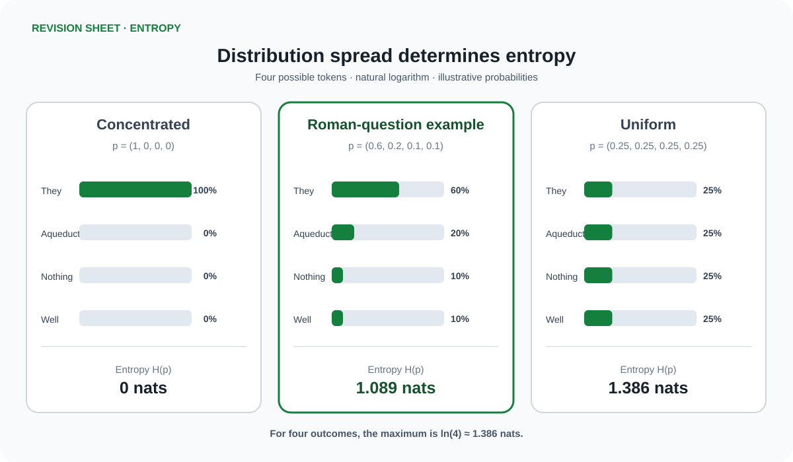

<!--
LLM-LAB-PAGE-MAP v1
id: "en/entropy"
summary: "Defines the entropy of the next-token distribution as predictive dispersion before observing a target, then distinguishes it from the surprisal of the observed token, sequence likelihood, and cross-entropy."
scope: "Define Shannon entropy of the model's next-token distribution for a fixed context as a measure of predictive dispersion before the next token is observed; distinguish it from the realized token's surprisal, sequence likelihood, and cross-entropy against a target distribution."
purpose: "Calculate and interpret the entropy of a categorical next-token distribution, state its bounds for a finite vocabulary, and distinguish expected predictive uncertainty from the surprisal of an observed token."
suggested_route:
  previous: "en/probabilities"
  next: "en/likelihood"
hierarchy:
  parents: ["en/probabilities"]
  children: ["en/cross-entropy"]
related: ["en/likelihood", "en/entropy-exercises"]
tags: ["type:concept-lesson", "destination:understand", "topic:entropy", "level:core", "language:en", "status:published"]
-->



::: {.chapter-lead}
The previous page, [Output probabilities](probabilities.qmd), showed how logits become a conditional distribution over the next token. This page characterizes how spread out that distribution is before the token is observed.

In an autoregressive LLM, entropy describes how spread out the predicted next-token distribution is for a given context. It characterizes that distribution: it does not tell us whether the answer is true or the model is reliable.
:::

::: {.callout-tip title="The one-minute mental model"}
- **Predictive entropy:** $H(p)=-\sum_v p(v)\log p(v)$ summarizes the spread of the entire next-token distribution for a given prefix.
- **Observed surprise:** $-\log p(x_t\mid x_{<t})$ concerns the token that was actually observed; it is not the entropy of the distribution.
- **Bounds:** for a finite vocabulary of size $V$, $0\leq H(p)\leq\log V$ nats (natural logarithm).
- **Interpretation:** low entropy guarantees neither factual correctness nor calibration; tokenizer, context, and temperature affect the quantity being measured.

**Quick question:** can you distinguish uncertainty before observing a token from surprise after observing a target?
:::

:::: {.pipeline-stepper .meta-flow .meta-flow--branch role="group" aria-label="Map of concepts related to the predictive distribution"}
::: {.meta-flow__source}
<strong>Predictive distribution</strong>p(next token | context)
:::
::: {.meta-flow__relation}
Two different questions depending on whether a token has been observed
:::
::: {.meta-flow__comparison}
::: {.meta-flow__comparison-item .meta-flow__branch--active}
<strong>Before observation · Entropy H(p)</strong><small>Spread of the full distribution: predictive uncertainty</small>
:::
::: {.meta-flow__comparison-item}
<strong>After observation · Surprise −log p(y)</strong><small>Score of the observed token; see [likelihood](likelihood.qmd)</small>
:::
:::
::: {.meta-flow__result}
<strong>Given a target distribution q: cross-entropy H(q, p)</strong> · [Compare prediction and target](cross-entropy.qmd)
:::
::::

For the prefix “What have the Romans ever done for us?”, entropy describes how spread out the distribution is over candidate next tokens. It does not measure whether a continuation is true, or the probability of the entire response to come.

## Entropy of the next-token distribution

Given a prefix $x_{<t}$, the model produces a categorical distribution over its vocabulary:

$$
p_\theta(v\mid x_{<t}),\qquad v\in\mathcal V.
$$

Its entropy, using natural logarithms, is (with the convention $0\log 0=0$):

$$
H_t=-\sum_{v\in\mathcal V}p_\theta(v\mid x_{<t})
\log p_\theta(v\mid x_{<t}).
$$

A distribution concentrated on a few tokens generally has lower entropy than a spread-out distribution. For a vocabulary of size $V$, entropy lies between 0 and $\log V$ nats. This bound assumes a normalized discrete distribution over a finite vocabulary.

Entropy depends on the context and on the distribution being measured. The same prefix can lead to different distributions depending on the model, tokenizer, or temperature applied to the logits.

### Numerical example: the Roman question's next-token distribution

For the Roman question, consider this illustrative distribution over four candidate next tokens:

| Candidate token | Probability |
|---|---:|
| “They” | 0.6 |
| “Aqueducts” | 0.2 |
| “Nothing” | 0.1 |
| “Well” | 0.1 |

Using natural logarithms, entropy is:

$$
\begin{aligned}
H(p)&=-\sum_v p(v)\ln p(v)\\
&=-(0.6\ln0.6+0.2\ln0.2
+2\times0.1\ln0.1)\\
&\approx 1.089\text{ nats}.
\end{aligned}
$$

The maximum for four outcomes is $\ln4\approx1.386$ nats, so this distribution reaches about 79% of that maximum. These illustrative values let us follow the same example through [likelihood](likelihood.qmd), [cross-entropy](cross-entropy.qmd), and [gradients](gradients.qmd).

{fig-alt="Three distributions over four tokens. The concentrated distribution (100%, 0%, 0%, 0%) has entropy 0 nats. The Roman-question example (60%, 20%, 10%, 10%) has entropy 1.089 nats. The uniform distribution (25% each) reaches the maximum of 1.386 nats. The bars show probabilities; entropy summarizes the spread of the whole distribution." fig-cap="For four outcomes, entropy increases as the distribution spreads out: 0 nats for a certain outcome, 1.089 nats for the example, and 1.386 nats for the uniform distribution." width=100%}

The key identity is:

$$
H(p)=\mathbb E_{X\sim p}[-\ln p(X)].
$$

In other words, entropy is the **expected** surprisal when the outcome is drawn from $p$. It is a property of the whole distribution, not the surprisal of one particular outcome.

## Predictive entropy and the observed token are different questions

Entropy $H(p)$ describes expected surprisal *before* the next token is known. Once the target token $x_t$ is observed, its surprisal under the model is:

$$
-\log p_\theta(x_t\mid x_{<t}).
$$

This quantity is the observed token's **surprisal**. With a one-hot target, it is also that token's **loss contribution** and its **negative log-likelihood** (NLL): $-\ln p_\theta(x_t\mid x_{<t})$. These names refer here to the same quantity, emphasizing its information-theoretic interpretation, its role in the objective, or its connection to likelihood.

A model can be very confident and still be wrong: if $p=(0.99;0.01)$, its entropy is low (about $0.056$ nats), but observing the second token gives surprisal $-\ln0.01\approx4.605$ nats. Observing the first token gives only $-\ln0.99\approx0.010$ nats. Entropy is the average of these possible surprisals, weighted by their probabilities.

Summing token-level NLLs gives the sequence NLL, using the autoregressive factorization derived on the canonical [Likelihood](likelihood.qmd) page.

## Entropy, temperature, and generation

Temperature $\tau>0$ transforms logits $z$ into a distribution:

$$
p_i^{(\tau)}=\operatorname{softmax}(z/\tau)_i.
$$

Lower temperature tends to concentrate the distribution; higher temperature tends to flatten it. For $\tau>0$, logit ordering and argmax remain unchanged, but probabilities and entropy change. Entropy after temperature scaling should not be presented as calibrated model uncertainty without empirical evaluation.

## What entropy does not establish

- Low entropy does not guarantee that the selected token is correct: a model can be confident and wrong.
- High entropy does not mean the output is false; multiple continuations may be plausible.
- Normalized probabilities do not guarantee calibration.
- **Perplexity** is the exponential of mean NLL per token (or $e^{\bar\ell}$ when the mean is in nats). It summarizes probabilistic performance on a corpus and depends on the tokenizer and evaluation protocol.
- If the data follow a true distribution $q$ and the model predicts $p$, mean surprisal under the data is cross-entropy $H(q,p)=\mathbb E_{X\sim q}[-\ln p(X)]$. It is not automatically the source entropy $H(q)$: equality holds when $p=q$ (more generally, the gap is KL divergence $D_{KL}(q\|p)$).



:::: {.language-switch}
[Français](../fr/entropy.qmd) · [English](entropy.qmd)
::::

  Supplementary resources
  Experiment, explore further, and practise the ideas from this lesson.

### Practice

The questions and exercises for this lesson are collected on its [dedicated practice page](exercises/entropy.qmd).

### Further reading

- [Probabilities and softmax](probabilities.qmd) — how logits become a conditional distribution.
- [Likelihood](likelihood.qmd) — probability of an observed token and sequence.
- [Cross-entropy and KL divergence](cross-entropy.qmd) — the probabilistic objective used to train the model.
- [Loss](loss.qmd) — target shifting, masks, and loss reduction.

## Are LLMs compression algorithms?

**Short answer: not exactly.** An LLM learns to predict the next token. That ability can help compress a sequence *when paired with an entropy coder*. But generating text is not decompressing the training corpus.

### 1. Prediction gives a measure of information

Given the context already observed, the model assigns a probability to the next token:

$$
p(x_t\mid x_{<t}).
$$

After the token is observed, its surprise, or *surprisal*, in bits is:

$$
I(x_t\mid x_{<t})=-\log_2 p(x_t\mid x_{<t}).
$$

If the model assigns probability $1/2$, the token ideally costs 1 bit; if it assigns $1/8$, it costs 3 bits. **The more predictable the token, the fewer bits its ideal code needs.** Summing these surprisals gives the ideal length associated with the sequence:

$$
L(x_{1:T})\approx-\sum_{t=1}^{T}\log_2 p(x_t\mid x_{<t}).
$$

### 2. But a coder and decoder are still needed

Probabilities are not, by themselves, a compressed file. An entropy coder (for example, an arithmetic coder) turns those probabilities into a bitstream. The decoder uses exactly the same model, tokenizer, and conventions to recover the tokens.

Without that shared protocol, an LLM's ability to continue a text does not mean it can reconstruct the exact original text from a shorter representation.

### 3. What this does not mean

- LLM weights are not a literal archive of the training corpus.
- Generating a plausible continuation is not the same as recovering an exact training example.
- Good predictions do not guarantee a net compression benefit once the model, tokenizer, and metadata are counted.
- **Model compression** (quantization, pruning, distillation) reduces the network's storage or runtime cost: that is a different question. See the [model-compression synthesis](https://github.com/JM-Brun/llm-lab/blob/main/docs/source-syntheses/model-compression-2026-11.md).

### Advanced extension — V-information: what an observer can use

Shannon mutual information describes dependence in the joint distribution without restricting the observer's computational power. Xu et al. (ICLR 2020) define a quantity relative to an explicit predictor family \\(\\mathcal V\\):

\$
I_{\\mathcal V}(X\\to Y)=H_{\\mathcal V}(Y\\mid\\varnothing)-H_{\\mathcal V}(Y\\mid X).
\$

It measures the predictive gain from the input for that family and loss. A restricted family may fail to exploit structure that is present in the data. The quantity can be directional; it does not replace Shannon mutual information and does not mean computation creates Shannon information.

**XOR example:** two bits determine their XOR perfectly (1 bit of mutual information), yet a constant predictor gains nothing from observing them. A predictor able to represent their interaction can use almost all of that information. See the [reproducible experiment](../../experiments/information-theory-llm/README.md) and the [primary paper](https://openreview.net/forum?id=r1eBeyHFDH).

### Takeaway

**Predictive compression:** the model supplies probabilities; a coder can use them to represent data with fewer bits.

**Model compression:** the network itself is made smaller or cheaper to run.

**Generation:** the model samples or selects a next token; this is not, by itself, lossless decoding.

To make these ideas concrete, run the [reproducible predictive-compression experiment](https://github.com/JM-Brun/llm-lab/tree/main/experiments/predictive-compression). To compare marginal entropy, conditional entropy, and zlib compression, also run the [sequence-compression experiment](../../experiments/sequence-compression/README.md).

### References

- Claude E. Shannon (1948), [*A Mathematical Theory of Communication*](https://people.math.harvard.edu/~ctm/home/text/others/shannon/entropy/entropy.pdf) — foundational information-theory source.
- Cover & Thomas, [*Elements of Information Theory*](https://onlinelibrary.wiley.com/doi/book/10.1002/047174882X) — entropy and coding.
- [3Blue1Brown — Reinventing Entropy](https://www.youtube.com/watch?v=l6DKRf-fAAM) — complementary visual intuition.

::: {.self-check}
## Check your understanding

[Dedicated exercises](exercises/entropy.qmd).

1. Does low entropy guarantee that the most likely token is correct?
2. How does entropy differ from the surprise of the observed token?
3. Why should the tokenizer be documented when comparing perplexities?

Show the answers

1. No. Entropy describes the spread of the distribution, not factual correctness.
2. Entropy is the expected surprisal under $p$; observed surprisal is $-\ln p(x_t)$ for the target that actually occurred.
3. Tokenizers segment text differently, changing the units and number of positions being evaluated.

:::

[**Revision sheet — Compression and LLMs**](compression-revision.qmd): review the connection between conditional probabilities, code length, model compression, and runtime memory in one place.

