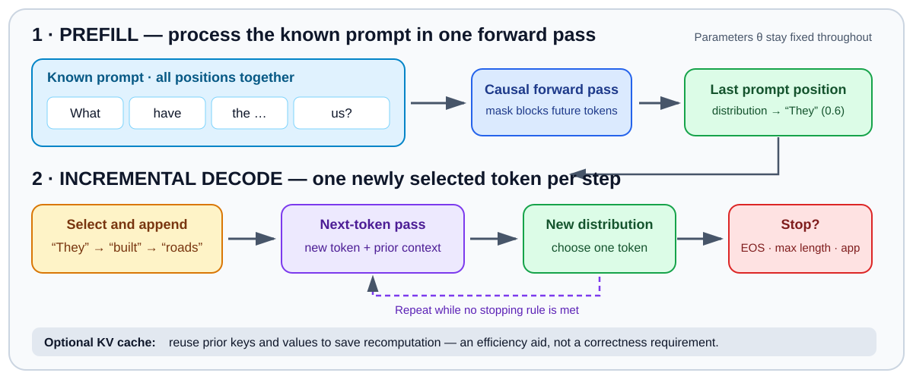

<!--
LLM-LAB-PAGE-MAP v1
id: "en/generation"
summary: "Presents generation as an autoregressive loop: context, next-token prediction, selection, feedback, and stopping. Introduces prefill, incremental decode, and selection strategies, then distinguishes inference from scoring and training."
scope: "Traces free-running generation from prompt processing to stopping. Latency and scheduling are covered as optional depth."
purpose: "Trace selection of the first token from prefill, then the feedback of selected tokens until generation stops."
suggested_route:
  previous: null
  next: "en/in-context-learning"
hierarchy:
  parents: ["en/llm-overview"]
  children: []
related: ["en/text-data", "en/transformer", "en/logits", "en/probabilities", "en/context-engineering", "en/build-path", "en/decoding-strategies", "en/gpt-generation-walkthrough", "en/training-examples", "en/generation-exercises"]
revision_support:
  status: integrated_sufficient
  evidence:
    - anchor: revision-summary
      note: "The recap covers model computation, token selection and feedback, and fixed parameters; Practice questions and exercises deepen sampling, prefill/decode and KV-cache behaviour."
tags: ["type:concept-lesson", "destination:understand", "topic:inference-generation", "level:core", "language:en", "status:published"]
-->



::: {.chapter-lead}
Return to the first prediction: after “What have the Romans ever done for us?”, the model gives 0.6 to “They” and 0.2 to “Aqueducts”. A table of probabilities is not yet an answer. How do we get from one to the other?

By repeating four moves: predict, select, feed back, then continue or stop. This loop is **autoregressive generation**. While it runs, the model's parameters do not change: producing a response is not learning.
:::

**Prefix supplied:** “What have the Romans ever done for us?” The question is already in the context when generation starts. The successive replies are spoken by several members of the group, so this is a context-and-response analogy, not a literal one-speaker generation trace. **Continuation followed here:** “They built roads between distant towns.” This is an original LLM Lab text, not a film quotation or a model output; its tokens are appended one at a time.

::: {.callout-tip title="The one-minute mental model" #revision-summary}
- **The model computes, a rule chooses.** The model supplies a distribution over the next token. A decoding rule, outside the network, draws a single token from it.
- **The chosen token becomes context.** It is appended to the text, and the model recomputes a distribution for the next position.
- **Nothing is learned along the way.** The parameters are the same at the first token and at the last.

**Coming from the overview?** Follow [the three turns in the example](#the-loop-on-an-example) before studying the computation. After [output probabilities](probabilities.qmd), use the same trace to read the calculation in notation and distinguish prompt *prefill*, iterative *decode*, and the selection rule.
:::

## The loop on an example {#the-loop-on-an-example}

Let us follow three turns of the loop. The probabilities are made up, as in the overview, and the decoding rule is the simplest one: take the most probable token.

```{=html}
<ol class="list-group list-group-numbered mb-3" data-generation-trace role="list">
  <li class="list-group-item d-flex gap-2">
    <div>
      <p class="mb-1"><strong>Context</strong> <span data-generation-prefix>What have the Romans ever done for us?</span></p>
      <p class="mb-1"><strong>Distribution (excerpt)</strong> <span data-generation-distribution>“They” 0.6 · “Aqueducts” 0.2 · “Nothing” 0.1 · “Well” 0.1</span></p>
      <p class="mb-0"><strong>Chosen token</strong> <span data-generation-choice>“They”</span></p>
    </div>
  </li>
  <li class="list-group-item d-flex gap-2">
    <div>
      <p class="mb-1"><strong>Context</strong> <span data-generation-prefix>What have the Romans ever done for us? <mark class="next-token-explorer__added">They</mark></span></p>
      <p class="mb-1"><strong>Distribution (excerpt)</strong> <span data-generation-distribution>“built” 0.5 · “gave” 0.3 · “made” 0.2</span></p>
      <p class="mb-0"><strong>Chosen token</strong> <span data-generation-choice>“built”</span></p>
    </div>
  </li>
  <li class="list-group-item d-flex gap-2">
    <div>
      <p class="mb-1"><strong>Context</strong> <span data-generation-prefix>What have the Romans ever done for us? They <mark class="next-token-explorer__added">built</mark></span></p>
      <p class="mb-1"><strong>Distribution (excerpt)</strong> <span data-generation-distribution>“roads” 0.8 · “bridges” 0.1 · “walls” 0.1</span></p>
      <p class="mb-0"><strong>Chosen token</strong> <span data-generation-choice>“roads”</span></p>
    </div>
  </li>
</ol>
```

Each turn repeats the same moves.

1. **Predict.** The model reads the whole context and computes a distribution over the next token.
2. **Select.** The decoding rule keeps one.
3. **Feed back.** That token is appended to the context. At turn 2, “They” is part of what the model reads, just like the question.
4. **Continue or stop.** The loop stops on an explicit criterion: a special end-of-sequence (EOS) token, a maximum length, or a rule set by the application. Stopping is a rule, not a sign that the model has “finished thinking”.

Two consequences follow from this mechanism.

**A choice shapes what follows.** If sampling picked “Aqueducts” on turn 1, the context on turn 2 would end in “Aqueducts”. The model would compute the next distribution from this new context. The remaining continuation could then change.

**The model's parameters stay the same from one turn to the next: generation does not update them.** The context, however, grows with the chosen token. An optimized implementation may also reuse previous computations through a KV cache, explained below; this cache speeds up inference but is neither learning nor a change to the parameters.

[Trace a generation loop to EOS](exercises-generation.qmd#ex-generation-autoregressive-loop).

## One step, in notation

Write the current context, that is, the prompt tokens and those already generated, as:

$$
c_t = (x_1, \ldots, x_{t-1}).
$$

Each $x_i$ denotes the **token** at position $i$, not its numerical identifier. In practice, the tokenizer maps this token to an integer ID, which selects its vector in the embedding table; the equations write tokens to stay readable.

The model runs a **forward pass** with fixed parameters $\theta$. It produces a vector of logits for every context position; generation uses the one at the last position, denoted $z_t$. Softmax turns it into a conditional distribution:

$$
p_\theta(\cdot \mid c_t) = \operatorname{softmax}(z_t).
$$

For a candidate token $v$, $p_\theta(v \mid c_t)$ is the probability that it is the next token given the context. These probabilities are assigned to vocabulary tokens, for the next position only, and they sum to 1. At turn 1 of the example, $p_\theta(\text{“They”} \mid c_t) = 0.6$.

A **decoding** rule then selects a token:

$$
x_t = \operatorname{Dec}\!\left(p_\theta(\cdot \mid c_t)\right),
$$

and the context grows:

$$
c_{t+1} = (x_1, \ldots, x_{t-1}, x_t).
$$

Three words thus name three scales: the **forward pass** is the network's computation, from context to distribution; **decoding** is the rule that draws a token from that distribution; **generation** is the whole loop, stopping criterion included. Some libraries use *decoding* in a broader sense; here it means only token selection and the processing that prepares it.

Computing the distribution itself occupies the intermediate stages of the path: [the Transformer](transformer.qmd) produces the states, [the logits](logits.qmd) are their projection, and [softmax](probabilities.qmd) normalizes them.

## How is the next token chosen? {#how-is-the-next-token-chosen}

The distribution at turn 1 does not point to a single output. The decoding rule decides.

**Greedy selection** (*greedy decoding*). Take the most probable token (*argmax*): “They”, on every run. The result is reproducible if the computation is deterministic. This local choice does not optimize the whole sentence and can lead to repetitions.

**Sampling.** Draw the token at random according to the distribution: “They” comes out six times in ten on average, “Aqueducts” twice in ten. Two runs can therefore produce two different texts. Fixing the seed of the random generator, with deterministic computation, makes the draw reproducible.

[Compute a softmax and compare greedy selection with sampling](exercises-generation.qmd#ex-generation-distribution-selection).

**Temperature.** Before the draw, the distribution can be sharpened or flattened by dividing the logits by a number $\tau > 0$.

| Continuation | $\tau = 0.5$ | $\tau = 1$ | $\tau = 2$ |
|---|---|---|---|
| “They” | 0.86 | 0.60 | 0.42 |
| “Aqueducts” | 0.10 | 0.20 | 0.24 |
| “Nothing” | 0.02 | 0.10 | 0.17 |
| “Well” | 0.02 | 0.10 | 0.17 |

A low temperature concentrates probability on the leading token; a high temperature leaves more room for the others. The order of the candidates does not change. As $\tau$ approaches zero, sampling joins greedy selection, except for ties and numerical effects. Temperature acts on the distribution used for the draw, not on the model's parameters, and makes an answer neither truer nor better. Its computation and effects are explored in [decoding strategies](decoding-strategies.qmd#temperature).

**Top-k** and **top-p** filters discard the least probable candidates before the draw; beam search and contrastive decoding follow other logics. The basic loop can be understood without them; their trade-offs are compared in [decoding strategies](decoding-strategies.qmd), and an [introduction by Nishanthan K](https://dev.to/nishanthan-k/core-elements-of-large-language-models-llms-tokens-context-windows-temperature-and-sampling-2m45) gives a first overview.

::: {.callout-warning title="Common misconceptions"}
- **“The model always picks the best token.”** The model does not pick: it supplies a distribution. Under sampling, “Aqueducts” can come out although “They” is more probable.
- **“A high probability guarantees a correct token.”** The distribution reflects learned regularities, not the state of the world. A model can give 0.6 to a false continuation.
- **“Repetitions are a bug.”** They can come from the decoding rule, greedy selection in particular, with no programming error.
:::

## From the prompt to subsequent tokens: prefill and decode

An inference system does not treat the prompt the way it treats the tokens it generates.

- **Prefill.** The question about the Romans is known in advance. A single forward pass processes all its positions together, under the causal mask; the distribution obtained at the last position is used to choose the first generated token.
- **Incremental decode.** After that, tokens arrive one at a time. At each step, the model computes the next distribution from the context extended with the last chosen token.
- **KV cache.** For each position, attention computes vectors called keys and values ([queries, keys, and values](queries-keys-values.qmd)). Those of the prefix no longer change once computed; an optimized implementation keeps them instead of recomputing everything at each turn. This saves time and is not a condition for correctness: without a cache, the result is the same, up to numerical effects.

*Decode* therefore names an execution phase, the one that follows prefill; *decoding* names the selection rule. The two words look alike and do not mean the same thing.

Prefill and *teacher forcing* have a limited similarity: in both cases, the model receives tokens that are already known, and the causal mask prevents each position from seeing the future. But the terms describe different things. *Prefill* is an inference execution phase: the supplied prompt is processed to produce the distribution for the first generated token and, when KV caching is enabled, to populate that cache. *Teacher forcing* is a conditioning strategy used notably in training: reference corpus tokens are supplied as inputs, while the logits at each position are compared with shifted targets. In free-running generation, by contrast, each selected token is fed back and may differ from the reference token. The same conditioning on an observed prefix can also be used to score a continuation with fixed parameters ([training examples](training-examples.qmd)).

The project's reference program applies this loop without a KV cache; the [guided tour of the generation code](gpt-generation-walkthrough.qmd) shows how it processes the prompt and recomputes the forward pass from the current context.

<div class="pipeline-stepper" role="group" aria-label="Autoregressive generation loop">
  <a class="step-item" href="text-data.qmd">Tokenized prompt</a>
  <span class="step-arrow" aria-hidden="true">→</span>
  <span class="step-item">Prefill: process the prompt</span>
  <span class="step-arrow" aria-hidden="true">→</span>
  <a class="step-item" href="probabilities.qmd">Next-token distribution</a>
  <span class="step-arrow" aria-hidden="true">→</span>
  <span class="step-item">Select and append token</span>
  <span class="step-arrow" aria-hidden="true">→</span>
  <span class="step-item active">Incremental decode</span>
  <span class="step-arrow" aria-hidden="true">→</span>
  <span class="step-item">Next distribution</span>
  <span class="step-arrow" aria-hidden="true">→</span>
  <span class="step-item">Stop: EOS or limit</span>
  <span class="meta-flow__loop" aria-label="Selection and decoding repeat until a stopping criterion is reached">↺ Select, append to context, and decode again</span>
</div>

<figure id="fig-generation-prefill-decode">
  <picture>
    <source media="(max-width: 600px)" srcset="../images/generation-prefill-decode-en-mobile.svg">
    
  </picture>
  <figcaption>Prefill processes the known prompt; incremental decode extends it one selected token at a time. The KV cache is an optional efficiency optimization, not a requirement for correct generation. The example probabilities are illustrative.</figcaption>
</figure>

::: {.callout-note title="Optional deep dive: inference latency and optimizations" collapse="true" data-reading-time="exclude"}

### Why can inference feel slow?

Visible latency comes from two different phases. Two metrics help distinguish them:

- **TTFT (*time to first token*)**: the delay from request receipt to the first generated token. It commonly includes queueing, input preparation, and *prefill*, so it is strongly affected by the tokenized prompt length.
- **ITL (*inter-token latency*)**: the delay between successive generated tokens after the first. It primarily characterizes incremental *decode* and determines how smooth streaming feels. It is often reported as a mean or percentile because delays can vary across tokens.

A longer prompt tends to increase *prefill* work and therefore TTFT; a longer answer requires more *decode* steps and increases total generation time. These are tendencies, not absolute laws: queueing, cached prefixes, batch size, hardware, and kernels can change the result.

The **KV cache** retains the keys (K) and values (V) already computed for each previous position and layer. It avoids recomputing attention over the entire prefix for every new token, at the cost of memory that grows with context length and the number of concurrent sequences. Its size depends on layers, cached positions, concurrent sequences, and K/V heads; the [memory estimate](llm-computational-complexity.qmd#kv-cache-memory) is derived in the complexity deep dive. *Grouped-Query Attention* reduces the number of K/V heads and therefore cache memory.

*Prefill* is often compute-bound, while *decode* can become memory-bandwidth-bound because each step reads the accumulated cache to produce only a small amount of new output. The actual bottleneck depends on hardware, batch size, context length, and kernels: measure rather than assume.

### Serving multiple requests: scheduling and cache reuse

The autoregressive loop describes **one sequence**. A server must handle several requests with different prompts and output lengths.

- **TPOT (*time per output token*)**: the average gap between output tokens, excluding the first token. For a request producing $N_{out}>1$ tokens, one estimate is
  It can be estimated as $\operatorname{TPOT}=\frac{\operatorname{E2E}-\operatorname{TTFT}}{N_{out}-1}$.
  **ITL** is the individual interval between consecutive tokens. For one request, mean ITL equals TPOT; aggregations across requests can differ depending on their weighting.
- **Continuous batching** (*in-flight batching*): the server adjusts the set of sequences at each decode iteration. When one sequence finishes, it frees its slot; a new request can enter without waiting for all others to finish. Each sequence remains autoregressive: scheduling changes, not the prediction rule.
- **Prefix caching**: two requests can reuse the KV cache of a shared prefix if their token prefixes are exactly identical and the cache entry is still available on a compatible worker. Semantic similarity or shared words are not enough; serialization or tokenization differences can break reuse. This is not response caching.
- **Chunked prefill**: a long prompt is processed in chunks, between which the server can advance sequences already decoding. This limits stalls imposed on active requests, but may increase TTFT and add scheduling overhead.

These techniques solve different problems: continuous batching improves GPU occupancy and sharing across requests; prefix caching avoids recomputing a strictly shared prefix; chunked prefill balances the arrival of a long prompt against the smoothness of ongoing decode. By themselves, they do not change the model's conditional next-token probabilities.

For implementation details and serving trade-offs, see the [guide to static, dynamic, and continuous batching](https://handbook.modular.com/inference-optimization/static-dynamic-continuous-batching/), [prefix caching](https://handbook.modular.com/inference-optimization/prefix-caching/), and [inference metrics](https://handbook.modular.com/llm-inference-basics/llm-inference-metrics/).

An advanced optimization, **speculative decoding**, has a draft model propose several tokens and a target model verify them. A proposed prefix can be accepted in one go; at the first mismatch, the procedure continues under a rule designed to preserve the target model's distribution. Speedup depends on verification cost and acceptance rate, so it is not automatically faster. This is an optional deep dive, not a prerequisite for understanding the basic loop.

[Brij Pandey's inference-path diagram](https://www.linkedin.com/posts/brijpandeyji_you-ask-llm-a-question-it-pauses-then-share-7525787285829804032-YNEl) is a useful overview of these phases and diagnostics. It is cited as an external resource; its figure is not reproduced here.

:::

## What generation does not do

**It does not correct the model.** No gradient is computed, no weight is updated. Generating more tokens does not improve a poorly trained model; that is the role of [learning](loss.qmd), which compares predictions with known targets and then changes the parameters.

**It sees only the context supplied.** The model processes at most a window of maximum size. That budget covers all tokens supplied, instructions, history, tool messages, prompt, and any multimodal tokens, as well as generated tokens. The advertised capacity is therefore not fully available for the response: the application may reserve an output allowance, truncate, or select the history. Information absent from the supplied context no longer directly influences the prediction, and a larger window does not guarantee that every item will be used correctly.

**It does not remember from one generation to the next.** If an application seems to retain a conversation, it is because it reinserts the history into the context, or keeps it outside the model. The weights themselves have recorded nothing. [Context engineering](context-engineering.qmd) explains how the application selects, summarizes, and updates that information.

**It does not create quality.** The loop runs just as well with an untrained model; its outputs are then of no interest. The mechanics of generation and the quality acquired through learning are two separate questions.

**It does not validate its result.** A fluent answer, or even syntactically valid, executable SQL, does not guarantee that it answers the intended business question. The schema, the definitions used (how refunds and failed payments are treated, for example), the assumptions, and the results are checked before any decision.




::: {.language-switch}
[Français](../fr/generation.qmd) · [English](generation.qmd)
:::

## Practice

[Check your understanding of the lesson](exercises/generation.qmd).

<details class="learning-resources">
<summary>
  <span class="learning-resources__title">Supplementary resources</span>
  <span class="learning-resources__description">Experiment, explore further, and practise the ideas from this lesson.</span>
</summary>
<div class="learning-resources__content" markdown="1">

### Additional implementation resources

- [Hugging Face — Behind the pipeline](https://huggingface.co/learn/llm-course/en/chapter2/2): trace the steps connecting the high-level API to model components.
- [Hugging Face — Optimized Inference Deployment](https://huggingface.co/learn/llm-course/en/chapter2/7): a practical extension on running models.


</div>
</details>
