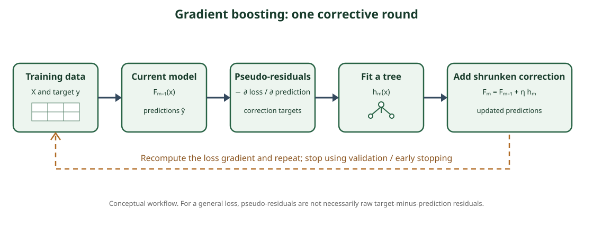

<!--
LLM-LAB-PAGE-MAP v1
id: "en/gradient-boosting"
scope: "Explains additive boosting and trees fitted to negative-loss-gradient pseudo-residuals."
purpose: "Trace an iteration and interpret loss, pseudo-residuals, learning rate, and overfitting controls."
suggested_route:
  previous: "en/decision-trees"
  next: "en/xgboost"
hierarchy:
  parents: []
  children: ["en/xgboost", "en/lightgbm", "en/catboost"]
related: ["en/bias-variance"]
tags: ["type:concept-lesson", "destination:deepen", "topic:gradient-boosting", "level:applied", "language:en", "status:published"]
-->
::: {.chapter-lead}
Gradient Boosting builds an additive predictor stage by stage. Each new tree reduces part of the error remaining in the current ensemble. It is neither an average of independent trees nor a stack of deep trees.
:::
## From a tree to an ensemble

A tree partitions feature space into regions and assigns a prediction to each leaf. Several limited trees can jointly represent a richer function:

\[
F_M(x)=F_0(x)+\sum_{m=1}^{M}\eta\,\rho_m h_m(x),
\]

where $h_m$ is the new tree, $\\rho_m$ adjusts its leaf contributions, and $\eta$ is the learning rate.

## Why “gradient”?

For differentiable loss $L(y,F(x))$, stage $m$ computes the negative gradient with respect to the current prediction:

\[
r_{im}=-\left[
\frac{\partial L(y_i,F(x_i))}{\partial F(x_i)}
\right]_{F=F_{m-1}}.
\]

These are **pseudo-residuals**. Under squared-error loss they are proportional to residuals $y_i-F_{m-1}(x_i)$. For other losses, they are not necessarily target-minus-prediction.

## One iteration

1. Initialize $F_0$ with a constant minimizing the loss.
2. Compute pseudo-residuals from the current model.
3. Fit a tree to those pseudo-residuals.
4. Fit its leaf contributions under the loss.
5. Add the tree with a controlled learning rate.
6. Repeat while monitoring validation and stopping criteria.

The next tree does not reconstruct the whole target; it seeks a structured correction to current errors.

{fig-alt="Workflow: training data, current model, pseudo-residuals, corrective tree, shrunken addition, and repetition."}

## Boosting versus bagging

| Bagging (random forest) | Boosting |
|---|---|
| Independently trained trees | Each stage depends on the current ensemble |
| Average or vote | Sum of successive contributions |
| Often reduces variance | Progressively reduces loss |
| Trees can be parallelized | Boosting stages are sequential |

Number of trees, learning rate, depth, subsampling, and early stopping control different aspects. Smaller contributions often require more trees. No setting is universal.

XGBoost formalizes a regularized objective and second-order approximation; LightGBM uses histograms and leaf-wise growth; CatBoost specifically handles categorical features. See [XGBoost](xgboost.qmd), [LightGBM](lightgbm.qmd), and [CatBoost](catboost.qmd).

::: {.self-check}
## Check your understanding
1. Why are pseudo-residuals not always raw residuals?

Show answer
They are the negative loss gradient with respect to predictions; this only coincides with residuals for some losses.

2. What separates bagging from boosting?

Show answer
Bagging aggregates independent models; boosting builds sequential corrections dependent on the current model.

3. Why can a lower learning rate underfit with a fixed number of trees?

Show answer
Each tree contributes a smaller correction, so the available stages may be insufficient.

:::
## Compare the implementations

| Dimension | XGBoost | LightGBM | CatBoost |
|---|---|---|---|
| Objective / construction | Second-order Taylor approximation, explicit regularization | Histograms, leaf-wise growth, GOSS/EFB | Ordered boosting and ordered categorical statistics |
| Typical growth | Level-wise / depth-controlled, depending on configuration | Leaf-wise best-first | Symmetric trees by default |
| Categorical data | Support depends on version and configuration | Native support with representation constraints | Categorical handling is central to the algorithm |
| Main caution | Regularization and split-search cost | Leaf-count control and overfitting | Encoding protocol, permutations, and compute cost |

This table summarizes characteristic choices, not absolute rules or performance guarantees. Versions, parameters, objectives, and hardware change behaviour. Choose by validation on the actual task, using a baseline and comparable compute budgets.

## References
- [Friedman (2001), Greedy Function Approximation: A Gradient Boosting Machine](https://doi.org/10.1214/aos/1013203451).
- [AiEdge — The Gradient Boosted Algorithm Explained!](https://newsletter.theaiedge.io/p/the-gradient-boosted-algorithm-explained).
- [AiEdge — GBM vs XGBoost vs LightGBM vs CatBoost](https://newsletter.theaiedge.io/p/gbm-vs-xgboost-vs-lightgbm-vs-catboost).
::: {.language-switch}
[Français](../fr/gradient-boosting.qmd) · [English](gradient-boosting.qmd)
:::
