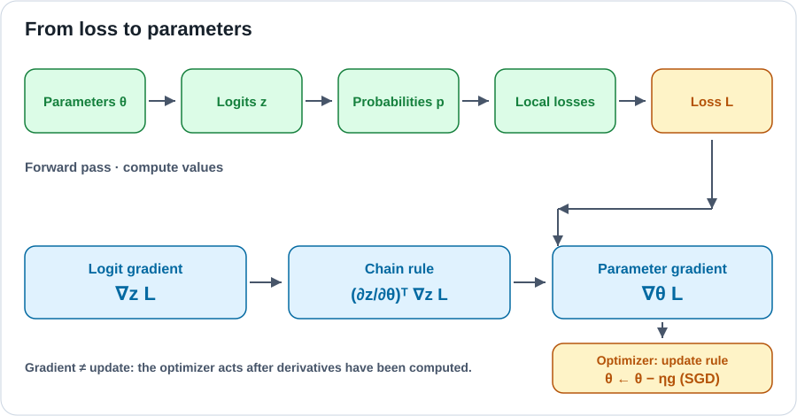

<!--
LLM-LAB-PAGE-MAP v1
id: "en/gradients"
summary: "Connects the loss to gradients through backpropagation and the chain rule, then explains how these derivatives guide parameter updates."
scope: "Propagates local loss sensitivity through the logits to the parameters. Places the parameter update in the optimizer."
purpose: "Trace a derivative through the computation graph and compute one plain descent step from a given gradient."
suggested_route:
  previous: "en/loss"
  next: "en/training-loop"
hierarchy:
  parents: []
  children: []
related: ["en/loss", "en/training-loop", "en/gradients-exercises"]
revision_support:
  status: integrated_sufficient
  evidence:
    - anchor: revision-summary
      note: "The recap distinguishes the objective, its local variation and chain-rule backpropagation; the lesson connects logit gradients, parameters and updates. Three answered questions cover the cross-entropy derivative, numerical checking and step size."
tags: ["type:concept-lesson", "destination:understand", "topic:gradients", "level:core", "language:en", "status:published"]
-->


::: {.chapter-lead}
The gradient $\nabla_\theta\mathcal{L}$ collects partial derivatives of the loss with respect to learned parameters. It describes local objective variation; by itself, it does not guarantee global improvement.
:::

::: {.callout-tip title="The one-minute mental model" #revision-summary}
The loss tells us **what should improve**; the gradient tells us **how the loss changes when parameters change**. Backpropagation applies the chain rule to carry this information from the output back to the parameters.

**First pass:** follow the path loss → derivative with respect to logits → derivatives with respect to parameters → parameter update. A gradient describes a local change; it does not guarantee that an arbitrary step will reduce the loss.

Correct gradient computation remains distinct from model generalization.
:::

  <a class="step-item" href="loss.qmd">1. Loss</a>
  →
  2. Backpropagation
  →
  3. Gradients
  →
  4. Parameter update

For each target token in the continuation, first compute how the local loss varies with each of its logits. A descent step applied directly to those logits would raise the target token’s score relative to the other scores. In the network, the chain rule gives derivatives with respect to the parameters that determine the logits. The optimizer then uses those derivatives to update the parameters.

## Gradient with respect to logits

For a one-hot target $y$, let $p=\operatorname{softmax}(z)$. For the unweighted cross-entropy computed from this distribution:

$$
\frac{\partial\ell}{\partial z_i}=p_i-\mathbb{1}[i=y].
$$

For a one-hot target, the components of this gradient sum to zero: $\sum_i(p_i-\mathbb{1}[i=y])=1-1=0$. This is consistent with softmax invariance to adding the same constant to every logit.

### Numerical example: the gradient for one target {#numerical-example-from-loss-to-output-weights}

The [batch loss](loss.qmd) aggregates losses over valid targets. Here, isolate the first target to compute how its loss changes with the logits.

For the first step of the Romans example, $p=(0.6,0.2,0.1,0.1)$ and target $y=0$ (“They”), so:

$$
g_z=\nabla_z\ell=p-\mathrm{onehot}(y)=(-0.4,0.2,0.1,0.1).
$$

::: {.callout-note collapse="true" title="Gradient of the mean over valid positions"}

At each position, $p_{b,t}=\operatorname{softmax}(z_{b,t})$. This formula gives the derivative of the loss **at one position**. For the unweighted mean over the valid target-position set $\mathcal{M}$ defined in [Loss](loss.qmd), the gradient with respect to each logit is:

$$
\frac{\partial\mathcal{L}}{\partial z_{b,t,i}}=
\begin{cases}
\frac{1}{|\mathcal{M}|}\left(p_{b,t,i}-\mathbb{1}[i=y_{b,t}]\right) & (b,t)\in\mathcal{M},\\
0 & (b,t)\notin\mathcal{M}.
\end{cases}
$$

The factor $1/|\mathcal{M}|$ comes from the mean; ignored positions have zero derivative with respect to their logits in this objective. A sum, weighting, or another reduction changes the corresponding factor. The local formula follows from combining softmax and cross-entropy; it does not mean the network parameters are the logits directly, since logits depend on parameters through many differentiable operations.

**A zero derivative does not necessarily cut off the whole graph (advanced)**

A zero derivative with respect to an ignored position's logits means those logits are not directly supervised by this loss term. If that position's representation still participates in computing a valid logit — for example, as an allowed key or value in attention — the valid-position loss can still propagate gradients through that dependency. Inspect the computation graph and attention masks, not only the loss mask.
:::

## Chain rule

If logits depend on parameters $z=z(\theta)$, then:

$$
\nabla_\theta\mathcal{L}
=\left(\frac{\partial z}{\partial\theta}\right)^\top
\nabla_z\mathcal{L}.
$$

Here, $z$ denotes all logits involved in the objective (for example, the logits at every valid position in the batch), not a single scalar score. They can be viewed as a vector obtained by flattening the tensor; the formula above then uses the corresponding Jacobian. Backpropagation applies the transposed Jacobian to the logit gradient without constructing the full Jacobian.

In a deep network, backpropagation applies this chain rule efficiently through the computation graph. Shapes must agree: derivatives are vectors or tensors with the same shape as the variable being differentiated.

<figure id="fig-gradient-backpropagation">
  <picture>
    <source media="(max-width: 600px)" srcset="../images/gradients-en-mobile.svg">
    
  </picture>
  <figcaption>The forward pass computes values; backpropagation carries derivatives backward through the computation graph. The parameter gradient is then used by the optimizer: computing a gradient and updating weights are distinct operations.</figcaption>
</figure>

## From gradient to parameter update

The gradient describes local loss sensitivity; it does not specify the update rule on its own. The optimizer turns it into a parameter update, and the learning rate sets its scale. The SGD rule and optimizer choices are covered in the [training loop](training-loop.qmd).

A numerical SGD step makes the distinction between computing the gradient and actually updating weights explicit. Work through the [SGD update exercise](exercises/gradients.qmd#ex-sgd-output-projection) on the dedicated Practice page.

Two distributions can assign the same probability to the target, and therefore have the same loss, while producing different gradients for the other logits.

In the [training loop](training-loop.qmd#replay-one-step-on-the-first-token), that new prediction comes from the forward pass after the update.

The [validation measurement](training-loop.qmd#training-loss-versus-validation-loss) uses held-out data to estimate behavior on new examples.

::: {.callout-note collapse="true" title="Optional second example: compute each weight change"}
To see how this reaches a parameter, consider a toy final affine projection $z=Wh+b$ with input state $h=(1,2)^\top$ and a matrix $W$ with four rows (one per token) and two columns. By the chain rule:

$$
\frac{\partial\ell}{\partial W}=\nabla_z\ell\,h^\top=
\begin{pmatrix}
-0.4&-0.8\\
0.2&0.4\\
0.1&0.2\\
0.1&0.2
\end{pmatrix}.
$$

With an illustrative SGD step $\eta=0.1$, the weight change is $\Delta W=-\eta\,\partial\ell/\partial W$: the first row increases by $(0.04,0.08)$, and the other three decrease by $(0.02,0.04)$, $(0.01,0.02)$, and $(0.01,0.02)$, respectively. This shows how the target signal reaches the final projection's weights. In a full Transformer, $h$ itself depends on earlier-layer parameters, so backpropagation continues through those layers. The values of $h$, $W$, and the learning rate are chosen to illustrate the rule, not taken from a trained model.
:::

::: {.callout-note collapse="true" title="Gradient descent is not Newton's method"}
Both methods use derivatives, but they use different information. **Gradient descent** uses the first derivative (the gradient) to choose a direction; **Newton's method** also uses curvature, represented by the Hessian in several dimensions, to scale and orient its step. Neural-network training commonly uses stochastic or minibatch gradients with optimizers such as Adam or AdamW—not a simplified Newton update. The methods are related, but one is not simply the other with a term removed.
:::

::: {.callout-note collapse="true" title="Numerical gradient checking (advanced)"}
For parameter coordinate $\theta_i$:

$$
g_i^{\mathrm{num}}=
\frac{\mathcal{L}(\theta_i+\epsilon)-\mathcal{L}(\theta_i-\epsilon)}
{2\epsilon}.
$$

Compare this with the analytical gradient using absolute and relative tolerances. Verification should use sufficient precision, a deterministic function, and an $\epsilon$ appropriate to parameter scale. Too small, and rounding error dominates; too large, and the estimate poorly approximates the local derivative. PyTorch notes that `gradcheck` defaults are designed for double-precision inputs; lower precision can cause failures. The check may also fail at non-differentiable points or with tensors whose indices share overlapping memory. A failure must therefore be interpreted in light of these conditions, not as immediate proof that the analytical derivative is wrong.
:::

::: {.callout-warning title="Misconceptions"}
- **“A zero gradient means the model is optimal.”** It may indicate a stationary point, saturation, a broken gradient path, or an implementation error.
- **“Gradients prove causal relationships in the data.”** They describe objective sensitivity to model parameters, not real-world causality.
- **“One passing finite-difference check proves the entire backward pass.”** It verifies one function, case, precision, and configuration; it does not replace shape, edge-case, and integration tests.
:::



:::: {.language-switch}
[Français](../fr/gradients.qmd) · [English](gradients.qmd)
::::

## Practice

[More gradient exercises](exercises/gradients.qmd).

  Supplementary resources
  Experiment, explore further, and practise the ideas from this lesson.

### Further reading

- [PyTorch — Autograd mechanics](https://docs.pytorch.org/docs/stable/notes/autograd.html): explains reverse-mode automatic differentiation and the computation graph.
- [PyTorch — `gradcheck`](https://docs.pytorch.org/docs/stable/generated/torch.autograd.gradcheck.gradcheck.html): documents numerical checking of analytical gradients against finite differences.

