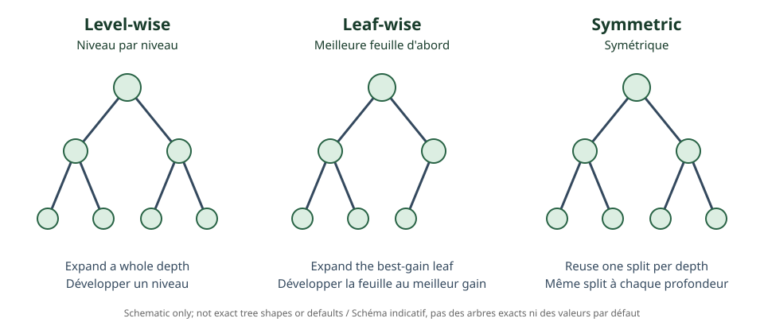

<!--
LLM-LAB-PAGE-MAP v1
id: "en/lightgbm"
scope: "Introduces histogram binning, leaf-wise growth, Gradient-based One-Side Sampling, and Exclusive Feature Bundling."
purpose: "Explain computational optimizations and overfitting risks associated with leaf-wise growth."
suggested_route:
  previous: "en/xgboost"
  next: "en/catboost"
hierarchy:
  parents: ["en/gradient-boosting"]
  children: []
related: ["en/xgboost", "en/catboost"]
tags: ["type:concept-lesson", "destination:deepen", "topic:lightgbm", "level:advanced", "language:en", "status:published"]
-->
::: {.chapter-lead}
LightGBM aims to make training efficient on large tabular datasets. Its characteristic choices concern threshold search, tree growth, and feature-processing cost.
:::
\n\n{fig-alt="Three schematic tree structures illustrating level-wise, leaf-wise, and symmetric growth; shapes are indicative."}\n\n## Histograms

Feature values are grouped into a limited number of bins. Gradient and Hessian statistics are aggregated per bin, and splits are searched over these histograms. This reduces operations and memory at the cost of approximate search, which depends in part on bin count.

## Leaf-wise growth

Rather than expanding all nodes at a level (*level-wise*), LightGBM selects the leaf whose candidate split has the highest gain, then expands it (*best-first* or *leaf-wise*). This can reduce loss quickly, but creates asymmetric trees and can overfit small datasets.

Leaf count, depth, minimum observations per leaf, and regularization therefore need control. A depth limit alone is not a substitute for a coherent leaf-count limit.

## GOSS and EFB

- **GOSS** keeps observations with large gradients and samples some with smaller gradients, with weighting intended to preserve useful split statistics.
- **EFB** bundles features that are rarely non-zero at the same time, reducing the number of features to process. It exploits sparsity and a conflict trade-off.

These are computational optimizations, not guarantees of predictive quality.

| Dimension | LightGBM |
|---|---|
| Search | Histograms and discretized thresholds |
| Growth | Leaf-wise, best-first |
| Optimizations | GOSS and EFB, depending on configuration |
| Risk | Asymmetric trees and overfitting |
| Parameters | Leaf count, depth, minimum per leaf, learning rate, subsampling |

Speed comparisons require the same data, objective, validation, and documented hardware.

::: {.self-check}
## Check your understanding
1. Why can histograms speed up search?

Show answer
They replace many distinct values with a limited number of bins and aggregate statistics per bin.

2. What trade-off does leaf-wise growth introduce?

Show answer
It expands the best-gain leaf but may create asymmetric, locally deep trees prone to overfitting.

3. Do GOSS and EFB do the same thing?

Show answer
No. GOSS reduces observations used for some statistics; EFB bundles sparse features that are rarely active together.

:::
## References
- [Ke et al. (2017), LightGBM: A Highly Efficient Gradient Boosting Decision Tree](https://proceedings.neurips.cc/paper/2017/hash/6449f44a102dod8eda4b4d2b6c5d2f9e-Abstract.html).
- [LightGBM documentation](https://lightgbm.readthedocs.io/en/stable/).
- [AiEdge — GBM vs XGBoost vs LightGBM vs CatBoost](https://newsletter.theaiedge.io/p/gbm-vs-xgboost-vs-lightgbm-vs-catboost).
::: {.language-switch}
[Français](../fr/lightgbm.qmd) · [English](lightgbm.qmd)
:::
