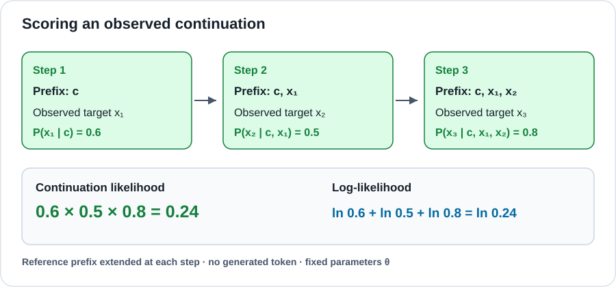

<!--
LLM-LAB-PAGE-MAP v1
id: "en/likelihood"
summary: "Explains how to score an already observed token sequence by combining its conditional probabilities. This branch evaluates a known continuation rather than selecting a new one."
scope: "Scores an already-observed sequence with a fixed context and fixed parameters."
purpose: "Compute continuation likelihood by multiplying conditional probabilities, then recover its log-likelihood and NLL."
suggested_route:
  previous: "en/entropy"
  next: "en/cross-entropy"
hierarchy:
  parents: []
  children: []
related: ["en/probabilities", "en/entropy", "en/cross-entropy", "en/likelihood-exercises"]
revision_support:
  status: integrated_sufficient
  evidence:
    - anchor: revision-summary
      note: "The recap connects scoring an observed sequence, the chain rule, summed log-probabilities and NLL while flagging comparison conventions; three answered exercises check factorization, independence and reduction."
tags: ["type:concept-lesson", "destination:understand", "topic:vraisemblance", "level:core", "language:en", "status:published"]
-->


::: {.chapter-lead}
Likelihood measures the probability of observed data for fixed parameters. In autoregressive language modeling, it is built from the conditional probabilities of each target token.
:::

::: {.callout-tip title="The one-minute mental model" #revision-summary}
- **Scoring:** the model receives the reference prefix and assigns probability to the observed target; no generated token is fed back and parameters remain fixed.
- **Sequence:** the chain rule gives $P_\theta(x_{1:T})=\prod_t P_\theta(x_t\mid x_{<t})$; the logarithm turns this product into a sum.
- **Objective:** NLL is $-\log P_\theta(x_{1:T})$. For the same observations and positions, maximizing log-likelihood is equivalent to minimizing NLL.
- **Comparison:** state the tokenizer, included positions, and sum or per-token mean; these conventions change the scale.

**Quick question:** why is scoring an observed sequence neither generation nor a parameter update?
:::

  1. Observed target
  →
  <a class="step-item" href="probabilities.qmd">2. Probability</a>
  →
  3. Product of probabilities or sum of their logs
  →
  4. Likelihood or log-likelihood

In the running example, the likelihood of the continuation is built from the conditional probabilities of its successive tokens: each probability is evaluated using the prefix available at that step, extended with the previously observed tokens.

## Autoregressive factorization

The derivation of this factorization from the chain rule, and the interpretation of conditional probabilities, are developed in [the mathematical formalization of language modeling](language-modeling-math.qmd). Here, the focus is on likelihood as an evaluation criterion for observed sequences and on its connection to the loss.

For a sequence $x_{1:T}$:

$$
P_\theta(x_{1:T})=\prod_{t=1}^{T}P_\theta(x_t\mid x_{<t}).
$$

### Scoring an observed sequence: the prefix is known

At each position, the model receives the observed prefix $x_{<t}$ and assigns a probability to the target token $x_t$. This conditioning on reference tokens is also used as *teacher forcing* during training (see [training examples](training-examples.qmd)). Here, it is used only to **score** the sequence: no generated token is selected, no model prediction is fed back, and the parameters $\theta$ remain fixed.

This differs from generation, which feeds the model-selected token back before the next step. It also differs from training: scoring computes no gradients and makes no parameter updates.

[Compare the prefixes used for generation and scoring](exercises/likelihood.qmd#ex-generation-versus-scoring).

For a sequence that fits within the context window, the model can compute logits for all positions in one *forward pass*: observed prefixes are supplied together, while the causal mask prevents each position from reading later tokens. Beyond that window, scoring requires a windowing or stride strategy and an explicit convention for the prefixes actually available and the targets counted.

For multiple independent dataset sequences, total likelihood is the product of each sequence probability. Products of many numbers at most one become tiny quickly, so we use log-likelihood:

$$
\log P_\theta(x_{1:T})=
\sum_{t=1}^{T}\log P_\theta(x_t\mid x_{<t}).
$$

The logarithm turns products into sums, which are more stable and convenient to compute.

## Example: scoring the continuation

Continue the illustrative sequence “They built roads”. Suppose the conditional probabilities assigned to its three successive observed tokens are $0.6$, $0.5$, and $0.8$. Each value is evaluated after extending the observed prefix with the preceding reference tokens; they are not independent probabilities.

$$
P(\text{continuation})=0.6\times0.5\times0.8=0.24.
$$

<figure id="fig-likelihood-scoring-trace">
  <picture>
    <source media="(max-width: 600px)" srcset="../images/likelihood-en-mobile.svg">
    
  </picture>
  <figcaption>Each probability is conditioned on a different reference prefix: the continuation is scored by multiplying conditional probabilities, or adding log-probabilities. This is neither an independence assumption nor generation.</figcaption>
</figure>

## From likelihood to loss

Negative log-likelihood $\operatorname{NLL}$ is:

$$
\operatorname{NLL}(\theta)=-\log P_\theta(x_{1:T}).
$$

The log-likelihood is $\log(0.24)\approx-1.427$ nats, and the sequence NLL is $-\log(0.24)\approx1.427$ nats. Dividing by three gives an average of approximately $0.476$ nats per token. These are illustrative values chosen to keep the arithmetic visible, not outputs from a trained model.

For fixed sequences and the same included positions, maximizing log-likelihood is equivalent to minimizing NLL. Averaging per token is a common scaling, useful for comparing sequences of different lengths, but it is not the same as the raw sum.

## Perplexity

For mean NLL computed with the natural logarithm, **perplexity** is $\operatorname{PPL}=\exp(\operatorname{NLL}_{\mathrm{mean}})$. It is the exponential of mean loss, or the geometric mean of the inverse probabilities assigned to observed tokens. It summarizes probabilistic fit over the units defined by the tokenizer; it does not measure overall answer quality or truth. Two perplexity values are directly comparable only when the corpus, tokenizer, evaluated positions, and reduction convention are compatible. For one-hot targets, mean cross-entropy computed over the same valid positions with the same reduction convention coincides with this mean NLL. If the mean is measured in bits rather than nats, use $2^{\bar{\ell}}$, with $\\bar{\\ell}$ measured in bits. The [Loss](loss.qmd) lesson revisits its use as a metric derived from the training objective.

::: {.callout-warning title="Misconceptions"}
- **“High likelihood proves the model is true.”** No: it indicates probabilistic fit to selected observations relative to a model, tokenizer, and data distribution.
- **“Token probabilities are independent.”** They are conditional on the prefix; the product follows from the chain rule, not independence.
- **“NLL is comparable without specifying the tokenizer.”** Not always: different segmentations change the number and granularity of evaluated events.
:::

[Questions and exercises](exercises/likelihood.qmd)

The next page decomposes this NLL at one target position and generalizes the one-hot case to a target distribution: [cross-entropy](cross-entropy.qmd).



:::: {.language-switch}
[Français](../fr/vraisemblance.qmd) · [English](likelihood.qmd)
::::

  Supplementary resources
  Experiment, explore further, and practise the ideas from this lesson.

### Further reading

- [Goodfellow, Bengio, and Courville — *Deep Learning*, §5.5: Maximum Likelihood Estimation](https://www.deeplearningbook.org/contents/ml.html): a general mathematical treatment of likelihood, log-likelihood, and maximum-likelihood estimation. The autoregressive factorization above applies that general framework to token sequences.

