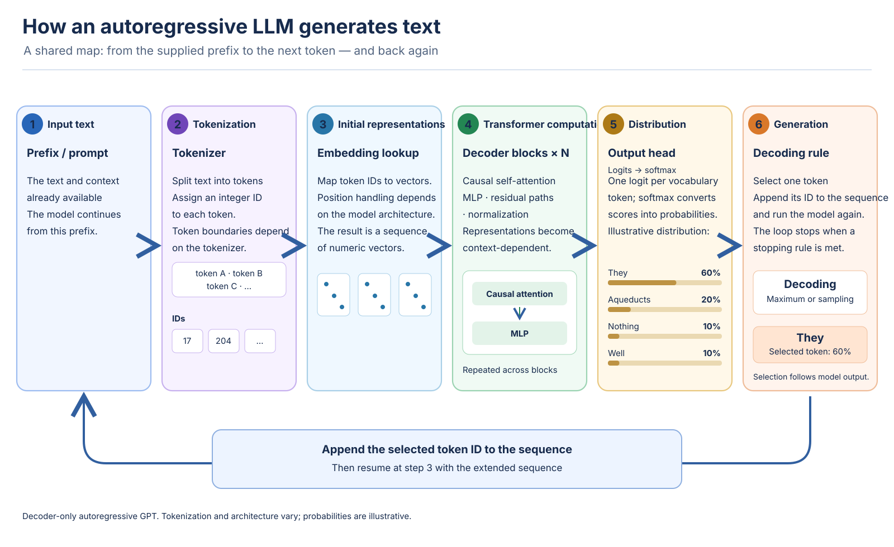
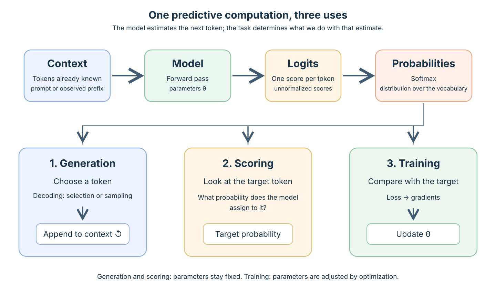
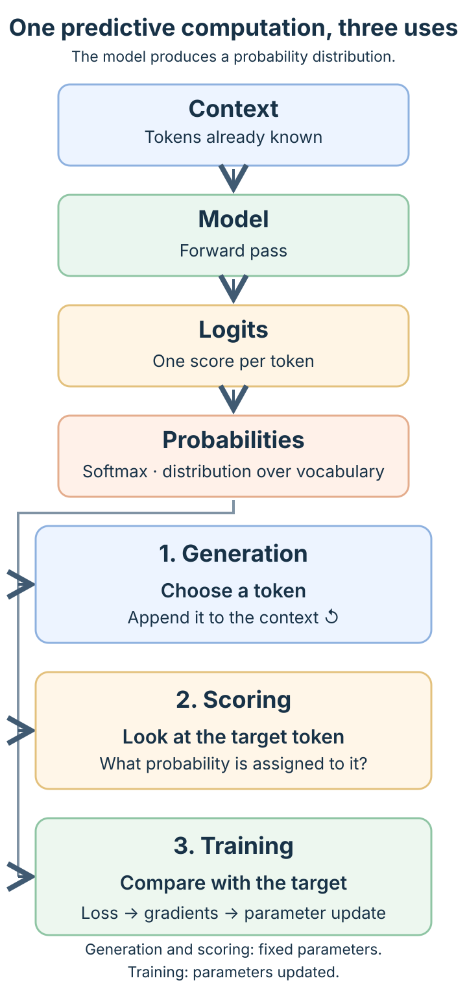

<!--
LLM-LAB-PAGE-MAP v1
id: "en/llm-overview"
summary: "Provides a first mental model of an LLM: conditional next-token prediction, distinct uses, architecture, learning, information provenance, and transfer."
scope: "Introduces the essential concepts without replacing the canonical pages on generation, training, context, document retrieval, history, or evaluation."
purpose: "Explain what an LLM predicts, how a distribution is used, where information resides, and why a general objective can support varied tasks."
suggested_route:
  previous: "en/index"
  next: "en/generation"
hierarchy:
  parents: ["en/index"]
  children: ["en/transformer", "en/transformer-architectures", "en/generation", "en/build-path", "en/language-modeling-math", "en/mathematical-foundations", "en/llm-limits", "en/llm-computational-complexity"]
covered_stages: [orientation, text-input, representations, computation, prediction, inference, context-use, scoring, training]
related: ["en/transformer-history", "en/scaling-laws", "en/llm-evolution", "en/entropy", "en/compression-revision", "en/in-context-learning", "en/context-engineering", "en/rag-memory-boundaries", "en/document-retrieval", "en/post-training", "en/llm-limits", "en/llm-overview-exercises"]
tags: ["type:system-overview", "destination:understand", "topic:llm-overview", "level:overview", "language:en", "status:published"]
-->



::: {.chapter-lead}
“What have the Romans ever done for us?” The question sets off a long series of answers. Put the same question to a conversational assistant: it carries on too. How does a program produce a continuation from a question?

It does not write its answer in one block. For each possible continuation, it estimates the probability that it comes after the text already written, keeps one, and starts again. A program that assigns probabilities to the continuations of a text in this way is a **language model**. Trained at scale, it is a **large language model** (LLM).
:::

::: {.callout-note title="Running example: a question and its continuation"}
**The prefix** is the question: “What have the Romans ever done for us?” It is the text supplied to the model. **The continuation** is what comes next. In the film, several characters answer in turn with aqueducts, sanitation, roads, and irrigation.

The scene is a hook, not a literal single-speaker generation. For calculations, the path uses an original continuation written for LLM Lab: “They built roads between distant towns.” The characters are fiction, the assistant is an application, and the LLM is the model that application queries: only the last one is studied here.
:::

::: {.callout-tip title="The one-minute mental model"}
- **What the model computes:** given a context, a probability for every token that could come next. One token after another, with parameters that do not change while the model is in use.
- **One computation, three uses:** generate (choose a token and append it to the context), score (read the probability given to a token that is already known), learn (compare the prediction with the expected token and update the parameters).
- **Three words to keep apart:** an **LLM** is a language model trained at scale; the **Transformer** is a family of architectures; a **GPT** is a decoder-only Transformer pretrained to predict the next token.
:::

::: {.callout-note .learning-outcomes}
**Estimated reading time: 8–10 minutes.**

**By the end of this page, you should be able to:**
- explain next-token prediction and why a probable continuation is not necessarily true;
- distinguish architecture, parameter learning, and model use;
- tell generation, scoring, and training apart;
- locate where information is stored, retrieved, supplied, and used;
- explain why a general objective can support varied tasks without guaranteeing success.
:::

## What the model predicts {#what-model-predicts}

The question “What have the Romans ever done for us?” is the **prefix**: the text already supplied to the model. The **continuation** is what comes next. Given the prefix, the model computes a probability distribution for the next token. Imagine the following result:

| Possible next token | Probability |
|---|---:|
| “They” | 0.6 |
| “Aqueducts” | 0.2 |
| “Nothing” | 0.1 |
| “Well” | 0.1 |

[Practise the calculation on an observed continuation](exercises/likelihood.qmd#ex-overview-likelihood-transfer).

These values are illustrative, not outputs from a trained model. A real vocabulary often contains tens of thousands of tokens, and a row does not necessarily correspond to a whole word. The same values are reused across pages so that the calculations can be checked by hand.

This is a **conditional distribution**: probabilities are computed given the prefix and sum to 1. If the decoding rule selects “They”, the token is appended to the context; the model then computes a new distribution conditioned on the extended prefix.

Three terms are enough:

- **Token:** the unit handled by the model. It is not necessarily a word; a tokenizer splits text and assigns an ID to each unit ([text and tokens](text-data.qmd)).
- **Context:** the tokens available to predict the next one: the supplied text and, during generation, the tokens already produced.
- **Parameters:** the learned numbers—especially weights and biases—that determine the computation. They remain fixed during ordinary inference.

The probability of a sentence is the product of the conditional probabilities of its successive tokens ([mathematical formulation of language modeling](language-modeling-math.qmd)). But a probable continuation is not necessarily true: the probability assigned to “They” says nothing about what the Romans actually did. Good prediction does not prove human-like understanding either ([limits of the training objective](llm-limits.qmd)).

## From text to a distribution {#text-to-distribution}



{#fig-gpt-generation-process fig-alt="An autoregressive GPT processes the prefix: text, tokens and IDs, embeddings and positional information, repeated Transformer blocks, logits converted into probabilities, then selection of a token appended to the prefix. Computation repeats with the extended context. Probabilities are illustrative."}

An autoregressive GPT turns text into tokens, their IDs into numeric representations, and processes those representations through Transformer blocks. The output head produces logits, which are converted into probabilities; a decoding rule then selects a token, appends it to the context, and starts the next computation. Selection happens after the Transformer has computed the distribution.

The diagram describes **one computation**, not a reading order. The canonical Understand sequence is shown in the [learning map](learning-map.qmd). For the individual mechanisms, see [text and tokenization](text-data.qmd), [embeddings](embedding-space.qmd), [the Transformer](transformer.qmd), [logits and probabilities](probabilities.qmd), and [generation](generation.qmd).

## One computation, three uses {#one-computation-three-uses}

Once the distribution has been computed, three different questions can be asked: do we want to produce a continuation, measure how expected a known continuation was, or improve the model from an expected continuation?

<!-- Desktop: three-column view; mobile: stacked view for readable labels. -->
{.d-none .d-md-block #fig-llm-shared-prediction-uses fig-alt="The context passes through the model, which produces logits and then a probability distribution over the next token. The distribution is used to select a token during generation, measure the probability of an observed token during scoring, or calculate a loss and update parameters during training."}

{.d-md-none fig-alt="Mobile version of the diagram: context passes through the model to produce logits and probabilities. Three blocks then show generation, scoring, and training."}

- **Generate:** the continuation is unknown. A rule selects a token, appends it to the context, and the computation repeats. Processing the initial prompt is *prefill*; producing tokens one by one is *decode* ([generation](generation.qmd)).
- **Score:** the continuation is known. Read the probability assigned to each observed token; their product is the sequence **likelihood** ([likelihood](likelihood.qmd)).
- **Learn:** the expected continuation is known and the parameters should change. The **loss** measures the gap to the target; **gradients** indicate how to adjust the parameters ([loss](loss.qmd), [gradients](gradients.qmd)). *Teacher forcing* builds the context from the actual tokens in the text ([training examples](training-examples.qmd)).

For an observed token with probability 0.6, its **surprisal** is \( -\ln(0.6)\approx0.51 \) nats; [entropy](entropy.qmd) measures expected surprisal before the token is known. The linked pages cover the mathematical details. **Scoring is not evaluation:** scoring assigns a probability to a given sequence; evaluation compares results over a defined set of examples held out from training.

Generating and scoring leave parameters unchanged; only learning updates them. The three uses share a computation, but they are not steps in one execution.

## LLM, Transformer, GPT: three notions {#llm-transformer-gpt}

**LLM** describes a language model trained at scale, not a particular architecture. No universal parameter threshold defines the category on its own: data and training compute matter too ([scaling laws](scaling-laws.qmd)).

**Transformer** names a family of architectures with several configurations:

| Family | General behavior | Example |
|---|---|---|
| **Encoder-only** | Builds contextual representations of the input; often used for understanding or classification | [BERT](https://arxiv.org/abs/1810.04805) |
| **Encoder–decoder** | Produces an output conditioned on an input, especially for sequence-to-sequence tasks | [Original Transformer](https://arxiv.org/abs/1706.03762), [T5](https://jmlr.org/papers/v21/20-074.html) |
| **Decoder-only** | Processes a causal context and predicts subsequent tokens | [GPT-3](https://arxiv.org/abs/2005.14165) |

**GPT** (*Generative Pre-trained Transformer*) names a family of decoder-only Transformers pretrained to predict the next token. LLM Lab studies a small GPT of this kind because its computation can be followed and programmed end to end ([architecture comparison](transformer-architectures.qmd), [Build path](build-path.qmd)). This is a teaching choice: not all LLMs are GPTs.

## Architecture, learning, use {#architecture-learning-use}

Describing a model means answering three questions:

| Dimension | Question | Examples |
|---|---|---|
| **Architecture** | How does the network transform information? | Encoder-only, encoder–decoder, decoder-only |
| **Learning** | How are parameters obtained or adapted? | Pretraining, fine-tuning, SFT, preference optimization |
| **Use** | What do we do with the model, parameters fixed? | Generation, classification, scoring, ICL, RAG, tools |

**Pretraining** learns regularities from large corpora. For a GPT, the text tokens are the targets; this is generally *self-supervised* learning. The resulting model before adaptation is often called a *base model*. A **foundation model** is a broader notion: a model trained at scale on broad data and adaptable to many tasks, sometimes beyond language ([Bommasani et al., 2021](https://crfm.stanford.edu/report)). Post-training may then adapt behavior or parameters, but it is not mandatory ([post-training](post-training.qmd)).

## Where does information reside? {#information-residence}

An answer can draw on information stored in different places. Distinguish **where it is stored**, **how it becomes accessible**, and **how it is used**.

| Location | Examples | How it can influence the answer |
|---|---|---|
| **Learned parameters** | Regularities and representations acquired during pretraining or post-training | They participate in computation, but are not a queryable document database |
| **Active context** | Instructions, messages, examples, documents, and tool results actually supplied | The model conditions its prediction on this content, which can change from one request to another |
| **External sources** | Documents, databases, and indexes used by RAG or tools | Information matters only if it is retrieved and then made available to the model |
| **Runtime state** | KV cache computed during inference | It avoids some recomputation and speeds up decoding; it is neither learning nor document memory |

**RAG** retrieves external information and can add it to context; retrieval alone is not enough. A document can be stored, indexed, or retrieved without being supplied. [Context engineering](context-engineering.qmd) designs and structures the input; [RAG and memory](rag-memory-boundaries.qmd) follows the information lifecycle; [document retrieval](document-retrieval.qmd) details search and ranking methods. **ICL** describes what the model does with examples present in context ([ICL](in-context-learning.qmd)).

## Why can prediction support varied tasks? {#transformers-changed}

Pretraining does not explicitly teach every task the model may later perform. Across large corpora, it learns language regularities, relationships, and representations that can be reused when a task is expressed in the input, examples are supplied, or parameters are adapted. This is **transfer learning**: a general objective can support tasks that were not explicit training objectives. Transfer nevertheless depends on the data, task, and evaluation; it is neither universal nor automatic ([LLM evolution](llm-evolution.qmd), [emergence](emergence.qmd), [limitations](llm-limits.qmd)).

An information-theoretic perspective sometimes connects this prediction to **predictive compression**: the model adjusts probabilities to anticipate continuations. But a probability distribution does not, by itself, decompress a sequence; exact coding requires a compatible encoder and decoder. This perspective is not a complete theory of intelligence ([entropy and compression](entropy.qmd#are-llms-compression-algorithms), [revision sheet](compression-revision.qmd)). For historical milestones and Transformer trade-offs, see [the history of Transformers](transformer-history.qmd).

## Choosing an approach {#choosing-an-approach}

Depending on the task, one can use a general model as is, supply context and external documents, adapt parameters, or have the application call tools. These approaches can be combined. The choice depends on measured quality, robustness, information freshness, cost, latency, privacy, provenance, and maintenance. A few successful prompts are not an evaluation ([post-training](post-training.qmd), [RAG and memory](rag-memory-boundaries.qmd)).

## From a model to a conversational system {#model-to-conversational-system}

A conversational assistant is a **system built around a model**. The application formats messages, manages context, and may coordinate external tools. The system, user, and assistant roles belong to the message format, not to Transformer layers. A tool request produced by the model has not yet been executed: the application must validate arguments and permissions, call the tool, and return its result. Persistent memory also requires application-side storage and orchestration ([LLM evolution](llm-evolution.qmd#tool-using-systems), [Build path](build-path.qmd)).

::: {.callout-tip title="Go further"}
- **History and architecture:** [history of Transformers](transformer-history.qmd) and [architecture comparison](transformer-architectures.qmd).
- **Computation and learning:** [generation](generation.qmd), [mathematical foundations](mathematical-foundations.qmd), and [post-training](post-training.qmd).
- **Context and external information:** [context engineering](context-engineering.qmd), [RAG and memory](rag-memory-boundaries.qmd), and [document retrieval](document-retrieval.qmd).
- **Compression and information:** [entropy](entropy.qmd) and the [compression and LLM revision sheet](compression-revision.qmd).
- **Watch an end-to-end overview:** [Andrej Karpathy — Deep Dive into LLMs like ChatGPT](https://www.youtube.com/watch?v=7xTGNNLPyMI) (2025, English video, about 3 h 31); an orientation resource, not a replacement for the detailed lessons.
:::

::: {.self-check}
## Check your understanding

Related exercises: [overview practice page](exercises/llm-overview.qmd).

<!-- self-check-coverage: enforced -->
<!-- self-check-covers: what-model-predicts -->
1. **Does a probable continuation have to be true?** The model assigns 0.6 to “They”. What does that probability prove?

Show the answer

It gives a conditional probability in this example; it does not prove that the continuation is true.

<!-- self-check-covers: text-to-distribution -->
2. **What happens after a token is selected?**

Show the answer

The token is appended to context; the model recomputes a distribution with the same parameters.

<!-- self-check-covers: one-computation-three-uses -->
3. **Are generating, scoring, and learning the same operation?**

Show the answer

No: generation and scoring leave parameters fixed; learning updates them.

<!-- self-check-covers: llm-transformer-gpt -->
4. **Is every LLM a GPT?**

Show the answer

No: LLM describes a model category, Transformer an architecture family, and GPT a decoder-only Transformer family.

<!-- self-check-covers: architecture-learning-use -->
5. **Does fine-tuning necessarily change the architecture?**

Show the answer

No: it mainly adapts parameters; architecture and learning method are distinct dimensions.

<!-- self-check-covers: information-residence -->
6. **Does information retrieved by RAG become part of the model parameters?**

Show the answer

No: it remains external and must be supplied in context or made available through an invoked tool.

<!-- self-check-covers: transformers-changed -->
7. **Did the Transformer make autoregressive generation parallel?**

Show the answer

No: positions can be processed in parallel during training, but new tokens are generated successively.

<!-- self-check-covers: choosing-an-approach -->
8. **Documentation changes every day. Must the model be retrained?**

Show the reasoning

Not necessarily: RAG can retrieve an updated source without changing parameters, provided retrieval and answer quality are measured.

<!-- self-check-covers: model-to-conversational-system -->
9. **A message contains a tool request. Has the tool already run?**

Show the answer

No: the application must validate, execute the tool, and return its result.

:::





::: {.language-switch}
**Language:** [Français](../fr/llm-overview.qmd) · [English](llm-overview.qmd)
:::
