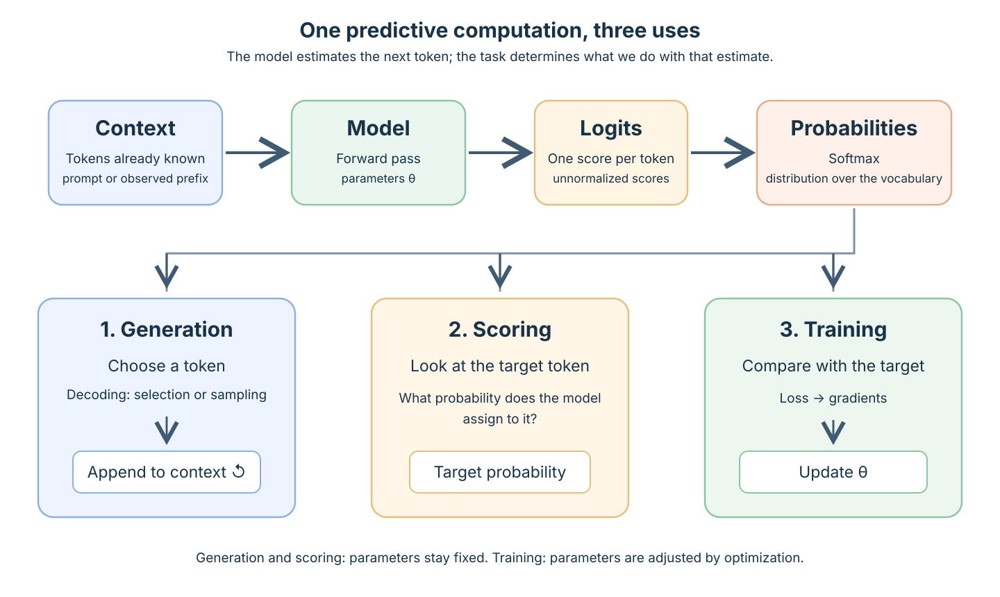
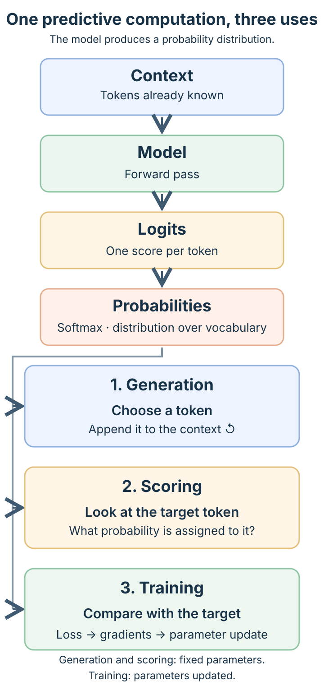

<!--
LLM-LAB-PAGE-MAP v1
id: "en/llm-overview"
summary: "Provides a system-level view of an LLM: next-token prediction, context processing, and the distinct uses of generation, scoring, and training. Directs readers to the pages that explain each mechanism."
scope: "Defines LLMs and GPTs, illustrates next-token prediction, and distinguishes architecture, parameter learning, and use. Directs readers to canonical lessons without duplicating their mechanisms."
purpose: "Give readers a first mental model of an LLM: what it predicts, how it maps context to a token distribution, and how that distribution is used for generation, scoring, and training."
suggested_route:
  previous: "en/index"
  next: "en/generation"
hierarchy:
  parents: ["en/index"]
  children: ["en/transformer", "en/transformer-architectures", "en/generation", "en/build-path", "en/language-modeling-math", "en/mathematical-foundations", "en/llm-limits", "en/llm-computational-complexity"]
related: ["en/transformer-history", "en/scaling-laws"]
tags: ["type:system-overview", "destination:understand", "topic:llm-overview", "level:overview", "language:en", "status:published"]
-->



::: {.chapter-lead}
You ask an assistant: “The report indicates that the concentration…” and it suggests a continuation. How does it produce that text? It does not write the whole response in one step: it first estimates which tokens could follow the context, then uses that prediction to continue.

That is the basic idea of a **language model**: assigning probabilities to possible continuations of a sequence. A **large language model** (LLM) is a language model trained at scale on large corpora with a substantial compute budget. No parameter-count threshold defines the category on its own; data and compute matter too ([scaling laws](scaling-laws.qmd); [Zhao et al., 2023](https://arxiv.org/abs/2303.18223); [Hoffmann et al., 2022](https://proceedings.neurips.cc/paper_files/paper/2022/hash/c1e2faff6f588870935f114ebe04a3e5-Abstract.html)). LLM therefore does not specify a particular architecture or training objective.
:::

::: {.callout-tip title="The one-minute mental model"}
- **Three different notions:** an **LLM** is a language model trained at scale — no agreed parameter-count threshold exists, data and compute matter; a **GPT** is a family of pretrained decoder-only Transformers; the **Transformer** is an architecture family. These three terms are not interchangeable.
- **What a GPT computes:** given a context, it turns text into logits, then into a conditional distribution over the next token, one token at a time, with parameters fixed during ordinary inference.
- **One shared computation, three uses:** generation feeds a selected token back, scoring evaluates an observed target, and learning compares distributions with target tokens and updates parameters — these are not branches of a single execution loop.

**Check yourself:** can you state what LLM, GPT, and Transformer each refer to, then separate architecture (the computation), learning (how parameters are obtained), and use (what is done with the model with its parameters fixed)?
:::

  1. Question
  →
  <a class="step-item" href="transformer-architectures.qmd">2. Architecture</a>
  →
  <a class="step-item" href="generation.qmd">3. Parameters</a>
  →
  <a class="step-item" href="generation.qmd">4. Uses</a>

## 1. LLM, GPT, and Transformer are different concepts

A **language model** assigns a probability or score to token sequences given a context. In an autoregressive model, this computation is repeated one token at a time: the model does not enumerate every possible complete continuation. **GPT** (*Generative Pre-trained Transformer*) is a family of pretrained models based on the Transformer architecture. Classic GPT models are **decoder-only** Transformers pretrained to predict the next token.

A **Transformer** is an architecture family, not a synonym for GPT or LLM. The original paper introduced an encoder–decoder architecture ([Vaswani et al., 2017](https://arxiv.org/abs/1706.03762)). Common configurations include:

| Family | General behavior | Example |
|---|---|---|
| **Encoder-only** | Builds contextual representations of the input; often used for understanding or classification tasks | [BERT](https://arxiv.org/abs/1810.04805) |
| **Encoder–decoder** | Produces an output conditioned on an input; commonly used for sequence-to-sequence tasks | [Original Transformer](https://arxiv.org/abs/1706.03762), [T5](https://jmlr.org/papers/v21/20-074.html) |
| **Decoder-only** | Processes a causal context and predicts subsequent tokens | [GPT-3](https://arxiv.org/abs/2005.14165) |

The differences in information flow, masking, and training objectives are explained in the [Transformer architecture comparison](transformer-architectures.qmd).

LLM Lab uses a small decoder-only GPT as a **teaching model**: its autoregressive computation can be inspected and implemented end to end. Its dimensions and optimizations are not intended to reproduce a production system. This is a pedagogical choice, not a claim that all LLMs are GPTs or decoder-only Transformers. The [Build path](build-path.qmd) develops this implementation step by step.

## 2. What an autoregressive GPT predicts

Given a context, such as “The report indicates that the concentration”, a GPT estimates which tokens could follow. It computes a score for every vocabulary token and turns those scores into a **conditional distribution** over the next token.

A few terms are enough to follow this computation:

- **Token and tokenizer:** a token is a discrete unit of text; the tokenizer segments text and maps each token to an integer ID. A token is not necessarily a word. See [text and data](text-data.qmd), then [tokenization strategies](tokenization-strategies.qmd) for segmentation methods.
- **Context:** the tokens available to compute a continuation. During generation, it contains the prompt followed by tokens already produced; see [generation](generation.qmd).
- **Parameters:** learned values — including weights and biases — that determine the network's computation. They remain fixed during ordinary inference; see the [configuration of a small GPT](gpt-config-walkthrough.qmd).

The model learns these distributions from a corpus; its quality and diversity affect what it can learn ([text and data](text-data.qmd)). For a GPT, a sequence probability factorizes into successive conditional probabilities; the [mathematical formulation of language modeling](language-modeling-math.qmd) derives this result. The course's mathematical prerequisites are collected in [mathematical foundations](mathematical-foundations.qmd). [Autoregressive generation](generation.qmd) shows how the distribution is used to produce a continuation.

Predicting a plausible continuation is not the same as verifying that it is true. The prediction objective guarantees neither factual outputs nor human-like understanding of the world; these limits are discussed in [The training objective: guarantees and limits](llm-limits.qmd).

## 3. From text to a distribution, then to different uses

The figure summarizes generation: text is tokenized, the network computes a distribution over the next token, and a decoding rule selects a token that is appended to the context.

{#fig-gpt-generation-process fig-alt="The prompt and context are tokenized and processed by a GPT with fixed parameters, then converted into a distribution. A decoding rule selects a token, which is appended to the context. Probabilities in the figure are illustrative."}

*The probabilities shown are illustrative; they are not outputs measured from a particular model.*

To follow the conceptual route: [text and data](text-data.qmd) for the input, [The Transformer in a GPT](transformer.qmd) for the internal computation, then [generation](generation.qmd) for the distribution and token selection. To inspect one block implementation, the [Transformer block walkthrough in the Build path](transformer-block-walkthrough.qmd) is a practical complement.

### One shared computation, three uses

The model maps the context to **logits** (scores for each vocabulary token). The *softmax* function then converts these scores into **probabilities**. This distribution tells us which tokens could follow the context and how likely each one is.

<!-- Desktop: three-column view; mobile: stacked view for readable labels. -->
{.d-none .d-md-block #fig-llm-shared-prediction-uses fig-alt="The context passes through the model, which produces logits and then a probability distribution over the next token. The distribution is used to select a token during generation, measure the probability of an observed token during scoring, or calculate a loss and update parameters during training."}

{.d-md-none fig-alt="Mobile version of the diagram: context passes through the model to produce logits and probabilities. Three blocks then show generation, scoring, and training."}

The predictive computation is shared; **what happens next depends on the question**:

- **Generate:** choose a token using a decoding rule, append it to the context, and repeat. *Prefill* processes the initial prompt in one pass to prepare the first prediction; *decode* then produces tokens one at a time. These are the two inference phases. See [generation](generation.qmd).
- **Score:** inspect the probability the model assigns to the token that actually follows in a known text. This lets us measure how much probability the model assigns to a sequence. See [likelihood](likelihood.qmd).
- **Learn:** compare probabilities with the expected tokens, calculate a *loss* (a measure of prediction error), and adjust parameters using gradients. When learning from a known text, prefixes are built from the text's actual tokens rather than tokens generated by the model: this is *teacher forcing*. See [training examples](training-examples.qmd), [loss](loss.qmd), and [gradients](gradients.qmd).

Scoring and evaluation are related but different: scoring computes probabilities for a given text; evaluation compares these results — or other measures — across a defined set of examples. It measures performance without changing the parameters.

## 4. Architecture, learning, and use

Describing a model requires three distinct questions:

| Dimension | Question | Examples and further reading |
|---|---|---|
| **Architecture** | How does the network transform information? | Encoder-only, encoder–decoder, decoder-only — [Transformer architectures](transformer-architectures.qmd) |
| **Learning** | How are the parameters obtained or adapted? | Pretraining, fine-tuning, SFT, and preference optimization |
| **Use** | What do we do with the model while its parameters are fixed? | Generation, classification, scoring, [in-context learning](in-context-learning.qmd), and retrieval-augmented generation (RAG) |

For a GPT, **pretraining** learns to predict the next token from a corpus. It is self-supervised: targets are constructed from the data itself. The model before adaptation is often called a *base model*. A **foundation model** is a broader category: it is trained on broad data at scale and can be adapted to many tasks, including tasks beyond language ([Bommasani et al., 2021](https://crfm.stanford.edu/report)). The terms are therefore not synonymous.

After pretraining, **parameter adaptation** is possible but not mandatory: task fine-tuning, *supervised fine-tuning* (SFT) on instruction–response examples, or preference optimization. A pretrained model can also be used directly.

At inference time, parameters remain fixed. The **prompt** (input text), in-context learning, and documents retrieved by a **retrieval-augmented generation** (RAG) system change the context supplied to the model, not its weights. Evaluation occurs at several stages; test data must remain held out until final evaluation to avoid biased measurements.

## 5. Uses and choosing an approach

LLMs are commonly used to generate or rewrite text, summarize, translate, extract information, classify, assist with programming, and answer questions.

Reusing a general-purpose model is attractive when it can cover several tasks or when labeled examples are scarce. Choosing between reusing a model, retrieving documents with RAG, or adapting its parameters then depends on the task. A RAG system can provide up-to-date information if its document corpus or index is updated, without retraining the model ([Lewis et al., 2020](https://arxiv.org/abs/2005.11401)). Adaptation may help with a specific format, domain, or behavior. Compare these options using measured criteria: quality, errors, robustness, cost, latency, confidentiality, data provenance, and maintenance. A demonstration on a few prompts is not an evaluation.

::: {.self-check}
[Exercises and practice](exercises.qmd).

1. **Does fine-tuning necessarily change the architecture?** No: it primarily updates parameters. Some methods also add modules, so distinguish the model family from the full structure of the adapted system.
2. **Documentation changes every day: RAG or fine-tuning?** RAG can retrieve new documents at inference time without changing the weights. It does not guarantee that retrieved documents are relevant or that the answer is faithful to them.
:::



::: {.language-switch}
**Language:** [Français](../fr/llm-overview.qmd) · [English](llm-overview.qmd)
:::
