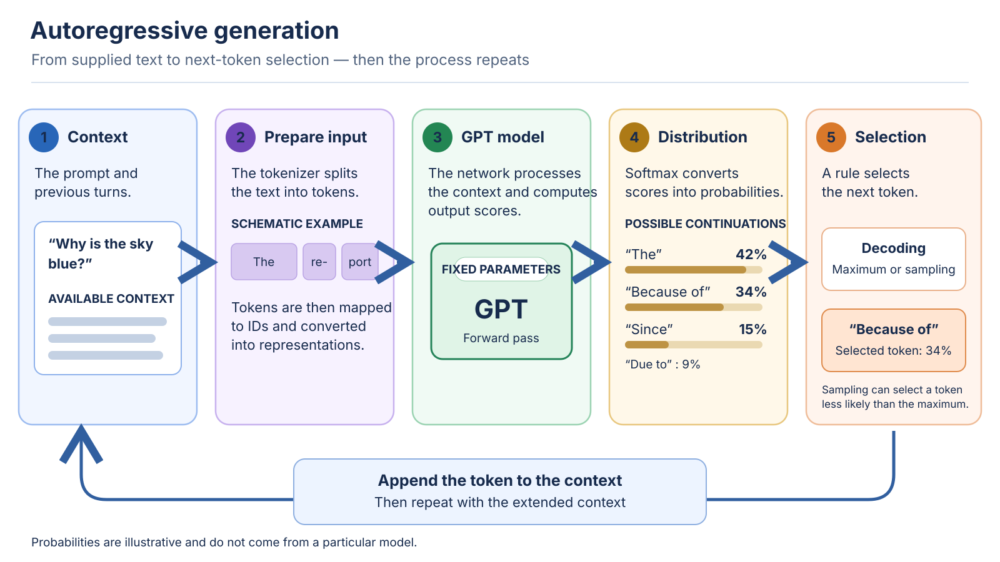

<!--
LLM-LAB-PAGE-MAP v1
id: "en/llm-overview"
scope: "Places modern LLMs within AI/ML and NLP; defines language model, generative model, LLM, GPT, and Transformer; distinguishes architecture, weight learning, and use; routes readers to dedicated pages without detailing the generation loop or internal mechanisms."
purpose: "By the end of this page, readers should be able to place LLMs, distinguish the key terms and the three dimensions of architecture/weight learning/use, and choose the specialized page for understanding Transformer computation or autoregressive inference."
suggested_route:
  previous: "en/index"
  next: "en/transformer"
hierarchy:
  parents: ["en/index"]
  children: ["en/transformer", "en/transformer-architectures", "en/generation", "en/build-path", "en/language-modeling-math", "en/mathematical-foundations", "en/llm-limits", "en/llm-computational-complexity"]
related: ["en/transformer-history"]
tags: ["type:system-overview", "destination:understand", "topic:llm-overview", "level:overview", "language:en", "status:published"]
-->
::: {.chapter-lead}
A **language model** estimates the plausibility of text sequences from a context. In a GPT, this capability is used in particular to estimate which token could follow the text already provided. A **generative model** can produce new samples from a learned distribution, possibly conditioned on an input. An **LLM** (*large language model*) is a language model trained at large scale: there is no universal parameter threshold that mechanically separates “small” models from LLMs. [Parameter count is only one dimension of scale](scaling-laws.qmd). The LLM category does not imply a particular architecture.

:::

::: {.callout-note .learning-outcomes collapse="true" title="Learning outcomes"}
By the end of this page, you will be able to:
- explain intuitively why a model must compare multiple possible continuations;
- place modern LLMs within AI/ML and NLP, and distinguish them from earlier task-specific NLP systems;
- distinguish a language model, generative model, LLM, GPT, and Transformer;
- describe the main stages by which a GPT turns context into the next token, and explain why the process repeats.
:::

## 1. The problem: continue text from a context

Given a prefix such as “The report indicates that the concentration”, the model must estimate which tokens could follow. There is not necessarily one uniquely correct continuation: several continuations may be grammatical and coherent while differing in meaning, precision, or relevance.

This language-modeling problem consists in assigning plausibility to sequences conditional on their context. For an autoregressive GPT, the probabilistic factorization of this estimate is presented in the [mathematical formalization of language modeling](language-modeling-math.qmd). How a trained model turns that estimate into text, one token at a time, belongs to the dedicated lesson on [generation](generation.qmd).

The model learns statistical regularities in its data; this objective does not, by itself, provide a mechanism for verifying truth.

### Why is this problem difficult?

- **Ambiguity and long-range dependencies:** a token's meaning often depends on distant words, syntax, discourse, and implicit knowledge.
- **Combinatorial space:** the number of possible sequences grows rapidly with length; the model must generalize beyond exact examples seen during training.
- **Heterogeneous data:** corpora mix styles, domains, quality levels, languages, and contradictions; not every learned regularity is relevant to a given task.
- **Compute trade-offs:** increasing model capacity is not enough. Data quality and diversity, the training objective, compute allocation and task-specific evaluation all matter; scale alone does not guarantee reliable capability.


## 2. How a GPT approaches this problem

**GPT** (*Generative Pre-trained Transformer*) names a family of pretrained generative models built on the Transformer architecture. In common usage, classic GPT models are **decoder-only** Transformers trained to predict the next token. GPT and Transformer are therefore not synonyms: Transformer names an architecture family; GPT names a family of models using a particular configuration.

Modern LLMs are deep-learning models within AI and machine learning; NLP is a field, not an architecture. Earlier NLP systems often relied on rules, hand-engineered features, or task-specific statistical/neural models. LLMs learn reusable patterns from broad corpora and can be adapted across tasks, but still require task-specific evaluation.

LLM Lab uses small, inspectable models to teach mechanisms, not to reproduce production-scale capabilities. An untrained reference model is expected to produce incoherent text.

## 3. Where generation fits in the system

The diagram is a **system map**, not another explanation of every operation. It locates text preparation, network computation, and next-token selection; the corresponding mechanisms are developed in their canonical pages.

{#fig-gpt-generation-process fig-alt="System overview: context is prepared, processed by the model, then extended with the selected token. The loop repeats."}

*Figure — High-level conceptual overview. The continuation percentages are illustrative; they are not the measured output of any particular model.*

- **Prepare the text:** see [text and data](text-data.qmd) and [tokenization strategies](tokenization-strategies.qmd).
- **Compute one forward pass:** see [GPT and Transformers](transformer.qmd), then the pages on [embeddings](embedding-space.qmd), [positional information](positional-encoding.qmd), and [attention](queries-keys-values.qmd).
- **Produce a continuation:** see the canonical lesson on [autoregressive generation](generation.qmd), which explains the next-token distribution, decoding, context update, and stopping.

Optimizations such as the **KV cache** reduce some repeated computation without changing the prediction objective; their compute and memory costs are covered in the [LLM computational complexity deep dive](llm-computational-complexity.qmd).

## 4. Three dimensions not to conflate

Describing an LLM requires three independent questions. They answer one another, but they denote neither the same objects nor the same operations.

| Dimension | Question | What it describes | Examples |
|---|---|---|---|
| **Architecture** | How does information flow through the model? | The operations and connections that define the computation performed | Encoder-only, encoder–decoder, decoder-only; see [the Transformer architecture comparison](transformer-architectures.qmd) |
| **Weight learning** | How were the parameters obtained or modified? | The objectives and procedures that learn or adjust the parameters | Pretraining, fine-tuning/SFT, preference optimization |
| **Inference and use** | What do you do with the model once its parameters are fixed? | Computing an output from an input, possibly within a system with retrieval or tools | Classification, scoring, autoregressive generation; prompting and RAG condition the context without changing weights |

The loop of section 1 belongs to inference. Training belongs to learning. The same model can change use without changing architecture: that is what the following sections unpack.

## 5. From learning to inference

Three landmarks help situate what happens to a model's parameters, from learning to use. This diagram is not a **complete model lifecycle**: it does not represent dataset curation, evaluation, deployment, or system maintenance.

```{mermaid}
flowchart LR
  P["1. Pretraining<br/>Learn from a corpus"] --> A["2. Optional adaptation<br/>Update the parameters"]
  P -. "without adaptation" .-> I
  A --> I["3. Inference<br/>Compute an output<br/>with fixed parameters"]
```

1. **[Pretraining](build-path.qmd).** The model learns from a corpus according to an objective — for a GPT, next-token prediction. The learning is called *self-supervised*: the targets are built from the data itself, without human labels. It produces a pretrained model, often called a *base model*. The term *foundation model* more broadly refers to a model intended for reuse and adaptation across many tasks; the two expressions are not exact synonyms.
2. **[Optional weight adaptation](build-path.qmd).** After pretraining, parameters can be updated: task fine-tuning (for example, classification), SFT on instruction–response examples, or preference optimization. This stage is not mandatory: a pretrained model can be used directly.

::: {.callout-note collapse="true" title="Optional deeper dive: RLHF and direct preference optimization"}

A **classic RLHF pipeline** (*reinforcement learning from human feedback*) commonly starts with supervised fine-tuning (SFT) on demonstrations. Human annotators then compare candidate responses; those preferences are used to train a **reward model**, which scores responses. A policy is subsequently optimized against that reward, historically often with a reinforcement-learning algorithm such as **PPO**, while controlling drift from a reference policy. This is one influential recipe, not a universal sequence used by every model or post-training system ([Ouyang et al., 2022](https://arxiv.org/abs/2203.02155)).

**DPO** (*direct preference optimization*) is a different preference-optimization approach: it learns directly from preference comparisons without the separate reward-model-plus-PPO loop of that classic RLHF recipe ([Rafailov et al., 2023](https://arxiv.org/abs/2305.18290)). It is therefore more precise to treat RLHF and DPO as related approaches to preference-based post-training, not as mandatory consecutive stages.

:::
3. **[Inference](generation.qmd).** The obtained parameters are used to process an input and compute an output. For an autoregressive model, this is the generation loop described above. The prompt and, optionally, documents retrieved by a RAG system provide context; they are not an additional learning phase and do not update the model's weights.

Adaptation is therefore an optional branch between pretraining and use, not a mandatory step. RAG belongs to context construction at inference time: it is neither a learning phase nor a stage in the model lifecycle. Evaluation, in turn, happens at several points; the test set must remain held out until the final evaluation, otherwise that evaluation would be biased.

## 6. What are these models for?

Common uses include text generation and rewriting, summarization, translation, structured extraction, classification, programming assistance, and question-answering interfaces.

Reusing a general-purpose model is attractive when one base can cover several tasks, or when the labeled examples of a task are scarce. For knowledge that changes frequently, retrieving up-to-date documents (RAG) is often better suited than changing parameters; for a specific format, domain, or behavior, an adaptation may become worthwhile. The choice is evaluated on the real task: quality, errors, robustness, cost, latency, confidentiality, data provenance, and maintenance — a convincing demo on a few prompts is not an evaluation.

::: {.self-check}

[Exercises and practice](../en/exercises.qmd).

Try to answer before opening the solutions. The goal is to manipulate the mental model, not to memorize labels.

1. A model has just generated the token "cat" and is preparing the next one. Describe what happens between these two tokens: what does the model receive, what does it compute, and what does not change?

<details>
<summary>Show the reasoning</summary>

The token "cat" is appended to the context: it is this longer sequence that the model receives. It computes a new probability distribution over the vocabulary, from which a selection rule extracts the next token. What does not change: the model's parameters — inference reads them, it does not modify them.

</details>

2. An application must answer from documentation that changes daily. Compare adding document retrieval (RAG) with fine-tuning: which one can exploit the new documents without retraining the weights?

<details>
<summary>Show the reasoning</summary>

RAG can retrieve documents at inference time and provide them in the context; the model's weights do not change. Fine-tuning modifies the weights from training examples and requires a new adaptation procedure to absorb the changes. RAG guarantees neither the relevance of the retrieved documents nor the faithfulness of the answer.

</details>

:::

::: {.callout-note collapse="true" title="One distinction to keep in mind"}

Next-token prediction guarantees neither the truth of a model's outputs nor human-like understanding of the world. These questions, along with claims about emergent capabilities, are examined in [What next-token prediction does not prove](llm-limits.qmd).

:::

::: {.language-switch}
**Language:** [Français](../fr/llm-overview.qmd) · [English](llm-overview.qmd)
:::
