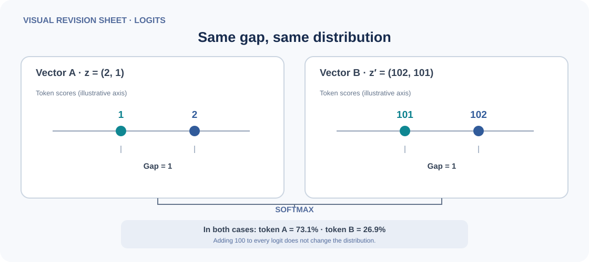

<!--
LLM-LAB-PAGE-MAP v1
id: "en/logits"
summary: "Presents logits as the unnormalized scores produced for vocabulary tokens at the network output, immediately before their transformation into a distribution."
scope: "Explains how the output head projects a final state into vocabulary-indexed scores."
purpose: "Identify the shape and axes of the logits, then read the ranking of candidates at one position."
suggested_route:
  previous: "en/causal-masking"
  next: "en/probabilities"
hierarchy:
  parents: ["en/transformer"]
  children: ["en/probabilities"]
related: ["en/causal-masking", "en/generation", "en/logits-exercises"]
revision_support:
  status: integrated_sufficient
  evidence:
    - anchor: revision-summary
      note: "The recap separates score, probability and truth; the lesson explains dimension V, ranking, common-shift invariance and the output projection. The exercises check these points and compare the attention and output softmax axes."
tags: ["type:concept-lesson", "destination:understand", "topic:logits", "level:core", "language:en", "status:published"]
-->



::: {.chapter-lead}
A **logit** is an unnormalized real-valued score associated with a class or vocabulary token. In an LLM, the final projection usually produces a vector $z\in\mathbb{R}^{V}$ at each prediction position.
:::

The previous page showed how causal masking limits the positions accessible to attention. In the project’s GPT, the states from the final block pass through a final normalization. The output head then projects each normalized state into this score vector.

::: {.callout-note .learning-outcomes collapse="true" title="Learning outcomes"}
By the end of this page, you will be able to:
- interpret a logit vector and explain why its values are not probabilities;
- distinguish score-based candidate ranking from the probability distribution used for generation;
- identify the vector dimension from the vocabulary size.
:::

::: {.callout-tip title="The one-minute mental model" #revision-summary}
**Logits are scores, not probabilities.** At one position, the model produces one score per vocabulary token. The largest score identifies the top-ranked candidate; by itself, it is neither a probability nor a measure of truth.

**First pass:** follow “Transformer representation → output projection → vector of $V$ logits”. The next page explains how these scores become a conditional distribution.
:::

  <a class="step-item" href="transformer.qmd">1. Final state</a>
  →
  2. Vocabulary projection
  →
  3. Logits
  →
  <a class="step-item" href="probabilities.qmd">4. Probabilities</a>

## From the final state to four scores {#running-example-output-projection}

After the Transformer processes “What have the Romans ever done for us?”, the output head reads the final state of the **last token in the prefix**. It assigns one score per vocabulary token to predict the following position.

Take an illustrative state $h=(1,-1)$ and a toy vocabulary of four tokens. The output matrix has four rows and two columns. In this example without a bias term, the score $z_i$ is the dot product of row $w_i$ and $h$. Multiply corresponding coordinates and add the products.

::: {.table-responsive}

<table class="table d-table">
<thead>
<tr><th scope="col" class="px-1 px-sm-2">Token</th><th scope="col" class="px-1 px-sm-2">Row $w_i$</th><th scope="col" class="px-1 px-sm-2">Score $z_i$</th></tr>
</thead>
<tbody>
<tr><th scope="row" class="px-1 px-sm-2">“They”</th><td class="px-1 px-sm-2">$(\ln 3,-\ln 2)$</td><td class="px-1 px-sm-2">$\ln 6$</td></tr>
<tr><th scope="row" class="px-1 px-sm-2">“Aqueducts”</th><td class="px-1 px-sm-2">$(\ln 2,0)$</td><td class="px-1 px-sm-2">$\ln 2$</td></tr>
<tr><th scope="row" class="px-1 px-sm-2">“Nothing”</th><td class="px-1 px-sm-2">$(1,1)$</td><td class="px-1 px-sm-2">$0$</td></tr>
<tr><th scope="row" class="px-1 px-sm-2">“Well”</th><td class="px-1 px-sm-2">$(-1,-1)$</td><td class="px-1 px-sm-2">$0$</td></tr>
</tbody>
</table>

:::

For “They”, the calculation gives $\ln 3-(-\ln 2)=\ln 6$. “Nothing” and “Well” get the same score for this state from two different rows.

The [calculation for these four candidates](probabilities.qmd#running-example-next-token) uses the same scores to obtain the first-step distribution.

## Definition and dimensions

At a given position, write the score vector as:
$$
z=(z_1,\ldots,z_V)\in\mathbb{R}^{V},
$$
where $V$ is the vocabulary size. Each component $z_i$ is associated with token ID $i$. Logits may be positive or negative; they are not constrained to $[0,1]$ and do not need to sum to one.

For a batch of sequences, the output head may produce a tensor of shape $(B,T,V)$: $B$ sequences, $T$ positions, and $V$ scores per position. During autoregressive generation, the scores at the current position are typically used to choose the next token.

To connect the position axis to the vocabulary axis, [compare two observed targets under the same prefix](exercises/contextualized-representations.qmd#ex-contextualization-causal-boundary). Identify the shared logit row, then the column used in each case.

## What logits tell us

- **Local ranking:** within one vector, the largest logit identifies the maximum-score candidate (the argmax).
- **Score gaps:** differences between scores describe their relative separation within that vector.
- **Not absolute confidence:** a raw logit depends on the scores' scale and offset. It is not a percentage and cannot, by itself, establish confidence or factual truth.

<figure id="fig-logits-common-shift">
  <picture>
    <source media="(max-width: 600px)" srcset="../images/logits-common-shift-en-mobile.svg">
    
  </picture>
  <figcaption>Softmax is invariant to adding the same constant to every logit: the gaps matter, not the absolute level.</figcaption>
</figure>

### The zero point of logits is arbitrary

Consider two vectors: $z=(2,1)$ and $z'=(102,101)$. Their scores differ greatly in absolute value, but the second vector is obtained by adding 100 to every component. Softmax gives exactly the same distribution for both vectors: the common offset cancels between numerator and denominator. **Differences between logits determine probability ratios, not their absolute level.**

More generally, if $p=\operatorname{softmax}(z)$, then $\log p_i=z_i-\log\sum_j e^{z_j}$ and therefore:

$
\log\frac{p_i}{p_j}=z_i-z_j.
$

The gap between two logits is exactly the log-ratio of their corresponding probabilities.

By contrast, multiplying every logit by a positive factor can change the distribution's concentration even when candidate ranking stays the same. Temperature uses precisely this property; the [output probabilities](probabilities.qmd) page explains its effect.

Converting scores into a probability distribution is a separate operation. It is covered in [Output probabilities](probabilities.qmd), the canonical page for softmax, temperature, and distribution interpretation.



:::: {.language-switch}
[Français](../fr/logits.qmd) · [English](logits.qmd)
::::

## Practice

[Compare the two softmax axes](exercises/logits.qmd#ex-attention-vocabulary-softmax) or explore the [other practice questions](exercises/logits.qmd).

:::: {.supplementary-resources}

  Supplementary resources
  Experiment, explore further, and practise the ideas from this lesson.

::: {.learning-resources__content}

### In an LLM

The final hidden representation is projected to a vector of dimension $V$, usually through a linear output layer. During training, logits can be passed directly to a loss function such as [cross-entropy](cross-entropy.qmd): an explicit softmax calculation is not required beforehand when the loss function incorporates it in a numerically stable way.

The [PyTorch — CrossEntropyLoss](https://docs.pytorch.org/docs/stable/generated/torch.nn.CrossEntropyLoss.html) documentation specifies unnormalized logits as the expected input.

:::

::::
