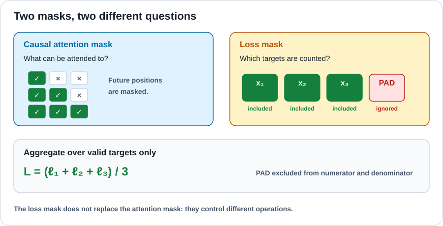

<!--
LLM-LAB-PAGE-MAP v1
id: "en/loss"
summary: "Connects penalties computed on target tokens to an aggregated training objective. The loss provides the scalar signal differentiated to compute gradients and update parameters."
scope: "Turns local penalties and a mask of valid targets into a scalar objective for a batch."
purpose: "Construct batch loss and explain the effect of choosing between a sum, a mean over valid tokens and a weighted mean."
suggested_route:
  previous: "en/cross-entropy"
  next: "en/gradients"
hierarchy:
  parents: []
  children: []
related: ["en/cross-entropy", "en/gradients", "en/training-loop", "en/loss-exercises"]
revision_support:
  status: integrated_sufficient
  evidence:
    - anchor: revision-summary
      note: "The recap specifies logit-target alignment, valid positions and aggregation; the lesson covers teacher forcing, masking, reduction and perplexity. The exercises check denominators, generalization, comparability and how aggregation can change the ranking of checkpoints."
tags: ["type:concept-lesson", "destination:understand", "topic:loss", "level:core", "language:en", "status:published"]
-->


::: {.chapter-lead}
*Loss* refers to a scalar objective that training seeks to minimize. It is often built from per-token cross-entropies, but its exact aggregation is part of the experiment's definition.
:::

::: {.callout-tip title="The one-minute mental model" #revision-summary}
The *loss* measures the mismatch between predictions and **target tokens**. In autoregressive prediction, we index logits by the **target position** here: logits computed from the prefix $x_{<t}$ are compared with target token $x_t$. Some implementations instead index logits by the input position and then predict $x_{t+1}$; a shift error can produce a plausible-looking loss while training the wrong task.

**First pass:** understand the penalty for one token, then its mean over valid positions only. Ignored positions (such as padding) must contribute neither to the sum nor to the denominator.

Reduction conventions determine how per-token losses are aggregated. Perplexity is the exponential of mean per-token loss; the loss gradient supplies the signal used to update parameters ([gradients](gradients.qmd)).

:::

  <a class="step-item" href="likelihood.qmd">1. Observed target</a>
  →
  <a class="step-item" href="cross-entropy.qmd">2. Per-token loss</a>
  →
  3. Aggregation
  →
  4. Loss

Before interpreting the loss, check how [training inputs and targets are constructed](training-examples.qmd): a correct formula cannot fix a token-shift error.

On the reference continuation, the model computes a loss for each valid target position. The batch loss aggregates these penalties according to the chosen reduction and mask: padding or explicitly ignored positions must not contribute to the average.

## From local penalty to batch loss

Let $p_{b,t,:}$ be the predicted distribution at position $(b,t)$ and $y_{b,t}$ the target-token ID. For each valid target position $(b,t)\in\mathcal{M}$, the loss is:

$$
\ell_{b,t}=-\log p_{b,t,y_{b,t}}.
$$

For a one-hot target, this term is the special case of [cross-entropy](cross-entropy.qmd) in which only the target token's probability contributes. The dedicated lesson derives it and connects it to logits; here, the focus is on aggregating it into a batch objective.

The mean over valid positions is:

$$
\mathcal{L}(\theta)=\frac{1}{|\mathcal{M}|}
\sum_{(b,t)\in\mathcal{M}}\ell_{b,t}.
$$

For this simplified calculation, the displayed units are treated as tokens; this is not a segmentation measured with a particular tokenizer.

For the illustrative continuation “They built roads”, the three local penalties are $-\log(0.6)\approx0.511$, $-\log(0.5)\approx0.693$, and $-\log(0.8)\approx0.223$ nats. Their sum is the sequence NLL, approximately $1.427$ nats; their mean is approximately $0.476$ nats per token. State whether a reported value is a sum or a mean: they answer different scale questions. These values illustrate the calculation on a reference continuation; they are not measurements from a real model.

The mean summarizes all three penalties. To see how one target contributes to the gradient, [isolate the first one, “They”](gradients.qmd#numerical-example-from-loss-to-output-weights), and trace its loss back to the logits.

::: {.callout-note collapse="true" data-reading-time="exclude" title="Other reductions and weighting"}
A sum and a per-sequence mean are also possible. A weighted mean defines another convention: for example, with nonnegative weights $w_{b,t}$ on valid positions, one may compute $\mathcal{L}_w=\frac{\sum_{(b,t)\in\mathcal{M}}w_{b,t}\ell_{b,t}}{\sum_{(b,t)\in\mathcal{M}}w_{b,t}}$, provided the denominator is nonzero. The denominator is then the sum of weights, not the number of valid positions. Some APIs use this rule for class weights; other weighting conventions, especially per-sequence weighting, may use a different denominator. These choices change the objective, gradient scale, or relative weight of sequences, so they must be documented.
:::

## Masking and shifted targets

In causal language modeling, the indexing convention must be explicit. With the target-position indexing used here, logits associated with prefix $x_{<t}$ predict $x_t$. With input-position indexing, logits at position $t$ usually predict $x_{t+1}$. The loss must align logits and labels under one convention rather than comparing logits with the wrong target. Padding tokens or explicitly ignored positions must be excluded from both the numerator **and** denominator of a mean over valid targets. The loss mask determines only which targets contribute to the objective; it does not determine which tokens may influence the representations used to predict those targets. That visibility is controlled by the attention mask (causal, padding, or document-boundary masking, as appropriate). Excluding a target from the loss therefore does not, by itself, prevent its information from entering the context. See also [training examples](training-examples.qmd) and [causal masking](causal-masking.qmd).

<figure id="fig-loss-and-attention-masks">
  <picture>
    <source media="(max-width: 600px)" srcset="../images/loss-en-mobile.svg">
    
  </picture>
  <figcaption>The attention mask controls visibility during computation; the loss mask controls which targets are counted. An ignored position is excluded from both numerator and denominator, but this mask alone does not determine whether its content can influence other positions.</figcaption>
</figure>

### Observed prefix and teacher forcing

With the target-position indexing used here, during a *teacher-forced* forward pass the context supplied at position $t$ is the reference prefix $x_{<t}$ and the target being scored is token $x_t$. The model is therefore not fed its own previous prediction as the input at every position: reference tokens provide the context, while predictions are compared with their corresponding targets. The causal mask prevents each position from accessing future reference tokens. This conditioning convention is distinct from the loss calculation and the parameter update: *teacher forcing* defines the context, the loss measures the mismatch with targets, and gradients plus the optimizer determine whether and how parameters change.

*Teacher forcing* should not be confused with *prefill*. Prefill processes the known prompt at the start of inference; teacher forcing refers to using the reference prefix as context during scoring or training. See [generation](generation.qmd) for prefill and [likelihood](likelihood.qmd) for scoring with fixed parameters.

A one-token alignment error can produce a finite, decreasing loss while training the wrong task.

[Worked exercise on the target shift, visibility, and the loss denominator](exercises/loss.qmd#ex-visible-token-masked-target).

## Training loss and metrics

Loss is the differentiable objective being optimized. A metric such as accuracy, response quality, or calibration can matter without being directly optimized by that loss. For language modeling, perplexity is related to mean per-token NLL:

$$
\operatorname{PPL}=\exp(\operatorname{NLL}_{\mathrm{mean}}).
$$

The formula with $\exp$ assumes mean NLL is computed with the natural logarithm (loss in nats). If it is computed in bits using $\log_2$, use $2^{\operatorname{NLL}_{\mathrm{mean}}}$. In either case, the aggregation convention must match. Perplexity also depends on the tokenizer and evaluated corpus.

::: {.callout-warning title="Misconceptions"}
- **“Lower loss proves better answers.”** It indicates a better value of the measured objective, not necessarily improvement in every capability or real-world usefulness.
- **“A falling training curve is enough.”** It cannot by itself detect data leakage, overfitting, or a misaligned evaluation.
- **“Mean loss is always comparable across experiments.”** Check tokenizer, data, masks, sequence length, reduction, and the exact objective.
:::

::: {.callout-note collapse="true" data-reading-time="exclude" title="Pipeline diagnostics (advanced)"}
Before interpreting a curve, document the objective, input/target shift, ignore mask, reduction, train/validation split, and any regularization terms. Overfitting a tiny batch is a useful pipeline sanity check, but not evidence of generalization.
:::



:::: {.language-switch}
[Français](../fr/loss.qmd) · [English](loss.qmd)
::::

## Practice

The [practice page](exercises/loss.qmd) includes a worked example that [compares two checkpoints by validation loss per valid token](exercises/loss.qmd#ex-validation-loss-by-token).

  Supplementary resources
  Experiment, explore further, and practise the ideas from this lesson.

### Further reading

**Implementation note:** standard cross-entropy functions expect unnormalized logits; do not apply softmax first when the API expects logits directly.

- [PyTorch — CrossEntropyLoss](https://docs.pytorch.org/docs/stable/generated/torch.nn.CrossEntropyLoss.html): documents the loss for unnormalized logits, ignored targets, optional class weights, and reduction modes. These conventions must be recorded when comparing reported losses.

