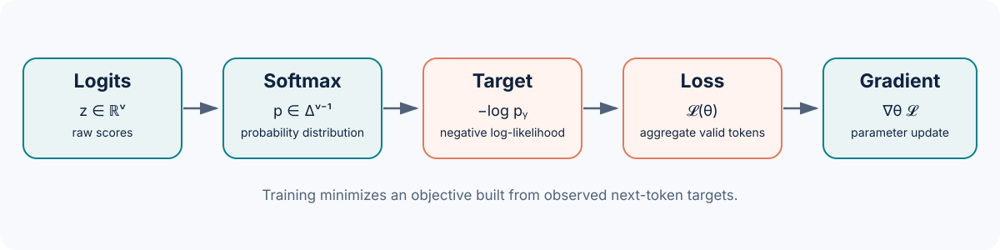

::: {.chapter-lead}
An autoregressive model produces **logits** for the next token. Softmax turns them into probabilities; the observed target defines a likelihood and a loss; differentiating that loss gives gradients used to update the parameters. These concepts are connected, but they are not interchangeable.
:::

{fig-alt="Computation chain: logits z, softmax to p, target-token probability, negative log-likelihood, then loss gradient with respect to parameters." width=100%}

## The chain at a glance

1. **[Logits](logits.qmd)** — unnormalized real-valued scores produced by the model.
2. **[Probabilities](probabilities.qmd)** — a distribution over the vocabulary obtained with softmax.
3. **[Likelihood](likelihood.qmd)** — the probability assigned to the observed target tokens, or its logarithm.
4. **[Cross-entropy](cross-entropy.qmd)** — the penalty associated with a target and a predicted distribution.
5. **[Loss function](loss.qmd)** — the scalar objective aggregated over selected tokens and examples.
6. **[Gradients](gradients.qmd)** — derivatives describing how the loss locally changes with logits and parameters.

## Shared notation

We use:

- \(B\): batch size; \(T\): number of prediction positions; \(V\): vocabulary size.
- (z_{b,t,v}\in\mathbb{R}): logit for vocabulary token \(v\), example \(b\), and position \(t\).
- (p_{b,t,v}\in[0,1]): corresponding probability, with \(\sum_{v=1}^{V}p_{b,t,v}=1\).
- (y_{b,t}\in\{1,\ldots,V\}): target token ID at the prediction position.
- \(\theta\): all learned model parameters.
- \(\mathcal{M}\): set of target positions included in the loss; ignored positions (such as padding) are excluded.

For one position, we sometimes omit (b,t). Logits \(z\in\mathbb{R}^{V}\) are converted to probabilities by:

\[
p_v=\frac{\exp(z_v)}{\sum_{j=1}^{V}\exp(z_j)}.
\]

The negative log-probability of target \(y\) is:

\[
\ell(z,y)=-\log p_y
= -z_y+\log\sum_{j=1}^{V}\exp(z_j).
\]

For a set of valid target positions, a common convention is the mean:

\[
\mathcal{L}(\theta)=-\frac{1}{|\mathcal{M}|}
\sum_{(b,t)\in\mathcal{M}}\log p_{b,t,y_{b,t}}.
\]

**Important:** both sum and mean reductions are possible, but they change gradient scale. Any comparison should state the reduction and how ignored tokens are handled.

## What these equations imply — and what they do not

::: {.callout-warning title="Misconceptions to avoid"}
- **“Logits are probabilities.”** False: logits can be negative, positive, and unbounded. Adding the same constant to every logit leaves softmax unchanged.
- **“A high probability proves the model is right.”** False: it is the model's relative confidence, not a guarantee of truth or correct calibration.
- **“Cross-entropy and loss always mean exactly the same thing.”** False: cross-entropy may be a per-token loss; the training objective may average it, add regularization, or combine multiple objectives.
- **“Maximizing likelihood differs from minimizing loss.”** For fixed data and conventions, negative log-likelihood is the negative log-likelihood; minimizing one is equivalent to maximizing the other.
- **“A negative gradient means a parameter is bad.”** False: its sign describes a local change with respect to one coordinate under a given convention, not an intrinsic quality.
:::

## How to use this path

Each concept page derives one step, gives a calculable example, and states its assumptions. The links do not imply mastery: derivations should be reproduced and tested against edge cases.

- Start with [logits](logits.qmd), then [probabilities](probabilities.qmd).
- Connect observed probabilities to [likelihood](likelihood.qmd) and [cross-entropy](cross-entropy.qmd).
- Distinguish per-token loss from the aggregated [loss function](loss.qmd).
- Finish with [gradients](gradients.qmd), the chain rule, and numerical verification.

## Foundational references

- Goodfellow, Bengio & Courville, [*Deep Learning*, Chapter 6 — Deep Feedforward Networks](https://www.deeplearningbook.org/contents/mlp.html), for cost functions and optimization.
- Bishop, [*Pattern Recognition and Machine Learning*](https://www.microsoft.com/en-us/research/people/cmbishop/prml-book/), for probabilities, likelihood, and estimation.
- [PyTorch — CrossEntropyLoss](https://docs.pytorch.org/docs/stable/generated/torch.nn.CrossEntropyLoss.html), which specifies logits, targets, and reduction conventions.

:::: {.language-switch}
**Language:** [Français](../fr/mathematical-foundations.qmd) · [English](mathematical-foundations.qmd)
::::
