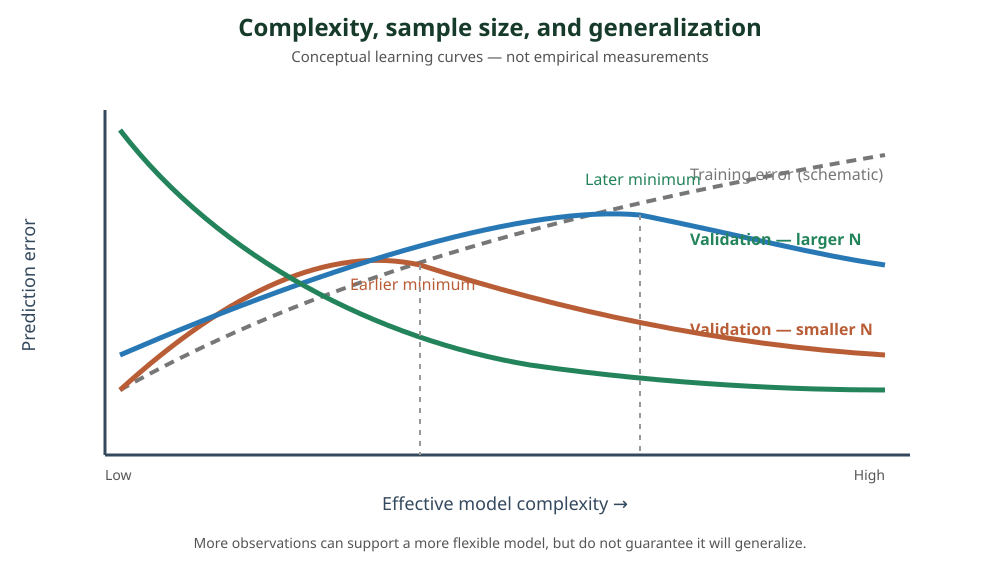

<!--
LLM-LAB-PAGE-MAP v1
id: "en/model-capacity-data-regimes"
scope: "Connects effective model capacity, feature dimension, sample size, noise, and underfitting/overfitting risks."
purpose: "Interpret N/M regimes, effective degrees of freedom, and learning curves cautiously when choosing and regularizing models."
suggested_route:
  previous: "en/bias-variance"
  next: "en/decision-trees"
hierarchy:
  parents: ["en/bias-variance"]
  children: []
related: ["en/decision-trees", "en/gradient-boosting", "en/xgboost"]
tags: ["type:concept-lesson", "destination:deepen", "topic:model-capacity-data-regimes", "level:applied", "language:en", "status:published"]
-->
::: {.chapter-lead}
Dataset size alone does not determine which model is appropriate. It must be considered alongside feature dimension, effective model capacity, signal structure, noise, and dependence between observations. The ratio $N/M$ is a starting point, not a model-selection law.
:::
## Three quantities to distinguish

- $N$: number of effectively independent or sufficiently informative observations.
- $M$: number of candidate features after encoding; this can differ substantially from the number of domain variables.
- **Effective capacity**: the amount of complexity the learning procedure can actually use given its architecture, constraints, regularization, and data.

Difficulty also depends on signal-to-noise ratio, feature redundancy, signal sparsity, categorical cardinality, missingness, and train-to-deployment distribution shift. Two datasets with the same $N$ and $M$ can therefore have very different difficulty.

## The ratio between observations and features

### When $N$ is small relative to $M$

The problem is underdetermined or weakly constrained: many models can explain the training observations. Risks include chance feature selection, unstable coefficients, and patterns that do not repeat.

An unregularized linear regression cannot uniquely identify all coefficients when the design matrix is rank-deficient. L1 regularization can favour a sparse solution; L2 stabilizes coefficients. Neither creates information that is absent: the choice depends on signal structure, feature correlation, and the validation protocol.

A tree can ignore many features and retain only selected splits. This does not make it automatically safe when $N \ll M$: testing many features and thresholds creates a multiple-selection effect, and a tree can find accidental splits. Depth, minimum gain, minimum leaf size, pruning, and validation remain important.

### When $N$ is large relative to $M$

There is generally more information available to estimate relationships, and more flexible models become feasible. But $N \gg M$ guarantees neither exploitable signal nor freedom from overfitting: low signal-to-noise ratio, temporal dependence, or distribution drift can keep the problem difficult.

Flexible models — trees, forests, boosting, neural networks — can exploit interactions and nonlinearities that linear models do not directly represent. Their capacity must still be tested against validation data representative of deployment.

## Degrees of freedom: useful, not a universal formula

Degrees of freedom aim to quantify an estimator's effective flexibility. For ordinary linear regression with design rank $r$, model degrees of freedom are tied to $r$, hence at most $\min(N,M)$ in the usual setting. For ridge regression, effective degrees of freedom are often expressed as $\operatorname{tr}(S_\lambda)$, where $S_\lambda$ maps observations to fitted values.

For trees, depth, leaf count, leaf sizes, and split constraints describe aspects of capacity, but do not reduce to a general $O(N)$ law. Two trees with the same number of leaves can behave differently depending on region geometry, selected features, and the observation distribution.

**Caution with asymptotic notation:** writing “complexity $O(N)$” without specifying the quantity being counted, model family, assumptions, and algorithm is insufficient. Statistical degrees of freedom, parameter count, memory cost, and training-time complexity are distinct quantities.

## Data size shifts the trade-off

{fig-alt="Qualitative diagram: training error decreases with complexity; validation error reaches a minimum, located further right with more data. This is not a universal empirical law."}

At fixed capacity, more independent observations tend to stabilize estimation. This can make a more flexible model usable: the validation minimum may move toward greater complexity. But this shift is not guaranteed and depends on data quality, noise, distribution, and how complexity is measured.

Read the curves:

- **Underfitting:** both training and validation errors are high; increasing capacity or improving features may help.
- **Generalization region:** validation improves and then reaches a minimum.
- **Overfitting:** training error keeps decreasing while validation error rises.
- **More data:** it may reduce instability and delay overfitting, but cannot fix leakage, a poor target, or distribution shift.

## Starting points to validate

| Observed situation | First hypothesis to test | What to monitor |
|---|---|---|
| Small $N$, large $M$ | Simple baseline, stronger regularization, sparse selection, or shallow model | Score variation across splits, stability of selected features |
| Moderate $N$, plausible interactions | Constrained trees, random forest, regularized boosting | Train-validation gap, depth, leaves, calibration |
| Large $N$, heterogeneous tabular data | Compare GBM, XGBoost, LightGBM, and CatBoost | Total runtime, memory, out-of-sample quality, drift |
| Very weak signal-to-noise ratio | Robust baseline and simple model | Real gain over baseline and estimate uncertainty |

This table does not rank algorithms. It suggests starting hypotheses to test under a comparable protocol.

## Why ensembles change the trade-off

A random forest averages trees built with randomness in observations and/or features. Aggregation often reduces variance, but the gain depends on two properties: individual-tree strength and correlation between trees. Highly correlated trees add less new information; excessive randomization can instead weaken each tree. Breiman formalizes this trade-off between strength and correlation.

Adding trees to a standard random forest generally reduces Monte Carlo noise in the aggregation, and the error converges to a limit; this does not mean that every change in depth, feature set, or protocol is immune to overfitting.

Boosting follows a different logic: each tree depends on the current model and corrects part of its loss. Diversity comes from this sequential construction, not from averaging independent models. Additional rounds can first improve generalization and eventually fit noise; learning rate, depth, penalties, and early stopping therefore matter.

See [Decision Trees](decision-trees.qmd), [Gradient Boosting](gradient-boosting.qmd), [XGBoost](xgboost.qmd), [LightGBM](lightgbm.qmd), and [CatBoost](catboost.qmd).

::: {.self-check}
## Check your understanding
1. If $N \ll M$, does a tree necessarily avoid overfitting because it selects only a few features?

Show answer
No. Searching across many features and thresholds can find accidental splits. Capacity must be controlled and out-of-sample stability measured.

2. Why is the $N/M$ ratio insufficient to characterize difficulty?

Show answer
Noise, redundancy, signal sparsity, dependence between observations, cardinality, and distribution shift change the amount of useful information.

3. Why can more data make a more flexible model usable?

Show answer
With comparable signal and distribution, more informative observations can reduce estimation uncertainty and stabilize more complex structures. This is not guaranteed if additional data are noisy or shifted.

4. Why is adding trees to a forest not equivalent to growing deeper trees?

Show answer
Tree count improves the approximation of the aggregate; depth changes the complexity and instability of the individual predictors.

:::
## References

- Hastie, Tibshirani & Friedman, [The Elements of Statistical Learning](https://hastie.su.domains/ElemStatLearn/), Chapters 2, 7, 8, and 15.
- Breiman (2001), [Random Forests](https://www.stat.berkeley.edu/~breiman/randomforest2001.pdf), especially the sections on convergence, strength, and correlation.
- Damien Benveniste, [GBM vs XGBoost vs LightGBM vs CatBoost](https://newsletter.theaiedge.io/p/gbm-vs-xgboost-vs-lightgbm-vs-catboost), public introduction on $N/M$ regimes and model capacity.
- [The AiEdge — The Gradient Boosted Algorithm Explained!](https://newsletter.theaiedge.io/p/the-gradient-boosted-algorithm-explained), public diagram of the additive learning cycle.
::: {.language-switch}
[Français](../fr/model-capacity-data-regimes.qmd) · [English](model-capacity-data-regimes.qmd)
:::
