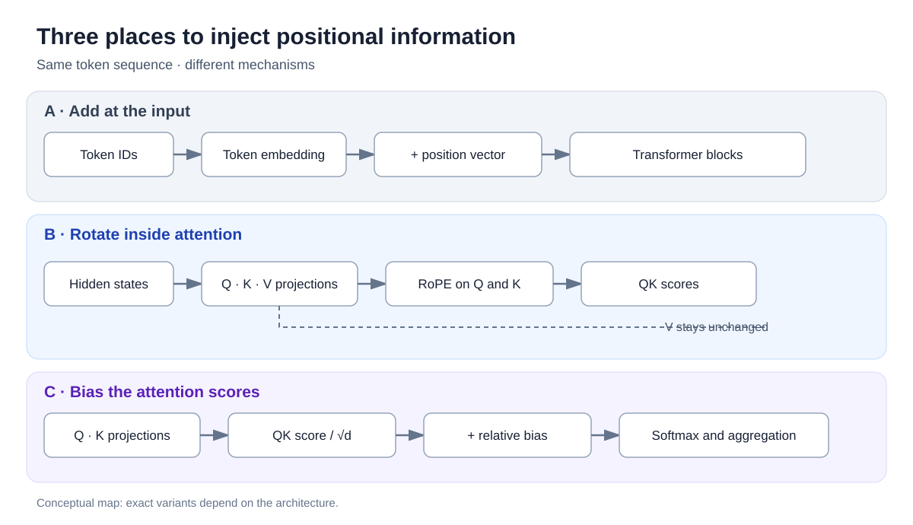

<!--
LLM-LAB-PAGE-MAP v1
id: "en/positional-encoding"
summary: "Shows why token content alone does not represent order, then distinguishes positional signals from causal visibility constraints."
scope: "Explains why order must be represented and compares the insertion points of absolute encodings, relative representations, score biases and RoPE. Distinguishes these signals from causal visibility and locates NoPE as the omission of an explicit positional mechanism. Derivations remain in the deep dives."
purpose: "Explain why content alone is insufficient, compare where positional mechanisms act in the computation, and distinguish explicit information, implicit order and causal visibility."
suggested_route:
  previous: "en/embedding-space"
  next: "en/contextualized-representations"
hierarchy:
  parents: []
  children: ["en/rope", "en/sinusoidal-positional-encoding"]
related: ["en/embedding-space", "en/contextualized-representations", "en/transformer", "en/positional-encoding-exercises"]
revision_support:
  status: integrated_sufficient
  evidence:
    - anchor: revision-summary
      note: "The recap distinguishes content, order, insertion points and causal visibility; five recall cards and a transfer exercise are available on the dedicated Practice page."
tags: ["type:concept-lesson", "destination:understand", "topic:positional-encoding", "level:core", "language:en", "status:published"]
-->


::: {.chapter-lead}
A Transformer needs an ordering signal to distinguish, for example, “the cat chases the dog” from “the dog chases the cat”. This page introduces positional mechanisms and distinguishes them from causal masking; the detailed RoPE derivation belongs in an [advanced deep dive](rope.qmd). For the original Transformer's sinusoidal encodings, see the [dedicated deep dive](sinusoidal-positional-encoding.qmd).
:::

## Why add positional information?

The two occurrences of `cat` at positions 0 and 3 retrieve the same vector from the [embedding table](embedding-space.qmd). The model needs an ordering signal to account for where each token occurs. Changing the order in “the cat chases the dog” can change who is chasing whom.

When used, the causal mask indicates which positions may be attended to (`j ≤ i`). Positional mechanisms can additionally represent an absolute position or a relative offset. These signals are complementary, not interchangeable. Some architectures described as **NoPE** omit an explicit positional mechanism: the nested visible prefixes induced by causal masking can then provide an implicit ordering signal. This structural signal does not provide an explicit absolute coordinate or relative distance, and it does not guarantee reliable generalization to longer contexts.

In “What have the Romans ever done for us?”, token order is part of the input. As generation adds “They built roads between distant towns.”, each new token takes its own position in the growing sequence.

## Two families, with several mechanisms

- **Absolute encoding added to the vector:** add a position-specific vector to the token representation. The original Transformer used sinusoidal encodings; other models learn positional embeddings.
- **Relative mechanisms:** introduce the offset between positions into the attention computation. Important examples include:
  - **Relative representations**, as in Shaw et al., attach learned representations to relations between positions and can affect both compatibility and aggregation.
  - **Relative biases**, as in T5 or ALiBi, add an offset-dependent term to attention scores before softmax: T5 learns bucketed values, whereas ALiBi uses a fixed linear penalty for each head.
  - **RoPE:** this rotary method applies position-dependent rotations to queries and keys after their projections and before the $QK^\top$ product. The resulting score depends on the relative offset. RoPE is therefore a relative-position mechanism; it is separated here to make its particular insertion point clear.

The first distinction is between **absolute** and **relative** positional information. RoPE is not a third disjoint family: it is a relative-position mechanism with a distinctive implementation point. These mechanisms inject positional information at different points and do not have exactly the same properties. The diagram compares three insertion points: absolute addition at the input, Q/K rotation, and a relative bias added to attention scores before softmax. The causal mask remains a separate visibility constraint.

| Mechanism | Insertion point | Example | Main effect |
|---|---|---|---|
| Absolute encoding | At the input, added to the token embedding | Sinusoidal encoding, learned positional embeddings | Supplies an absolute-position representation. |
| RoPE (relative) | On Q and K after projection, before the QKᵀ product | RoPE | Makes attention scores depend on relative offset through rotations. |
| Relative bias | On attention scores, before softmax | T5, ALiBi | Adds an offset-dependent term to attention scores. |

<figure id="fig-positional-entry-points">
  <picture>
    <source media="(max-width: 600px)" srcset="../images/positional-entry-points-en-mobile.svg">
    
  </picture>
  <figcaption>These mechanisms inject positional information at different points in the computation. RoPE belongs to the relative family and acts on Q and K; causal masking remains a separate visibility constraint.</figcaption>
</figure>

### A permutation reveals the problem

Compare “the cat chases the dog” with “the dog chases the cat”. The same token embeddings occur in a different order. Without a positional signal or an order-dependent structural constraint, self-attention based only on content is permutation equivariant: permuting the inputs permutes the outputs, but does not tell the model which role belongs to the first or last position.

A positional mechanism makes order available to the network. A causal mask answers a different question: which positions may a query access? The two mechanisms are complementary, not interchangeable.

In the additive exercise, the toy table gives both occurrences of `cat` the same embedding $(2,-1)$. The vector added at each occurrence depends on its position. [Compute the two first-block inputs](exercises/text-data.qmd#ex-token-to-block-input).

::: {.callout-note title="A computable signal does not guarantee extrapolation"}
A mechanism may compute a signal for a position without the model generalizing reliably to that context length. **Being able to represent a position does not guarantee performance at that position.** The deep dives on [sinusoidal encodings](sinusoidal-positional-encoding.qmd) and [RoPE](rope.qmd) examine the limitations and related techniques.
:::

At this stage, it is enough to understand the mechanisms' role and approximate location in the computation. For relative-offset dependence and rotation conventions, see the [advanced RoPE deep dive](rope.qmd).

## Common misconceptions

- **“Attention naturally knows which token comes first.”** Content-based attention does not carry that order on its own; a positional mechanism or structural constraint such as causal masking must supply it.

::: {.callout-tip title="The one-minute mental model" #revision-summary}
- **Why:** content embeddings alone do not say where a token occurs. Without positional information or an order-dependent constraint, self-attention is permutation equivariant.
- **Where:** additive absolute encodings enter at the input; **RoPE** rotates Q and K after projection; T5/ALiBi biases modify scores before softmax.
- **Do not conflate:** the causal mask controls visibility. In NoPE it can provide implicit order, but not an explicit absolute coordinate or distance.
:::

## Where does this step sit in the route?

The [embedding-space lookup](embedding-space.qmd) maps each ID to an initial vector that does not depend on position; this page explains why and how order is then taken into account. [Contextualized representations](contextualized-representations.qmd), the next step in the route, describe how Transformer blocks turn those initial states into context-dependent states. To go further: the [RoPE](rope.qmd) page details the rotary relative mechanism, and [causal masking](causal-masking.qmd) presents a distinct structural constraint: it determines which positions each query can access.



::: {.language-switch}
**Language:** [Français](../fr/positional-encoding.qmd) · [English](positional-encoding.qmd)
:::

## Practice

The questions and exercises for this lesson are collected on its [dedicated practice page](exercises/positional-encoding.qmd).

## Further exploration

:::: {.supplementary-resources}

  Mathematical details and references
  Explore the permutation-equivariance argument, sinusoidal geometry, and further references.

::: {.learning-resources__content}

### Why is self-attention alone not enough? {#permutation-equivariance}

For content-only self-attention, with no positional bias or order-dependent mask, permuting the input rows permutes the output rows in the same way. If $P$ is a permutation matrix, then:

$$
\operatorname{Attention}(PX)=P\,\operatorname{Attention}(X).
$$

To verify this, let $S=QK^\top/\sqrt{d_k}$ and $A=\operatorname{softmax}(S)$, with softmax applied row-wise. For the permuted input, $Q'=PQ$, $K'=PK$, and $V'=PV$. Hence $A'=\operatorname{softmax}(PSP^\top)=PAP^\top$, and $A'V'=PAP^\top PV=PAV$.

The computation is **permutation equivariant**: it reorders its outputs along with its inputs. By itself, it therefore provides no reference that distinguishes positions in the sequence.

This property assumes that no positional signal or order-dependent constraint is present. A fixed causal mask introduces a structural ordering constraint; that role should not be confused with an explicit positional encoding.

### Optional deepening — the geometry of sinusoidal encodings

In the original sinusoidal encoding, each coordinate pair uses its own frequency. Let $\omega_i=10000^{-2i/d}$. The pair associated with index $i$ is:

$$
p_i(t)=
\begin{bmatrix}
\sin(\omega_i t)\\
\cos(\omega_i t)
\end{bmatrix}.
$$

For a fixed offset $k$, trigonometric identities give:

$$
p_i(t+k)=
\begin{bmatrix}
\cos(\omega_i k) & \sin(\omega_i k)\\
-\sin(\omega_i k) & \cos(\omega_i k)
\end{bmatrix}
p_i(t).
$$

Thus, a fixed offset corresponds to a fixed rotation **for a given pair and frequency**. For example, with $d=2$, the only pair has $\omega_0=1$: $p_0(0)=[0,1]^\top$ and $p_0(1)=[\sin(1),\cos(1)]^\top\approx[0.8415,0.5403]^\top$.

In this construction, $P$ is added to the embeddings at the input, $X_0=E[\text{token IDs}]+P$. This is not RoPE: RoPE rotates the projected $Q$ and $K$ after they are computed and before attention scores are formed. The geometric property above makes offsets accessible to a linear transformation; it does not guarantee that a head will actually learn a rule such as “look three tokens back”.

### References

- [Vaswani et al. (2017), *Attention Is All You Need*](https://arxiv.org/abs/1706.03762) — sinusoidal positional encodings.
- [Shaw et al. (2018), *Self-Attention with Relative Position Representations*](https://aclanthology.org/N18-2074/) — relative representations in compatibility and aggregation.
- [Raffel et al. (2020), *Exploring the Limits of Transfer Learning with a Unified Text-to-Text Transformer*](https://arxiv.org/abs/1910.10683) — T5’s learned bucketed relative bias (§2.1).
- [Press et al. (2022), *Train Short, Test Long: Attention with Linear Biases Enables Input Length Extrapolation*](https://arxiv.org/abs/2108.12409) — ALiBi’s fixed linear bias and extrapolation results in the studied protocols.
- [Su et al. (2021), *RoFormer: Enhanced Transformer with Rotary Position Embedding*](https://arxiv.org/abs/2104.09864) — the original RoPE paper.
- [Hugging Face Transformers documentation](https://huggingface.co/docs/transformers/) — implementation details vary by architecture.
- [Jay Joshi, *The Mathematics of a Transformer… Part 1*](https://medium.com/@jayjj6272/the-mathematics-of-a-transformer-explained-with-numbers-you-can-check-by-hand-with-geometric-96b5873c95be) — complementary pedagogical treatment of embedding and sinusoidal-encoding geometry; the calculations shown here were independently checked.

:::

::::
