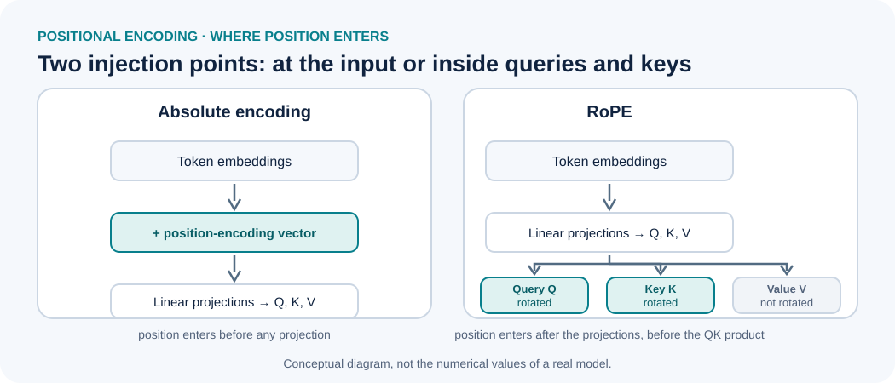

<!--
LLM-LAB-PAGE-MAP v1
id: "en/positional-encoding"
summary: "Explains how positional information lets a Transformer account for token order, and locates the main families of mechanisms in the computation."
scope: "Explains where token order enters, with an absolute signal at the input and a relative signal in attention comparisons."
purpose: "Predict what changes when two tokens swap places and locate positional information in the mechanisms shown."
suggested_route:
  previous: "en/embedding-space"
  next: "en/contextualized-representations"
hierarchy:
  parents: ["en/embedding-space"]
  children: ["en/contextualized-representations", "en/rope", "en/sinusoidal-positional-encoding"]
related: ["en/transformer", "en/positional-encoding-exercises"]
revision_support:
  status: integrated_sufficient
  evidence:
    - anchor: revision-summary
      note: "The recap distinguishes additive and relative mechanisms from causal visibility. Comparing B in the middle tests lookup, content attention, and masking; the exercise with B last checks the scope of that result."
tags: ["type:concept-lesson", "destination:understand", "topic:positional-encoding", "level:core", "language:en", "status:published"]
-->


::: {.chapter-lead}
“The cat chases the dog” and “the dog chases the cat” use the same words, but their order changes who chases whom. Where does a token’s position enter the computation in GPT?
:::

## Why add positional information?

Both occurrences of `cat` at positions 0 and 3 retrieve the same vector $(2,-1)$ from the [toy embedding table](embedding-space.qmd#lookup). In the exercise’s additive GPT, a vector for each position is added to the token vector before the first block.

[Compute the two first-block inputs](exercises/text-data.qmd#ex-token-to-block-input) with $P[0]=(0,1)$ and $P[3]=(1,0)$.

Show both input vectors

At position 0, $(2,-1)+(0,1)=(2,0)$. At position 3, $(2,-1)+(1,0)=(3,-1)$. The lookup is identical; adding the position vector creates the difference.

### Follow B when the order changes {#position-permutation}

Consider two already tokenized sequences, `ABC` and `CBA`. B keeps the same ID and the same middle position. We swap occurrences in the sequence and keep the vocabulary IDs fixed. Compare B’s output in three computations, with fixed parameters.

| Computation | Result for B |
|---|---|
| Embedding lookup | B retrieves the same vector, since its ID is the same. |
| One layer of content-only self-attention, with no positional mechanism or mask | B can attend to the same three tokens. Swapping A and C reorders the contributions without changing their aggregation for B. |
| The same layer with only a causal mask | B sees `AB` in one case and `CB` in the other. Its output can change because the set of visible tokens changes. |

In the second case, permuting the inputs permutes the outputs in the same way. This is **permutation equivariance**. The causal mask breaks this symmetry by making visibility depend on position. A query at position $t$ can see positions $s \le t$. Explicit encodings can also supply a position or an offset.

## Two families, with several mechanisms

An **additive absolute encoding** uses a token’s position. A **relative** mechanism makes attention sensitive to the offset between two positions. Before comparing positions, attention computes queries (Q), keys (K), and values (V) from the states. A query is compared with the keys to determine weights, which are then used to combine the values.

| Mechanism | Where position acts |
|---|---|
| Additive absolute encoding | Adds a vector to the embedding before the first block. The original Transformer used sinusoidal vectors; other models learn them. |
| [RoPE](rope.qmd) | Rotates Q and K after projection according to their respective positions. For fixed Q and K before rotation, their dot product depends on the **relative offset**. The rotation is not applied directly to V. |
| Relative bias | Adds a term based on the offset to attention scores before softmax. Other variants use relative representations. |

The causal mask determines which keys can contribute regardless of the positional mechanism. See the lessons on [Q/K/V projections](queries-keys-values.qmd) and [sinusoidal encodings](sinusoidal-positional-encoding.qmd) for details.

In the running example, each token of “They built roads between distant towns.” appended after “What have the Romans ever done for us?” takes the next position in the sequence.

::: {.callout-note collapse="true" title="Compare the two insertion points in the diagram"}

{fig-alt="An absolute encoding is added to the embeddings at the input, before any projection. RoPE applies rotations to queries and keys after their projections, before the QK product, so the attention scores carry positional information." width=100%}

:::

::: {.callout-note collapse="true" title="A computable signal does not guarantee extrapolation"}
The sinusoidal formula can be evaluated at arbitrarily large position indices. That does not guarantee that a model trained on shorter sequences will use those unseen positions reliably. Likewise, RoPE alone does not guarantee reliable long-context behaviour: this depends in part on the frequencies, any scaling method, training sequence length, and data. **Being able to represent a position is not the same as generalizing to it.** The deep dives on [sinusoidal encodings](sinusoidal-positional-encoding.qmd) and [RoPE](rope.qmd) examine these limitations.
:::

At this stage, it is enough to understand the mechanisms' role and approximate location in the computation. For relative-offset dependence and rotation conventions, see the [advanced RoPE deep dive](rope.qmd).

[Check the related questions on the dedicated practice page](exercises/positional-encoding.qmd#ex-additive-position-and-causal-mask) · [Compare two contexts at the same position](exercises/contextualized-representations.qmd#ex-contextualization-causal-boundary)

::: {.callout-tip title="The one-minute mental model" #revision-summary}
- **Why:** content embeddings alone do not say where a token occurs. Without positional information or an order-dependent constraint, self-attention is permutation equivariant.
- **Where:** absolute encodings are added to input representations; relative mechanisms act inside attention; **RoPE** rotates queries and keys after projection.
- **Do not conflate:** the causal mask limits which positions are visible (no future tokens), but it does not replace a mechanism that represents positions or their offsets.
:::

## Where does this step sit in the route?

The [embedding-space lookup](embedding-space.qmd) maps each ID to an initial vector that does not depend on position; this page explains why and how order is then taken into account. In the [lesson on contextualized representations](contextualized-representations.qmd), position stays fixed. The accessible context changes to show how Transformer blocks transform those initial states. To go further: the [RoPE](rope.qmd) page details the rotary relative mechanism, and [causal masking](causal-masking.qmd) presents a distinct structural constraint: it determines which positions each query can access.



::: {.language-switch}
**Language:** [Français](../fr/positional-encoding.qmd) · [English](positional-encoding.qmd)
:::

:::: {.supplementary-resources}

  Supplementary resources
  Experiment, explore further, and practise the ideas from this lesson.

::: {.learning-resources__content}

### Practice

The questions and exercises for this lesson are collected on its [dedicated practice page](exercises/positional-encoding.qmd).

### Why is self-attention alone not enough?

For content-only self-attention, with no positional bias or order-dependent mask, permuting the input rows permutes the output rows in the same way. If $P$ is a permutation matrix, then:

$$
\operatorname{Attention}(PX)=P\,\operatorname{Attention}(X).
$$

To verify this, let $S=QK^\top/\sqrt{d_k}$ and $A=\operatorname{softmax}(S)$, with softmax applied row-wise. For the permuted input, $Q'=PQ$, $K'=PK$, and $V'=PV$. Hence $A'=\operatorname{softmax}(PSP^\top)=PAP^\top$, and $A'V'=PAP^\top PV=PAV$.

The computation is **permutation equivariant**: it reorders its outputs along with its inputs. By itself, it therefore provides no reference that distinguishes positions in the sequence.

This property assumes that no positional signal or order-dependent constraint is present. A fixed causal mask introduces a structural ordering constraint; that role should not be confused with an explicit positional encoding.

### Optional deepening — the geometry of sinusoidal encodings

In the original sinusoidal encoding, each coordinate pair uses its own frequency. Let $\omega_i=10000^{-2i/d}$. The pair associated with index $i$ is:

$$
p_i(t)=
\begin{bmatrix}
\sin(\omega_i t)\\
\cos(\omega_i t)
\end{bmatrix}.
$$

For a fixed offset $k$, trigonometric identities give:

$$
p_i(t+k)=
\begin{bmatrix}
\cos(\omega_i k) & \sin(\omega_i k)\\
-\sin(\omega_i k) & \cos(\omega_i k)
\end{bmatrix}
p_i(t).
$$

Thus, a fixed offset corresponds to a fixed rotation **for a given pair and frequency**. For example, with $d=2$, the only pair has $\omega_0=1$: $p_0(0)=[0,1]^\top$ and $p_0(1)=[\sin(1),\cos(1)]^\top\approx[0.8415,0.5403]^\top$.

In this construction, $P$ is added to the embeddings at the input, $X_0=E[\text{token IDs}]+P$. This is not RoPE: RoPE rotates the projected $Q$ and $K$ after they are computed and before attention scores are formed. The geometric property above makes offsets accessible to a linear transformation; it does not guarantee that a head will actually learn a rule such as “look three tokens back”.

### References

- [Vaswani et al. (2017), *Attention Is All You Need*](https://arxiv.org/abs/1706.03762) — sinusoidal positional encodings.
- [Su et al. (2021), *RoFormer: Enhanced Transformer with Rotary Position Embedding*](https://arxiv.org/abs/2104.09864) — the original RoPE paper.
- [Hugging Face Transformers documentation](https://huggingface.co/docs/transformers/) — implementation details vary by architecture.
- [Jay Joshi, *The Mathematics of a Transformer… Part 1*](https://medium.com/@jayjj6272/the-mathematics-of-a-transformer-explained-with-numbers-you-can-check-by-hand-with-geometric-96b5873c95be) — complementary pedagogical treatment of embedding and sinusoidal-encoding geometry; the calculations shown here were independently checked.

:::

::::
