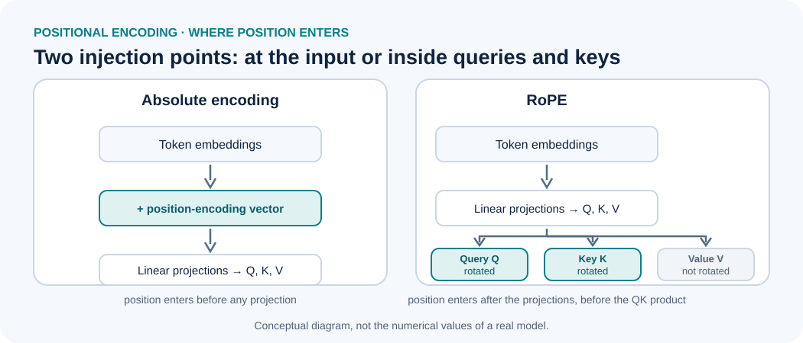

<!--
LLM-LAB-PAGE-MAP v1
id: "en/positional-encoding"
scope: "Introduces why a Transformer needs positional information and compares the main mechanism families at a conceptual level; RoPE geometry, derivation, and variants are reserved for the advanced deep dive."
purpose: "Readers should be able to explain why a Transformer needs positional information, distinguish several ways of introducing it, and describe where these mechanisms enter the computation."
suggested_route:
  previous: "en/embedding-space"
  next: "en/contextualized-representations"
hierarchy:
  parents: ["en/embedding-space", "en/transformer"]
  children: ["en/contextualized-representations", "en/rope"]
related: []
tags: ["type:concept-lesson", "destination:understand", "topic:positional-encoding", "level:core", "language:en", "status:published"]
-->


::: {.chapter-lead}
Attention compares token representations, but it does not inherently know their order. A positional mechanism supplies this information, allowing a model to distinguish, for example, “the cat chases the dog” from “the dog chases the cat”. This page introduces the main mechanism families conceptually; RoPE geometry and derivation belong in an [advanced deep dive](rope.qmd).
:::

## Why add positional information?

Without positional information, standard self-attention has no explicit signal on its own indicating whether one token appears before or after another. Order matters, so it must be introduced into the representations or the attention computation.

{fig-alt="An absolute encoding is added to the embeddings at the input, before any projection. RoPE applies rotations to queries and keys after their projections, before the QK product, so the attention scores carry positional information." width=100%}

## Three approaches to distinguish

- **Absolute encoding added to the vector:** add a position-specific vector to the token representation. The original Transformer used sinusoidal encodings; other models learn positional embeddings.
- **Relative encoding or bias:** the computation explicitly uses the distance or offset between two positions.
- **RoPE:** apply position-dependent rotations to queries and keys before attention scores are computed. This approach introduces positional information inside the attention mechanism.

These approaches inject positional information at different points and do not have exactly the same properties. At this stage, it is enough to understand their role and approximate location in the computation. For relative-offset dependence, rotation conventions, and long-sequence limitations, see the [advanced RoPE deep dive](rope.qmd).

## Common misconceptions

- **“Attention naturally knows which token comes first.”** Order must be supplied by a positional mechanism or an equivalent structure.

## References

- [Vaswani et al. (2017), *Attention Is All You Need*](https://arxiv.org/abs/1706.03762) — sinusoidal positional encodings.
- [Su et al. (2021), *RoFormer: Enhanced Transformer with Rotary Position Embedding*](https://arxiv.org/abs/2104.09864) — the original RoPE paper.
- [Hugging Face Transformers documentation](https://huggingface.co/docs/transformers/) — implementation details vary by architecture.

::: {.language-switch}
**Language:** [Français](../fr/positional-encoding.qmd) · [English](positional-encoding.qmd)
:::
