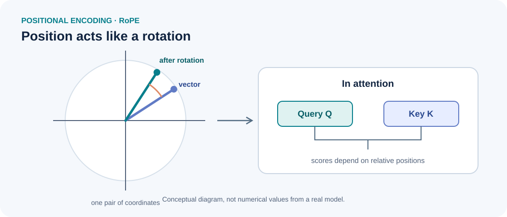

::: {.chapter-lead}
Attention compares token representations, but it does not inherently know their order. A positional mechanism supplies this information, allowing a model to distinguish, for example, “the cat chases the dog” from “the dog chases the cat”. Transformers use several approaches; **RoPE** (*Rotary Position Embedding*) encodes position by rotating pairs of coordinates in queries and keys.
:::

## Why add positional information?

Without positional information, standard self-attention has no explicit signal on its own indicating whether one token appears before or after another. Order matters, so it must be introduced into the representations or the attention computation.

{fig-alt="RoPE applies position-dependent rotations to pairs of query and key coordinates. The angles depend on position and the frequency associated with each pair." width=100%}

The diagram shows a single pair of coordinates. In practice, RoPE acts on multiple pairs with different frequencies. The figure illustrates the geometric operation, not the numerical values of a real model.

## Three approaches to distinguish

- **Absolute encoding added to the vector:** add a position-specific vector to the token representation. The original Transformer used sinusoidal encodings; other models learn positional embeddings.
- **Relative encoding or bias:** the computation explicitly uses the distance or offset between two positions.
- **RoPE:** apply position-dependent rotations to queries and keys. The dot product used for the attention score then carries information about the relationship between their positions.

These approaches inject positional information at different points and do not have exactly the same properties.

## The mathematical intuition behind RoPE

For a pair of coordinates $(x_1,x_2)$, a rotation by angle $\theta$ is:

$$
R(\theta)=
\begin{pmatrix}
\cos\theta & -\sin\theta\\
\sin\theta & \cos\theta
\end{pmatrix},
\qquad
x'=R(\theta)x.
$$

To see why relative-position information appears, consider one coordinate pair at a fixed frequency. Let $q$ and $k$ be the query and key components before rotation; at positions $m$ and $n$, they become $q_m=R(m\theta)q$ and $k_n=R(n\theta)k$. Since rotations satisfy $R(\alpha)^\top=R(-\alpha)$ and $R(\alpha)R(\beta)=R(\alpha+\beta)$, we obtain:

$$
q_m^\top k_n
= q^\top R(m\theta)^\top R(n\theta)k
= q^\top R((n-m)\theta)k.
$$

Thus, for this pair and frequency, the score depends on the offset $n-m$, rather than on the absolute positions separately. RoPE applies this reasoning pair by pair, with a different frequency for each pair.

In an attention head, rotations are applied to $Q$ and $K$ before computing $QK^\top$. In standard RoPE, the values $V$ are not directly rotated.

## What RoPE provides — and what it does not guarantee

RoPE provides a structured way to introduce position into attention and is used in many modern LLMs. However, its presence alone does not guarantee reliable extrapolation to sequences much longer than those seen during training.

Long-context behaviour also depends on the frequency base, training sequence length, any scaling methods, the attention mechanism, and the data. The exact variant must be identified before comparing models.

## Common misconceptions

- **“Attention naturally knows which token comes first.”** Order must be supplied by a positional mechanism or an equivalent structure.
- **“RoPE simply adds a position vector to the embeddings.”** No: in its common form, RoPE rotates pairs of query and key coordinates.
- **“RoPE guarantees long context windows.”** No: performance beyond the training length depends on several design choices and must be evaluated.
- **“RoPE also rotates the values $V$.”** In the standard version, the operation acts on $Q$ and $K$; attention then aggregates values using the computed weights.

## How to validate an implementation

Check tensor dimensions, the pairing convention for coordinates, the positions used, numerical precision, and behaviour at several sequence lengths. An indexing error can produce correctly shaped tensors while encoding the wrong positions. Tests should compare outputs against a known reference and inspect attention scores.

This page describes the mechanism without adding an implementation before the required concepts and tests have been acquired.

## Continue learning

- [Tensors](tensors.qmd): axes and shapes of queries and keys.
- [Queries, keys, and values](queries-keys-values.qmd): the roles of $Q$, $K$, and $V$ in attention.
- [Scaled dot-product attention](scaled-dot-product-attention.qmd): scores and softmax.
- [Embedding space](embedding-space.qmd): initial vectors and contextualized representations.

## Further video

- [Video suggested for further study](https://www.youtube.com/watch?v=fqsxg3aJ1XE) — the link was supplied, but its title and content have not been independently verified.

## References

- [Vaswani et al. (2017), *Attention Is All You Need*](https://arxiv.org/abs/1706.03762) — sinusoidal positional encodings.
- [Su et al. (2021), *RoFormer: Enhanced Transformer with Rotary Position Embedding*](https://arxiv.org/abs/2104.09864) — the original RoPE paper.
- [Hugging Face Transformers documentation](https://huggingface.co/docs/transformers/) — implementation details vary by architecture.

::: {.language-switch}
**Language:** [Français](../fr/positional-encoding.qmd) · [English](positional-encoding.qmd)
:::
