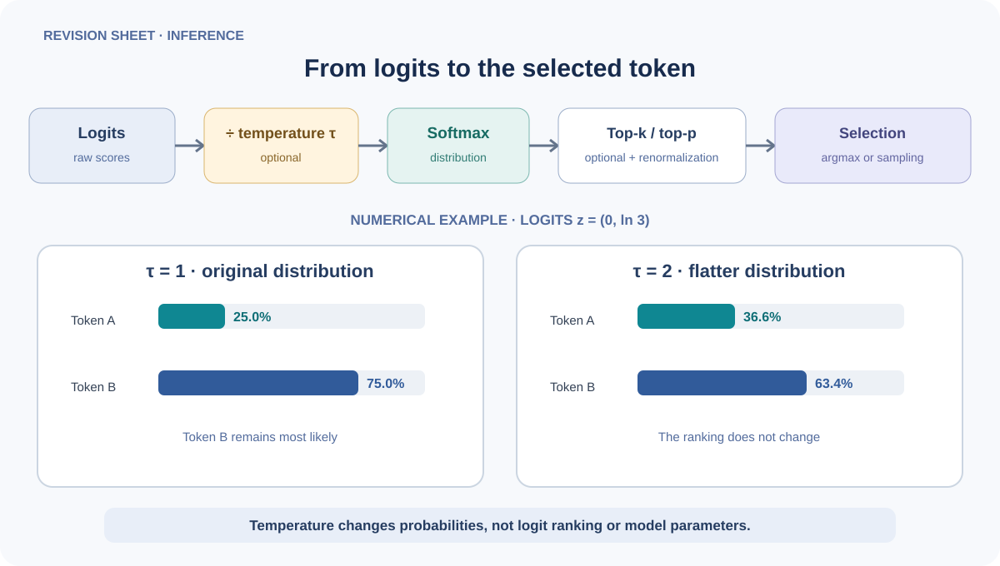

<!--
LLM-LAB-PAGE-MAP v1
id: "en/probabilities"
summary: "Explains how logits become a conditional distribution over the next token, and how that distribution informs selection without guaranteeing factual truth."
scope: "Builds the next-token distribution with softmax and shows how temperature changes its concentration."
purpose: "Turn logits into probabilities over the vocabulary and distinguish a normalized distribution from a calibrated prediction."
suggested_route:
  previous: "en/logits"
  next: "en/entropy"
hierarchy:
  parents: ["en/logits", "en/generation"]
  children: ["en/entropy", "en/likelihood"]
related: ["en/probabilities-exercises"]
revision_support:
  status: integrated_sufficient
  evidence:
    - anchor: revision-summary
      note: "The recap connects softmax, conditional distributions, temperature, selection and the limits of calibration/truth. The numerical workbench, warnings and four answered questions cover normalization, concentration and interpretation."
tags: ["type:concept-lesson", "destination:understand", "topic:probabilites", "level:core", "language:en", "status:published"]
-->



::: {.chapter-lead}
Why does “They” get 60% in the first turn of the Romans example? Start with four illustrative scores, then change the temperature to see how it redistributes the probabilities.
:::

::: {.callout-tip title="The one-minute mental model" #revision-summary}
Softmax turns logits into a **distribution conditioned on the prefix**. It guarantees positive values that sum to one; it does not guarantee calibration or factual truth.

:::

## From logits to a categorical distribution

At a given position, the model produces a logit $z_i$ for each vocabulary token $i$. Logits are unnormalized scores: they may be positive or negative and do not sum to one.

Softmax transforms these scores into probabilities:

$$
p_i=\operatorname{softmax}(z)_i=\frac{e^{z_i}}{\sum_{j=1}^{V}e^{z_j}}.
$$

Probabilities are positive and sum to one. This normalization does not prove that the values are calibrated or that the most probable token is factually correct. Numerical implementations use stable softmax/log-softmax forms to reduce overflow risk.

### Numerical example

<a id="running-example-next-token"></a>

For the prefix “What have the Romans ever done for us?”, take a toy vocabulary of four tokens. The logits in the [output projection example](logits.qmd#running-example-output-projection) are chosen to reproduce the probabilities of the first step in the running example. The exponentials sum to 10, so softmax divides each by 10.

::: {.probability-example}

| Candidate token | Logit | Exponential | Probability |
|---|---:|---:|---:|
| “They” | $\ln 6$ | 6 | 0.6 |
| “Aqueducts” | $\ln 2$ | 2 | 0.2 |
| “Nothing” | $0$ | 1 | 0.1 |
| “Well” | $0$ | 1 | 0.1 |
:::


The illustrative continuation takes “They”. Once this token is appended to the prefix, the [next generation step](generation.qmd#the-loop-on-an-example) uses a new distribution.

## Conditional probability in an autoregressive model

The next-token distribution depends on the prefix:

$$
p_\theta(x_t\mid x_{<t}).
$$

The same token can therefore receive different probabilities depending on the prefix. The likelihood of a complete sequence combines conditional probabilities position by position; the product and its logarithm are covered in the [likelihood](likelihood.qmd) lesson. Tokenization also matters: probabilities are assigned to tokenized units, not directly to words or semantic propositions.

## Temperature and decoding strategy

For temperature $\tau>0$, the distribution becomes:

$$
p_i^{(\tau)}=\operatorname{softmax}(z/\tau)_i.
$$

### Explore the effect of temperature

At $\tau=1$, “They” gets 60%. Before trying $\tau=0.5$, predict what will change. The probability distribution, the leading token, or both?

```{=html}
<div class="interactive-toy-box" id="temp-explorer-en" data-temperature-explorer hidden>
  <label for="temp-slider-en">Temperature (τ) <output for="temp-slider-en">1</output></label>
  <input type="range" class="form-range" id="temp-slider-en" min="0.1" max="3" step="0.05" value="1">
  <div class="d-flex flex-wrap gap-2">
    <button class="btn btn-sm btn-outline-secondary" type="button" data-temperature="0.5">τ = 0.5</button>
    <button class="btn btn-sm btn-outline-secondary" type="button" data-temperature="1">τ = 1</button>
    <button class="btn btn-sm btn-outline-secondary" type="button" data-temperature="2">τ = 2</button>
  </div>
  <div class="interactive-bars" data-temperature-bars></div>
</div>
<noscript><p>With JavaScript off, compare the table at τ = 1 with the calculation at τ = 0.5 below.</p></noscript>
<script src="../scripts/temperature-explorer.js" defer></script>
```

<details>
<summary>Check your prediction</summary>

At $\tau=0.5$, dividing the logits by the temperature doubles them. Their exponentials go from $(6,2,1,1)$ to $(36,4,1,1)$. Softmax then divides each value by $42$. “They” goes from 60% to about 85.7% and remains first.

</details>

Lower temperature tends to make the distribution more concentrated; higher temperature tends to flatten it. For $\tau>0$, logit ordering and argmax remain unchanged, but probabilities change. Temperature changes the distribution used for decoding, not the model parameters; it cannot establish the truth of an output.

With finite logits, the distribution approaches uniformity as temperature rises. As $\tau$ goes to infinity, every probability tends to $1/V$. At low temperature, unfiltered sampling can still draw any candidate with positive probability.

Softmax also has two useful properties: it preserves logit ordering and is invariant to adding the same constant to every score. At $\tau=1$, probability ratios satisfy $p_i/p_j=e^{z_i-z_j}$; more generally, $p_i^{(\tau)}/p_j^{(\tau)}=e^{(z_i-z_j)/\tau}$.


::: {.micro-workbench}
::: {.micro-workbench-header}
<span>NUMERICAL WORKBENCH · TEMPERATURE-SCALED SOFTMAX</span>
<span>Python 3.12+ / NumPy</span>
:::
::: {.micro-workbench-body}
```python
import numpy as np

logits = np.log([6, 2, 1, 1])

def stable_softmax(z, temperature=1.0):
    scaled = z / temperature
    exp_z = np.exp(scaled - np.max(scaled))
    return exp_z / np.sum(exp_z)

# Temperatures offered in the explorer
p_cold, p_standard, p_hot = (stable_softmax(logits, t) for t in (0.5, 1, 2))

for temperature, probabilities in zip((0.5, 1, 2), (p_cold, p_standard, p_hot)):
    print(f"Leading token probability (τ={temperature}) = {probabilities[0]:.2%}")

assert p_cold[0] > p_standard[0] > p_hot[0]
assert np.argmax(p_cold) == np.argmax(p_standard) == np.argmax(p_hot)
```
:::
::: {.micro-workbench-footer}
Temperature modulates distribution entropy without altering token ranking ($z_i > z_j \implies p_i > p_j$).
:::
:::

::: {.callout-warning title="Misconceptions"}
- **“A positive logit means high probability.”** No: the sign depends on the score reference level. A logit of 10 can be less probable than another logit of 12.
- **“The largest logit measures the confidence gap.”** The maximum determines the argmax, but uncertainty depends on all logits and their scale.
- **“Logits are directly comparable across models.”** Not necessarily: architectures, temperatures, and training can produce different scales.
:::

<details class="spot-the-fallacy">
<summary>Common Fallacy: “Two models outputting the exact same top logit score share the same prediction confidence”</summary>
<div class="fallacy-content">
<p><strong>Counterexample:</strong> Model A outputs logits $(10, 2, 1)$ while Model B outputs $(10, 9.9, 9.8)$. Both have the same maximum logit ($z_1 = 10$). After softmax, model A assigns over 99% probability to the first token, compared with about 36.7% for model B. The distribution depends on all score differences, not the absolute maximum. A high probability does not establish calibration or the truth of a prediction.</p>
</div>
</details>

To reduce numerical overflow, implementations usually subtract the maximum before exponentiation: $e^{z_i-m}/\sum_j e^{z_j-m}$, where $m=\max_j z_j$. A tested implementation of temperature-scaled softmax is available in `src/llm_lab/foundations/attention.py` (`softmax_with_temperature`) and covered by `tests/unit/test_attention.py`.

Selecting the argmax token at each position is not equivalent to globally searching for the best sequence, and can produce text different from sampling. Decoding strategy is distinct from training.

## From the distribution to a selected token

<ol class="probability-flow" aria-label="From logits to the selected token" aria-describedby="probability-flow-description">
  <li><a href="logits.qmd">Logits</a></li>
  <li>Temperature ÷ τ</li>
  <li>Softmax</li>
  <li>Top-k/top-p filters</li>
  <li>Argmax or sampling</li>
  <li><a href="generation.qmd">Append token</a></li>
</ol>
<p id="probability-flow-description" class="meta-flow__relation">Temperature scaling and filtering are optional. Temperature acts on logits before softmax. In the project reference implementation, top-k and top-p then filter the distribution and renormalize it; library pipelines may use different orders. Even a filtered distribution is not yet a selected token.</p>

During training, a [loss function](cross-entropy.qmd) compares the logits with target tokens.

## Normalization, calibration, and truth

- **Normalization:** the algebraic property that probabilities sum to one.
- **Calibration:** the empirical property that, over a relevant population, events assigned a given probability occur at a compatible frequency.
- **Factual truth:** a property of the output relative to the world and available evidence; it does not follow from either of the preceding properties.

A probability of 0.9 therefore does not automatically mean “a 90% chance that the answer is true.” Calibration must be evaluated on relevant held-out data, and good overall calibration does not guarantee that each individual answer is reliable.


This distribution is the starting point for three uses. [Generation](generation.qmd) selects a token. [Scoring](likelihood.qmd) reads an observed token’s probability. [Training](loss.qmd) aggregates target penalties into a batch objective.

At the same position, a softmax is applied within attention and another after the output projection. In [Two softmax operations, two axes](exercises/logits.qmd#ex-attention-vocabulary-softmax), compute what each one normalizes and test whether an attention weight can recover the next-token probability.



:::: {.language-switch}
[Français](../fr/probabilites.qmd) · [English](probabilities.qmd)
::::

<details class="learning-resources">
<summary>
  <span class="learning-resources__title">Supplementary resources</span>
  <span class="learning-resources__description">Experiment, explore further, and practise the ideas from this lesson.</span>
</summary>
<div class="learning-resources__content" markdown="1">

### Practice

The questions and exercises for this lesson are collected on its [dedicated practice page](exercises/probabilities.qmd).


### Further reading

- [Entropy](entropy.qmd) — spread of the predictive distribution before the next token is observed.
- [Cross-entropy](cross-entropy.qmd) — computing the penalty at one position.
- [Mathematical foundations exercises](exercises-foundations.qmd#foundations) — worked exercises on softmax, loss and related topics; further topics remain planned.

### Another example with two candidates

With two logits $z=(0,\log 3)$, softmax gives $p=(0.25,0.75)$. The second token is more probable, but this distribution does not mean that it is three times more true: it reflects the model's scores in this context.

{fig-alt="Logits optionally pass through temperature scaling, then softmax. Optional top-k or top-p filters may then be applied with renormalization, before selection by argmax or sampling. For z equal to (0, ln 3), probabilities change from 25/75 percent at temperature 1 to 36.6/63.4 percent at temperature 2; the ranking stays unchanged." fig-cap="The stages have distinct roles: transform scores, build a distribution, restrict candidates, then select a token." width=100%}

### Compare a different set of four logits

With $z=(3.0,1.5,1.0,0.2)$, the rounded percentages are as follows.

| Temperature | A | B | C | D |
|---:|---:|---:|---:|---:|
| 0.2 | 99.9401 | 0.0553 | 0.0045 | 0.0001 |
| 1 | 70.4585 | 15.7214 | 9.5355 | 4.2846 |
| 5 | 33.5306 | 24.8401 | 22.4763 | 19.1530 |

At $\tau=5$, all four probabilities are within 10 percentage points of the uniform value of 25%. To reproduce the table, reuse the workbench's `stable_softmax` function with these four logits and three temperatures.

### References

- [PyTorch — Softmax](https://docs.pytorch.org/docs/stable/generated/torch.nn.Softmax.html) and [LogSoftmax](https://docs.pytorch.org/docs/stable/generated/torch.nn.LogSoftmax.html).
- [PyTorch — Numerical accuracy](https://docs.pytorch.org/docs/stable/notes/numerical_accuracy.html).

</div>
</details>
