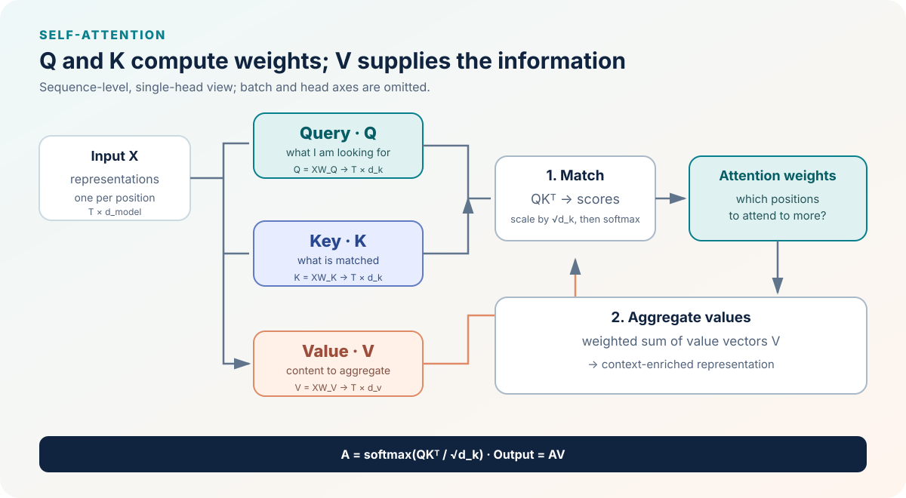
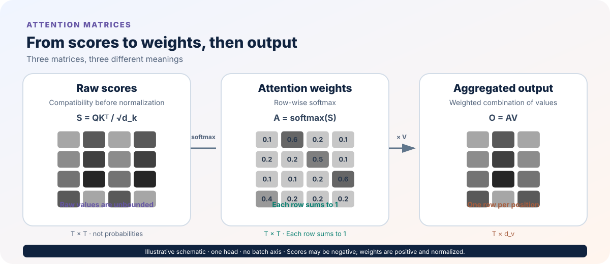

<!--
LLM-LAB-PAGE-MAP v1
id: "en/queries-keys-values"
summary: "Distinguishes the three learned self-attention projections: Q forms queries, K supports compatibility scores, and V carries the content that is aggregated."
scope: "Distinguishes three learned projections of a block state and their roles in one self-attention head."
purpose: "Explain why self-attention projects the block input into Q, K, and V; distinguish compatibility computation (Q/K) from aggregated content (V); and predict the effects of changing one projection in isolation."
suggested_route:
  previous: "en/transformer"
  next: "en/scaled-dot-product-attention"
hierarchy:
  parents: ["en/transformer"]
  children: ["en/queries-keys-values-advanced"]
related: ["en/contextualized-representations", "en/scaled-dot-product-attention", "en/cross-attention", "en/transformer-block-walkthrough", "en/queries-keys-values-exercises"]
revision_support:
  status: integrated_sufficient
  evidence:
    - anchor: revision-summary
      note: "The takeaway separates Q/K (scores and weights) from V (aggregated content), explains what changes when V alone varies and flags interpretation limits; the comprehension questions and associated exercises are collected on the dedicated companion page."
tags: ["type:concept-lesson", "destination:understand", "topic:queries-keys-values", "level:core", "language:en", "status:published"]
-->



::: {.chapter-lead}
The previous page, [The Transformer in a GPT: architecture and computation](transformer.qmd), showed that self-attention is a sublayer within the repeated block. We now start with a simple question: how can one position use the context provided by the other tokens?
:::

## The problem: using context

In “The cat chased the dog because it was fast,” the pronoun **it** could refer to either the cat or the dog. A model therefore cannot always interpret a token from its local representation alone: it needs to use information carried by other positions in the sequence.

That is what self-attention provides. For each position, the mechanism builds two things: **where to look** in the context and **what information to bring back**. Q, K, and V provide the representations needed for these two operations.

For the current token in “What have the Romans ever done for us?”, Q is compared with the K vectors at accessible positions; the resulting weights are then used to aggregate their V vectors. This describes the computation, not conscious search or human-like interpretation of the sentence.

This example is adapted from [Neha KK](https://medium.com/@nkk18072004/understanding-queries-keys-and-values-in-transformers-149ed07c9f8b). It motivates the need for context; it does not prove that one isolated head resolves coreference or describe the attention weights of a trained model.

  Verified concept
  Architecture: Transformer

:::: {.pipeline-stepper .meta-flow .meta-flow--branch role="group" aria-label="Map of parallel Q, K and V projections and their recombination"}
::: {.meta-flow__source}
<strong>Shared input</strong>Input representations at each position
:::
::: {.meta-flow__source .meta-flow__branch--active}
<strong>Learned Q, K and V projections</strong>Three parallel transformations of the same input state
:::
::: {.meta-flow__branches}
::: {.meta-flow__branch}
<strong>Q · Query</strong>Vector compared with keys
:::
::: {.meta-flow__branch}
<strong>K · Key</strong>Vector compared with queries
:::
::: {.meta-flow__branch}
<strong>V · Value</strong>The content that can be aggregated
:::
:::
::: {.meta-flow__relation}
Q and K determine the weights; V provides the content to mix
:::
::: {.meta-flow__result}
<strong>QKᵀ → scores → <a href="scaled-dot-product-attention.qmd#five-computation-steps">weight computation</a></strong>
:::
::: {.meta-flow__result}
<strong>Weights × V → weighted sum → attention output</strong>
:::
::::

## Three complementary roles

The three projections are easiest to distinguish by following the flow of information:

- **Q — the query:** what the current position is looking to match in the context;
- **K — the key:** what each position presents for comparison with a query;
- **V — the value:** the information carried by that position and available to be transmitted.

Q and K therefore determine **how attention is distributed**. V supplies **the content that is aggregated** using that distribution. K and V can represent different features: compatibility supports routing, while the value carries the transmitted content. They are learned numerical vectors, not readable labels or ready-made answers.

::: {.callout-tip title="Another intuition: a recommendation system"}
Imagine a system that compares a request with several candidate items, then combines information from those items according to the resulting weights:

- **Q (query)** represents what the current position is trying to match;
- **K (key)** provides what is compared with that query;
- **V (value)** provides the content that will be combined using the computed weights.

The analogy helps separate **compatibility scoring** (**Q/K**) from **content transport** (**V**). But a Transformer does not look up a catalogue of labelled records: Q, K, and V are learned continuous vectors, and attention computes a weighted sum rather than selecting one discrete result.

This complementary intuition is developed in [Understanding Transformers (Part 4)](https://joseparreogarcia.substack.com/p/understanding-transformers-part-4). It prepares the reader for the equations below; it does not replace them.
:::

<picture>
  <source media="(max-width: 600px)" srcset="../images/queries-keys-values-en-mobile.svg">
  
</picture>

### Score, attention-weight and output matrices

<picture>
  <source media="(max-width: 600px)" srcset="../images/attention-matrices-en-mobile.svg">
  
</picture>

The diagram reveals two paths: one determines the weighting, the other supplies the content. **Why are three distinct projections needed to build these two paths from the same input?**

## Why three projections from the same input? {#why-three-projections-from-the-same-input}

In self-attention, Q, K, and V are three learned transformations of the same representation stream. Call the block input $H_{\mathrm{in}}$. In the first block it comes from token embeddings and the architecture’s input mechanism. In later blocks it contains already contextualized states. In a stack of Transformer blocks, these projections are recomputed inside each attention sublayer from that block’s own input state. They help produce the states passed to the next block; they are not an operation placed after the final contextualized representations. In this project's reference GPT, learned absolute positional embeddings are **added** to token embeddings before the first block ([positional embeddings](positional-encoding.qmd)). With [RoPE](rope.qmd), queries and keys receive a position-dependent rotation after the linear projection. The equations below describe the projections before this rotation.

In the [reference GPT’s pre-LN block](transformer.qmd), LayerNorm acts position by position before the projections. Their shared input is therefore $X=\operatorname{LN}_1(H_{\mathrm{in}})$. The residual path receives $H_{\mathrm{in}}$.

For a sequence of $T$ positions, write $X\in\mathbb{R}^{T\times d_{model}}$:

$$
\begin{aligned}
Q &= XW_Q,\\
K &= XW_K,\\
V &= XW_V.
\end{aligned}
$$

The matrices $W_Q$, $W_K$, and $W_V$ are **distinct but learned jointly**. They let the model build, from the same input, representations suited to two different functions: computing compatibility (Q and K) and carrying content (V). This parameterization follows [Vaswani et al. (2017), *Attention Is All You Need*](https://arxiv.org/abs/1706.03762). For a complementary visual introduction, see [How Query, Key, and Value (QKV) Work in Transformers](https://dev.to/nishanthan-k/how-query-key-and-value-qkv-work-in-transformers-199a); the equations, dimensions, and interpretive limits are established in this lesson and the [advanced Q/K/V deep dive](queries-keys-values-advanced.qmd).

With $W_Q,W_K\in\mathbb{R}^{d_{model}\times d_k}$ and $W_V\in\mathbb{R}^{d_{model}\times d_v}$, the outputs have these shapes:

- $Q,K\in\mathbb{R}^{T\times d_k}$;
- $V\in\mathbb{R}^{T\times d_v}$.

Each row corresponds to one position. The same projection matrices are applied at every position, while the input representations vary. The dimensions $d_k$ and $d_v$ need not be equal; optional biases are omitted here. This shared provenance is specific to self-attention; in [cross-attention](cross-attention.qmd), Q comes from the querying stream, while K and V come from the stream being queried. To trace these projections in the block implementation, see the [guided Transformer-block walkthrough](transformer-block-walkthrough.qmd); general dimension and axis conventions are covered in the [tensor reference](tensors.qmd).

## Takeaway and next steps {#revision-summary}

The functional distinction is simple but fundamental:

- **Q and K** determine compatibility scores, then attention weights;
- **V** supplies the vectors combined using those weights;
- changing V alone therefore leaves the weights unchanged, even though the aggregated content may change.

The weights are not a universal measure of semantic relevance, and attention is not nearest-neighbour search in the initial embedding space: it operates on learned projections. The limits of this interpretation and the gradient paths are developed in the [advanced Q/K/V deep dive](queries-keys-values-advanced.qmd).

The next lesson, [Scaled dot-product attention](scaled-dot-product-attention.qmd), explains how scores become weights and how those weights aggregate V. Its [optional lab](scaled-dot-product-attention.qmd#attention-intervention) lets you check what happens when you change a key or a value.



::: {.language-switch}
**Language:** [Français](../fr/queries-keys-values.qmd) · [English](queries-keys-values.qmd)
:::

## Practice

The questions and exercises for this lesson are collected on its [dedicated practice page](exercises/queries-keys-values.qmd).

## Further exploration

:::: {.supplementary-resources}

  Supplementary resources
  Explore the mathematical and architectural extensions of this lesson.

::: {.learning-resources__content}

### Mathematical and architectural deep dive

Per-position equations, compatibility geometry, gradient paths, and multi-head variants become useful once the mental model is established. They are collected in the [advanced Q/K/V deep dive](queries-keys-values-advanced.qmd), rather than scattered across several collapsed callouts on this page.

To compare architectures that change the number of K/V heads, compress the cache, or restrict attended positions, see [Attention variants](transformer-block-walkthrough.qmd#attention-variants) in the guided Transformer-block walkthrough. It explicitly distinguishes this comparison from the MHA code actually implemented.

To follow this distinction through the actual operations, continue to [scaled dot-product attention](scaled-dot-product-attention.qmd), then to the [guided Transformer-block walkthrough](transformer-block-walkthrough.qmd) to trace both paths in code.

For an alternative worked intuition, [Zsombor Veres-Lakos's *Attention from scratch*](https://zsomborvereslakos.substack.com/p/attention-from-scratch) follows a meeting analogy from Q/K/V projections through the context vector, W_O and a residual-stream update. Treat it as complementary reading rather than a reference derivation: its factor of 10 is pedagogical, and causal masking and multi-head attention are explicitly omitted.

:::

::::
