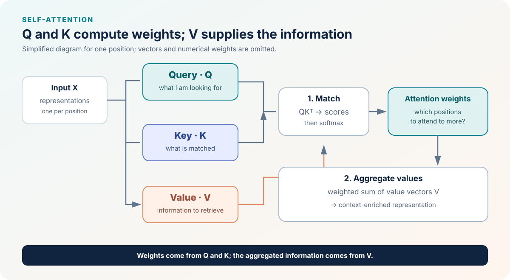

::: {.chapter-lead}
Queries, keys, and values are not three kinds of tokens. They are three **learned projections** of input representations, used to compute which positions contribute to a contextualized representation.
:::

## Intuition

Imagine a collection of index cards. A **query** expresses what a position is looking for; a **key** describes how a position can be matched as relevant; a **value** carries the information that will actually be aggregated. This analogy separates the roles, but does not imply that the model performs explicit symbolic search.

{fig-alt="Input representations are projected into queries, keys, and values. Queries and keys determine attention weights; the weights combine values into a context-enriched representation." width=100%}

The computation has two distinct stages:

1. **Match.** A position's query is compared with the keys of positions it is allowed to access. The resulting scores are transformed into weights by softmax, after scaling and any required mask.
2. **Aggregate.** The weights form a weighted sum of value vectors. Positions with larger weights contribute more to that output representation.

Q and K therefore determine the weights, while V supplies the content being aggregated. These are learned vector roles, not human-readable labels.

## A numerical example: weights are not values

Suppose a query produces two attention scores, \(s=(0,\ln 3)\). Applying *softmax* gives weights \((0.25, 0.75)\). If the two value vectors are, for this toy example, scalars \(v_1=2\) and \(v_2=10\), the aggregated output is:

\[
o=0.25\times 2+0.75\times 10=8.
\]

This separates the two roles: scores from Q and K determine **the weights**; values V supply **the content being aggregated**. This does not mean values are generally scalars, nor that weights alone explain a prediction. In a real model, scores and values are vectors produced by learned projections.

## Definition and dimensions

For $X\in\mathbb{R}^{T\times d_{model}}$, the projections for one head are:

$$
Q=XW_Q,\qquad K=XW_K,\qquad V=XW_V.
$$

With $W_Q,W_K\in\mathbb{R}^{d_{model}\times d_k}$ and $W_V\in\mathbb{R}^{d_{model}\times d_v}$, we obtain $Q,K\in\mathbb{R}^{T\times d_k}$ and $V\in\mathbb{R}^{T\times d_v}$. Optional biases are omitted for clarity.

The scores $QK^\top$ compare every query with every key. After scaling and applying any mask, the weights determine the combination of rows of $V$. In standard dot-product attention, values therefore do not directly determine the scores.

## Why separate these roles?

- **Q and K determine where to look.** The scores $QK^\top$ compare each query with each key. In an autoregressive Transformer, a causal mask excludes future positions before softmax.
- **V determines what information is transmitted.** Once the weights have been computed, they combine the value vectors.
- **All three are learned jointly.** The model learns transformations suited to its objective; these are not manually assigned fields.

The full formula for one attention head is given in [scaled dot-product attention](scaled-dot-product-attention.qmd). The [causal-masking page](causal-masking.qmd) explains how to prevent a position from accessing the future.

## Misconceptions and counterexamples

- **“A key is a human-readable semantic identifier.”** No: its coordinates are learned jointly with the objective and generally do not correspond to interpretable human labels.
- **“The nearest value must be the most useful.”** Scores depend on projected queries and keys, not on a universal distance between the original representations.
- **“Q, K, and V must always have the same dimension.”** Not necessarily: key and value dimensions may differ, although multi-head architectures impose precise shape constraints.
- **“A high weight reveals the cause of a prediction.”** It describes one aggregation step, not by itself the causal effect on the final output.

## Historical context

Attention mechanisms were studied in neural encoder–decoder translation models, notably by Bahdanau, Cho, and Bengio (2014). *Attention Is All You Need* (Vaswani et al., 2017) made self-attention central to the Transformer architecture and formalized scaled dot-product attention. This distinction matters: attention predates the Transformer, while the Transformer combined self-attention with a specific architecture and efficient multi-head computation.

- [Bahdanau et al. (2014), *Neural Machine Translation by Jointly Learning to Align and Translate*](https://arxiv.org/abs/1409.0473)
- [Vaswani et al. (2017), *Attention Is All You Need*](https://arxiv.org/abs/1706.03762)

## Connections to other concepts

- Follow scores and softmax in [scaled dot-product attention](scaled-dot-product-attention.qmd).
- Understand the ordering constraint in [causal masking](causal-masking.qmd).
- See how the operations fit into the [Transformer overview](transformer.qmd).
- Connect softmax to [probabilities](probabilities.qmd).

## Code and tests

No reusable Q/K/V implementation is currently present in **src/llm_lab/**. This page therefore defines mathematical contracts to test before writing the module: tensor shapes, projections, gradient flow, and multi-head behavior.

- [Existing source code](https://github.com/JM-Brun/llm-lab/tree/main/src/llm_lab)
- [Existing tests](https://github.com/JM-Brun/llm-lab/tree/main/tests)
- [Planned causal-attention acceptance criteria](https://github.com/JM-Brun/llm-lab/blob/main/docs/roadmap.md#deferred--causal-attention-implementation)

:::: {.language-switch}
**Language:** [Français](../fr/queries-keys-values.qmd) · [English](queries-keys-values.qmd)
::::