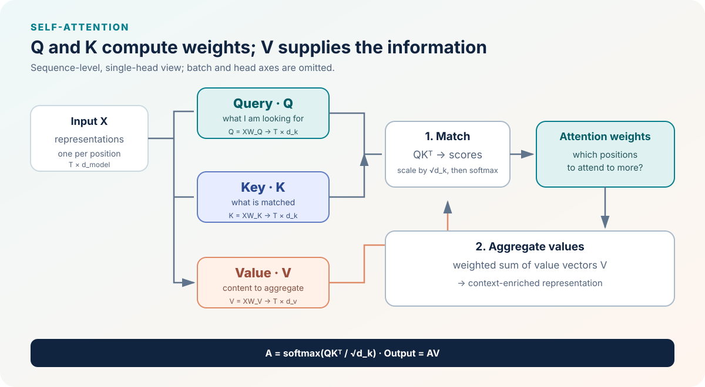

<!--
LLM-LAB-PAGE-MAP v1
id: "en/queries-keys-values"
scope: "Explains the roles and learned Q, K, and V projections in self-attention, their shared input and output dimensions; delegates score and aggregation computation to scaled dot-product attention, the temporal constraint to causal masking, implementation to the guided build, and historical context to the dedicated reference."
purpose: "Readers should be able to distinguish Q/K projections that determine the weights from the V projection that supplies content, write the three self-attention projections, infer their shapes, and predict the effect of changing V while Q and K stay fixed."
suggested_route:
  previous: "en/transformer"
  next: "en/scaled-dot-product-attention"
hierarchy:
  parents: ["en/transformer"]
  children: []
related: ["en/contextualized-representations", "en/scaled-dot-product-attention", "en/cross-attention", "en/transformer-block-walkthrough"]
tags: ["type:concept-lesson", "destination:understand", "topic:queries-keys-values", "level:core", "language:en", "status:published"]
-->

::: {.chapter-lead}
The previous page, [GPT and Transformers: architecture and data flow](transformer.qmd), places self-attention within the network's forward pass. Here we isolate the three projections that feed it: **Q**, **K**, and **V**. These are not three token categories, but three learned transformations of a representation. Q and K determine the weights; V supplies the aggregated content. The next page derives the weights and aggregation themselves.
:::

  Verified concept
  Architecture: Transformer

  <a class="step-item" href="text-data.qmd">1. Text</a>
  →
  <a class="step-item" href="embedding-space.qmd">2. Embeddings</a>
  →
  3. Attention (Q, K, V)
  →
  <a class="step-item" href="logits.qmd">4. Logits</a>
  →
  <a class="step-item" href="cross-entropy.qmd">5. Loss & Training</a>

::: {.callout-tip title="The essential idea"}
**Q and K determine the weights; V supplies the aggregated content.** This is the key distinction to retain before studying the attention computation.
:::

## Intuition: compare, then transmit

Imagine a collection of index cards:

- the **query Q** expresses what a position is looking for;
- the **key K** provides the vector against which that position can be compared;
- the **value V** carries the information that may be transmitted and aggregated.

The analogy separates the roles, but it is not a literal symbolic search: the model does not manipulate readable questions, labels, or cards. Q, K, and V are learned numerical vectors.

::: {.callout-note collapse="true" title="Another perspective: viewing Q and K in vector space"}
Codefinity offers a geometric intuition: picture Q and K as vectors whose orientation and alignment contribute to a compatibility score. This complements the index-card analogy by helping bridge conceptual roles and numerical objects.

For two vectors, the dot product can be written as:

$$
q^\top k = \lVert q\rVert\,\lVert k\rVert\cos(\theta).
$$

The angle is only part of the score: **the dot product also depends on the norms** of Q and K. It is not, in general, cosine similarity. In attention, these scores are subsequently scaled, normalized with softmax over accessible keys, and used to weight V. There is no requirement to select one nearest neighbour, and no automatic semantic-relevance interpretation.

This geometric intuition is a bridge to the [scaled dot-product attention calculation](scaled-dot-product-attention.qmd), not a substitute for its mathematical definition.

Source of this perspective: [Codefinity, *Queries, Keys, and Values: The Building Blocks*](https://codefinity.com/courses/v2/e7ee0772-6b82-4a1c-96ba-69b85ddee608/7ce26687-f7a7-4728-be33-7014c6c7b707/a5ac1dbf-dbec-4dd1-a8d6-f3d83cbb905b).
:::

{fig-alt="An input representation is projected into a query, key, and value. Queries are compared with keys; the resulting weights are applied to values." width=100%}

::: {.callout-note title="A complementary illustration in the source"}
Nishanthan K provides a complementary visual explanation of the Q/K/V roles in the article. [Open the article and its original illustration on Medium](https://nishanthan-k.medium.com/how-query-key-and-value-qkv-work-in-transformers-1274bfa14ea8) (a mirror of the [DEV Community article](https://dev.to/nishanthan-k/how-query-key-and-value-qkv-work-in-transformers-199a)).

Reference: Nishanthan K, *How Query, Key, and Value (QKV) Work in Transformers*, DEV Community, posted October 22, 2026. The illustration remains hosted by its source; LLM Lab links to it rather than copying the asset because reuse rights have not been established.
:::

For the historical development of attention before the Transformer architecture, see [A history of Transformers](transformer-history.qmd).

## Where do Q, K, and V come from?

In self-attention, all three projections start from the same representation stream. Here, $X$ denotes the current input to the attention sublayer, not necessarily a raw token embedding. In the first block it starts from token embeddings; positional information is supplied either at the input (for example, by adding [positional embeddings](positional-encoding.qmd)) or inside attention (for example, [RoPE](rope.qmd) rotates queries and keys). In later blocks, $X$ is an already contextualized hidden state. For a sequence of $T$ positions, let this matrix be $X\in\mathbb{R}^{T\times d_{model}}$:

$$
Q=XW_Q,\qquad K=XW_K,\qquad V=XW_V.
$$

This parameterization into three distinct projections follows the Transformer attention formulation presented in [Vaswani et al. (2017), *Attention Is All You Need*](https://arxiv.org/abs/1706.03762).

The matrices $W_Q$, $W_K$, and $W_V$ are learned jointly during training. They transform each input representation, but play distinct roles in the mechanism. Keeping these projections separately parameterized lets the model represent compatibility (Q and K) and payload (V) in distinct learned spaces. Their parameters are nevertheless optimized jointly during training; separate parameterization does not mean independent learning.

With $W_Q,W_K\in\mathbb{R}^{d_{model}\times d_k}$ and $W_V\in\mathbb{R}^{d_{model}\times d_v}$, the resulting shapes are:

- $Q,K\in\mathbb{R}^{T\times d_k}$;
- $V\in\mathbb{R}^{T\times d_v}$.

Each row corresponds to one sequence position: at position $t$, the projections produce $q_t=x_tW_Q$, $k_t=x_tW_K$, and $v_t=x_tW_V$. The same projection matrices are applied at every position; the input representations vary from one position to another.

::: {.callout-note collapse="true" title="How does training learn these projections?"}
The matrices $W_Q$, $W_K$, and $W_V$ do not each receive an explicit “correct” target. They are adjusted indirectly from the model's loss function through backpropagation.

In the attention path considered here:

- the gradient reaching **Q and K** passes through the compatibility scores and their normalization;
- the gradient reaching **V** passes through the weighted aggregation: it indicates how the transmitted content contributes to the final error.

For a fixed input $X$, with no bias and the linear projections written above, the derivative rule has the form:

$$
\frac{\partial\mathcal L}{\partial W_Q}
=X^\top\frac{\partial\mathcal L}{\partial Q},
\qquad
\frac{\partial\mathcal L}{\partial W_K}
=X^\top\frac{\partial\mathcal L}{\partial K},
\qquad
\frac{\partial\mathcal L}{\partial W_V}
=X^\top\frac{\partial\mathcal L}{\partial V}.
$$

These gradients are computed in the context of the full network, and the optimizer then updates the parameters. The three projections are therefore **parameterized separately but learned jointly**: changing one can alter the output, while the other parameters also adapt during training. This explains the principle; it does not replace the full derivation of attention or backpropagation.
:::
::: {.callout-note collapse="true" title="Scope: the standard formulation and its variants"}
This page presents the standard formulation with separately parameterized Q, K and V projections. It is a useful baseline, not a claim that every Transformer uses three wholly independent projection matrices or the same number of query and key/value heads.

For example, **multi-query attention (MQA)** and **grouped-query attention (GQA)** use fewer key/value heads than query heads, sharing each key/value head across multiple query heads to reduce inference-time [KV-cache](llm-computational-complexity.qmd) costs. Other recent work studies tying projection parameters, including sharing the key and value projections. These are architecture variants with empirical trade-offs; they do not invalidate the role distinction taught here.

- Vaswani et al. (2017), [*Attention Is All You Need*](https://arxiv.org/abs/1706.03762) — standard Transformer attention formulation.
- Ainslie et al. (2023), [*GQA: Training Generalized Multi-Query Transformer Models from Multi-Head Checkpoints*](https://arxiv.org/abs/2305.13245) — grouped key/value heads.
- Kayyam et al. (2026), [*Do Transformers Need Three Projections? Systematic Study of QKV Variants*](https://proceedings.mlr.press/v306/kayyam26a.html) — empirical study of projection sharing.
:::

The dimensions $d_k$ and $d_v$ therefore need not be equal. Optional biases are omitted here. To trace these projections in the actual block implementation, see the [guided Transformer-block walkthrough](transformer-block-walkthrough.qmd); general dimension and axis conventions are covered in the [tensor reference](tensors.qmd).

**Cross-attention:** this single-input formula describes self-attention, not every attention mechanism. In cross-attention, Q comes from the stream doing the querying, while K and V come from the stream being queried. See the [advanced cross-attention lesson](cross-attention.qmd).

::: {.callout-note collapse="true" title="A linguistic example: when a token needs context"}
Consider: “The animal didn't cross the road because it was tired.” The pronoun **it** is understood in context. As an intuition, a query formed at that position can be compared with keys from several earlier tokens; the resulting weights then combine their value vectors.

This is an illustration of contextual information flow, not a report of measured attention. The article by [Neha KK](https://medium.com/@nkk18072004/understanding-queries-keys-and-values-in-transformers-149ed07c9f8b) gives this example but reports no model, head, attention weights or experiment. It therefore does not establish that a particular attention head resolves coreference, nor that an attention map explains the model's decision.
:::

::: {.callout-note collapse="true" title="Two contextual phenomena: coreference and lexical ambiguity"}
The Q/K/V sources examined here illustrate two different language challenges:

| Phenomenon | Example | What context helps interpret |
|---|---|---|
| Coreference | “The animal didn't cross the road because it was tired.” | Which referent does the pronoun “it” refer to? |
| Lexical ambiguity | “He sat by the bank,” in a river context | Which sense of *bank* is intended: riverbank or financial institution? |

The first example, used by [Neha KK](https://medium.com/@nkk18072004/understanding-queries-keys-and-values-in-transformers-149ed07c9f8b), emphasizes relations between tokens. The second, used by [Codefinity](https://codefinity.com/courses/v2/e7ee0772-6b82-4a1c-96ba-69b85ddee608/7ce26687-f7a7-4728-be33-7014c6c7b707/a5ac1dbf-dbec-4dd1-a8d6-f3d83cbb905b), emphasizes competing senses of the same word. They are not interchangeable: they provide two examples of tasks to which contextualized representations may contribute.

In both cases, the Q/K/V explanation remains an illustration of information flow. These examples do not prove that one identified attention head alone performs coreference resolution or lexical disambiguation. For the broader role of context in representations, see [Contextualized representations](contextualized-representations.qmd).
:::

::: {.callout-note collapse="true" title="A useful distinction: what attracts attention is not necessarily what gets transmitted"}
Brenndoerfer makes the separation between **routing** and **content** especially explicit. A key participates in deciding whether a position receives attention; the corresponding value determines what that position contributes if selected. These roles need not encode the same feature.

For example, a hypothetical token could be attended to because its key signals a useful grammatical role, while its value carries semantic content. This is a functional illustration, not a claim that a trained head has been shown to implement that linguistic behavior.

This is why Q/K and V are not interchangeable: changing V alone leaves the attention weights unchanged, although it can change the resulting weighted sum. The score and aggregation equations are derived in [scaled dot-product attention](scaled-dot-product-attention.qmd).

Source perspective: [Brenndoerfer, *Query, Key, Value: The Foundation of Transformer Attention*](https://mbrenndoerfer.com/writing/query-key-value-attention-mechanism).
:::

## Operations to master

Understanding Q/K/V should be demonstrated through observable operations, not just recall of definitions. By the end of this lesson, you should be able to:

1. **Recognize the three roles:** distinguish the projections that determine attention weights (Q and K) from the projection that supplies aggregated content (V).
2. **Reconstruct the projections:** write $Q=XW_Q$, $K=XW_K$, $V=XW_V$, track dimensions, and calculate the resulting representations.
3. **Understand how they are learned:** explain how the model loss backpropagates gradients to all three matrices, through different paths for Q/K and V.
4. **Predict the consequences of parameter changes:** identify what changes — and what remains invariant — when $W_Q$, $W_K$, or $W_V$ is modified.
5. **Transfer the reasoning:** reuse these distinctions in cross-attention and attention variants, making changes in input provenance or projection sharing explicit.

The associated exercises are grouped in the [Attention](exercises.qmd#attention) section. They distinguish Q/K/V-specific competencies from score, softmax, and aggregation calculations, which belong to the [scaled dot-product attention](scaled-dot-product-attention.qmd) lesson.

## Keep these objects distinct

| Object | Role in the computation |
|---|---|
| Q and K | Determine comparison scores and then attention weights |
| V | Supplies the vectors combined using those weights |
| Attention weights | Determine each value's relative contribution to an output |

A key is not a human-readable semantic label, and attention is not nearest-neighbour search in the initial embedding space: scores are computed between learned projections. Likewise, the value closest to a query is not automatically the most useful: Q and K determine the weights, which are then applied to V vectors; values are not compared with one another to select the nearest one. The weights are neither the values nor a universal measure of semantic relevance. Their computation and interpretive limits are explained in [scaled dot-product attention](scaled-dot-product-attention.qmd).

::: {.self-check}
## Check the essential idea

[Extended exercises on Q/K/V and attention](exercises.qmd#attention).

**Which projections determine attention weights, and which one supplies the aggregated vectors? What happens if V changes while Q and K stay the same?**

Show the reasoning

Q and K determine the attention weights; V supplies the vectors whose content is aggregated. Changing Q or K can change the weights. If only V changes, the weights remain unchanged because the scores depend on Q and K; the aggregated content can change, but need not do so: weighted changes can cancel out.

:::

  <a class="route-nav-card" href="transformer.qmd">
    ← Previous step
    GPT and Transformers: architecture and data flow
  </a>
  <a class="route-nav-card" href="scaled-dot-product-attention.qmd">
    Next step →
    Scaled dot-product attention
  </a>

::: {.language-switch}
**Language:** [Français](../fr/queries-keys-values.qmd) · [English](queries-keys-values.qmd)
:::
