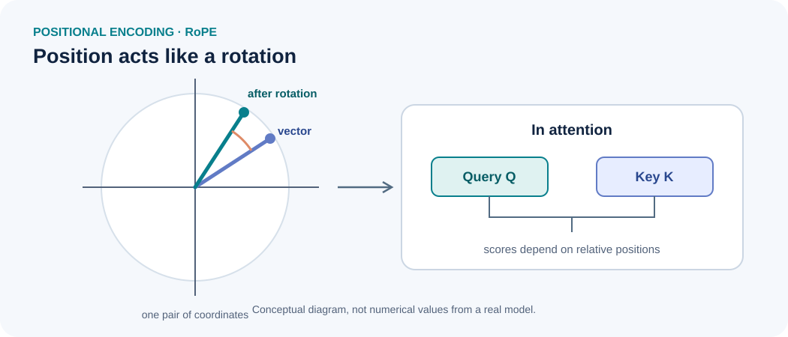

<!--
LLM-LAB-PAGE-MAP v1
id: "en/rope"
scope: "Deepens Rotary Position Embedding: pairwise coordinate rotations, relative-offset dependence of the dot product, implementation conventions, and extrapolation limits; it does not repeat the general introduction to positional information."
purpose: "Readers should be able to derive relative-offset dependence for one coordinate pair, locate rotations in Q/K computation, and identify implementation and evaluation choices that condition long-sequence behaviour."
domain: "architectures-mechanisms"
suggested_route:
  previous: null
  next: null
hierarchy:
  parents: ["en/positional-encoding"]
  children: []
related: ["en/queries-keys-values", "en/scaled-dot-product-attention"]
tags: ["type:deep-dive", "destination:deepen", "topic:rope", "level:advanced", "language:en", "status:published"]
-->

::: {.chapter-lead}
This page is an **advanced deep dive**. It assumes that the reader understands the role of positional information and the general attention computation. It studies the geometry of **RoPE** (*Rotary Position Embedding*), which applies position-dependent rotations to queries and keys before attention scores are computed.
:::

## Geometric principle

{fig-alt="RoPE applies position-dependent rotations to pairs of query and key coordinates. The angles depend on position and the frequency associated with each pair." width=100%}

The diagram shows a single coordinate pair. In practice, RoPE acts on multiple pairs with different frequencies. The figure illustrates the geometric operation, not the numerical values of a real model.

For a coordinate pair $(x_1,x_2)$, a rotation by angle $\theta$ is:

$$
R(\theta)=
\begin{pmatrix}
\cos\theta & -\sin\theta\\
\sin\theta & \cos\theta
\end{pmatrix},
\qquad
x'=R(\theta)x.
$$

## Why does the score depend on the relative offset?

Consider one coordinate pair at a fixed frequency. Let $q$ and $k$ be the query and key components before rotation; at positions $m$ and $n$, they become $q_m=R(m\theta)q$ and $k_n=R(n\theta)k$.

Since rotations satisfy $R(\alpha)^\top=R(-\alpha)$ and $R(\alpha)R(\beta)=R(\alpha+\beta)$, we obtain:

$$
q_m^\top k_n
= q^\top R(m\theta)^\top R(n\theta)k
= q^\top R((n-m)\theta)k.
$$

Thus, for this pair and frequency, the score depends on the offset $n-m$, rather than on the absolute positions separately. RoPE applies this reasoning pair by pair, with a different frequency for each pair.

In an attention head, rotations are applied to $Q$ and $K$ **after their projections and before computing $QK^\top$**. In standard RoPE, the values $V$ are not directly rotated. See [queries, keys, and values](queries-keys-values.qmd) and [scaled dot-product attention](scaled-dot-product-attention.qmd).

## What RoPE provides — and what it does not guarantee

RoPE provides a structured way to introduce position into attention. Its presence alone does not guarantee reliable extrapolation to sequences much longer than those seen during training.

Long-context behaviour also depends on the frequency base, training sequence length, any scaling methods, the attention mechanism, and the data. The exact variant must be identified before comparing models.

## Common misconceptions

- **“RoPE simply adds a position vector to the embeddings.”** No: in its common form, RoPE rotates pairs of query and key coordinates.
- **“RoPE guarantees long context windows.”** No: performance beyond the training length depends on several design choices and must be evaluated.
- **“RoPE also rotates the values $V$.”** In the standard version, the operation acts on $Q$ and $K$; attention then aggregates values using the computed weights.

## Implementation checks

Check tensor dimensions, the pairing convention for coordinates, the positions used, numerical precision, and behaviour at several sequence lengths. An indexing error can produce correctly shaped tensors while encoding the wrong positions. Tests should compare outputs against a known reference and inspect attention scores.

## References

- [Su et al. (2021), *RoFormer: Enhanced Transformer with Rotary Position Embedding*](https://arxiv.org/abs/2104.09864) — the original RoPE formulation.
- [Hugging Face Transformers documentation](https://huggingface.co/docs/transformers/) — implementation conventions vary by architecture.

::: {.language-switch}
**Language:** [Français](../fr/rope.qmd) · [English](rope.qmd)
:::
