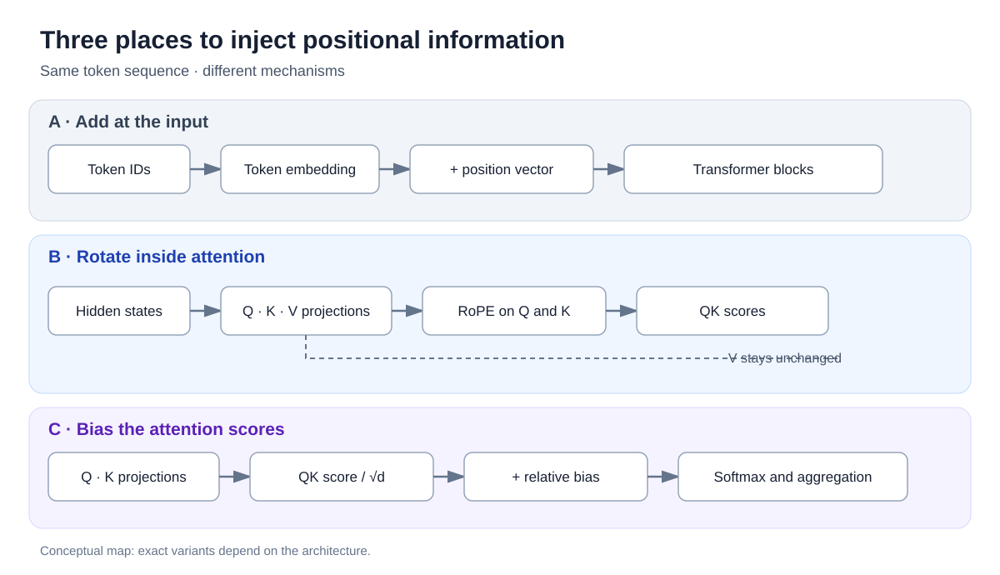
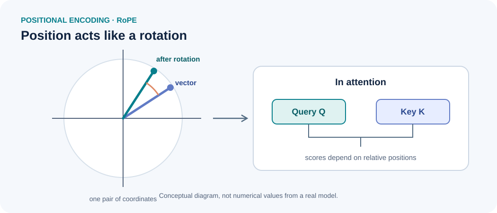

<!--
LLM-LAB-PAGE-MAP v1
id: "en/rope"
scope: "Deepens Rotary Position Embedding: pairwise coordinate rotations, relative-offset dependence of the dot product, implementation conventions, and extrapolation limits; it does not repeat the general introduction to positional information."
purpose: "Readers should be able to derive relative-offset dependence for one coordinate pair, locate rotations in Q/K computation, and identify implementation and evaluation choices that condition long-sequence behaviour."
domain: "architectures-mechanisms"
suggested_route:
  previous: null
  next: null
hierarchy:
  parents: ["en/positional-encoding"]
  children: []
related: ["en/queries-keys-values", "en/scaled-dot-product-attention", "en/causal-masking", "en/rope-exercises"]
tags: ["type:deep-dive", "destination:deepen", "topic:rope", "level:advanced", "language:en", "status:published"]
-->


::: {.chapter-lead}
This page is an **advanced deep dive**. It assumes that the reader understands the role of positional information and the general attention computation. It studies the geometry of **RoPE** (*Rotary Position Embedding*), which applies position-dependent rotations to queries and keys before attention scores are computed.
:::

## Three points where positional information enters

The most useful distinction is not only “absolute versus relative”: these mechanisms enter at different points in the computation.

{fig-alt="Three paths: a position vector is added to the token embedding before the blocks; RoPE transforms Q and K after projection while V is unchanged; a relative bias is added to the QK score before softmax." width=100%}

- **Input addition:** positional information changes the representation before the first block.
- **RoPE:** positional information acts inside attention, on queries and keys before the dot product.
- **Relative bias:** positional information modifies attention scores before softmax.

These are mechanism families, not three operations that are necessarily mutually exclusive in every architecture.

## Geometric principle

{fig-alt="RoPE applies position-dependent rotations to pairs of query and key coordinates. The angles depend on position and the frequency associated with each pair." width=100%}

The diagram shows a single coordinate pair. In practice, RoPE acts on multiple pairs with different frequencies. The figure illustrates the geometric operation, not the numerical values of a real model.

For a coordinate pair $(x_1,x_2)$, a rotation by angle $\theta$ is:

$$
R(\theta)=
\begin{pmatrix}
\cos\theta & -\sin\theta\\
\sin\theta & \cos\theta
\end{pmatrix},
\qquad
x'=R(\theta)x.
$$

## Why does the score depend on the relative offset?

Consider one coordinate pair at a fixed frequency. Let $q$ and $k$ be the query and key components before rotation; at positions $m$ and $n$, they become $q_m=R(m\theta)q$ and $k_n=R(n\theta)k$.

Since rotations satisfy $R(\alpha)^\top=R(-\alpha)$ and $R(\alpha)R(\beta)=R(\alpha+\beta)$, we obtain:

$$
q_m^\top k_n
= q^\top R(m\theta)^\top R(n\theta)k
= q^\top R((n-m)\theta)k.
$$

Thus, for this pair and frequency, the score depends on the offset $n-m$, rather than on the absolute positions separately. RoPE applies this reasoning pair by pair, with a different frequency for each pair.

In an attention head, rotations are applied to $Q$ and $K$ **after their projections and before computing $QK^\top$**. In standard RoPE, the values $V$ are not directly rotated. See [queries, keys, and values](queries-keys-values.qmd) and [scaled dot-product attention](scaled-dot-product-attention.qmd).



<link rel="stylesheet" href="../styles/rope-pair-explorer.css">



<link rel="stylesheet" href="../styles/rope-attention-pipeline.css">



<link rel="stylesheet" href="../styles/rope-pair-layout.css">



<link rel="stylesheet" href="../styles/rope-frequency-explorer.css">



<link rel="stylesheet" href="../styles/rope-memory-ledger.css">



<link rel="stylesheet" href="../styles/nope-prefix-experiment.css">

## Hybrid RoPE/NoPE layers: local operations, inherited states

A layer that omits RoPE does not receive a blank or reset representation: it receives the previous layer's contextualized hidden states. Earlier layers may have made positional and contextual distinctions available to later layers, although no architecture diagram can guarantee that those distinctions survive or are used.



<link rel="stylesheet" href="../styles/hybrid-rope-nope.css">

## Relative bias: add a position term before softmax

An attention score can be decomposed into a content term and a relative-position term, for example \(s_{ij}=q_i^\top k_j/\sqrt{d_k}+b(h_i,j-i)\). The exact function is architecture-specific. In T5, the bias is a learned scalar indexed by a distance bucket; in ALiBi, a fixed head-specific slope creates a linear penalty. A query-conditioned bias such as the Inkling mechanism described by Raschka is a further parameterization. These biases act on scores before softmax; they are not RoPE rotations.



<link rel="stylesheet" href="../styles/relative-bias-decomposition.css">

## What RoPE provides — and what it does not guarantee

RoPE provides a structured way to introduce position into attention. Its presence alone does not guarantee reliable extrapolation to sequences much longer than those seen during training.

Long-context behaviour also depends on the frequency base, training sequence length, any scaling methods, the attention mechanism, and the data. The exact variant must be identified before comparing models.

## Common misconceptions

- **“RoPE simply adds a position vector to the embeddings.”** No: in its common form, RoPE rotates pairs of query and key coordinates.
- **“RoPE guarantees long context windows.”** No: performance beyond the training length depends on several design choices and must be evaluated.
- **“RoPE also rotates the values $V$.”** In the standard version, the operation acts on $Q$ and $K$; attention then aggregates values using the computed weights.

## Implementation checks

Check tensor dimensions, the pairing convention for coordinates, the positions used, numerical precision, and behaviour at several sequence lengths. An indexing error can produce correctly shaped tensors while encoding the wrong positions. Tests should compare outputs against a known reference and inspect attention scores.

## Architectural variants and neighboring mechanisms

Full RoPE rotates every coordinate pair in Q and K. Recent architectures can change how many dimensions are rotated or which layers apply RoPE. Other relative mechanisms, introduced in the previous section, modify scores directly; they are not RoPE variants.

- **Partial RoPE** rotates only a subset of each head's dimensions. This narrows the sine/cosine tables, but does not reduce the dimensions of cached keys and values in the KV cache. The MiniMax-M3 example discussed by Raschka uses 64 rotary dimensions out of 128. An experimental study by Khan et al. (2026), on 1B and 8B configurations, reports convergence close to full RoPE from around 10% rotary dimensions and up to 10× lower memory for precomputed RoPE tables; these savings do not apply to the KV cache and remain specific to the study's protocol.
- **NoPE** omits explicit positional transformations in a layer while retaining the causal mask. Nested visible prefixes can provide an implicit order signal, but not an explicit absolute coordinate or relative distance. Length-generalization results depend on the task and training regime.
- **RoPE/NoPE hybrid layers** apply RoPE in some layers and omit it in others. SmolLM3 is an example discussed in the article; check the exact pattern against the configuration of the version being studied.

These mechanisms are not interchangeable. The examples are dated snapshots, not an exhaustive taxonomy.

## Frequencies and implementation conventions

For an even head dimension d, the standard inverse frequency for pair i is omega_i = b^(-2i/d), and the angle at position m is m * omega_i. Here the cosine/sine tables have shape (sequence_length, d/2): one column per feature pair. They are commonly precomputed and broadcast across batch and heads. Note that the base is model-specific: the classic example often uses 10,000, while the Qwen3 configuration in Raschka's notebook uses theta = 1,000,000.

~~~python
def rope_params(head_dim, positions, base=10_000):
    assert head_dim % 2 == 0
    indices = torch.arange(0, head_dim, 2, device=positions.device)
    inv_freq = base ** (-indices.float() / head_dim)
    angles = positions.float()[:, None] * inv_freq[None, :]
    return angles.cos(), angles.sin()
~~~

**Interleaved** pairs adjacent coordinates; **split-half** pairs the two halves. They are equivalent after a consistent feature permutation, but must not be mixed. Standard RoPE applies to Q and K after projection, not V.

### Useful tests

- Check cosine/sine table shapes and broadcasting.
- Check that only rotary dimensions change in Partial RoPE.
- Compare conventions after an explicit feature permutation.
- Shift all positions by the same constant and verify QK-score invariance for fixed Q/K.
- Test prefill and incremental decoding positions with a KV cache.

For a complete PyTorch implementation of Qwen3, see [Raschka's tutorial and repository](https://github.com/rasbt/LLMs-from-scratch); external code is not copied here.

[Questions and exercises on RoPE](exercises/rope.qmd).

## References

- [Su et al. (2021), *RoFormer: Enhanced Transformer with Rotary Position Embedding*](https://arxiv.org/abs/2104.09864) — the original RoPE formulation.
- [Shaw et al. (2018), *Self-Attention with Relative Position Representations*](https://aclanthology.org/N18-2074/) — relative representations in keys and values.
- [Raffel et al. (2020), *Exploring the Limits of Transfer Learning with a Unified Text-to-Text Transformer*](https://arxiv.org/abs/1910.10683) — T5's learned bucketed relative bias.
- [Press et al. (2022), *Train Short, Test Long: Attention with Linear Biases Enables Input Length Extrapolation*](https://arxiv.org/abs/2108.12409) — ALiBi's linear bias.
- [Hugging Face Transformers documentation](https://huggingface.co/docs/transformers/) — implementation conventions vary by architecture.

**Canonical lesson:** [Positional encoding](positional-encoding.qmd). This page deepens one particular mechanism; it does not replace the general introduction to positional information.

::: {.language-switch}
**Language:** [Français](../fr/rope.qmd) · [English](rope.qmd)
:::
