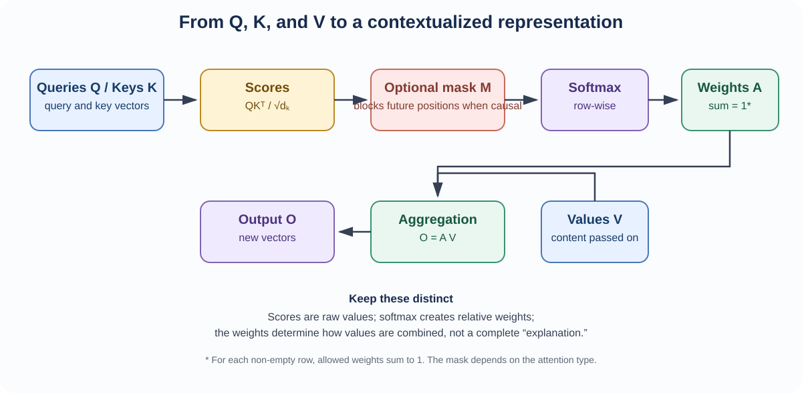
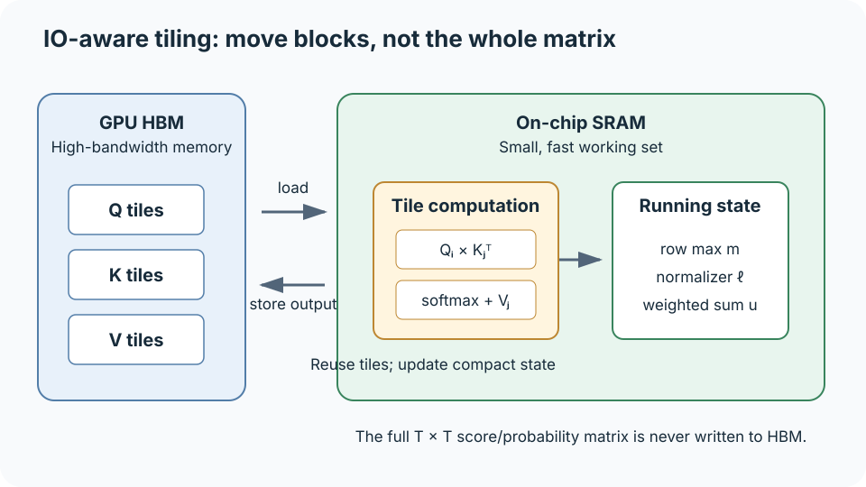
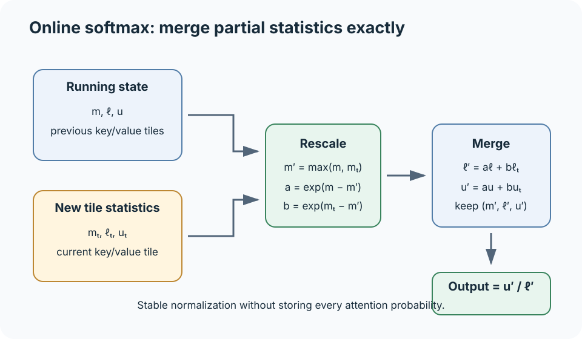
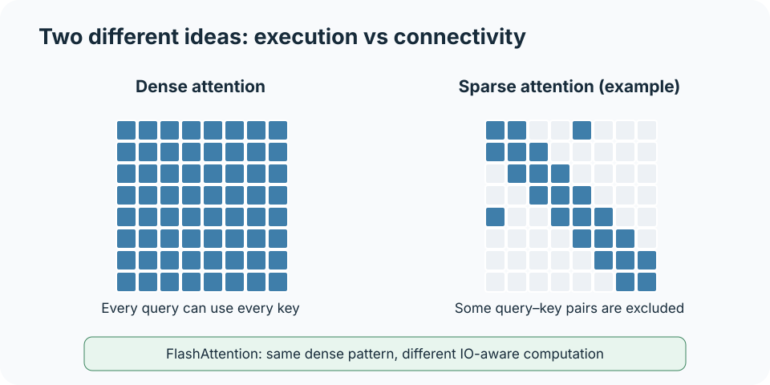

<!--
LLM-LAB-PAGE-MAP v1
id: "en/scaled-dot-product-attention"
summary: "Follows attention computation end to end: Q–K compatibility, score scaling, normalization, and weighted aggregation of V."
scope: "Traces one attention row from Q–K comparisons to a weighted combination of values."
purpose: "Explain and reconstruct one attention row — scores, scaling, masking, softmax, and aggregation — and justify the shapes and normalization of its intermediate quantities."
suggested_route:
  previous: "en/queries-keys-values"
  next: "en/causal-masking"
hierarchy:
  parents: ["en/transformer"]
  children: ["en/causal-masking", "en/attention-score-scaling"]
related: ["en/queries-keys-values", "en/scaled-dot-product-attention-exercises"]
revision_support:
  status: integrated_sufficient
  evidence:
    - anchor: revision-summary
      note: "The recap orders QKᵀ scores, scaling, optional masking, softmax and V aggregation; Practice questions check the steps and limits of interpreting attention weights."
tags: ["type:concept-lesson", "destination:understand", "topic:scaled-dot-product-attention", "level:core", "language:en", "status:published"]
-->



::: {.chapter-lead}
Scaled dot-product attention turns learned compatibility scores between queries and keys into weights, then uses those weights to aggregate values. Softmax exponentiates and normalizes the (scaled, optionally masked) scores into weights over accessible positions; it does not prove semantic relevance or causality.
:::

  Verified Concept
  Architecture: Standard Attention

::: {.callout-tip title="The one-minute mental model" #revision-summary}
Attention is not one indivisible operation: it is the sequence **scores → scaling → optional mask → softmax → aggregation**. Scores compare Q and K; weights are normalized row by row; the output is a weighted combination of V.

**First pass:** follow the transition from scores to weights, then from weights to the output. Keep these three objects distinct.

**Go deeper:** the derivation of the scaling factor — why divide by $\sqrt{d_k}$ and what the argument does not guarantee — is developed in [Why scale attention scores?](attention-score-scaling.qmd); changing which positions are accessible before softmax is the role of [causal masking](causal-masking.qmd).
:::

  <a class="step-item" href="queries-keys-values.qmd">Q, K, V</a>
  →
  QKᵀ scores
  →
  Scaling
  →
  <a class="step-item" href="causal-masking.qmd">Optional mask</a>
  →
  Softmax per query
  →
  Weighted sum of V

## The computation at a glance

<figure id="fig-attention-calculation-flow">
  <picture>
    <source media="(max-width: 600px)" srcset="../images/attention-calculation-flow-en-mobile.svg">
    
  </picture>
  <figcaption>Two paths meet: Q and K determine the weights, while V supplies the aggregated content. Raw scores, normalized weights, and the output are distinct objects; allowed weights sum to 1 in each non-empty row.</figcaption>
</figure>

## Five computation steps {#five-computation-steps} {#five-computation-steps}

For one head, $Q,K\in\mathbb{R}^{T\times d_k}$ and $V\in\mathbb{R}^{T\times d_v}$, where $T$ is the sequence length.

$$
O=\operatorname{softmax}\left(\frac{QK^\top}{\sqrt{d_k}}+M\right)V.
$$

The raw scores $S=QK^\top$, the scaled scores $S'=S/\sqrt{d_k}$, the masked scores $S''=S'+M$ and the weights $A=\operatorname{softmax}(S'')$ all have shape $T\times T$, as does the optional mask $M$. With the row-oriented matrix convention used here, row $i$ corresponds to the query at position $i$ and column $j$ to the key at position $j$: softmax is applied along the key axis, independently for each query. For each query, [softmax](probabilities.qmd#from-logits-to-a-categorical-distribution) divides the exponential of each accessible key’s score by the sum of the exponentials over those keys. Finally, $O=AV$ has shape $T\times d_v$.

Here $M$ denotes an additive hard mask: $M_{ij}=0$ for an allowed query-key pair and $M_{ij}=-\infty$ for a disallowed pair. If no mask is needed, omit $M$ (equivalently, use an all-zero matrix). In this computation, the additive mask is applied to scaled scores **before** softmax. The next lesson, on [causal masking](causal-masking.qmd), explains how to construct the mask and identify accessible positions.

In the running example “What have the Romans ever done for us?”, follow the final position of the prefix. Its query is compared with the keys at accessible positions, and its weights combine their values. The sum is the head's output for that position. The [causal mask](causal-masking.qmd) determines which positions are accessible.

1 — Compare queries with keys

The product $S=QK^\top$ takes two matrices $Q$ and $K$ of shape $T\times d_k$ and yields a matrix $S$ of shape $T\times T$. Each row contains one query's scores against all $T$ keys.

2 — Scale the scores

Divide each score by $\sqrt{d_k}$. The input $S$ and the output $S'=S/\sqrt{d_k}$ both have shape $T\times T$.

3 — Exclude inaccessible keys if a mask applies

Add the scaled scores $S'$ and mask $M$, both of shape $T\times T$. In the output $S''=S'+M$ of the same shape, inaccessible pairs have score $-\infty$ before normalization.

4 — Turn one query's scores into weights

Apply $A=\operatorname{softmax}(S'')$ row by row. The input $S''$ and output $A$ have shape $T\times T$. Each non-empty row is a probability distribution over the positions accessible to its query.

5 — Combine the values with these weights

The product $O=AV$ takes weights $A$ of shape $T\times T$ and values $V$ of shape $T\times d_v$. The output $O$ has shape $T\times d_v$, with one weighted sum per query.

## From the mechanism to the calculation

Follow the final position of the prefix. Its input state supplies the query for this row; the sequence positions supply the keys and values. Attention softmax weights these **positions**. Later, the [softmax applied to the output logits](exercises/logits.qmd#ex-attention-vocabulary-softmax) normalizes scores over **vocabulary tokens**. In the workshop, try the case where the training sequence includes the next target and the [causal mask](causal-masking.qmd) blocks access to it.

[Compute the scores, weights, and output on the dedicated practice page](exercises/scaled-dot-product-attention.qmd#full-calculation-scores-weights-output).



## Provenance and purpose {#provenance-and-purpose}

The formulation is presented in [Vaswani et al. (2017), *Attention Is All You Need*](https://arxiv.org/abs/1706.03762), which compares additive and dot-product attention and introduces the scaling factor. It supports efficient matrix computation and naturally fits multi-head mechanisms.

## Misconceptions and counterexamples

- **“Softmax measures absolute similarity.”** No: it produces a distribution relative to the scores in a row. Adding the same constant to every score in a row leaves the weights unchanged.
- **“A weight of 0.8 means 80% semantic relevance.”** No: it is a weight in this aggregation, conditional on the other scores and learned projections.

Common Fallacy: “An attention weight of 0.95 proves this token is the primary cause of the answer”

<strong>Rigorous refutation:</strong> The weight $\alpha_{ij}$ is obtained by applying softmax to the score $q_i^\top k_j/\sqrt{d_k}$: it expresses a relative weighting among accessible positions, not causality. Before the output projection, position $j$ contributes the direct aggregation term $\alpha_{ij}v_j$, whose norm is $\alpha_{ij}\lVert v_j\rVert$. A high weight therefore does not even guarantee a large-norm aggregation term. Nor is that term the effect on the final prediction: the output projection, residual connections, normalization, and MLP further transform the signal. Establishing causal importance requires an appropriate intervention-based analysis, not merely reading attention weights.

- **“The scale factor is an empirical constant with no rationale.”** No: it follows from reasoning about dot-product scale; the assumptions are simplified, but the factor addresses a specific numerical issue. The full derivation and numerical simulation are developed in [Why scale attention scores?](attention-score-scaling.qmd).

### Attention and mutual information: an analogy, not an identity

Mutual information between two random variables depends on a joint distribution:

$$
I(X;Y)=H(X)-H(X\mid Y)
=\sum_{x,y}p(x,y)\ln\frac{p(x,y)}{p(x)p(y)}.
$$

It measures how much observing $Y$ reduces uncertainty about $X$. Attention weights, by contrast, are softmax-normalized compatibility coefficients over accessible positions; they depend on the input, queries, keys, and mask, and are used to aggregate the value vectors $V$. They do not directly measure, in bits, how much information one token provides about another. A row of attention weights is therefore neither a joint distribution over $(X,Y)$ nor an automatic estimator of $I(X;Y)$.

The analogy can motivate a useful question — which positions contribute to a contextualized representation? — but it is not a mathematical equivalence. A high attention weight does not quantify “how much information” a token provides, nor does it establish statistical dependence or causal importance. An attention map alone does not establish a causal or semantic explanation.

## Connections to other concepts

- The derivation of the scaling factor and the numerical variance simulation are developed in [Why scale attention scores?](attention-score-scaling.qmd).
- Inputs $Q,K,V$ are explained in [queries, keys, and values](queries-keys-values.qmd).
- Excluding future tokens is defined in [causal masking](causal-masking.qmd).
- Softmax connects to [probabilities](probabilities.qmd), but a normalized distribution is not necessarily calibrated.
- The [Transformer overview](transformer.qmd) places this computation in the model's data flow.



:::: {.language-switch}
**Language:** [Français](../fr/scaled-dot-product-attention.qmd) · [English](scaled-dot-product-attention.qmd)
::::

## Practice

The questions and exercises for this lesson are collected on its [dedicated practice page](exercises/scaled-dot-product-attention.qmd).

## Further exploration

:::: {.supplementary-resources}

  Supplementary resources
  Explore implementation choices and optimizations of attention computation.

::: {.learning-resources__content}

### Optional Build-path companion

This page belongs to the conceptual **Theory / Understand** path: it explains the mechanism and its invariants. To see how the primitive is called in a multi-head implementation, optionally consult the [Transformer-block walkthrough](transformer-block-walkthrough.qmd), which belongs to the **Build** path, independent of the conceptual path. General axis and dimension conventions are collected in [tensors](tensors.qmd).

### Optimized execution (optional deepening)

The mathematical definition of attention does not prescribe how a GPU executes it. [FlashAttention](https://arxiv.org/abs/2205.14135) preserves exact dense attention while processing blocks and reducing transfers between GPU memory and fast on-chip memory. It should not be confused with sparse attention, which changes the allowed positions. For the mechanism, trade-offs and measurement caveats, see [the FlashAttention source review](https://github.com/JM-Brun/llm-lab/blob/main/docs/source-reviews/flashattention-io-aware-2026-11.md), followed by the [PyTorch SDPA documentation](https://docs.pytorch.org/docs/stable/generated/torch.nn.functional.scaled_dot_product_attention.html) and the [reproducible benchmark protocol](https://github.com/JM-Brun/llm-lab/blob/main/docs/experiments/flashattention-benchmark-protocol.md). This hardware optimization is an optional deepening, not an extra stage in the conceptual route.

#### FlashAttention in pictures (optional deepening)

These diagrams are **original pedagogical reconstructions** based on the FlashAttention paper and follow-up work; they do not reproduce figures from the newsletter.

##### 1. Move tiles instead of materializing the full matrix

<figure>
  
  <figcaption>The central gain is fewer HBM↔SRAM transfers and fewer intermediates materialized in global memory. The score matrix remains conceptually dense; it simply is not stored in full in HBM.</figcaption>
</figure>

##### 2. Merge online-softmax statistics

<figure>
  
  <figcaption>Rescaling by the new maximum makes it possible to merge partial statistics stably. At the end, the weighted sum is divided by the normalizer.</figcaption>
</figure>

##### 3. Do not confuse IO optimization with sparsity

<figure>
  
  <figcaption>FlashAttention preserves the connectivity of exact dense attention (up to floating-point effects). A sparse method changes the connectivity pattern and therefore the mathematical computation.</figcaption>
</figure>

:::

::::
