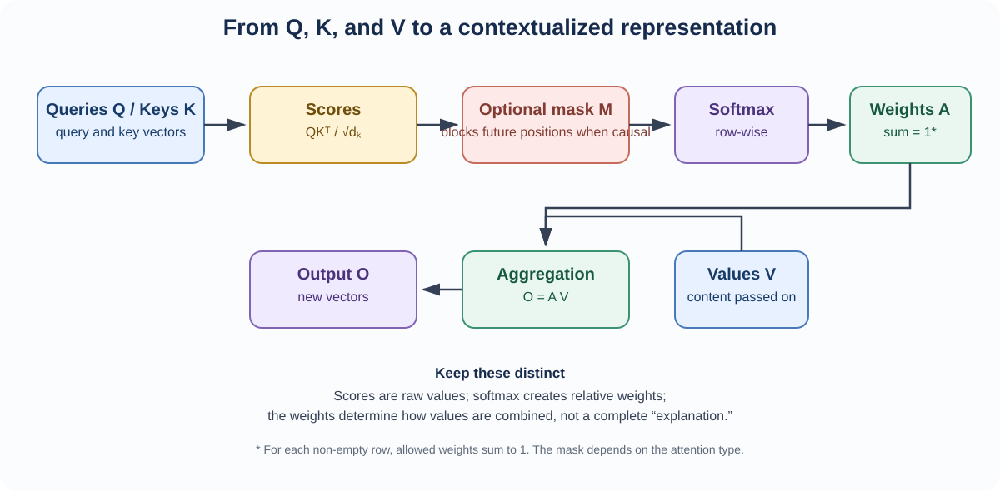

<!--
LLM-LAB-PAGE-MAP v1
id: "en/scaled-dot-product-attention"
scope: "Breaks down scaled dot-product attention: QKᵀ scores, scaling by key dimension, softmax normalization, and weighted aggregation of values; the scaling-factor rationale is developed in a dedicated deep dive, causal masking is treated separately, and multi-head architecture is only a further topic."
purpose: "Readers should be able to follow the attention calculation, explain the role of scaling, and interpret the weights as an aggregation distribution conditioned on scores and the mask."
suggested_route:
  previous: "en/queries-keys-values"
  next: "en/causal-masking"
hierarchy:
  parents: ["en/transformer"]
  children: ["en/causal-masking", "en/attention-score-scaling"]
related: ["en/queries-keys-values"]
tags: ["type:concept-lesson", "destination:understand", "topic:scaled-dot-product-attention", "level:core", "language:en", "status:published"]
-->

::: {.chapter-lead}
Scaled dot-product attention turns learned compatibility scores between queries and keys into weights, then uses those weights to aggregate values. Softmax normalizes scores over accessible positions; it does not prove semantic relevance or causality.
:::

  Verified Concept
  Python · run locally
  Architecture: Standard Attention

  <a class="step-item" href="text-data.qmd">1. Text</a>
  →
  <a class="step-item" href="embedding-space.qmd">2. Embeddings</a>
  →
  3. Scaled Dot-Product Attention
  →
  <a class="step-item" href="logits.qmd">4. Logits</a>
  →
  <a class="step-item" href="cross-entropy.qmd">5. Loss & Training</a>

::: {.callout-tip title="The one-minute mental model"}
Attention is not one indivisible operation: it is the sequence **scores → scaling → optional mask → softmax → aggregation**. Scores compare Q and K; weights are normalized row by row; the output is a weighted combination of V.

**First pass:** follow the four steps and work through the one-query, two-key example. Check the shape of each matrix separately: scores have shape $T\times T$, while the output has shape $T\times d_v$.

**Go deeper:** the derivation of the scaling factor — why divide by $\sqrt{d_k}$ and what the argument does not guarantee — is developed in [Why scale attention scores?](attention-score-scaling.qmd); changing which positions are accessible before softmax is the role of [causal masking](causal-masking.qmd).
:::

## Four computation steps

For one head, $Q,K\in\mathbb{R}^{T\times d_k}$ and $V\in\mathbb{R}^{T\times d_v}$.

1. **Scores:** $S=QK^\top$, with shape $T\times T$.
2. **Scaling:** $S/\sqrt{d_k}$.
3. **Normalization:** $A=\operatorname{softmax}(S/\sqrt{d_k}+M)$, row-wise.
4. **Aggregation:** $O=AV$, with shape $T\times d_v$.

Thus,

$$
O=\operatorname{softmax}\left(\frac{QK^\top}{\sqrt{d_k}}+M\right)V.
$$

Here $M$ denotes an additive hard mask: $M_{ij}=0$ for an allowed query-key pair and $M_{ij}=-\infty$ for a disallowed pair. If no mask is needed, omit $M$ (equivalently, use an all-zero matrix). The mask acts on scores **before** softmax: that is the only point where it can change which positions are accessible to normalization. Which positions to forbid — the causal constraint — and how to handle a fully masked row are defined in [causal masking](causal-masking.qmd), the next step on the route.

## Worked numerical example

Consider one query and two accessible keys, with no mask:

$
q=(1,0),\quad k_1=(1,0),\quad k_2=(0,1),\quad
v_1=(10,0),\quad v_2=(0,20).
$

Here $d_k=2$. The raw scores are $qk_1^\top=1$ and $qk_2^\top=0$. After scaling, the scores are $(1/\sqrt{2},0)\approx(0.707,0)$. Applying softmax gives weights approximately $(0.67,0.33)$, which sum to one. The output is their weighted sum of the values:

$
o\approx0.67(10,0)+0.33(0,20)=(6.7,6.6).
$

This small example separates the roles: the query and keys determine the weights; the values determine what is combined. The weights are relative to the keys available in this row, not a measure of semantic relevance.

{fig-alt="Queries and keys produce scores. After scaling and optional masking, softmax creates weights that combine the values." width=100%}

The diagram also shows why three objects must not be conflated: **scores** (raw compatibility values), **weights** (normalized relative to accessible positions), and **outputs** (weighted combinations of values). In non-causal attention, the mask may be absent or encode another constraint. Softmax normalization does not turn the weights into a universal measure of semantic relevance.

## Provenance and purpose

The formulation is presented in [Vaswani et al. (2017), *Attention Is All You Need*](https://arxiv.org/abs/1706.03762), which compares additive and dot-product attention and introduces the scaling factor. It supports efficient matrix computation and naturally fits multi-head mechanisms.

## Misconceptions and counterexamples

- **“Softmax measures absolute similarity.”** No: it produces a distribution relative to the scores in a row. Adding the same constant to every score in a row leaves the weights unchanged.
- **“A weight of 0.8 means 80% semantic relevance.”** No: it is a weight in this aggregation, conditional on the other scores and learned projections.

Common Fallacy: “An attention weight of 0.95 proves this token is the primary cause of the answer”

<strong>Rigorous refutation:</strong> The weight $\alpha_{ij}$ is obtained by applying softmax to the score $q_i^\top k_j/\sqrt{d_k}$: it expresses a relative weighting among accessible positions, not causality. Before the output projection, position $j$ contributes the direct aggregation term $\alpha_{ij}v_j$, whose norm is $\alpha_{ij}\lVert v_j\rVert$. A high weight therefore does not even guarantee a large-norm aggregation term. Nor is that term the effect on the final prediction: the output projection, residual connections, normalization, and MLP further transform the signal. Establishing causal importance requires an appropriate intervention-based analysis, not merely reading attention weights.

- **“The scale factor is an empirical constant with no rationale.”** No: it follows from reasoning about dot-product scale; the assumptions are simplified, but the factor addresses a specific numerical issue. The full derivation and numerical simulation are developed in [Why scale attention scores?](attention-score-scaling.qmd).

## Connections to other concepts

- The derivation of the scaling factor and the numerical variance simulation are developed in [Why scale attention scores?](attention-score-scaling.qmd).
- Inputs $Q,K,V$ are explained in [queries, keys, and values](queries-keys-values.qmd).
- Excluding future tokens is defined in [causal masking](causal-masking.qmd).
- Softmax connects to [probabilities](probabilities.qmd), but a normalized distribution is not necessarily calibrated.
- The [Transformer overview](transformer.qmd) places this computation in the model's data flow.

::: {.self-check}
## Check your understanding

[Extended exercises on this topic](../en/exercises.qmd#attention).

1. A row of scores is $(2,0)$ and the key dimension is $d_k=4$. Calculate the softmax weights after scaling.

Show the reasoning

First divide the scores by $\sqrt{4}=2$, giving $(1,0)$. Softmax is approximately $(0.731,0.269)$. Scaling precedes normalization; the weights remain relative to the scores in this row only. The variant where one position is forbidden by a causal mask is covered in the self-check on [causal masking](causal-masking.qmd).

:::

::: {.callout-note collapse="true" title="Implementation and verification (advanced)"}
The current NumPy reference in `src/llm_lab/foundations/attention.py` (`scaled_dot_product_attention`) implements **one unbatched head**: Q has shape `(T_q, d_k)`, K has shape `(T_k, d_k)`, and V has shape `(T_k, d_v)`. It supports different query and key lengths, and the value width need not equal the key width.

This lesson uses a **hard additive mask** (0 for allowed positions and `-inf` for forbidden ones). The reference function also accepts finite additive biases; that API capability is not needed for the introductory causal-mask path. If a row is fully masked, the implementation deliberately returns zero weights and zero output. Such a row is not a probability distribution; rows with at least one accessible key normalize to one over the accessible keys.

The test suite in `tests/unit/test_attention.py` checks shape preservation, weighted aggregation, mask behavior, normalization invariants and numerical edge cases. Input and output dimensions matter as much as the formula; see [tensors](tensors.qmd).

- [Reference implementation](https://github.com/JM-Brun/llm-lab/tree/main/src/llm_lab/foundations/attention.py)
- [Unit tests](https://github.com/JM-Brun/llm-lab/tree/main/tests/unit/test_attention.py)
- [Current implementation and validation status](https://github.com/JM-Brun/llm-lab/blob/main/docs/project-status.md)
- [Planned verification criteria](https://github.com/JM-Brun/llm-lab/blob/main/docs/roadmap.md#deferred--causal-attention-implementation)
:::

  <a class="route-nav-card" href="queries-keys-values.qmd">
    ← Previous Step
    Queries, Keys, and Values (Q, K, V)
  </a>
  <a class="route-nav-card" href="causal-masking.qmd">
    Next Step →
    Causal Masking
  </a>

:::: {.language-switch}
**Language:** [Français](../fr/scaled-dot-product-attention.qmd) · [English](scaled-dot-product-attention.qmd)
::::
